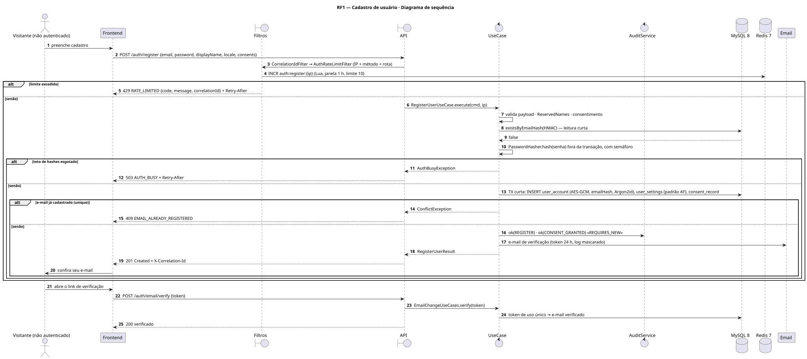
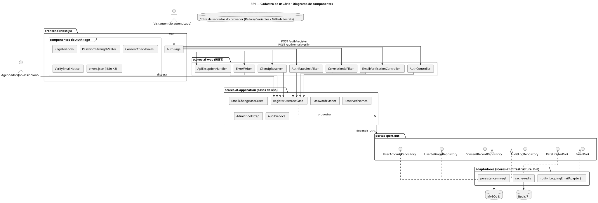
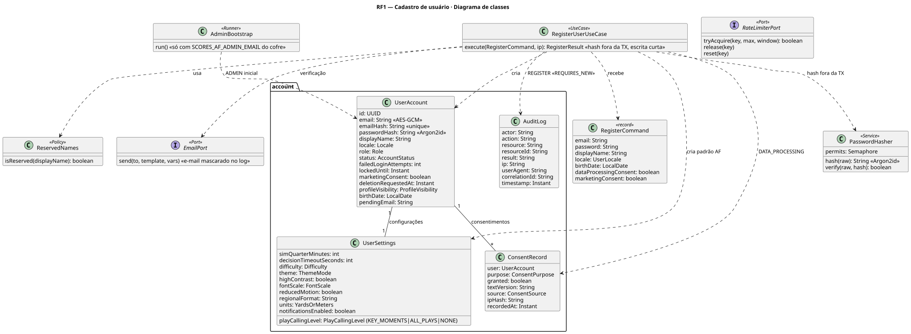
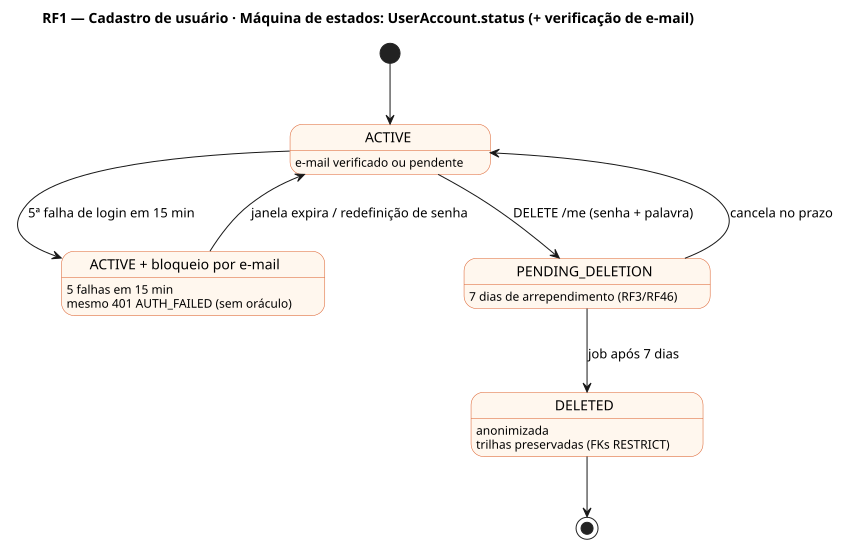

# RF1 — Cadastro de usuário

## História de usuário

> HU-RF1 — COMO usuário acessando o app pela primeira vez POSSO criar uma nova conta PARA jogar o Scores: American Football

Sprint: 3 · Atores: Visitante, Scheduler · Tela: Abertura / menu — Cadastro (/auth, aba Cadastrar)

## Diagramas

### Atividades

Fonte: [`RF1-act.puml`](RF1-act.puml)

### Sequência

Fonte: [`RF1-seq.puml`](RF1-seq.puml)

### Componentes

Fonte: [`RF1-cmp.puml`](RF1-cmp.puml)

### Classes

Fonte: [`RF1-cls.puml`](RF1-cls.puml)

### Máquina de estados: UserAccount.status (+ verificação de e-mail)

Fonte: [`RF1-stm.puml`](RF1-stm.puml)

## Endpoints

✅ = existe num controller do `scores-af-web` · ⛔ alvo = previsto no modelo, ainda sem controller (lista em `generator/endpoints_code.json`).

| Estado | Método | Rota | Caso de uso | Autorização | Descrição |
|---|---|---|---|---|---|
| ✅ | `POST` | `/api/v1/auth/register` | `RegisterUserUseCase` | público · 10 por IP/hora | Cria UserAccount (e-mail AES-GCM + emailHash HMAC, senha Argon2id fora da transação, status ACTIVE), UserSettings padrão do futebol americano (jardas, controle KEY_MOMENTS) e consentimento de processamento; envia e-mail de verificação (token 24 h) |
| ✅ | `POST` | `/api/v1/auth/email/verify` | `EmailChangeUseCases.verify` | público · 40 por IP/hora | Confirma a posse do e-mail (cadastro ou troca) com token de uso único |

## Pontos de decisão

| Gateway | Regra | Se falso |
|---|---|---|
| Dentro do limite da rota? | AuthRateLimitFilter: POST /auth/register ≤ 10 por IP confiável (ClientIpResolver, nunca X-Forwarded-For cru; IPv6 por /64) em 1 h | 429 RATE_LIMITED + Retry-After, corpo com correlationId |
| Payload válido? | e-mail RFC 5322 (domínios reservados recusados), senha ≥ 8 caracteres, displayName 3–40, locale pt-BR\|en-US\|es-ES, idade ≥ 13 anos | 422 VALIDATION_ERROR com details por campo |
| Nome não é reservado? | ReservedNames.isReserved(displayName) == false (admin, scores, velion, suporte… normalizados) | 422 NAME_RESERVED |
| Consentimento LGPD marcado? | dataProcessingConsent == true (obrigatório) · marketing opcional e nunca pré-marcado | 422 CONSENT_REQUIRED |
| Teto de hashes livre? | PasswordHasher: semáforo de hashes simultâneos (Argon2id ~19 MiB cada), espera limitada | 503 AUTH_BUSY + Retry-After (nunca 500) |
| E-mail disponível? | não existe UserAccount com emailHash == HMAC(e-mail normalizado), checado na escrita curta depois do hash | 409 EMAIL_ALREADY_REGISTERED (mensagem genérica) |
| E-mail de verificação enviado? | EmailPort.send (em dev o adaptador mascara o e-mail e nunca loga o token) | conta fica ACTIVE sem e-mail verificado; reenvio no login |
| Token de verificação válido? | existe, não expirou (24 h) e não foi usado | 422 TOKEN_INVALID + opção de reenvio |
| Admin inicial só pelo cofre? | AdminBootstrap roda só com SCORES_AF_ADMIN_EMAIL e senha forte vindos do cofre (D-5: nenhuma credencial no código, nem de teste) | não cria admin e loga aviso sem valores |

---
Gerado por `../generator/generate.py` a partir de `../generator/model/*.py` e `../generator/common.py`; não edite os .puml à mão.
