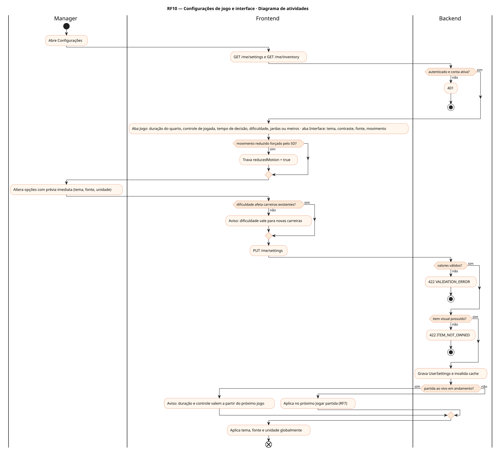
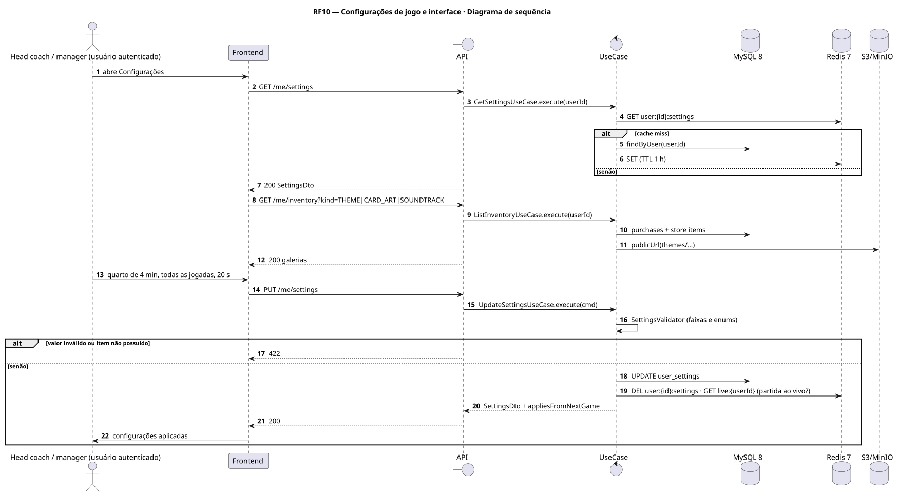
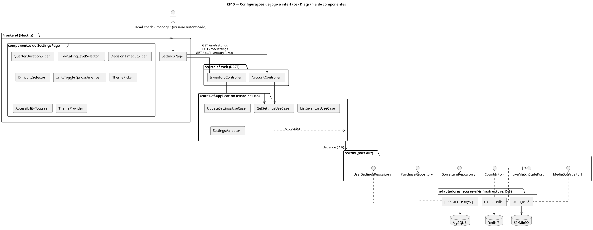
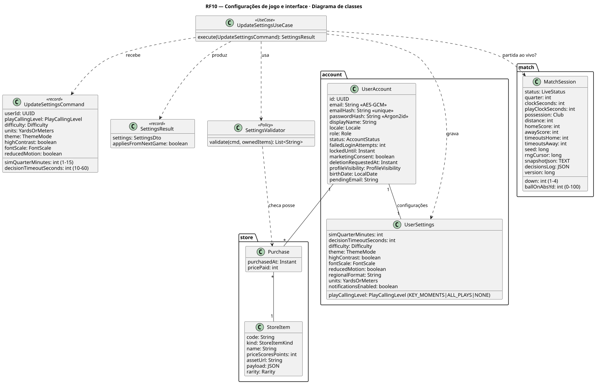
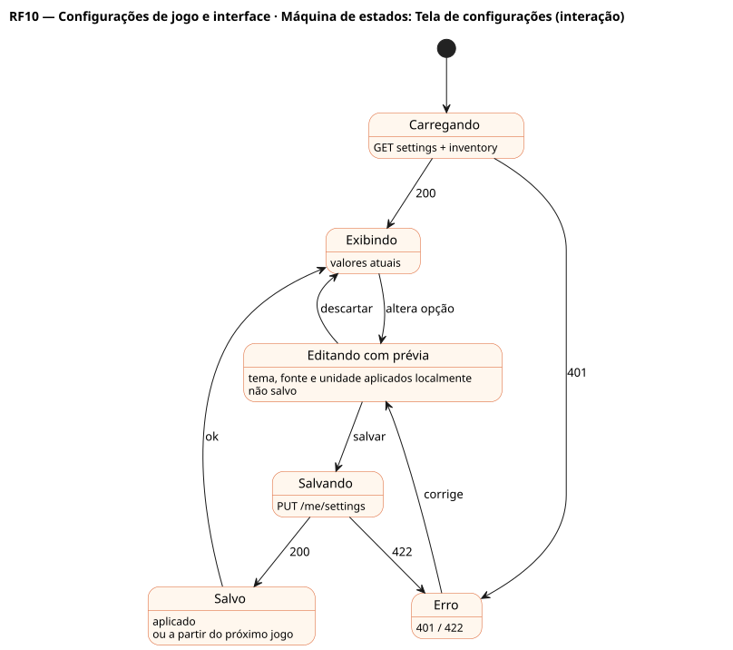

# RF10 — Configurações de jogo e interface

## História de usuário

> HU-RF10 — COMO usuário autenticado POSSO abrir Configurações PARA definir a duração do quarto simulado, o nível de controle de jogada (momentos decisivos, todas as jogadas ou nenhuma), o tempo de decisão, a dificuldade, jardas ou metros, tema, fonte e acessibilidade

Sprint: 4 · Atores: Manager · Tela: Configurações (/settings) — aba Jogo e aba Interface

## Diagramas

### Atividades

Fonte: [`RF10-act.puml`](RF10-act.puml)

### Sequência

Fonte: [`RF10-seq.puml`](RF10-seq.puml)

### Componentes

Fonte: [`RF10-cmp.puml`](RF10-cmp.puml)

### Classes

Fonte: [`RF10-cls.puml`](RF10-cls.puml)

### Máquina de estados: Tela de configurações (interação)

Fonte: [`RF10-stm.puml`](RF10-stm.puml)

## Endpoints

✅ = existe num controller do `scores-af-web` · ⛔ alvo = previsto no modelo, ainda sem controller (lista em `generator/endpoints_code.json`).

| Estado | Método | Rota | Caso de uso | Autorização | Descrição |
|---|---|---|---|---|---|
| ✅ | `GET` | `/api/v1/me/settings` | `GetSettingsUseCase` | JWT | UserSettings: simQuarterMinutes, playCallingLevel, decisionTimeoutSeconds, difficulty, units, theme, highContrast, fontScale, reducedMotion, notificationsEnabled |
| ✅ | `PUT` | `/api/v1/me/settings` | `UpdateSettingsUseCase` | JWT | Salva preferências validadas |
| ⛔ alvo | `GET` | `/api/v1/me/inventory` | `ListInventoryUseCase` | JWT | Temas, artes de card e trilhas compradas na loja (Purchase) para as galerias |

## Pontos de decisão

| Gateway | Regra | Se falso |
|---|---|---|
| Autenticado e conta ativa? | JWT RS256 válido · família de sessão sid ativa (SessionActiveFilter) · status != DELETED | 401 UNAUTHENTICATED {code, message, details, correlationId} |
| Valores válidos? | simQuarterMinutes 1–15 (tempo real por quarto, RNF2) · playCallingLevel ∈ KEY_MOMENTS\|ALL_PLAYS\|NONE · decisionTimeoutSeconds 10–60 · difficulty ∈ EASY\|NORMAL\|HARD\|LEGEND · units ∈ YARDS\|METERS · fontScale na lista | 422 VALIDATION_ERROR |
| Item visual possuído? | tema, arte ou trilha é padrão ou existe Purchase do usuário para o StoreItem | 422 ITEM_NOT_OWNED |
| Partida ao vivo em andamento? | existe MatchSession LIVE do usuário | aplica já · se sim: duração e nível de controle valem a partir do próximo jogo (o snapshot guarda os da partida) |
| Dificuldade afeta carreiras existentes? | save.difficulty é fixada na criação · só novas carreiras usam o valor | aviso na tela (não bloqueia) |
| Movimento reduzido forçado pelo SO? | prefers-reduced-motion: reduce | usa reducedMotion salvo |

---
Gerado por `../generator/generate.py` a partir de `../generator/model/*.py` e `../generator/common.py`; não edite os .puml à mão.
