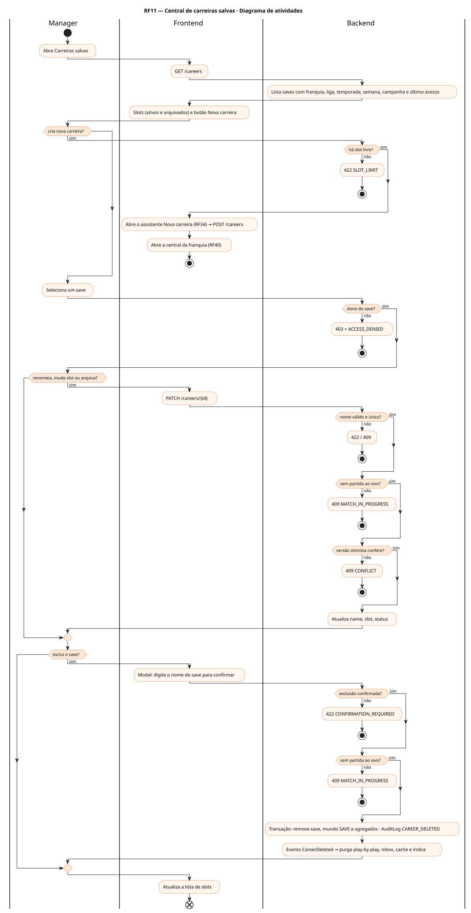
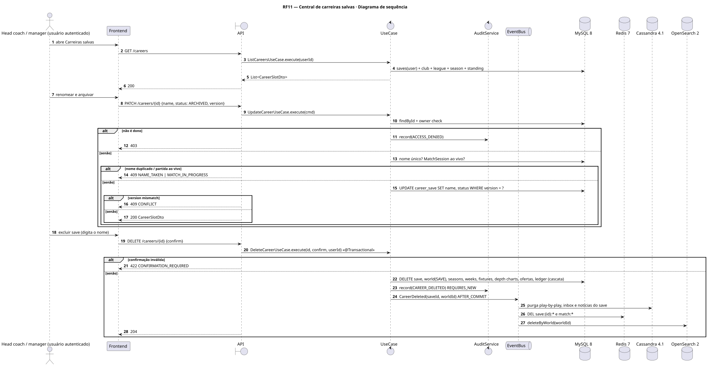
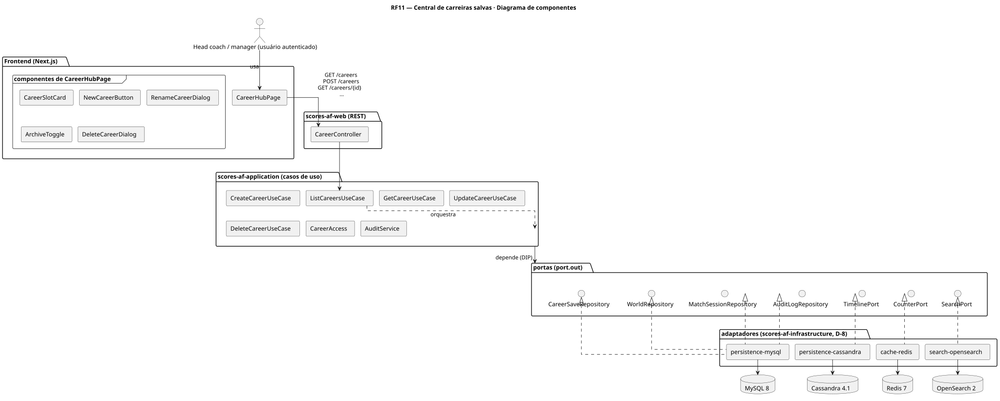
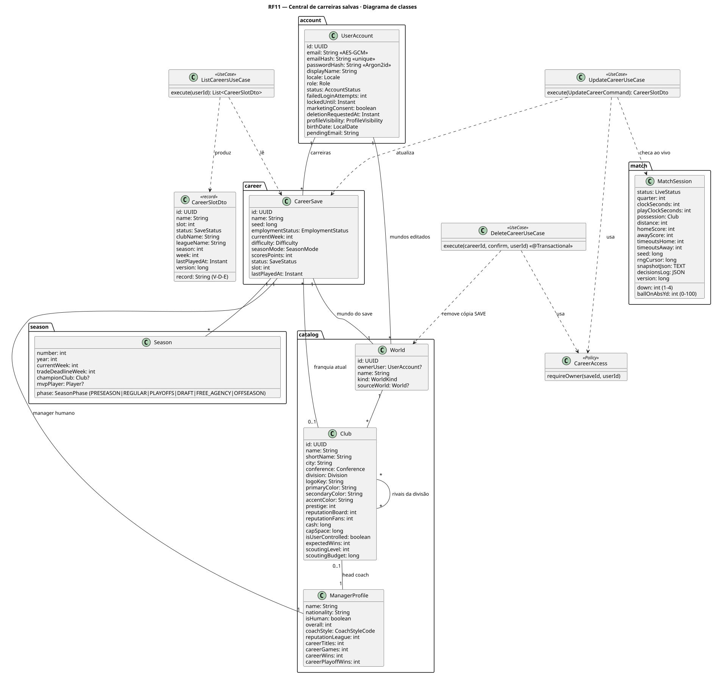
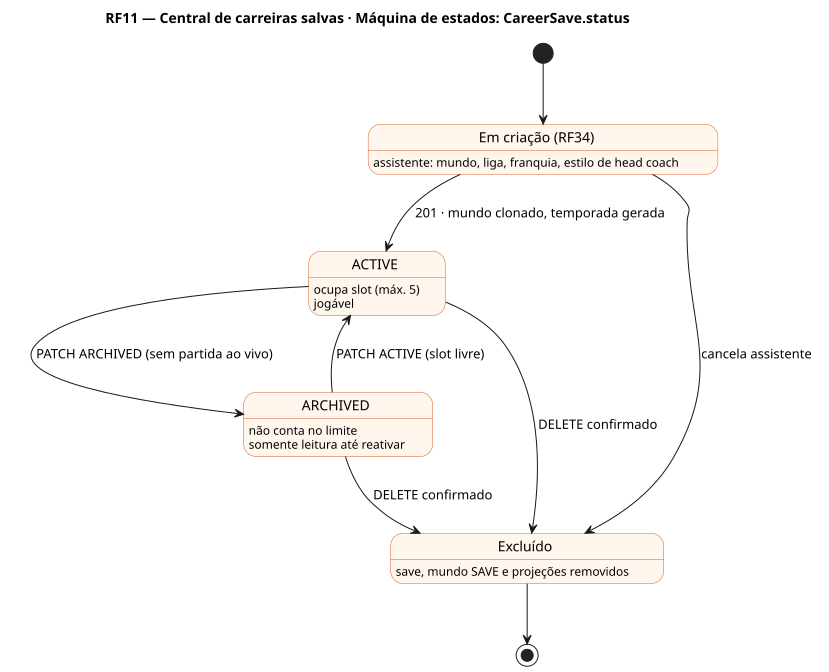

# RF11 — Central de carreiras salvas

## História de usuário

> HU-RF11 — COMO usuário autenticado POSSO acessar a central de carreiras salvas PARA criar, excluir, renomear e arquivar carreiras

Sprint: 3 · Atores: Manager · Tela: Abertura / menu — Carreiras salvas (/careers)

## Diagramas

### Atividades

Fonte: [`RF11-act.puml`](RF11-act.puml)

### Sequência

Fonte: [`RF11-seq.puml`](RF11-seq.puml)

### Componentes

Fonte: [`RF11-cmp.puml`](RF11-cmp.puml)

### Classes

Fonte: [`RF11-cls.puml`](RF11-cls.puml)

### Máquina de estados: CareerSave.status

Fonte: [`RF11-stm.puml`](RF11-stm.puml)

## Endpoints

✅ = existe num controller do `scores-af-web` · ⛔ alvo = previsto no modelo, ainda sem controller (lista em `generator/endpoints_code.json`).

| Estado | Método | Rota | Caso de uso | Autorização | Descrição |
|---|---|---|---|---|---|
| ✅ | `GET` | `/api/v1/careers` | `ListCareersUseCase` | JWT | Slots do usuário: nome, franquia, liga, temporada/semana, campanha (V-D-E), status, lastPlayedAt |
| ✅ | `POST` | `/api/v1/careers` | `CreateCareerUseCase` | JWT | Nova carreira (assistente RF34): clona o mundo, cria head coach, temporada e contrato |
| ✅ | `GET` | `/api/v1/careers/{id}` | `GetCareerUseCase` | JWT · dono do save | Detalhe do save |
| ✅ | `PATCH` | `/api/v1/careers/{id}` | `UpdateCareerUseCase` | JWT · dono do save | Renomeia, muda slot, arquiva/reativa |
| ✅ | `DELETE` | `/api/v1/careers/{id}` | `DeleteCareerUseCase` | JWT · dono do save | Exclui save, mundo SAVE e projeções (play-by-play, inbox, cache, índice) |

## Pontos de decisão

| Gateway | Regra | Se falso |
|---|---|---|
| Dono do save? | save.userId == jwt.sub (CareerAccess.requireOwner) | 403 FORBIDDEN + AuditLog ACCESS_DENIED |
| Há slot livre? | saves ACTIVE do usuário < 5 | 422 SLOT_LIMIT (arquive ou exclua uma carreira) |
| Nome válido e único? | 3–40 chars e sem homônimo entre os saves do usuário | 422 NAME_INVALID / 409 NAME_TAKEN |
| Sem partida ao vivo? | nenhuma MatchSession LIVE\|HALFTIME\|DECISION do save | 409 MATCH_IN_PROGRESS |
| Exclusão confirmada? | confirm == nome do save digitado | 422 CONFIRMATION_REQUIRED |
| Versão otimista confere? | CareerSave.version == versão enviada | 409 CONFLICT |

---
Gerado por `../generator/generate.py` a partir de `../generator/model/*.py` e `../generator/common.py`; não edite os .puml à mão.
