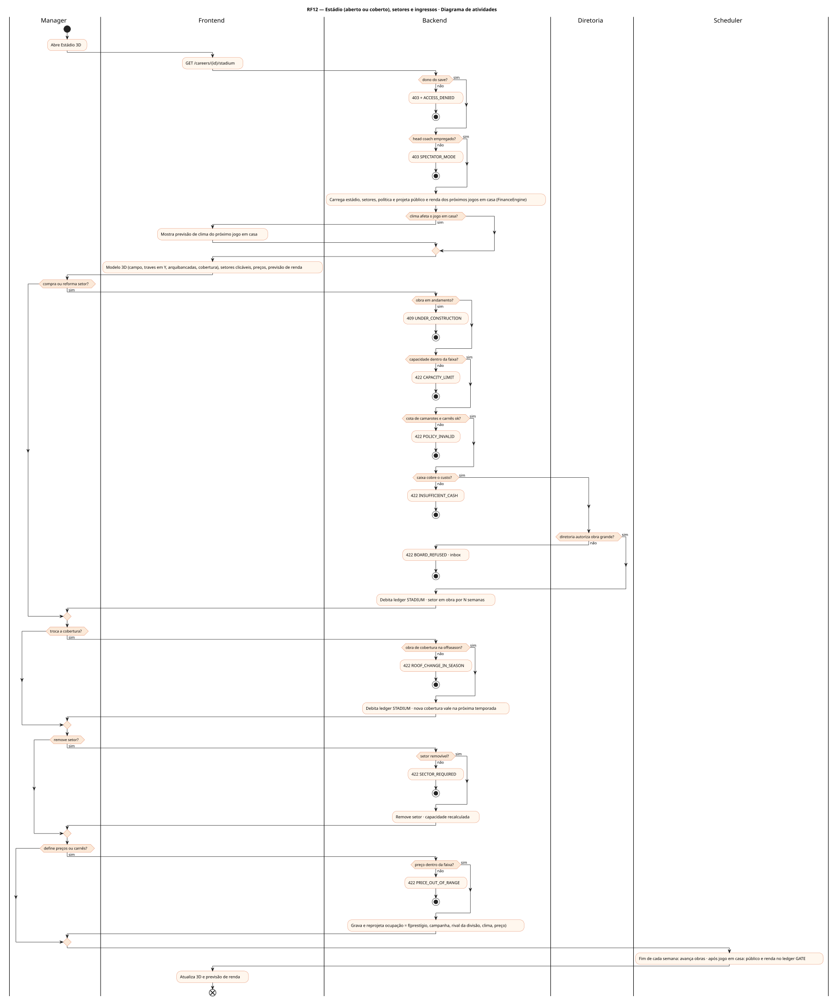
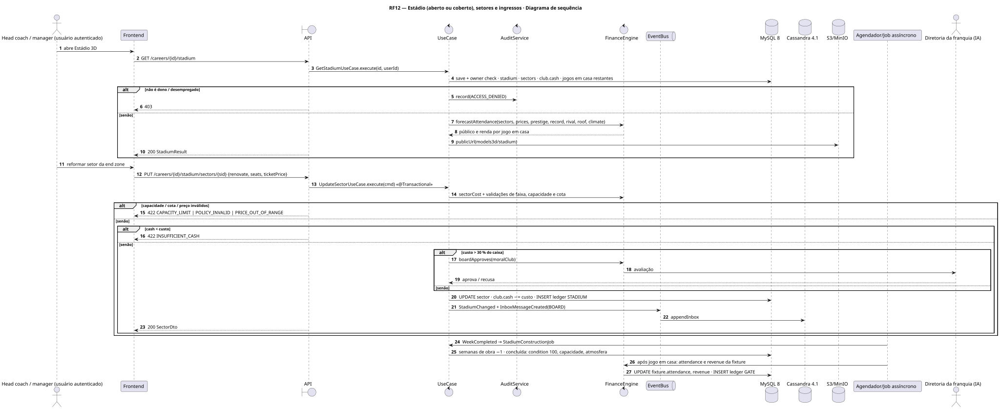
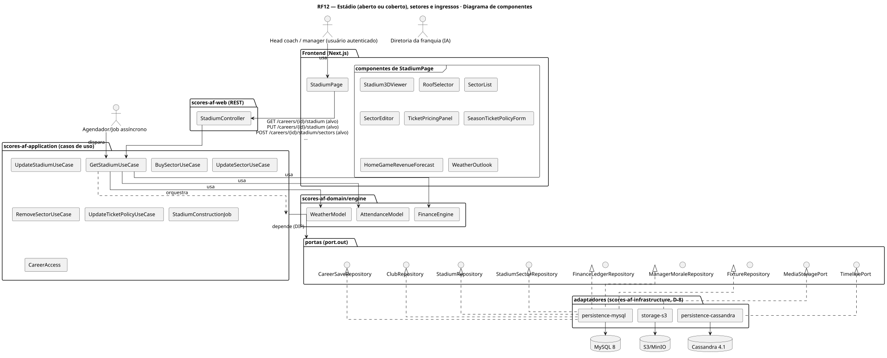
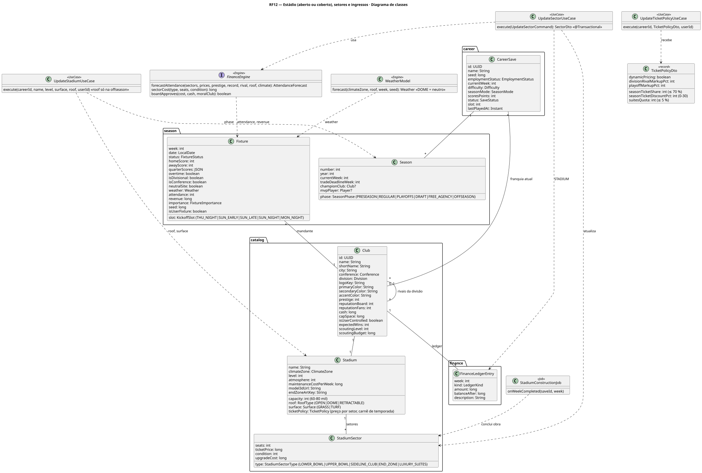
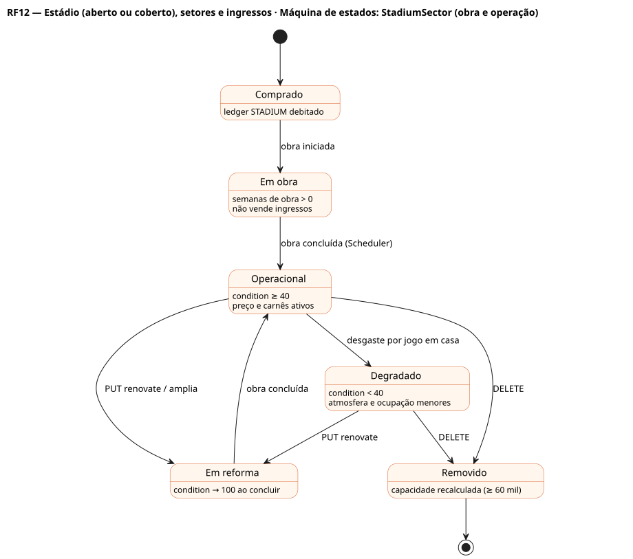
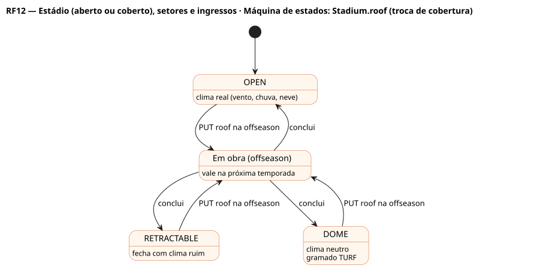

# RF12 — Estádio (aberto ou coberto), setores e ingressos

## História de usuário

> HU-RF12 — COMO head coach dentro do painel da franquia POSSO modificar setores do estádio (comprar, reformar, excluir), a cobertura (aberto, domo, retrátil) e definir preço de ingressos, carnês da temporada e camarotes PARA equilibrar público (60–80 mil), clima de jogo e renda dos 8–9 jogos em casa

Sprint: 11 · Atores: Manager, Diretoria, Scheduler · Tela: Estádio 3D (/c/{careerId}/stadium)

## Diagramas

### Atividades

Fonte: [`RF12-act.puml`](RF12-act.puml)

### Sequência

Fonte: [`RF12-seq.puml`](RF12-seq.puml)

### Componentes

Fonte: [`RF12-cmp.puml`](RF12-cmp.puml)

### Classes

Fonte: [`RF12-cls.puml`](RF12-cls.puml)

### Máquina de estados: StadiumSector (obra e operação)

Fonte: [`RF12-stm.puml`](RF12-stm.puml)

### Máquina de estados: Stadium.roof (troca de cobertura)

Fonte: [`RF12-stm-stadium-roof-troca-de-cobertura.puml`](RF12-stm-stadium-roof-troca-de-cobertura.puml)

## Endpoints

✅ = existe num controller do `scores-af-web` · ⛔ alvo = previsto no modelo, ainda sem controller (lista em `generator/endpoints_code.json`).

| Estado | Método | Rota | Caso de uso | Autorização | Descrição |
|---|---|---|---|---|---|
| ⛔ alvo | `GET` | `/api/v1/careers/{id}/stadium` | `GetStadiumUseCase` | JWT · dono do save | Estádio (capacidade, cobertura, gramado, zona climática, nível), setores, política de ingressos, previsão de público e renda por jogo em casa e efeito do clima |
| ⛔ alvo | `PUT` | `/api/v1/careers/{id}/stadium` | `UpdateStadiumUseCase` | JWT · dono do save | Nome, nível, troca de gramado (GRASS|TURF) e de cobertura (OPEN|DOME|RETRACTABLE, só na offseason) |
| ⛔ alvo | `POST` | `/api/v1/careers/{id}/stadium/sectors` | `BuySectorUseCase` | JWT · dono do save | Compra setor (LOWER_BOWL, UPPER_BOWL, SIDELINE_CLUB, END_ZONE, LUXURY_SUITES) |
| ⛔ alvo | `PUT` | `/api/v1/careers/{id}/stadium/sectors/{sid}` | `UpdateSectorUseCase` | JWT · dono do save | Reforma (condição), amplia assentos, define preço |
| ⛔ alvo | `DELETE` | `/api/v1/careers/{id}/stadium/sectors/{sid}` | `RemoveSectorUseCase` | JWT · dono do save | Exclui setor (não obrigatório e sem obra) |
| ⛔ alvo | `PUT` | `/api/v1/careers/{id}/stadium/ticket-policy` | `UpdateTicketPolicyUseCase` | JWT · dono do save | Carnê da temporada (season tickets), desconto de carnê, preço dinâmico por rival da divisão e playoffs, cota de camarotes |

## Pontos de decisão

| Gateway | Regra | Se falso |
|---|---|---|
| Dono do save? | save.userId == jwt.sub (CareerAccess.requireOwner) | 403 FORBIDDEN + AuditLog ACCESS_DENIED |
| Head coach empregado? | save.employmentStatus == EMPLOYED && save.club != null | 403 SPECTATOR_MODE (só leitura, RF37) |
| Caixa cobre o custo? | club.cash ≥ custo (setor novo = assentos × preço-base do tipo · reforma = upgradeCost × (100 − condição)/100 · cobertura retrátil ou domo = custo fixo alto) | 422 INSUFFICIENT_CASH (sugere empréstimo RF14) |
| Capacidade dentro da faixa? | 60 000 ≤ Σ seats ≤ min(80 000, 60 000 + 5 000 × (level − 1)) | 422 CAPACITY_LIMIT |
| Obra de cobertura na offseason? | troca de roof só com season.phase ∈ OFFSEASON|DRAFT|FREE_AGENCY (sem jogos em casa) | 422 ROOF_CHANGE_IN_SEASON |
| Cota de camarotes e carnês ok? | LUXURY_SUITES ≤ 5 % dos assentos · carnês ≤ 70 % · desconto de carnê 0–30 % | 422 POLICY_INVALID |
| Preço dentro da faixa? | ticketPrice entre min e max do tipo (LUXURY_SUITES > SIDELINE_CLUB > LOWER_BOWL > END_ZONE > UPPER_BOWL) e ≤ 3× média da liga | 422 PRICE_OUT_OF_RANGE |
| Setor removível? | type != LOWER_BOWL, capacidade continua ≥ 60 000 e sem obra em andamento | 422 SECTOR_REQUIRED |
| Obra em andamento? | setor com semanas de obra > 0 | aplica imediatamente |
| Diretoria autoriza obra grande? | custo > 30 % do caixa exige moralClub ≥ 40 | 422 BOARD_REFUSED + mensagem no inbox |
| Clima afeta o jogo em casa? | roof == OPEN e climateZone fria ou chuvosa → Fixture.weather sorteado por seed (vento, chuva, neve) entra no motor (RF42) · DOME → clima neutro | clima neutro |

---
Gerado por `../generator/generate.py` a partir de `../generator/model/*.py` e `../generator/common.py`; não edite os .puml à mão.
