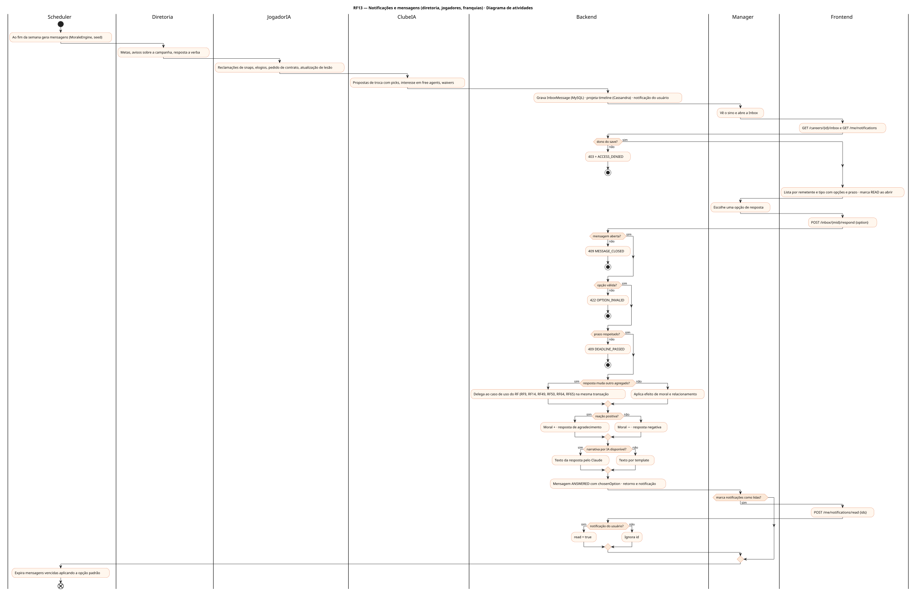
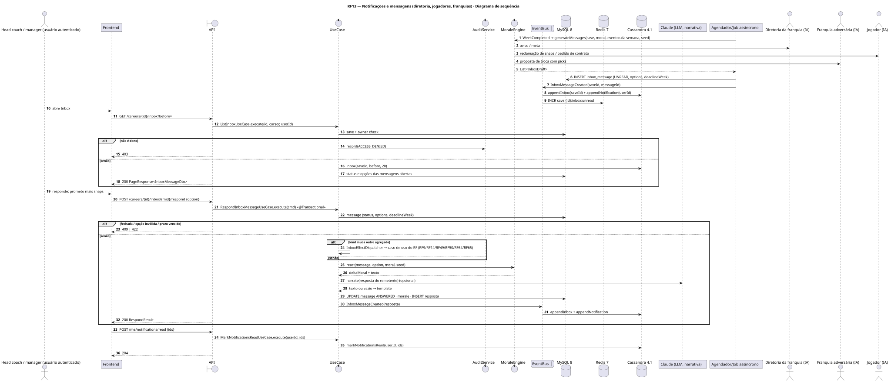
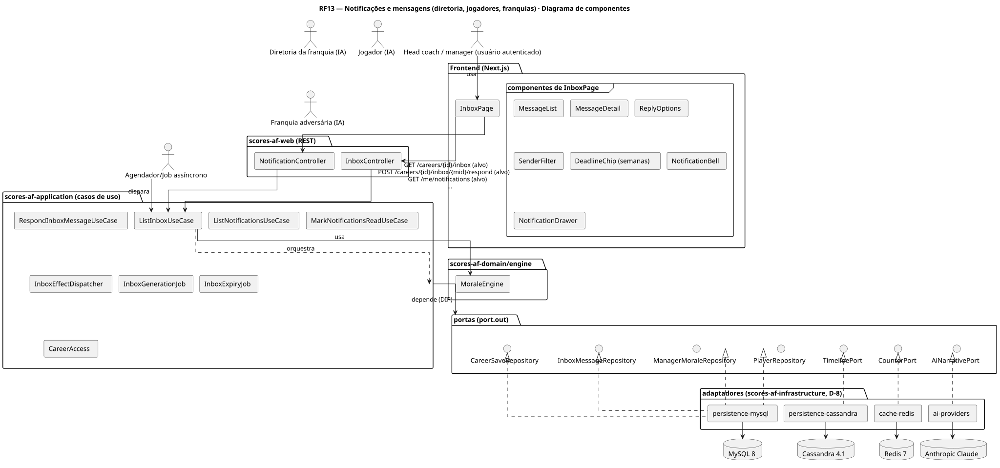
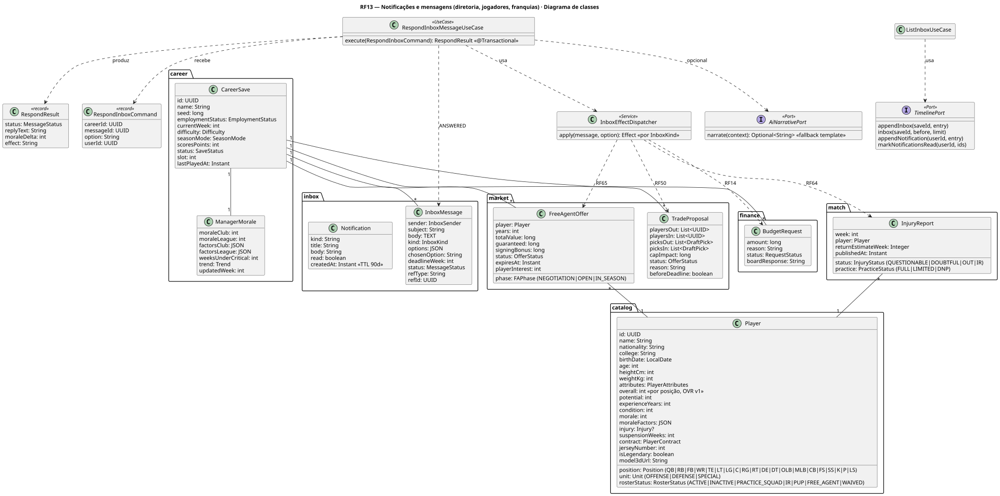
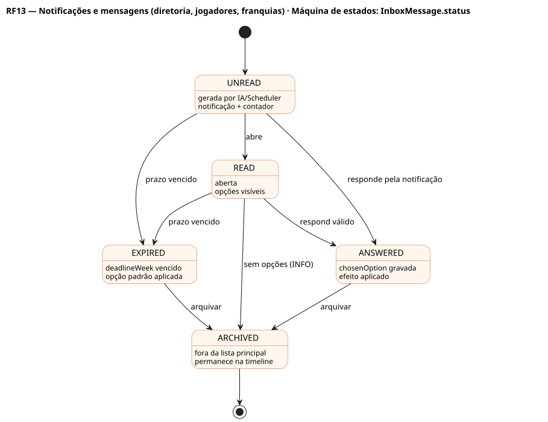

# RF13 — Notificações e mensagens (diretoria, jogadores, franquias)

## História de usuário

> HU-RF13 — COMO head coach dentro do painel da franquia POSSO visualizar notificações e mensagens da diretoria, dos meus jogadores e de outras franquias da liga PARA responder com base na minha decisão

Sprint: 7 · Atores: Manager, Diretoria, JogadorIA, ClubeIA, Scheduler · Tela: Inbox (/c/{careerId}/inbox) + sino de notificações

## Diagramas

### Atividades

Fonte: [`RF13-act.puml`](RF13-act.puml)

### Sequência

Fonte: [`RF13-seq.puml`](RF13-seq.puml)

### Componentes

Fonte: [`RF13-cmp.puml`](RF13-cmp.puml)

### Classes

Fonte: [`RF13-cls.puml`](RF13-cls.puml)

### Máquina de estados: InboxMessage.status

Fonte: [`RF13-stm.puml`](RF13-stm.puml)

## Endpoints

✅ = existe num controller do `scores-af-web` · ⛔ alvo = previsto no modelo, ainda sem controller (lista em `generator/endpoints_code.json`).

| Estado | Método | Rota | Caso de uso | Autorização | Descrição |
|---|---|---|---|---|---|
| ⛔ alvo | `GET` | `/api/v1/careers/{id}/inbox` | `ListInboxUseCase` | JWT · dono do save | Mensagens do save (Cassandra, cursor por createdAt) com remetente, tipo, opções, prazo em semanas e status |
| ⛔ alvo | `POST` | `/api/v1/careers/{id}/inbox/{mid}/respond` | `RespondInboxMessageUseCase` | JWT · dono do save | Escolhe uma opção · aplica o efeito (moral, contrato, verba, troca, free agency) e gera a resposta |
| ⛔ alvo | `GET` | `/api/v1/me/notifications` | `ListNotificationsUseCase` | JWT | Notificações do usuário (TTL 90 dias) para o sino |
| ⛔ alvo | `POST` | `/api/v1/me/notifications/read` | `MarkNotificationsReadUseCase` | JWT | Marca notificações como lidas |

## Pontos de decisão

| Gateway | Regra | Se falso |
|---|---|---|
| Dono do save? | save.userId == jwt.sub (CareerAccess.requireOwner) | 403 FORBIDDEN + AuditLog ACCESS_DENIED |
| Mensagem aberta? | message.saveId == id && status ∈ UNREAD\|READ | 409 MESSAGE_CLOSED |
| Opção válida? | chosenOption ∈ message.options | 422 OPTION_INVALID |
| Prazo respeitado? | deadlineWeek == null ou deadlineWeek ≥ save.currentWeek (prazo de trocas e free agency conferidos na fase da temporada) | 409 DEADLINE_PASSED · Scheduler expira com a opção padrão |
| Resposta muda outro agregado? | kind ∈ TRADE_PROPOSAL (RF50) · FA_OFFER (RF65) · CONTRACT_REQUEST (RF49) · JOB_OFFER (RF9) · BUDGET_RESPONSE (RF14) · INJURY_UPDATE (RF64) | efeito só de moral e relacionamento |
| Reação positiva? | MoraleEngine: score(opção, moral, personalidade, seed) ≥ limiar | resposta negativa · moral −3 a −8 · possível nova mensagem |
| Narrativa por IA disponível? | AiNarrativePort responde no tempo e o usuário tem consentimento AI_ANALYST | texto por template (fallback) |
| Notificação do usuário? | notification.userId == jwt.sub | id ignorado (idempotente) |

---
Gerado por `../generator/generate.py` a partir de `../generator/model/*.py` e `../generator/common.py`; não edite os .puml à mão.
