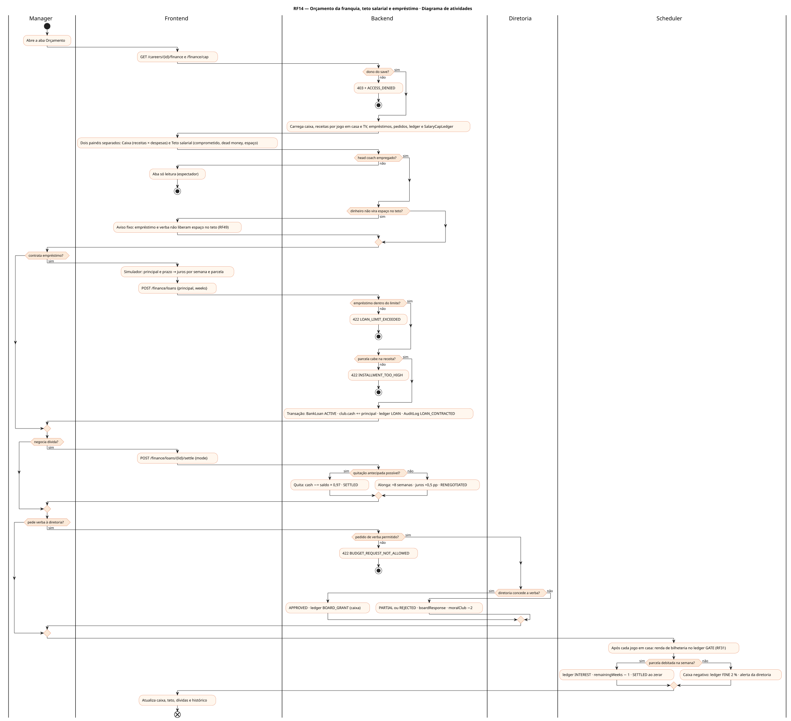
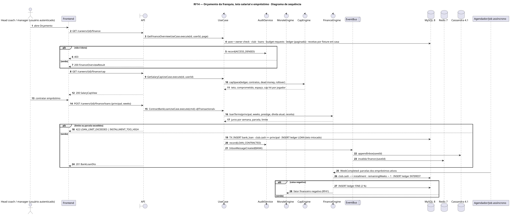
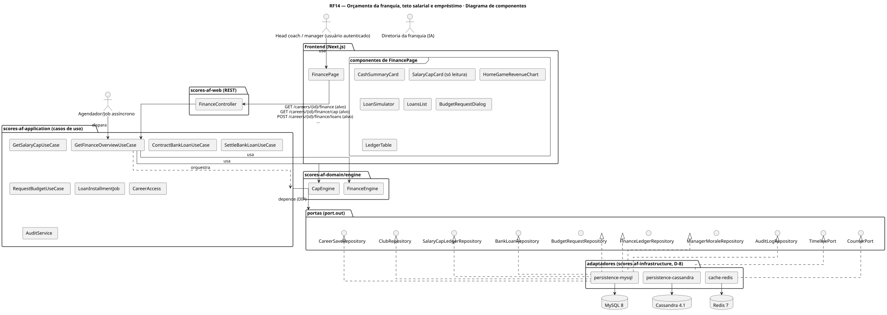
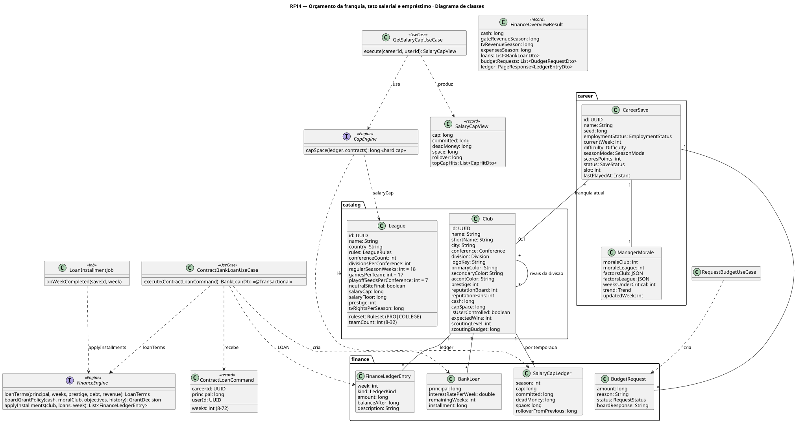
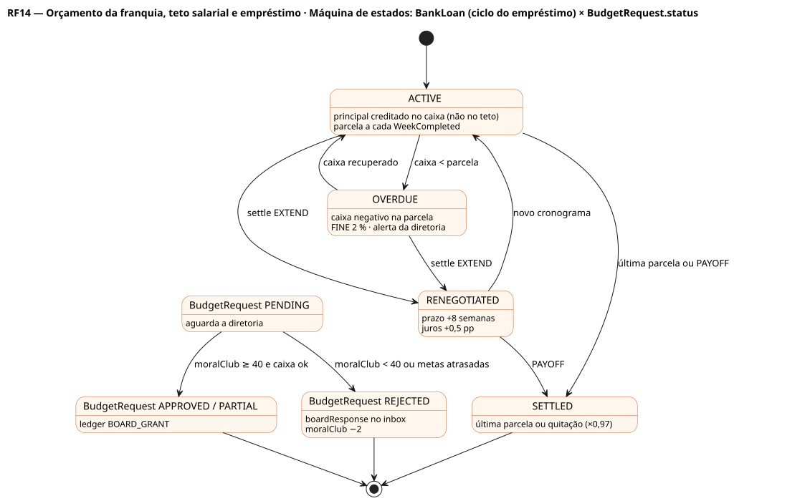

# RF14 — Orçamento da franquia, teto salarial e empréstimo

## História de usuário

> HU-RF14 — COMO head coach dentro do painel da franquia POSSO visualizar a aba orçamento PARA acompanhar caixa e teto salarial rígido, receitas dos 8–9 jogos em casa, contratar empréstimo, pedir verba à diretoria, negociar dívidas e ver o histórico de transações

Sprint: 11 · Atores: Manager, Diretoria, Scheduler · Tela: Orçamento (/c/{careerId}/finance) — Caixa, Teto salarial, Empréstimos, Histórico

## Diagramas

### Atividades

Fonte: [`RF14-act.puml`](RF14-act.puml)

### Sequência

Fonte: [`RF14-seq.puml`](RF14-seq.puml)

### Componentes

Fonte: [`RF14-cmp.puml`](RF14-cmp.puml)

### Classes

Fonte: [`RF14-cls.puml`](RF14-cls.puml)

### Máquina de estados: BankLoan (ciclo do empréstimo) × BudgetRequest.status

Fonte: [`RF14-stm.puml`](RF14-stm.puml)

## Endpoints

✅ = existe num controller do `scores-af-web` · ⛔ alvo = previsto no modelo, ainda sem controller (lista em `generator/endpoints_code.json`).

| Estado | Método | Rota | Caso de uso | Autorização | Descrição |
|---|---|---|---|---|---|
| ⛔ alvo | `GET` | `/api/v1/careers/{id}/finance` | `GetFinanceOverviewUseCase` | JWT · dono do save | Caixa, receitas por jogo em casa, direitos de TV, despesas, empréstimos, pedidos de verba e ledger paginado (page, size, kind, week) |
| ⛔ alvo | `GET` | `/api/v1/careers/{id}/finance/cap` | `GetSalaryCapUseCase` | JWT · dono do save | SalaryCapLedger da temporada: teto, comprometido, dead money, espaço, rollover; cap hit por jogador (só leitura, gestão em RF49) |
| ⛔ alvo | `POST` | `/api/v1/careers/{id}/finance/loans` | `ContractBankLoanUseCase` | JWT · dono do save | Contrata empréstimo (principal, prazo em semanas) · juros por semana por prestígio e dívida · ledger LOAN |
| ⛔ alvo | `POST` | `/api/v1/careers/{id}/finance/loans/{lid}/settle` | `SettleBankLoanUseCase` | JWT · dono do save | Quitação antecipada (desconto de juros) ou alongamento (juros +0,5 pp) |
| ⛔ alvo | `POST` | `/api/v1/careers/{id}/finance/budget-request` | `RequestBudgetUseCase` | JWT · dono do save | Pede verba operacional à diretoria (amount, reason) · decidida pela IA |

## Pontos de decisão

| Gateway | Regra | Se falso |
|---|---|---|
| Dono do save? | save.userId == jwt.sub (CareerAccess.requireOwner) | 403 FORBIDDEN + AuditLog ACCESS_DENIED |
| Head coach empregado? | save.employmentStatus == EMPLOYED && save.club != null | 403 SPECTATOR_MODE (só leitura, RF37) |
| Dinheiro não vira espaço no teto? | empréstimo e verba só alteram club.cash · capSpace = league.salaryCap − committed − deadMoney + rollover (SalaryCapLedger, RF49) | regra fixa: nenhuma operação de caixa mexe no teto |
| Empréstimo dentro do limite? | principal + Σ saldo devedor ≤ 2 × receita da temporada anterior · ≤ 2 empréstimos ativos · prazo 8–72 semanas | 422 LOAN_LIMIT_EXCEEDED |
| Parcela cabe na receita? | installment ≤ 35 % da receita média semanal (jogos em casa + TV + patrocínio) | 422 INSTALLMENT_TOO_HIGH (sugere prazo maior) |
| Quitação antecipada possível? | club.cash ≥ saldo devedor × 0,97 | 422 INSUFFICIENT_CASH · oferece alongamento |
| Pedido de verba permitido? | nenhum BudgetRequest PENDING · último há ≥ 4 semanas · amount ≤ 20 % do caixa × moralClub/100 | 422 BUDGET_REQUEST_NOT_ALLOWED |
| Diretoria concede a verba? | FinanceEngine: moralClub ≥ 50, metas em dia, caixa projetado ≥ 0 → APPROVED · 40–49 → PARTIAL (50 %) · < 40 → REJECTED | REJECTED/PARTIAL + boardResponse no inbox · moralClub −2 se REJECTED |
| Parcela debitada na semana? | WeekCompleted: para cada BankLoan ativo, cash −= installment · remainingWeeks − 1 | caixa negativo → ledger FINE (2 %) e alerta da diretoria (fator financeiro RF41) |

---
Gerado por `../generator/generate.py` a partir de `../generator/model/*.py` e `../generator/common.py`; não edite os .puml à mão.
