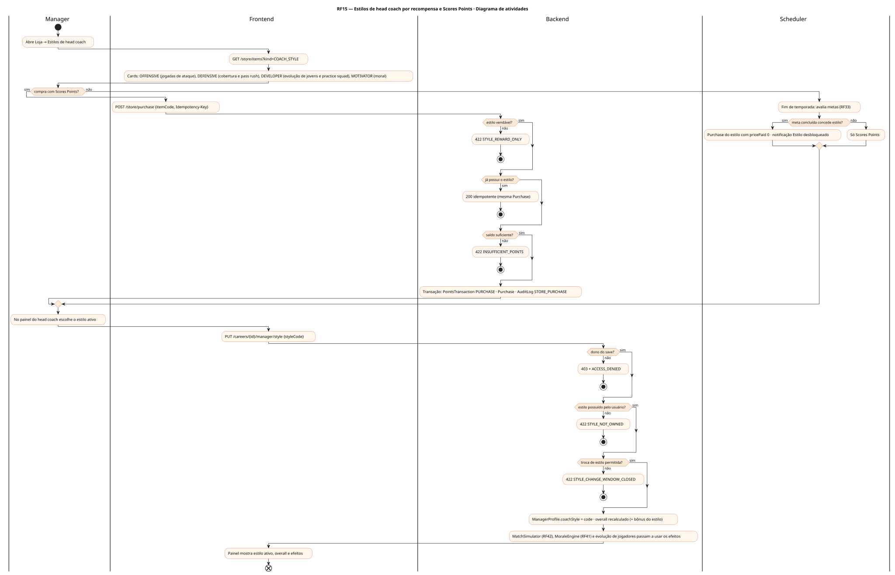
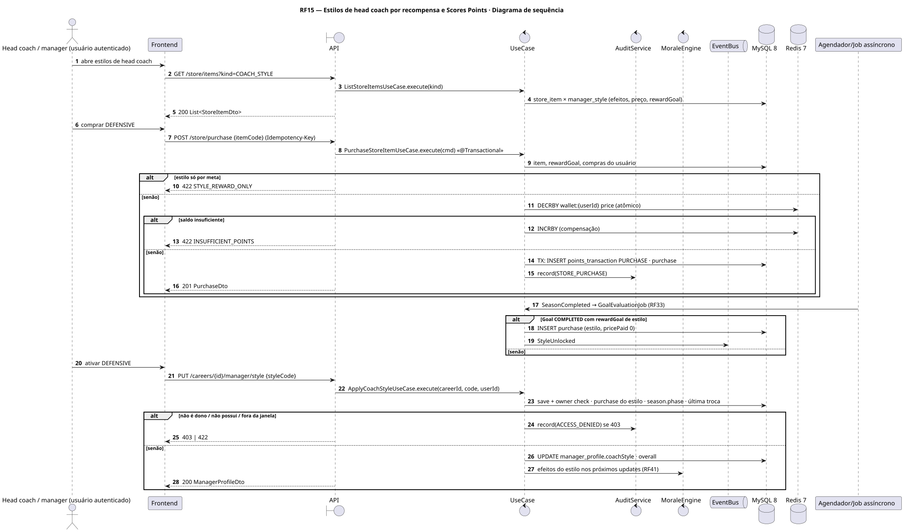
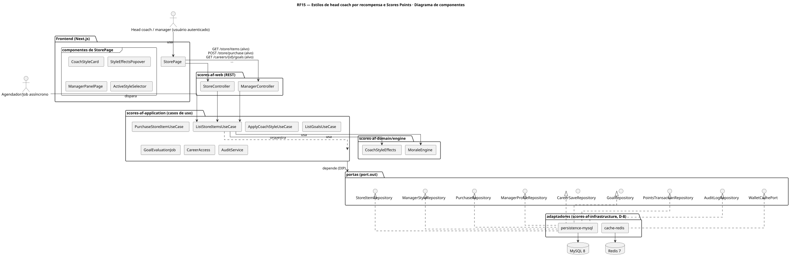
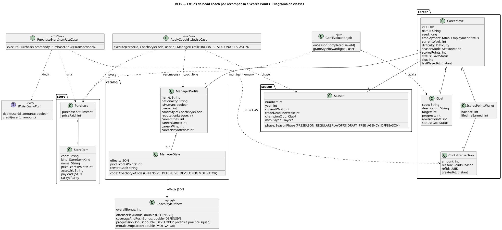
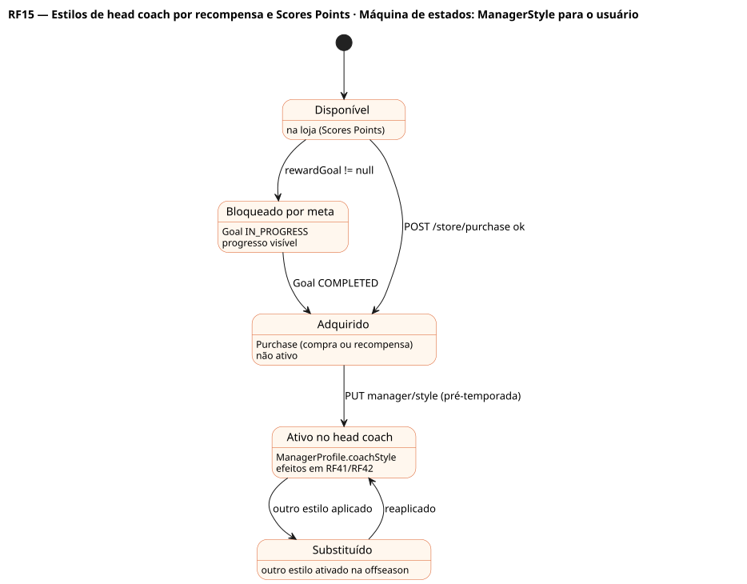

# RF15 — Estilos de head coach por recompensa e Scores Points

## História de usuário

> HU-RF15 — COMO usuário que joga frequentemente POSSO adquirir estilos de head coach (ofensivo, defensivo, desenvolvedor, motivador), por compra com Scores Points ou por metas, PARA caracterizar e melhorar o overall e os efeitos do meu head coach

Sprint: 11 · Atores: Manager, Scheduler · Tela: Loja → Estilos de head coach (/store?kind=COACH_STYLE) · Head coach (/c/{careerId}/manager) → Estilo ativo

## Diagramas

### Atividades

Fonte: [`RF15-act.puml`](RF15-act.puml)

### Sequência

Fonte: [`RF15-seq.puml`](RF15-seq.puml)

### Componentes

Fonte: [`RF15-cmp.puml`](RF15-cmp.puml)

### Classes

Fonte: [`RF15-cls.puml`](RF15-cls.puml)

### Máquina de estados: ManagerStyle para o usuário

Fonte: [`RF15-stm.puml`](RF15-stm.puml)

## Endpoints

✅ = existe num controller do `scores-af-web` · ⛔ alvo = previsto no modelo, ainda sem controller (lista em `generator/endpoints_code.json`).

| Estado | Método | Rota | Caso de uso | Autorização | Descrição |
|---|---|---|---|---|---|
| ⛔ alvo | `GET` | `/api/v1/store/items` | `ListStoreItemsUseCase` | JWT | kind=COACH_STYLE: OFFENSIVE, DEFENSIVE, DEVELOPER, MOTIVATOR com efeitos, preço em Scores Points ou meta de recompensa |
| ⛔ alvo | `POST` | `/api/v1/store/purchase` | `PurchaseStoreItemUseCase` | JWT · Idempotency-Key | Compra estilo com Scores Points: débito idempotente na carteira + Purchase |
| ⛔ alvo | `GET` | `/api/v1/careers/{id}/goals` | `ListGoalsUseCase` | JWT · dono do save | Metas que concedem estilo (ex.: 5 temporadas com ataque top-5 em jardas → OFFENSIVE) |
| ⛔ alvo | `PUT` | `/api/v1/careers/{id}/manager/style` | `ApplyCoachStyleUseCase` | JWT · dono do save | Ativa um estilo possuído no head coach do save (1 ativo) |
| ⛔ alvo | `GET` | `/api/v1/careers/{id}/manager` | `GetManagerPanelUseCase` | JWT · dono do save | Perfil com estilo ativo, overall e efeitos vigentes |

## Pontos de decisão

| Gateway | Regra | Se falso |
|---|---|---|
| Dono do save? | save.userId == jwt.sub (CareerAccess.requireOwner) | 403 FORBIDDEN + AuditLog ACCESS_DENIED |
| Estilo vendável? | StoreItem.kind == COACH_STYLE && ManagerStyle.rewardGoal == null (estilos por meta não são vendidos) | 422 STYLE_REWARD_ONLY |
| Já possui o estilo? | existe Purchase do usuário para o mesmo StoreItem (ou recompensa concedida) | segue a compra (Idempotency-Key) |
| Saldo suficiente? | wallet.balance ≥ priceScoresPoints (débito atômico + PointsTransaction PURCHASE) | 422 INSUFFICIENT_POINTS |
| Meta concluída concede estilo? | Goal.status == COMPLETED && ManagerStyle.rewardGoal == goal.code | só Scores Points (RF33) |
| Estilo possuído pelo usuário? | Purchase do usuário (compra ou recompensa) para o código do estilo | 422 STYLE_NOT_OWNED |
| Troca de estilo permitida? | só na PRESEASON ou OFFSEASON (Season.phase), no máximo 1 troca por temporada | 422 STYLE_CHANGE_WINDOW_CLOSED |

---
Gerado por `../generator/generate.py` a partir de `../generator/model/*.py` e `../generator/common.py`; não edite os .puml à mão.
