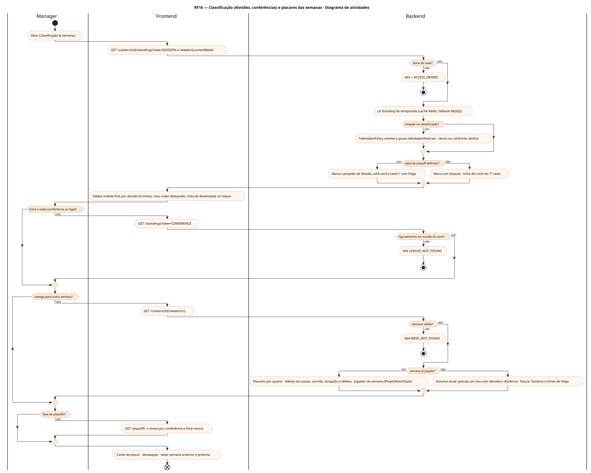
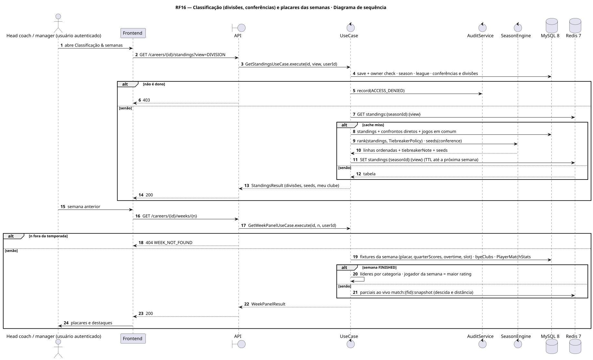
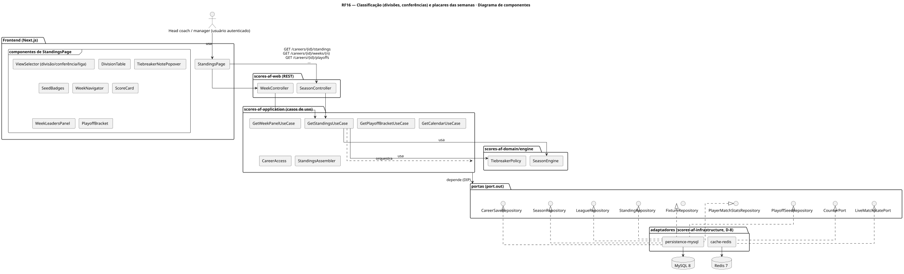
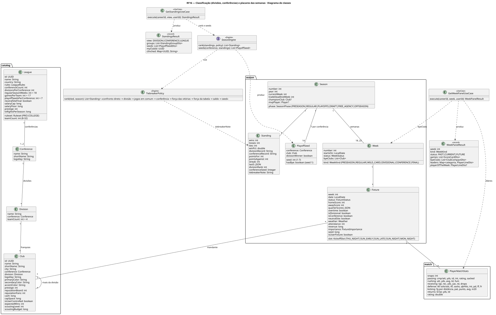
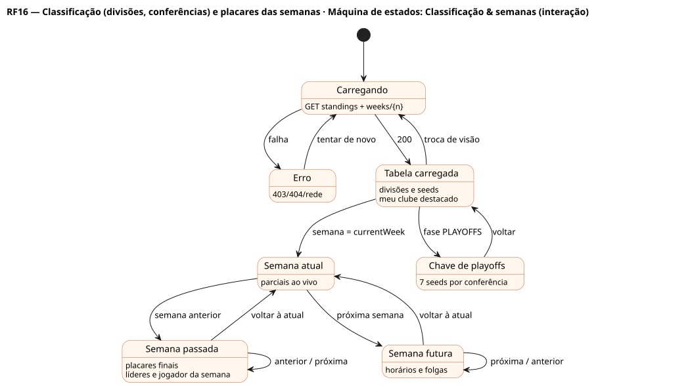

# RF16 — Classificação (divisões, conferências) e placares das semanas

## História de usuário

> HU-RF16 — COMO head coach dentro do painel da franquia POSSO ver a classificação por divisão, conferência e liga, com critérios de desempate e seeds de playoff, junto com os placares das semanas passadas, atual e futuras e os destaques da semana

Sprint: 6 · Atores: Manager · Tela: Classificação & semanas (/c/{careerId}/standings)

## Diagramas

### Atividades

Fonte: [`RF16-act.puml`](RF16-act.puml)

### Sequência

Fonte: [`RF16-seq.puml`](RF16-seq.puml)

### Componentes

Fonte: [`RF16-cmp.puml`](RF16-cmp.puml)

### Classes

Fonte: [`RF16-cls.puml`](RF16-cls.puml)

### Máquina de estados: Classificação & semanas (interação)

Fonte: [`RF16-stm.puml`](RF16-stm.puml)

## Endpoints

✅ = existe num controller do `scores-af-web` · ⛔ alvo = previsto no modelo, ainda sem controller (lista em `generator/endpoints_code.json`).

| Estado | Método | Rota | Caso de uso | Autorização | Descrição |
|---|---|---|---|---|---|
| ⛔ alvo | `GET` | `/api/v1/careers/{id}/standings` | `GetStandingsUseCase` | JWT · dono do save | view=DIVISION\|CONFERENCE\|LEAGUE: V-D-E, % de vitórias (empate vale meio), recorde na divisão e na conferência, pontos pró e contra, sequência, últimos 5, seed e nota de desempate |
| ⛔ alvo | `GET` | `/api/v1/careers/{id}/weeks/{n}` | `GetWeekPanelUseCase` | JWT · dono do save | Placares da semana n (passada: finais por quarto e prorrogação · atual: ao vivo · futura: agendados e horários), times de folga e destaques (líderes em passe, corrida, recepção e defesa, jogador da semana) |
| ⛔ alvo | `GET` | `/api/v1/careers/{id}/playoffs` | `GetPlayoffBracketUseCase` | JWT · dono do save | Chave com 7 seeds por conferência, folga do seed 1 e final em campo neutro (RF66) |
| ⛔ alvo | `GET` | `/api/v1/careers/{id}/calendar` | `GetCalendarUseCase` | JWT · dono do save | Semanas futuras com jogos de divisão, quinta à noite e semana de folga (RF21) |

## Pontos de decisão

| Gateway | Regra | Se falso |
|---|---|---|
| Dono do save? | save.userId == jwt.sub (CareerAccess.requireOwner) | 403 FORBIDDEN + AuditLog ACCESS_DENIED |
| Liga pertence ao mundo do save? | league.worldId == save.worldId | 404 LEAGUE_NOT_FOUND |
| Semana válida? | 1 ≤ n ≤ total de semanas da temporada (regular + playoffs) | 404 WEEK_NOT_FOUND |
| Semana já jogada? | todas as Fixtures da semana FINISHED | atual: placares LIVE e parciais sem destaques · futura: agenda e favoritos |
| Empate na classificação? | mesmo winPct → TiebreakerPolicy em ordem: confronto direto, recorde na divisão, jogos em comum, recorde na conferência, força das vitórias, força da tabela, saldo de pontos, sorteio por seed | ordem direta por winPct |
| Seed de playoff definido? | campeões de divisão nos seeds 1–4 da conferência e 3 wild cards nos 5–7 · seed 1 com folga | mostra posição provisória (em disputa) |

---
Gerado por `../generator/generate.py` a partir de `../generator/model/*.py` e `../generator/common.py`; não edite os .puml à mão.
