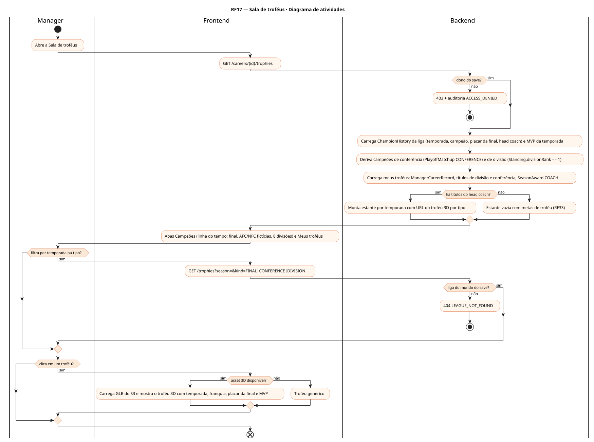
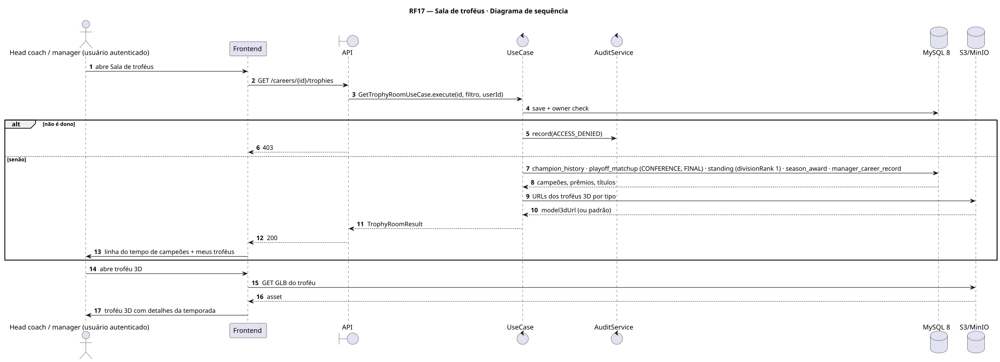
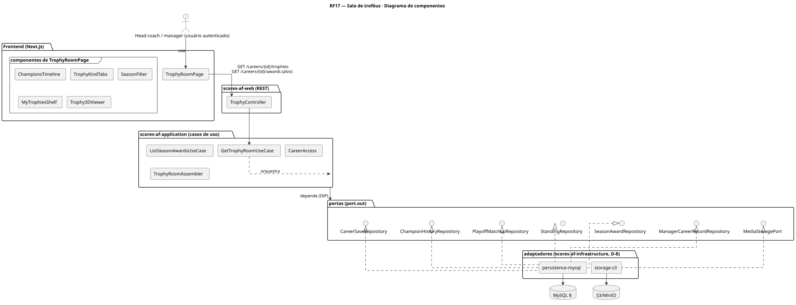
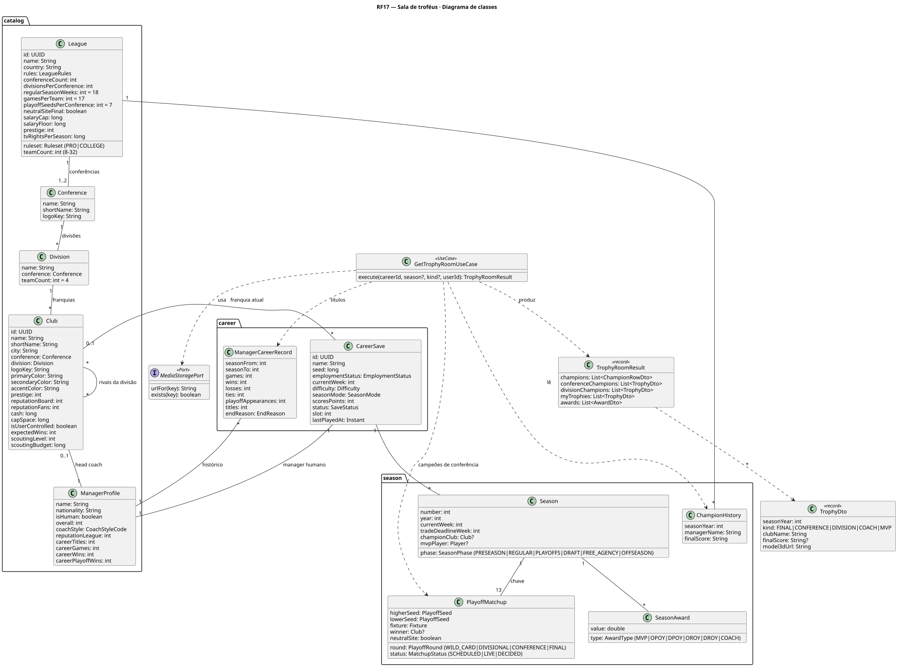
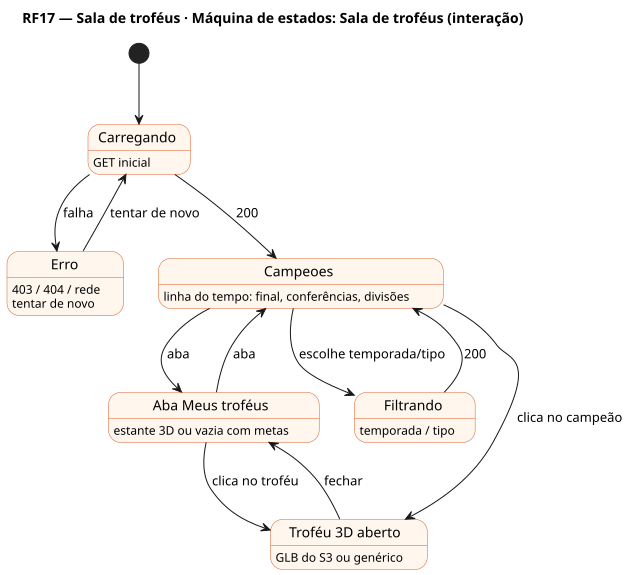

# RF17 — Sala de troféus

## História de usuário

> HU-RF17 — COMO usuário dentro do painel da franquia POSSO visualizar o histórico de campeões da liga na sala de troféus, com títulos de divisão, de conferência e da final, além dos troféus e prêmios que conquistei como head coach

Sprint: 11 · Atores: Manager · Tela: Sala de troféus (/c/{careerId}/trophies)

## Diagramas

### Atividades

Fonte: [`RF17-act.puml`](RF17-act.puml)

### Sequência

Fonte: [`RF17-seq.puml`](RF17-seq.puml)

### Componentes

Fonte: [`RF17-cmp.puml`](RF17-cmp.puml)

### Classes

Fonte: [`RF17-cls.puml`](RF17-cls.puml)

### Máquina de estados: Sala de troféus (interação)

Fonte: [`RF17-stm.puml`](RF17-stm.puml)

## Endpoints

✅ = existe num controller do `scores-af-web` · ⛔ alvo = previsto no modelo, ainda sem controller (lista em `generator/endpoints_code.json`).

| Estado | Método | Rota | Caso de uso | Autorização | Descrição |
|---|---|---|---|---|---|
| ⛔ alvo | `GET` | `/api/v1/careers/{id}/trophies` | `GetTrophyRoomUseCase` | JWT · dono do save | Campeões por temporada (final, conferências, divisões) e meus troféus (títulos do head coach, prêmio COACH) com URL do troféu 3D · filtros season, kind |
| ⛔ alvo | `GET` | `/api/v1/careers/{id}/awards` | `ListSeasonAwardsUseCase` | JWT · dono do save | Prêmios individuais por temporada (MVP, OPOY, DPOY, OROY, DROY, COACH) filtráveis por temporada e conferência |

## Pontos de decisão

| Gateway | Regra | Se falso |
|---|---|---|
| Dono do save? | save.userId == jwt.sub (CareerAccess.requireOwner) | 403 + AuditLog ACCESS_DENIED |
| Liga do mundo do save? | league.worldId == save.worldId | 404 LEAGUE_NOT_FOUND |
| Qual troféu? | FINAL: vencedor do PlayoffMatchup FINAL · CONFERENCE: vencedor da final de conferência · DIVISION: divisionRank == 1 ao fim da temporada regular | sem troféu na categoria |
| Há títulos do head coach? | ManagerCareerRecord.titles > 0 ou título de divisão/conferência ou SeasonAward COACH do manager humano | estante vazia com metas de troféu (RF33) |
| Asset 3D disponível? | GLB do troféu por tipo (final, conferência, divisão) existe no S3 | troféu genérico (GLB padrão) |

---
Gerado por `../generator/generate.py` a partir de `../generator/model/*.py` e `../generator/common.py`; não edite os .puml à mão.
