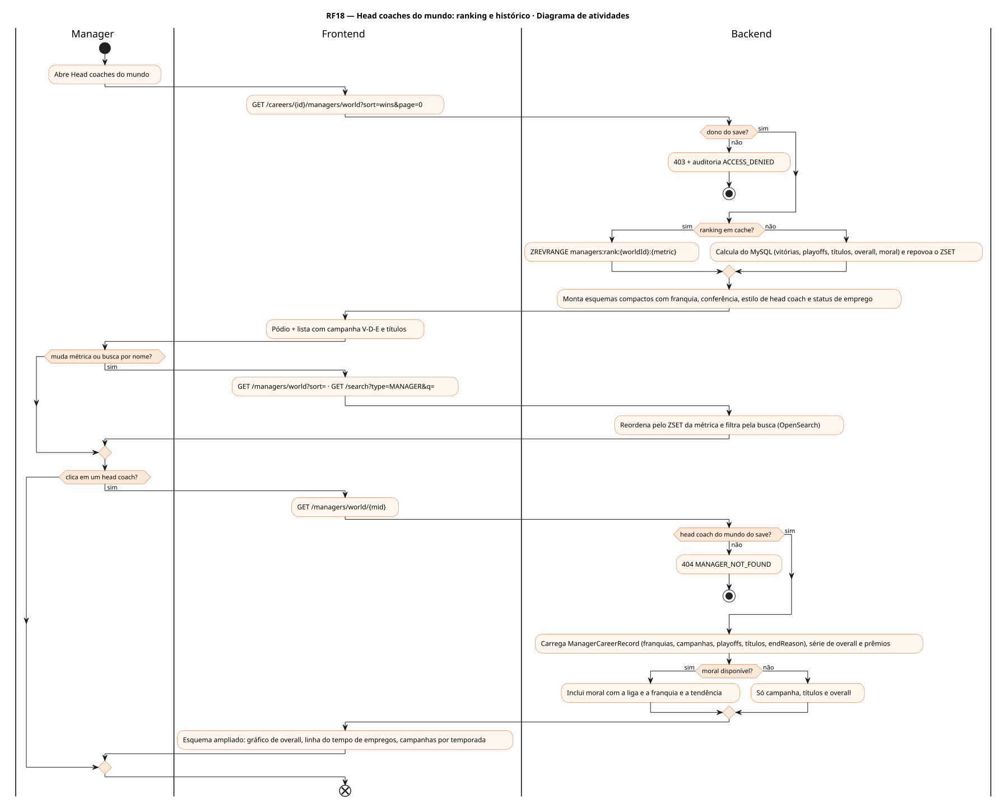
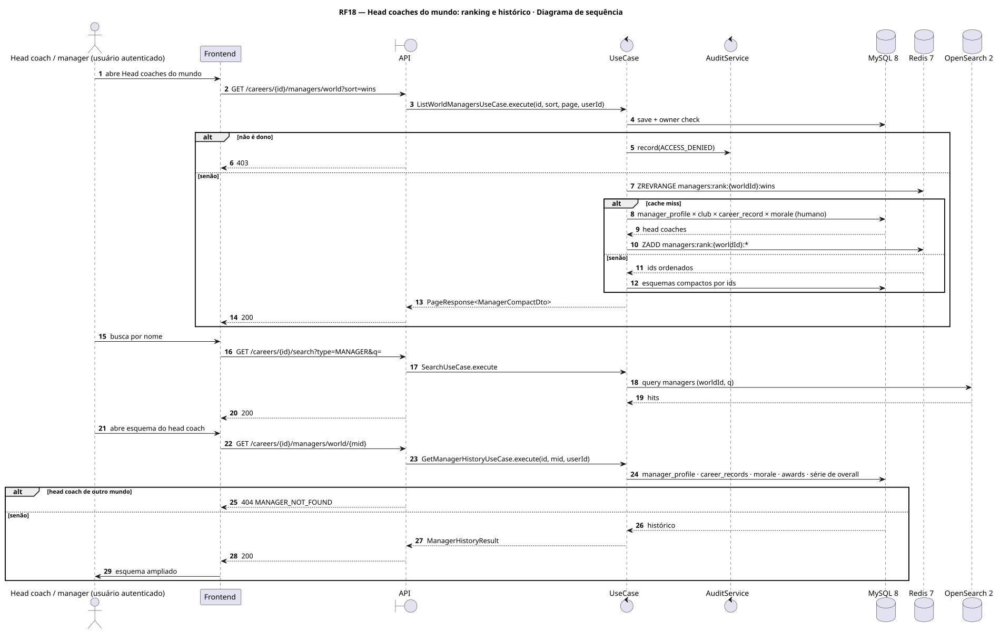
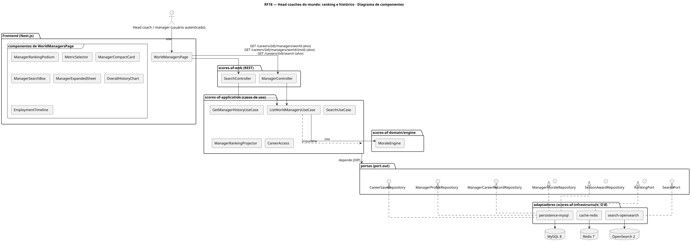
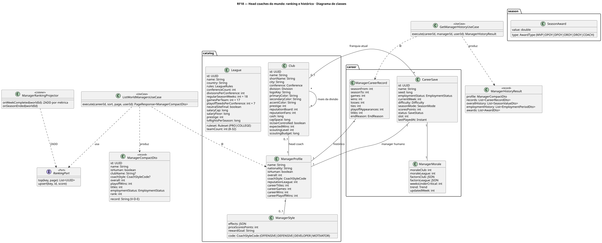
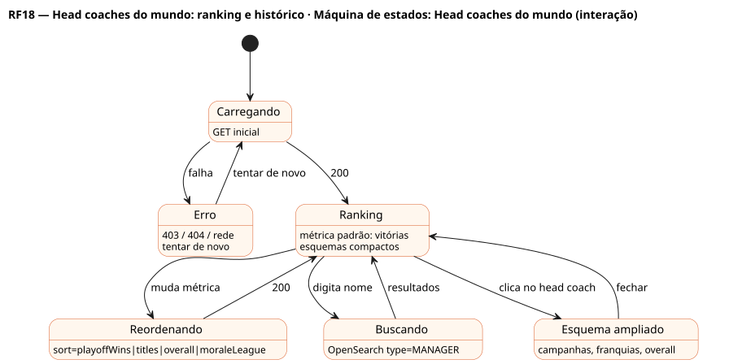

# RF18 — Head coaches do mundo: ranking e histórico

## História de usuário

> HU-RF18 — COMO usuário dentro do painel da franquia POSSO acessar a aba 'head coaches do mundo' PARA visualizar o ranking de técnicos, os esquemas com franquia atual e o histórico de cada um ao clicar no item

Sprint: 11 · Atores: Manager · Tela: Head coaches do mundo (/c/{careerId}/managers)

## Diagramas

### Atividades

Fonte: [`RF18-act.puml`](RF18-act.puml)

### Sequência

Fonte: [`RF18-seq.puml`](RF18-seq.puml)

### Componentes

Fonte: [`RF18-cmp.puml`](RF18-cmp.puml)

### Classes

Fonte: [`RF18-cls.puml`](RF18-cls.puml)

### Máquina de estados: Head coaches do mundo (interação)

Fonte: [`RF18-stm.puml`](RF18-stm.puml)

## Endpoints

✅ = existe num controller do `scores-af-web` · ⛔ alvo = previsto no modelo, ainda sem controller (lista em `generator/endpoints_code.json`).

| Estado | Método | Rota | Caso de uso | Autorização | Descrição |
|---|---|---|---|---|---|
| ⛔ alvo | `GET` | `/api/v1/careers/{id}/managers/world` | `ListWorldManagersUseCase` | JWT · dono do save | Ranking (Redis ZSET) e esquemas compactos: nome, franquia, overall, estilo de head coach, campanha (V-D-E), vitórias em playoffs, títulos · sort=wins\|playoffWins\|titles\|overall\|moraleLeague |
| ⛔ alvo | `GET` | `/api/v1/careers/{id}/managers/world/{mid}` | `GetManagerHistoryUseCase` | JWT · dono do save | Esquema ampliado: franquias por temporada (ManagerCareerRecord), campanhas, playoffs, série de overall, estilo, prêmios COACH |
| ⛔ alvo | `GET` | `/api/v1/careers/{id}/search` | `SearchUseCase` | JWT · dono do save | type=MANAGER: busca por nome, nacionalidade ou franquia (OpenSearch) |

## Pontos de decisão

| Gateway | Regra | Se falso |
|---|---|---|
| Dono do save? | save.userId == jwt.sub (CareerAccess.requireOwner) | 403 + AuditLog ACCESS_DENIED |
| Ranking em cache? | ZSET managers:rank:{worldId}:{metric} existe (atualizado no WeekCompleted e no fim de temporada) | recalcula do MySQL e repovoa o ZSET |
| Head coach do mundo do save? | manager.worldId == save.worldId (IA ou humano do save) | 404 MANAGER_NOT_FOUND |
| Moral disponível? | humano: ManagerMorale do save · IA: reputationLeague e campanha × expectedWins da franquia | exibe só campanha, títulos e overall |

---
Gerado por `../generator/generate.py` a partir de `../generator/model/*.py` e `../generator/common.py`; não edite os .puml à mão.
