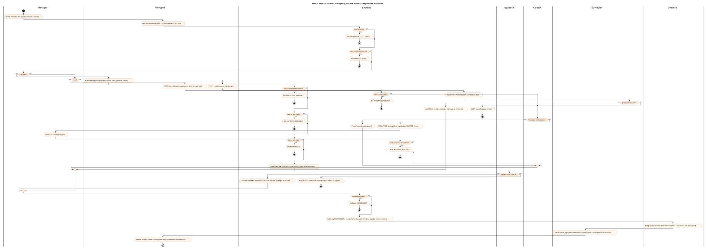
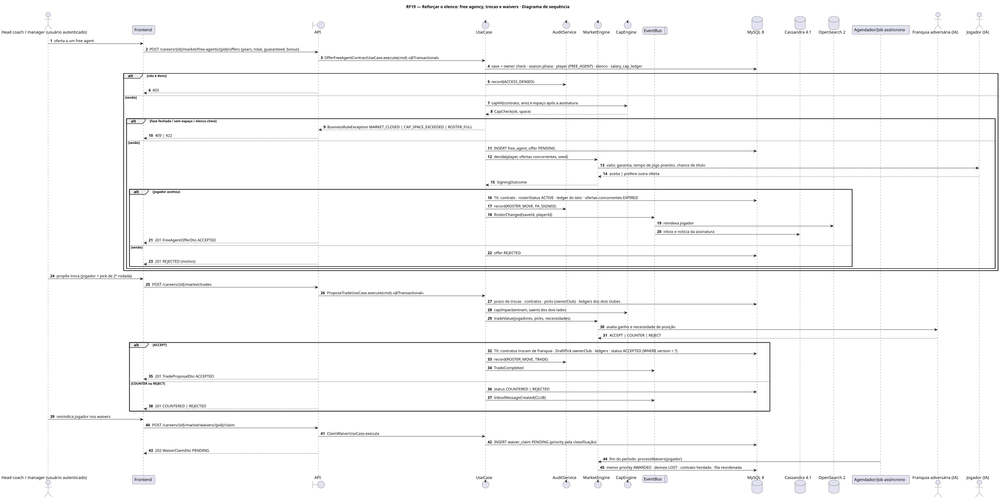
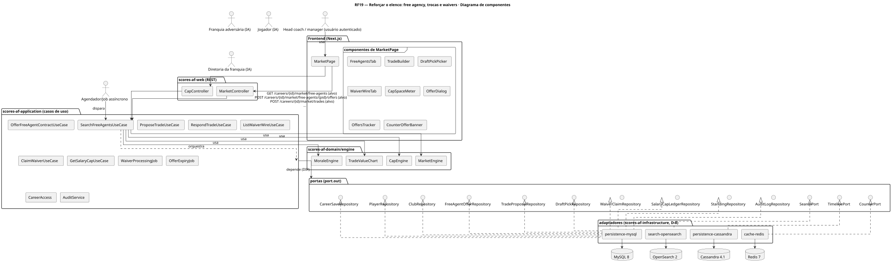
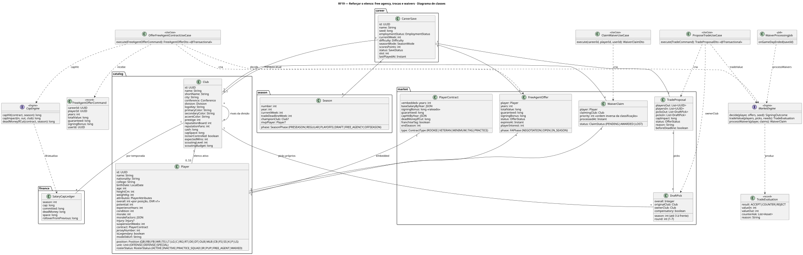
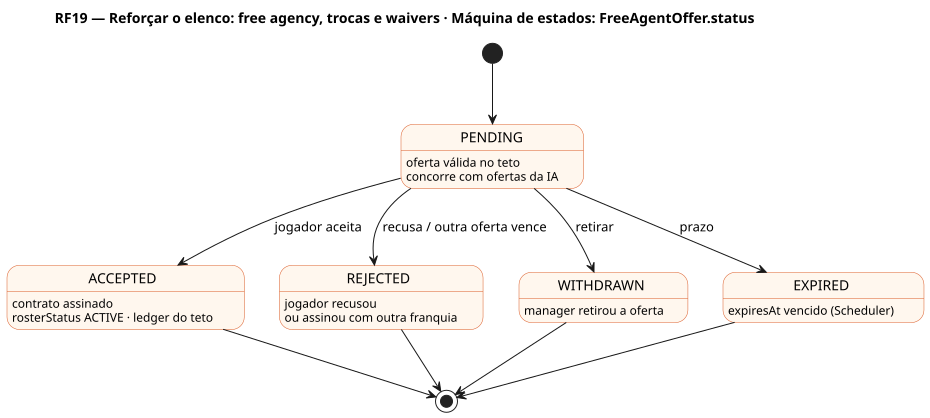
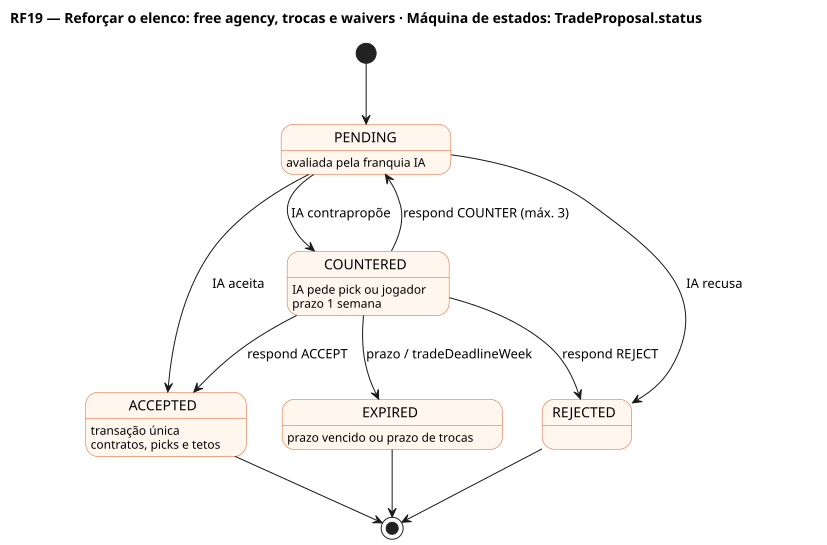
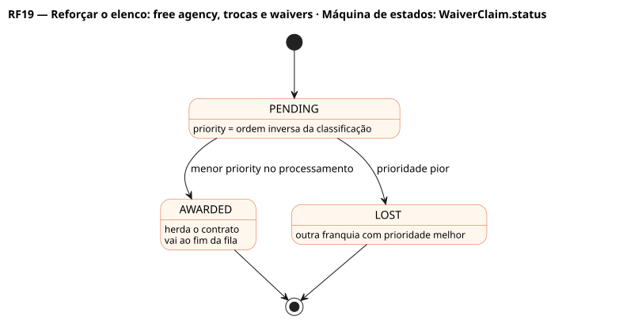

# RF19 — Reforçar o elenco: free agency, trocas e waivers

## História de usuário

> HU-RF19 — COMO usuário dentro do painel da minha franquia POSSO fazer oferta a um free agent, propor uma troca com outra franquia ou reivindicar um jogador dispensado (waivers) PARA reforçar o elenco dentro do teto salarial, negociando com a diretoria da outra franquia e com o jogador

Sprint: 7 · Atores: Manager, ClubeIA, JogadorIA, Diretoria, Scheduler · Tela: Mercado (/c/{careerId}/market) · abas Free agents, Trocas, Waivers · esquema do jogador → Fazer oferta / Propor troca

## Diagramas

### Atividades

Fonte: [`RF19-act.puml`](RF19-act.puml)

### Sequência

Fonte: [`RF19-seq.puml`](RF19-seq.puml)

### Componentes

Fonte: [`RF19-cmp.puml`](RF19-cmp.puml)

### Classes

Fonte: [`RF19-cls.puml`](RF19-cls.puml)

### Máquina de estados: FreeAgentOffer.status

Fonte: [`RF19-stm.puml`](RF19-stm.puml)

### Máquina de estados: TradeProposal.status

Fonte: [`RF19-stm-tradeproposal-status.puml`](RF19-stm-tradeproposal-status.puml)

### Máquina de estados: WaiverClaim.status

Fonte: [`RF19-stm-waiverclaim-status.puml`](RF19-stm-waiverclaim-status.puml)

## Endpoints

✅ = existe num controller do `scores-af-web` · ⛔ alvo = previsto no modelo, ainda sem controller (lista em `generator/endpoints_code.json`).

| Estado | Método | Rota | Caso de uso | Autorização | Descrição |
|---|---|---|---|---|---|
| ⛔ alvo | `GET` | `/api/v1/careers/{id}/market/free-agents` | `SearchFreeAgentsUseCase` | JWT · dono do save | Free agents com pedida (anos, valor, garantia), interesse na franquia e overall por posição · filtros position, unit, minOverall, age |
| ⛔ alvo | `POST` | `/api/v1/careers/{id}/market/free-agents/{pid}/offers` | `OfferFreeAgentContractUseCase` | JWT · dono do save | FreeAgentOffer (anos, valor total, garantia, bônus de assinatura); o jogador decide pela oferta mais atraente até expiresAt |
| ⛔ alvo | `POST` | `/api/v1/careers/{id}/market/trades` | `ProposeTradeUseCase` | JWT · dono do save | TradeProposal: jogadores e picks de draft (até 3 temporadas à frente) dos dois lados · impacto no teto calculado no backend |
| ⛔ alvo | `POST` | `/api/v1/careers/{id}/market/trades/{tid}/respond` | `RespondTradeUseCase` | JWT · dono do save | ACCEPT a contraproposta \| REJECT \| COUNTER · aceite executa a troca em transação única |
| ⛔ alvo | `GET` | `/api/v1/careers/{id}/market/waivers` | `ListWaiverWireUseCase` | JWT · dono do save | Jogadores dispensados nas últimas 24 h de jogo com contrato, cap hit e minha prioridade (ordem inversa da classificação) |
| ⛔ alvo | `POST` | `/api/v1/careers/{id}/market/waivers/{pid}/claim` | `ClaimWaiverUseCase` | JWT · dono do save | WaiverClaim PENDING · processado no fim do período pela prioridade |
| ⛔ alvo | `GET` | `/api/v1/careers/{id}/cap` | `GetSalaryCapUseCase` | JWT · dono do save | Teto, comprometido, dead money e espaço da temporada (SalaryCapLedger) para validar a oferta |

## Pontos de decisão

| Gateway | Regra | Se falso |
|---|---|---|
| Dono do save? | save.userId == jwt.sub (CareerAccess.requireOwner) | 403 + AuditLog ACCESS_DENIED |
| Fase permite a operação? | free agency: season.phase ∈ {FREE_AGENCY, PRESEASON, REGULAR} · troca: currentWeek ≤ tradeDeadlineWeek e fora dos playoffs · waivers: temporada regular ou pré-temporada | 409 MARKET_CLOSED (prazo de trocas ou fase) |
| Não há compra entre clubes? | jogador com contrato só muda de franquia por TradeProposal; FreeAgentOffer só para rosterStatus FREE_AGENT; claim só para WAIVED | 422 PLAYER_NOT_AVAILABLE |
| Cabe no teto rígido? | SalaryCapLedger.space ≥ cap hit do ano corrente (salário + bônus rateado) · troca: capImpact dos dois lados ≥ 0 de espaço | 422 CAP_SPACE_EXCEEDED |
| Elenco tem vaga? | ativos < LeagueRules.rosterMax (53) ou saída prevista na própria troca | 422 ROSTER_FULL (corte ou practice squad antes) |
| Jogador aceita a oferta? | MarketEngine: valor anual, garantia, prestígio, chance de título, tempo de jogo previsto pelo depth chart, moral do head coach com a liga · u(seed) < playerInterest | FreeAgentOffer REJECTED ou outra franquia vence · moral −1 |
| Franquia IA aceita a troca? | MarketEngine.tradeValue: valor dos jogadores (overall por posição, idade, contrato) + tabela de valor de picks · ganho ≥ 0 e necessidade de posição · senão COUNTER pedindo pick ou jogador | TradeProposal REJECTED ou COUNTERED (prazo 1 semana) |
| Contraproposta ainda válida? | status == COUNTERED e prazo ≥ semana atual e antes do prazo de trocas | 409 OFFER_NOT_PENDING (EXPIRED) |
| Prioridade de waiver? | entre claims PENDING do mesmo jogador vence a menor priority (pior campanha) · claim vencido vai ao fim da fila | WaiverClaim LOST |
| Transação única ok? | @Version: contratos, rosterStatus, picks (ownerClub), SalaryCapLedger dos dois clubes, status da proposta e propostas concorrentes EXPIRED | rollback · 409 CONFLICT |

---
Gerado por `../generator/generate.py` a partir de `../generator/model/*.py` e `../generator/common.py`; não edite os .puml à mão.
