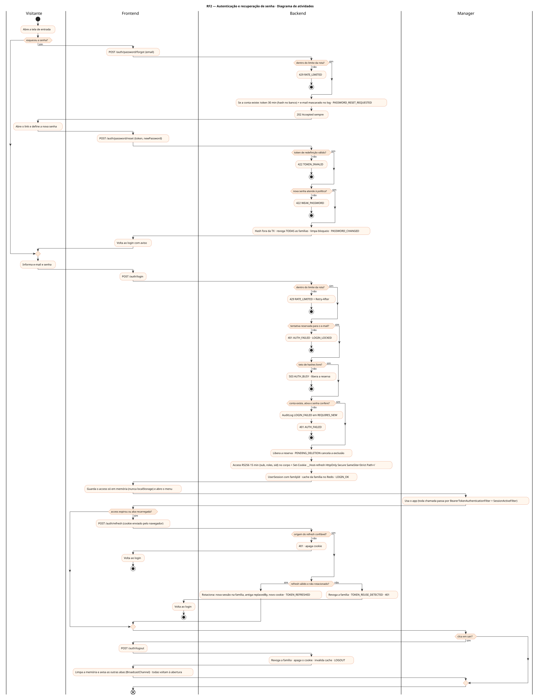
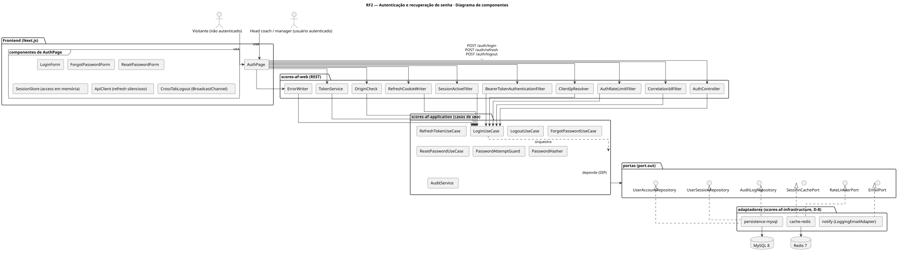
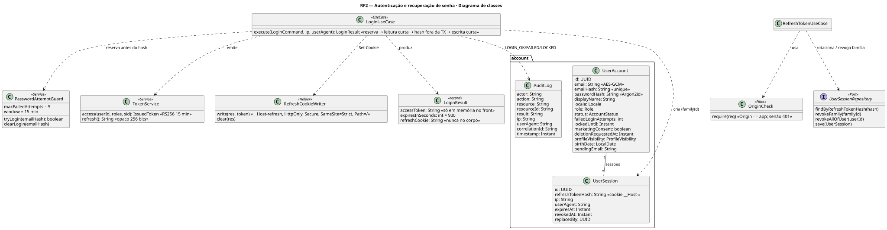
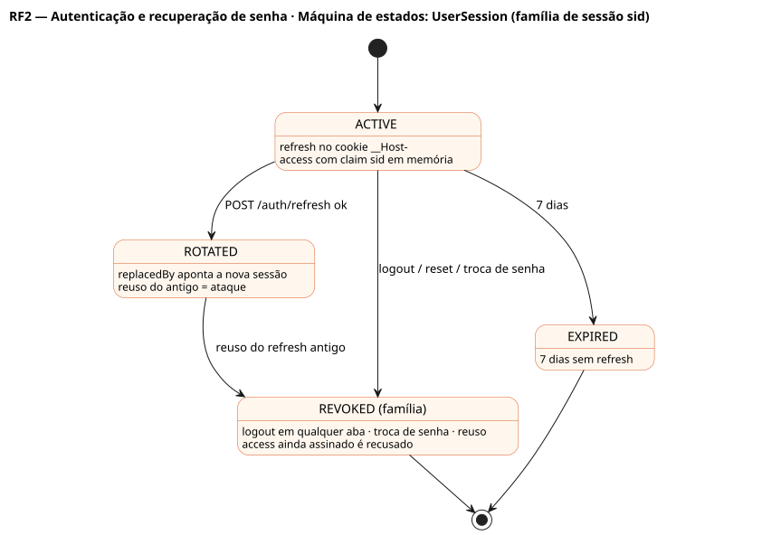
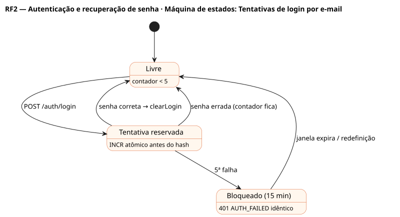

# RF2 — Autenticação e recuperação de senha

## História de usuário

> HU-RF2 — COMO usuário que possui conta POSSO autenticar-me com e-mail e senha (ou recuperar minha senha) PARA acessar minhas carreiras salvas e o menu principal do Scores: American Football

Sprint: 3 · Atores: Visitante, Manager · Tela: Abertura / menu — Entrar (/auth), Esqueci a senha, Redefinir senha

## Diagramas

### Atividades

Fonte: [`RF2-act.puml`](RF2-act.puml)

### Sequência

Fonte: [`RF2-seq.puml`](RF2-seq.puml)

### Componentes

Fonte: [`RF2-cmp.puml`](RF2-cmp.puml)

### Classes

Fonte: [`RF2-cls.puml`](RF2-cls.puml)

### Máquina de estados: UserSession (família de sessão sid)

Fonte: [`RF2-stm.puml`](RF2-stm.puml)

### Máquina de estados: Tentativas de login por e-mail

Fonte: [`RF2-stm-tentativas-de-login-por-e-mail.puml`](RF2-stm-tentativas-de-login-por-e-mail.puml)

## Endpoints

✅ = existe num controller do `scores-af-web` · ⛔ alvo = previsto no modelo, ainda sem controller (lista em `generator/endpoints_code.json`).

| Estado | Método | Rota | Caso de uso | Autorização | Descrição |
|---|---|---|---|---|---|
| ✅ | `POST` | `/api/v1/auth/login` | `LoginUseCase` | público · 30 por IP/10 min | Reserva atômica de tentativa por e-mail ANTES do hash (5 em 15 min); mesmo 401 AUTH_FAILED para todos os casos; access RS256 15 min no corpo (fica só em memória) + refresh opaco 7 dias em cookie __Host- HttpOnly Secure SameSite=Strict (D-5) |
| ✅ | `POST` | `/api/v1/auth/refresh` | `RefreshTokenUseCase` | cookie __Host-refresh · Origin conferida · 120 por IP/10 min | Rotaciona o refresh (replacedBy) e regrava o cookie; reuso de token antigo revoga a família inteira |
| ✅ | `POST` | `/api/v1/auth/logout` | `LogoutUseCase` | JWT | Revoga a família de sessão, apaga o cookie e avisa as outras abas (logout entre abas, D-5) |
| ✅ | `POST` | `/api/v1/auth/password/forgot` | `ForgotPasswordUseCase` | público · 10 por IP/hora | Token de redefinição (30 min) por e-mail · 202 sempre (não revela existência) |
| ✅ | `POST` | `/api/v1/auth/password/reset` | `ResetPasswordUseCase` | público · 20 por IP/hora | Novo hash fora da transação; limpa o bloqueio por e-mail; revoga todas as famílias de sessão |

## Pontos de decisão

| Gateway | Regra | Se falso |
|---|---|---|
| Dentro do limite da rota? | AuthRateLimitFilter por IP confiável + método + rota: login 30/10 min · refresh 120/10 min · forgot 10/h · reset 20/h | 429 RATE_LIMITED + Retry-After |
| Tentativa reservada para o e-mail? | PasswordAttemptGuard.tryLogin(emailHash): tryAcquire(auth:login:{emailHash}, 5, 15 min) antes de ler a conta ou calcular hash | 401 AUTH_FAILED idêntico + AuditLog LOGIN_LOCKED |
| Teto de hashes livre? | PasswordHasher: semáforo com espera limitada | 503 AUTH_BUSY + Retry-After (libera a reserva) |
| Conta existe, ativa e senha confere? | findByEmailHash · status ACTIVE ou PENDING_DELETION (cancela) · Argon2id.verify fora da transação (hash fictício se inexistente) | 401 AUTH_FAILED sem distinguir motivo · AuditLog LOGIN_FAILED (REQUIRES_NEW) |
| Família de sessão ativa? | SessionActiveFilter: claim sid tem UserSession não revogada (cache Redis + MySQL) | 401 UNAUTHENTICATED mesmo com assinatura válida |
| Origem do refresh confiável? | cookie __Host-refresh presente · Origin == origem do app (cookie SameSite=Strict não basta sozinho) | 401 · cookie apagado |
| Refresh válido e não rotacionado? | hash existe · revokedAt == null · replacedBy == null · expiresAt > now | 401 · reuso revoga a família + AuditLog TOKEN_REUSE_DETECTED |
| Token de redefinição válido? | hash existe, < 30 min, não usado | 422 TOKEN_INVALID |
| Nova senha atende à política? | ≥ 8 caracteres, diferente da atual | 422 WEAK_PASSWORD |

---
Gerado por `../generator/generate.py` a partir de `../generator/model/*.py` e `../generator/common.py`; não edite os .puml à mão.
