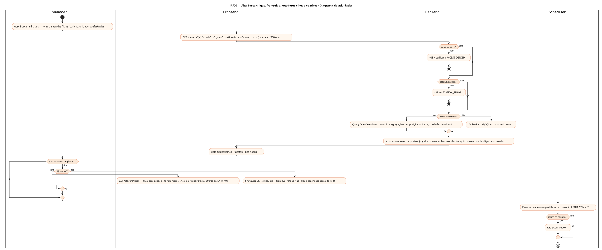
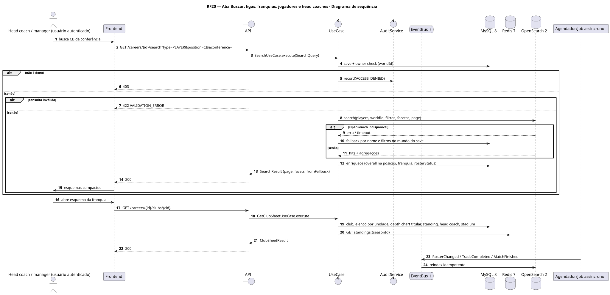
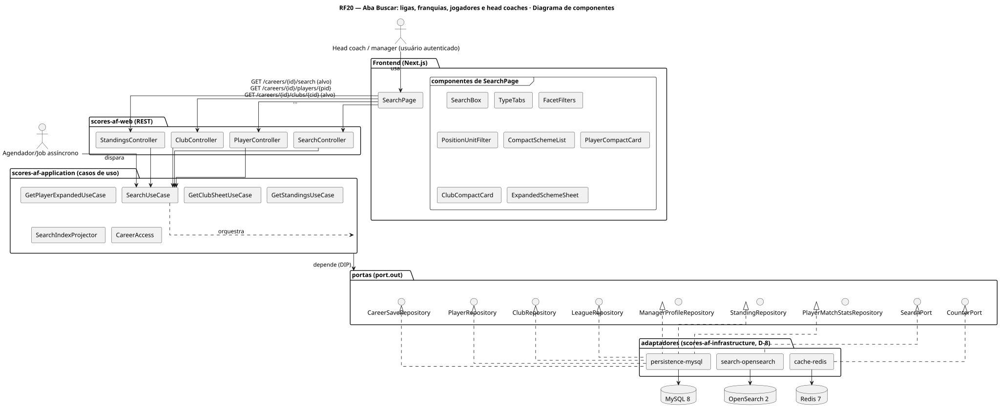
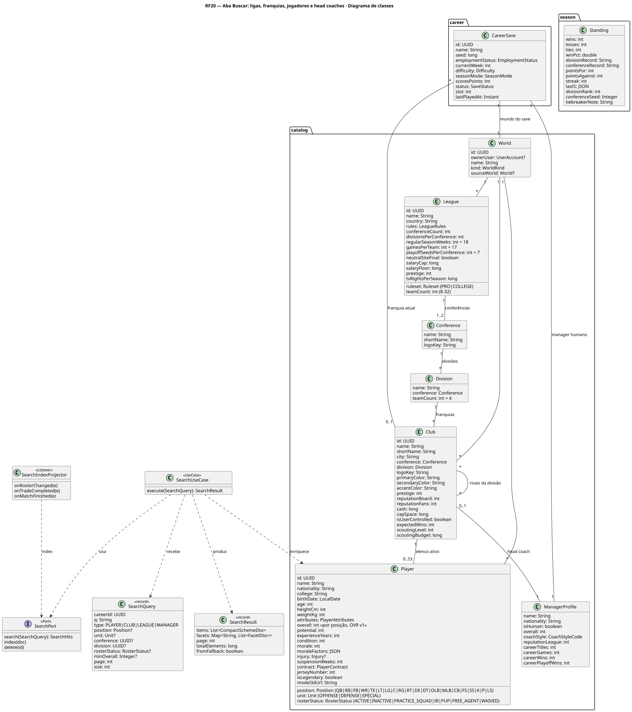
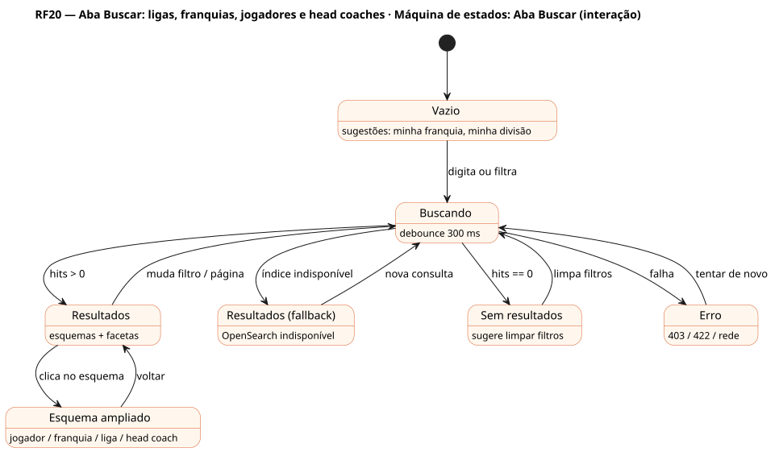

# RF20 — Aba Buscar: ligas, franquias, jogadores e head coaches

## História de usuário

> HU-RF20 — COMO usuário logado dentro de um save de carreira POSSO clicar na aba buscar PARA visualizar dados de ligas, franquias, jogadores e head coaches em esquemas compacto e ampliado, filtrando por posição, unidade, conferência e divisão

Sprint: 11 · Atores: Manager, Scheduler · Tela: Buscar (/c/{careerId}/search)

## Diagramas

### Atividades

Fonte: [`RF20-act.puml`](RF20-act.puml)

### Sequência

Fonte: [`RF20-seq.puml`](RF20-seq.puml)

### Componentes

Fonte: [`RF20-cmp.puml`](RF20-cmp.puml)

### Classes

Fonte: [`RF20-cls.puml`](RF20-cls.puml)

### Máquina de estados: Aba Buscar (interação)

Fonte: [`RF20-stm.puml`](RF20-stm.puml)

## Endpoints

✅ = existe num controller do `scores-af-web` · ⛔ alvo = previsto no modelo, ainda sem controller (lista em `generator/endpoints_code.json`).

| Estado | Método | Rota | Caso de uso | Autorização | Descrição |
|---|---|---|---|---|---|
| ⛔ alvo | `GET` | `/api/v1/careers/{id}/search` | `SearchUseCase` | JWT · dono do save | q, type=PLAYER\|CLUB\|LEAGUE\|MANAGER, position, unit (OFFENSE\|DEFENSE\|SPECIAL), conference, division, rosterStatus, minOverall, college · facetas e paginação (OpenSearch, fallback MySQL) |
| ✅ | `GET` | `/api/v1/careers/{id}/players/{pid}` | `GetPlayerExpandedUseCase` | JWT · dono do save | Esquema ampliado do jogador (RF22) |
| ⛔ alvo | `GET` | `/api/v1/careers/{id}/clubs/{cid}` | `GetClubSheetUseCase` | JWT · dono do save | Esquema ampliado da franquia: identidade, divisão, campanha, elenco por unidade, depth chart titular, head coach, estádio |
| ⛔ alvo | `GET` | `/api/v1/careers/{id}/standings` | `GetStandingsUseCase` | JWT · dono do save | Esquema ampliado da liga: classificação por divisão e líderes estatísticos (jardas de passe, corrida, recepção, sacks) |

## Pontos de decisão

| Gateway | Regra | Se falso |
|---|---|---|
| Dono do save? | save.userId == jwt.sub (CareerAccess.requireOwner) | 403 + AuditLog ACCESS_DENIED |
| Consulta válida? | q com 2–60 caracteres ou ao menos um filtro · type e position no vocabulário único · size ≤ 50 | 422 VALIDATION_ERROR |
| Índice disponível? | scores.persistence.search=opensearch e cluster saudável | fallback no MySQL do mundo do save com aviso no header |
| Resultado do mundo do save? | filtro obrigatório worldId == save.worldId na query | descartado (isolamento entre saves) |
| Índice atualizado? | RosterChanged, TradeCompleted, CatalogChanged e MatchFinished reindexados AFTER_COMMIT (idempotente) | retry com backoff · MySQL prevalece no esquema ampliado |

---
Gerado por `../generator/generate.py` a partir de `../generator/model/*.py` e `../generator/common.py`; não edite os .puml à mão.
