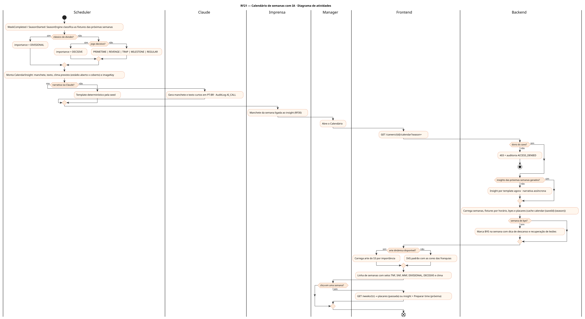
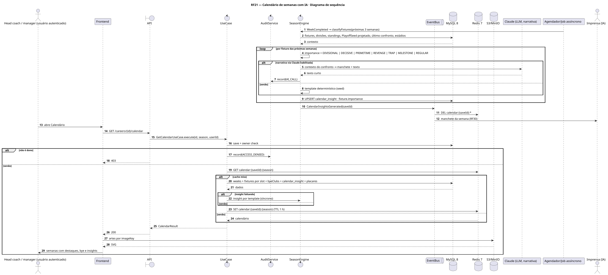
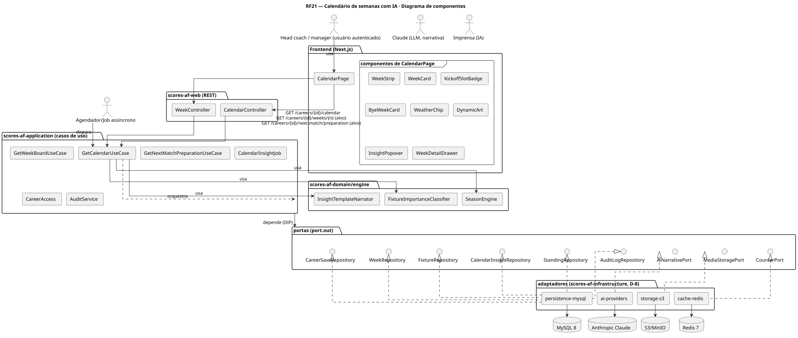
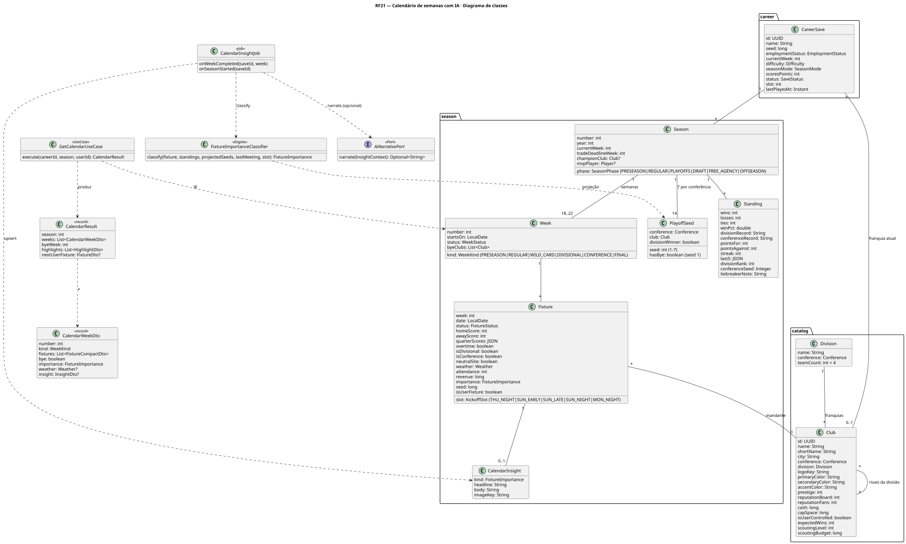
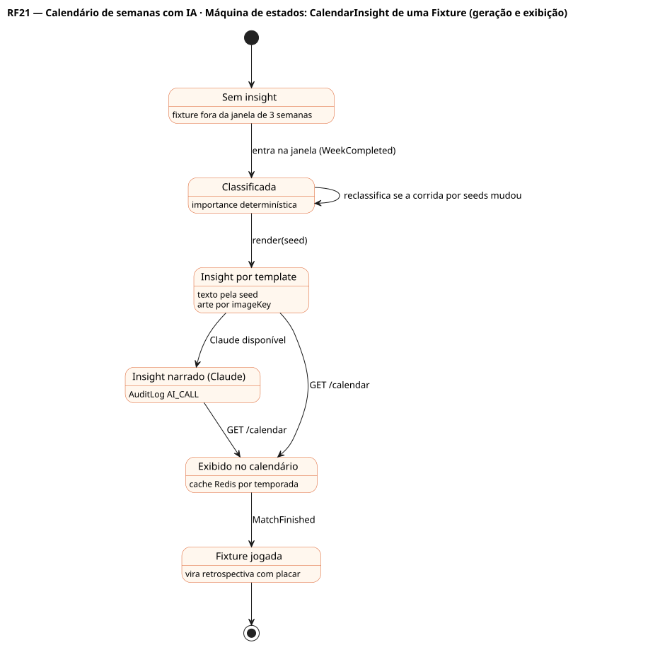

# RF21 — Calendário de semanas com IA

## História de usuário

> HU-RF21 — COMO usuário autenticado POSSO visualizar um calendário automatizado com IA PARA ver as semanas da temporada com bye, jogos de quinta e segunda à noite, clássicos de divisão, jogos decisivos pela vaga nos playoffs e outros destaques

Sprint: 6 · Atores: Manager, Scheduler, Claude, Imprensa · Tela: Calendário (/c/{careerId}/calendar)

## Diagramas

### Atividades

Fonte: [`RF21-act.puml`](RF21-act.puml)

### Sequência

Fonte: [`RF21-seq.puml`](RF21-seq.puml)

### Componentes

Fonte: [`RF21-cmp.puml`](RF21-cmp.puml)

### Classes

Fonte: [`RF21-cls.puml`](RF21-cls.puml)

### Máquina de estados: CalendarInsight de uma Fixture (geração e exibição)

Fonte: [`RF21-stm.puml`](RF21-stm.puml)

## Endpoints

✅ = existe num controller do `scores-af-web` · ⛔ alvo = previsto no modelo, ainda sem controller (lista em `generator/endpoints_code.json`).

| Estado | Método | Rota | Caso de uso | Autorização | Descrição |
|---|---|---|---|---|---|
| ⛔ alvo | `GET` | `/api/v1/careers/{id}/calendar` | `GetCalendarUseCase` | JWT · dono do save | Semanas da temporada (pré, 18 regulares, playoffs) com fixtures por horário (THU_NIGHT, SUN_EARLY, SUN_LATE, SUN_NIGHT, MON_NIGHT), bye, clima previsto, importance e CalendarInsight |
| ⛔ alvo | `GET` | `/api/v1/careers/{id}/weeks/{n}` | `GetWeekBoardUseCase` | JWT · dono do save | Detalhe da semana ao clicar (placares, destaques ou prévia) |
| ⛔ alvo | `GET` | `/api/v1/careers/{id}/next-match/preparation` | `GetNextMatchPreparationUseCase` | JWT · dono do save | Atalho para preparar o time a partir do próximo jogo (RF6/RF7) |

## Pontos de decisão

| Gateway | Regra | Se falso |
|---|---|---|
| Dono do save? | save.userId == jwt.sub (CareerAccess.requireOwner) | 403 + AuditLog ACCESS_DENIED |
| Semana de bye? | save.club ∈ week.byeClubs (1 bye por franquia entre as semanas 5 e 14) | mostra o jogo da semana |
| Insights das próximas semanas gerados? | CalendarInsight existe para as fixtures das próximas 3 semanas (gerado no WeekCompleted e no início da temporada) | gera por template agora e agenda narrativa assíncrona |
| Clássico de divisão? | fixture.isDivisional (6 jogos por temporada contra os 3 rivais da divisão) | segue a classificação por importância |
| Jogo decisivo? | a partir da semana 14: os dois disputam título de divisão ou vaga de seed 1–7 (PlayoffSeed projetado) ou é jogo de playoff | PRIMETIME se THU/SUN/MON_NIGHT · REVENGE se perdeu o último confronto · TRAP antes do bye ou após prime time · senão REGULAR |
| Narrativa via Claude? | scores.ai.narrative=claude, rate-limit ok e circuito fechado | template determinístico pela seed · AuditLog AI_CALL só quando chamou o provedor |
| Arte dinâmica disponível? | imageKey por importância e cores das franquias existe no S3 | SVG padrão no frontend com as cores do capacete |

---
Gerado por `../generator/generate.py` a partir de `../generator/model/*.py` e `../generator/common.py`; não edite os .puml à mão.
