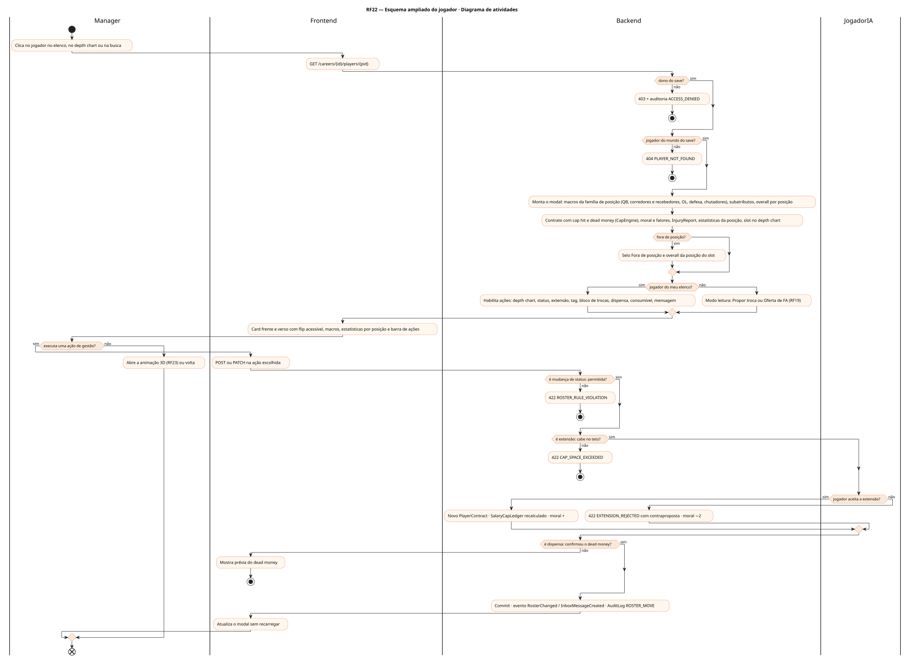
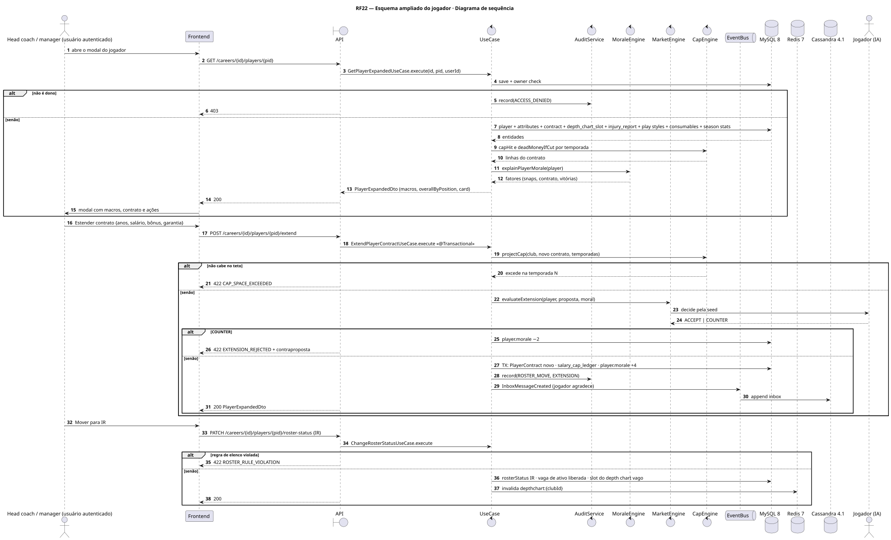
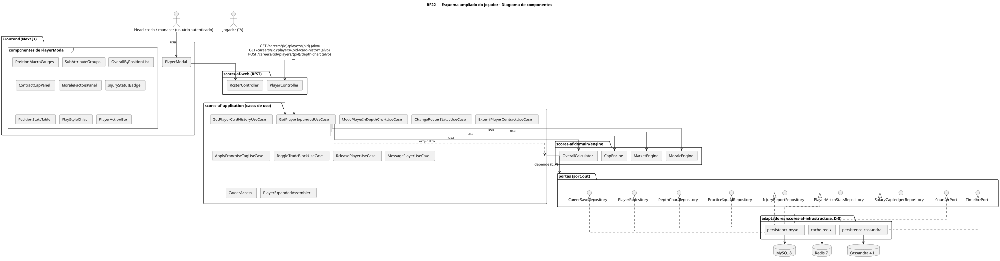
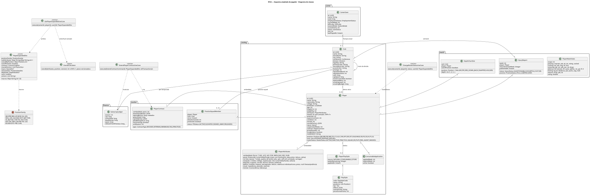
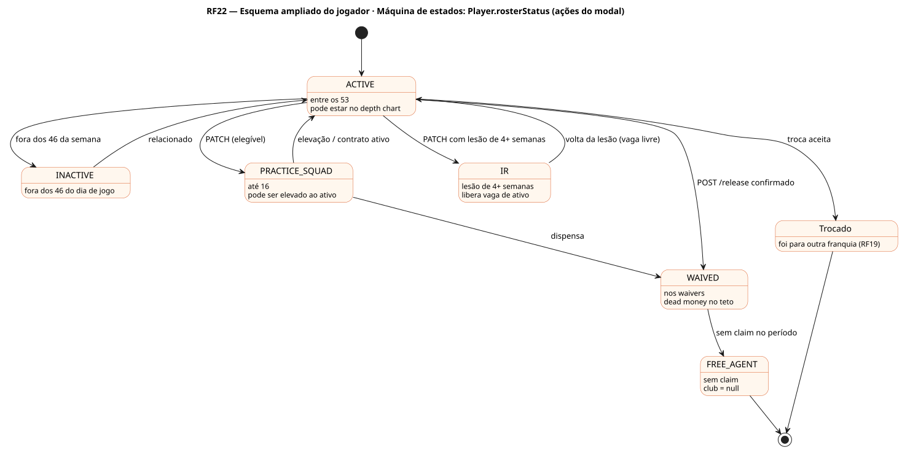

# RF22 — Esquema ampliado do jogador

## História de usuário

> HU-RF22 — COMO usuário logado dentro de um save de carreira POSSO abrir o modal de um jogador PARA ver idade, posição, macros da família de posição, overall por posição, moral, lesão, contrato com cap hit, slot no depth chart, estilos e consumíveis, e aplicar ações de gestão: mover no depth chart, practice squad ou IR, estender contrato, franchise tag, bloco de trocas, dispensar, consumível e mensagem

Sprint: 9 · Atores: Manager, JogadorIA · Tela: Modal do jogador (/c/{careerId}/roster/{playerId})

## Diagramas

### Atividades

Fonte: [`RF22-act.puml`](RF22-act.puml)

### Sequência

Fonte: [`RF22-seq.puml`](RF22-seq.puml)

### Componentes

Fonte: [`RF22-cmp.puml`](RF22-cmp.puml)

### Classes

Fonte: [`RF22-cls.puml`](RF22-cls.puml)

### Máquina de estados: Player.rosterStatus (ações do modal)

Fonte: [`RF22-stm.puml`](RF22-stm.puml)

## Endpoints

✅ = existe num controller do `scores-af-web` · ⛔ alvo = previsto no modelo, ainda sem controller (lista em `generator/endpoints_code.json`).

| Estado | Método | Rota | Caso de uso | Autorização | Descrição |
|---|---|---|---|---|---|
| ⛔ alvo | `GET` | `/api/v1/careers/{id}/players/{pid}` | `GetPlayerExpandedUseCase` | JWT · dono do save | 6 macros pela família de posição (D-6), ≈40 subatributos agrupados, overall em cada posição com aviso fora de posição, contrato (cap hit, garantia, dead money), moral e fatores, lesão e InjuryReport, estatísticas da temporada pela posição, estilos, consumíveis, slot no depth chart e card (nível Bronze…Elite) |
| ⛔ alvo | `GET` | `/api/v1/careers/{id}/players/{pid}/card-history` | `GetPlayerCardHistoryUseCase` | JWT · dono do save | Versões do card por temporada, prêmio ou título |
| ⛔ alvo | `POST` | `/api/v1/careers/{id}/players/{pid}/depth-chart` | `MovePlayerInDepthChartUseCase` | JWT · dono do save | Atalho do RF60: posição ou papel (KR, PR, 3RD_DOWN_BACK) e profundidade |
| ⛔ alvo | `PATCH` | `/api/v1/careers/{id}/players/{pid}/roster-status` | `ChangeRosterStatusUseCase` | JWT · dono do save | ACTIVE, PRACTICE_SQUAD ou IR dentro das regras 53 / 16 / IR |
| ⛔ alvo | `POST` | `/api/v1/careers/{id}/players/{pid}/extend` | `ExtendPlayerContractUseCase` | JWT · dono do save | Extensão: anos, salário por ano, bônus de assinatura (rateado), garantia · jogador IA aceita ou contrapropõe |
| ⛔ alvo | `POST` | `/api/v1/careers/{id}/players/{pid}/franchise-tag` | `ApplyFranchiseTagUseCase` | JWT · dono do save | Franchise tag de 1 ano no último ano de contrato (1 por franquia por temporada, RF49) |
| ⛔ alvo | `POST` | `/api/v1/careers/{id}/players/{pid}/trade-block` | `ToggleTradeBlockUseCase` | JWT · dono do save | Entra ou sai do bloco de trocas (franquias IA podem propor, RF19) |
| ⛔ alvo | `POST` | `/api/v1/careers/{id}/players/{pid}/release` | `ReleasePlayerUseCase` | JWT · dono do save | Dispensa: vai aos waivers e o dead money entra no teto |
| ⛔ alvo | `POST` | `/api/v1/careers/{id}/players/{pid}/consumables` | `ApplyConsumableUseCase` | JWT · dono do save | Aplica consumível (RF25) |
| ⛔ alvo | `POST` | `/api/v1/careers/{id}/players/{pid}/message` | `MessagePlayerUseCase` | JWT · dono do save | Mensagem ao jogador (inbox, RF24) |

## Pontos de decisão

| Gateway | Regra | Se falso |
|---|---|---|
| Dono do save? | save.userId == jwt.sub (CareerAccess.requireOwner) | 403 + AuditLog ACCESS_DENIED |
| Jogador do mundo do save? | player.worldId == save.worldId | 404 PLAYER_NOT_FOUND |
| Jogador do meu elenco? | player.club == save.club (ativo, practice squad ou IR) | modo leitura: só Ver e Propor troca / Oferta de FA (RF19) |
| Fora de posição? | slot do depth chart ≠ player.position → overall da posição do slot | sem aviso · se fora: selo e overall da posição usada |
| Mudança de status permitida? | ACTIVE ≤ rosterMax 53 · PRACTICE_SQUAD ≤ 16 e experienceYears ≤ 2 (ou vaga de veterano) · IR só com lesão de weeksOut ≥ 4 | 422 ROSTER_RULE_VIOLATION (motivo) |
| Extensão cabe no teto? | CapEngine: cap hit dos anos futuros ≤ espaço projetado de cada temporada | 422 CAP_SPACE_EXCEEDED |
| Jogador aceita a extensão? | MarketEngine: valor anual e garantia ≥ pedida(overall, idade, posição) × (1 − bônus de moral) | 422 EXTENSION_REJECTED com contraproposta · moral −2 |
| Franchise tag possível? | contract.endSeason == season.year · nenhuma tag usada pela franquia nesta temporada · espaço para o valor da tag | 422 FRANCHISE_TAG_NOT_ALLOWED |
| Confirmou o dead money? | release exige confirmDeadMoney = true após ver deadMoneyIfCut | 200 com prévia do dead money, sem dispensar |

---
Gerado por `../generator/generate.py` a partir de `../generator/model/*.py` e `../generator/common.py`; não edite os .puml à mão.
