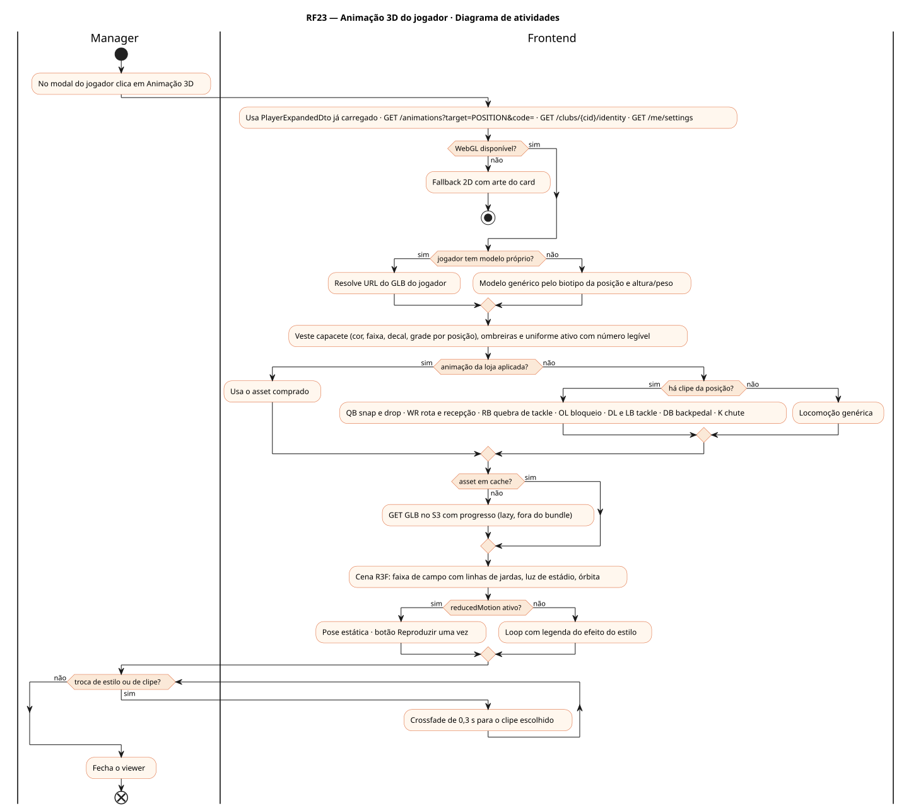
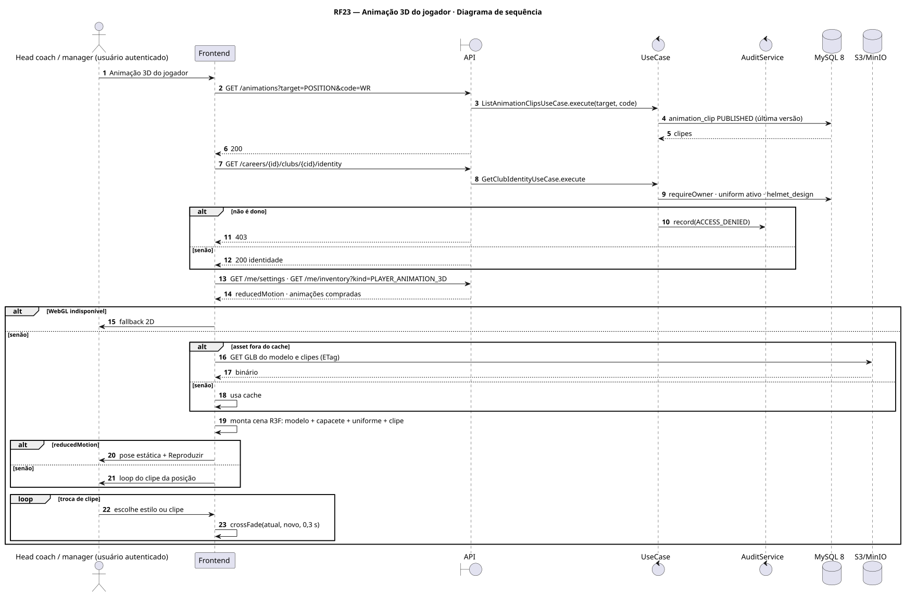
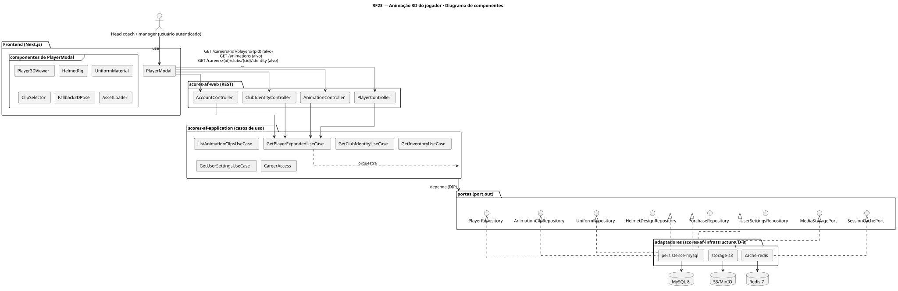
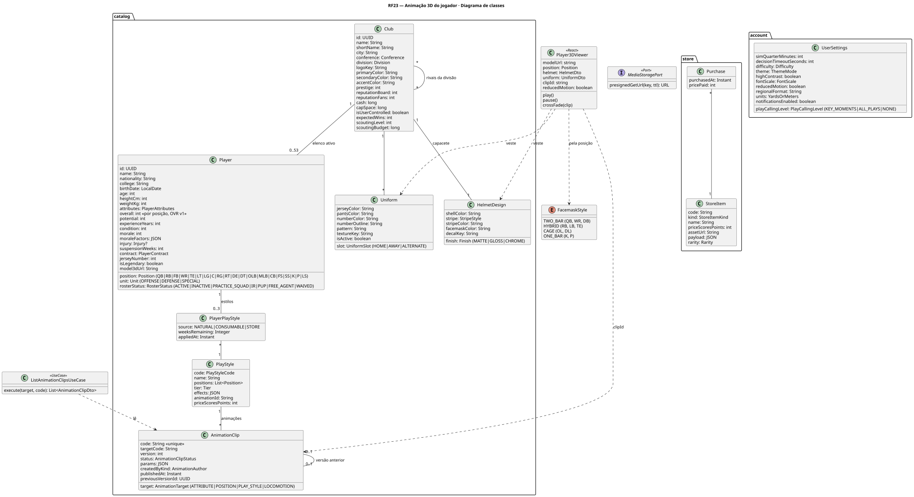
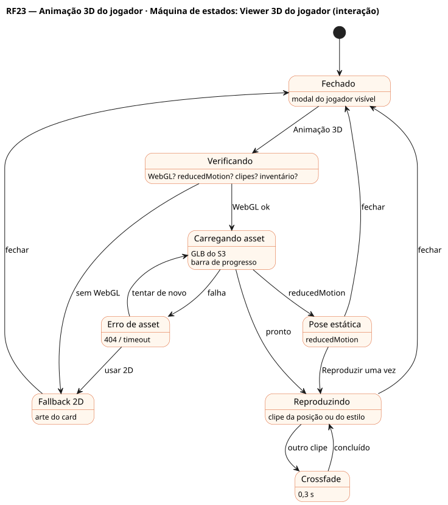

# RF23 — Animação 3D do jogador

## História de usuário

> HU-RF23 — DADO QUE estou vendo o modal de um jogador QUANDO clico em 'animação 3D do jogador' ENTÃO o sistema mostra o atleta em 3D com capacete, ombreiras e uniforme da franquia executando as animações da posição e dos estilos (snap e drop do QB, rota e recepção, corrida com quebra de tackle, bloqueio, tackle, chute, comemoração)

Sprint: 8 · Atores: Manager · Tela: Modal do jogador → viewer 3D (/c/{careerId}/roster/{playerId}#3d)

## Diagramas

### Atividades

Fonte: [`RF23-act.puml`](RF23-act.puml)

### Sequência

Fonte: [`RF23-seq.puml`](RF23-seq.puml)

### Componentes

Fonte: [`RF23-cmp.puml`](RF23-cmp.puml)

### Classes

Fonte: [`RF23-cls.puml`](RF23-cls.puml)

### Máquina de estados: Viewer 3D do jogador (interação)

Fonte: [`RF23-stm.puml`](RF23-stm.puml)

## Endpoints

✅ = existe num controller do `scores-af-web` · ⛔ alvo = previsto no modelo, ainda sem controller (lista em `generator/endpoints_code.json`).

| Estado | Método | Rota | Caso de uso | Autorização | Descrição |
|---|---|---|---|---|---|
| ⛔ alvo | `GET` | `/api/v1/careers/{id}/players/{pid}` | `GetPlayerExpandedUseCase` | JWT · dono do save | model3dUrl, posição, altura e peso, estilos ativos e animationId de cada um |
| ⛔ alvo | `GET` | `/api/v1/animations` | `ListAnimationClipsUseCase` | JWT | Clipes PUBLISHED por target=POSITION\|PLAY_STYLE\|LOCOMOTION e code (locomoção herdada das 37 do basquete) |
| ⛔ alvo | `GET` | `/api/v1/careers/{id}/clubs/{cid}/identity` | `GetClubIdentityUseCase` | JWT · dono do save | Uniforme ativo e capacete (cores, faixa, decal, grade) para vestir o modelo |
| ⛔ alvo | `GET` | `/api/v1/me/inventory` | `GetInventoryUseCase` | JWT | Animações 3D compradas na loja (RF32) aplicadas ao jogador |
| ⛔ alvo | `GET` | `/api/v1/me/settings` | `GetUserSettingsUseCase` | JWT | reducedMotion (RNF9) |

## Pontos de decisão

| Gateway | Regra | Se falso |
|---|---|---|
| Dono do save? | save.userId == jwt.sub (CareerAccess.requireOwner) | 403 + AuditLog ACCESS_DENIED |
| WebGL disponível? | canvas.getContext('webgl2') != null | fallback 2D: arte do card e descrição dos estilos |
| Jogador tem modelo próprio? | player.model3dUrl != null | modelo genérico pelo biotipo da posição (OL pesado, WR esguio) e altura/peso |
| Grade do capacete por posição? | QB/WR/DB: 2 barras · RB/LB/TE: intermediária · OL/DL: gaiola · K/P: 1 barra | grade padrão |
| Há clipe da posição? | AnimationClip PUBLISHED com target POSITION e code == player.position | locomoção genérica (andar, acelerar, parar) |
| Animação da loja aplicada? | Purchase do item PLAYER_ANIMATION_3D aplicada a player.id | clipe natural do estilo ou da posição |
| reducedMotion ativo? | settings.reducedMotion == true | loop da animação · se ativo: pose estática e botão Reproduzir uma vez |
| Asset em cache? | GLB no cache do navegador ou CDN (ETag) | download do S3 com barra de progresso |

---
Gerado por `../generator/generate.py` a partir de `../generator/model/*.py` e `../generator/common.py`; não edite os .puml à mão.
