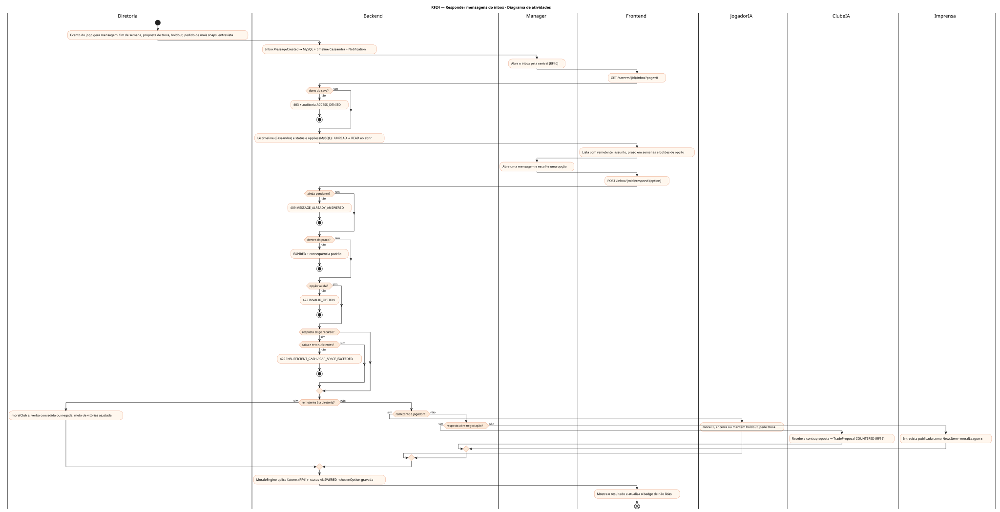
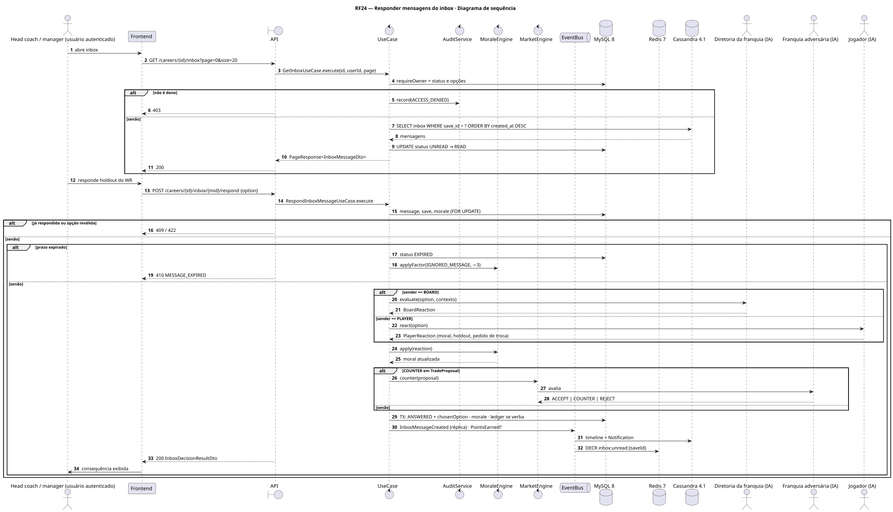
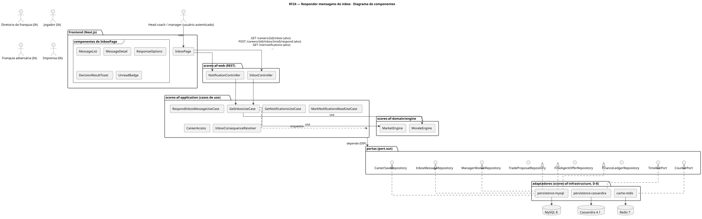
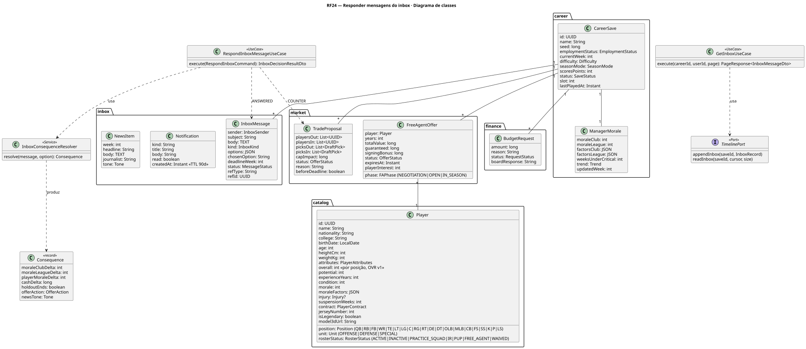
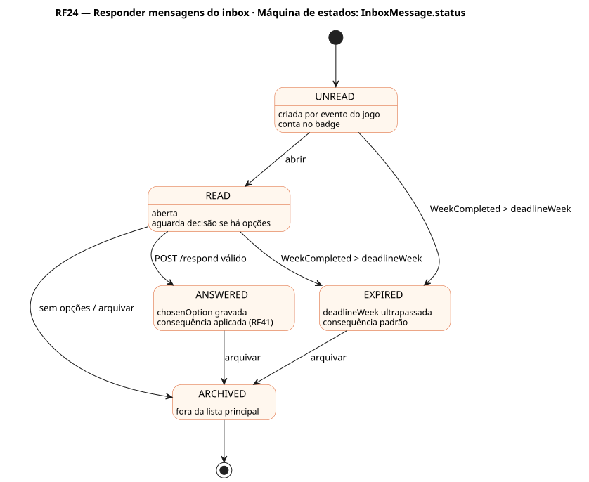

# RF24 — Responder mensagens do inbox

## História de usuário

> HU-RF24 — DADO QUE estou no painel da minha franquia QUANDO recebo mensagens da diretoria, de jogadores, de agentes, de outras franquias, da liga ou da imprensa ENTÃO posso respondê-las com base nos meus critérios e ver a consequência

Sprint: 7 · Atores: Manager, Diretoria, JogadorIA, ClubeIA, Imprensa · Tela: Inbox (/c/{careerId}/inbox)

## Diagramas

### Atividades

Fonte: [`RF24-act.puml`](RF24-act.puml)

### Sequência

Fonte: [`RF24-seq.puml`](RF24-seq.puml)

### Componentes

Fonte: [`RF24-cmp.puml`](RF24-cmp.puml)

### Classes

Fonte: [`RF24-cls.puml`](RF24-cls.puml)

### Máquina de estados: InboxMessage.status

Fonte: [`RF24-stm.puml`](RF24-stm.puml)

## Endpoints

✅ = existe num controller do `scores-af-web` · ⛔ alvo = previsto no modelo, ainda sem controller (lista em `generator/endpoints_code.json`).

| Estado | Método | Rota | Caso de uso | Autorização | Descrição |
|---|---|---|---|---|---|
| ⛔ alvo | `GET` | `/api/v1/careers/{id}/inbox` | `GetInboxUseCase` | JWT · dono do save | Mensagens paginadas por data (Cassandra) com status, remetente, opções e prazo em semanas |
| ⛔ alvo | `POST` | `/api/v1/careers/{id}/inbox/{mid}/respond` | `RespondInboxMessageUseCase` | JWT · dono do save | Escolhe uma opção e aplica a consequência (moral, verba, proposta de troca, oferta de FA, entrevista) via RF41 |
| ⛔ alvo | `GET` | `/api/v1/me/notifications` | `GetNotificationsUseCase` | JWT | Notificações do usuário (TTL 90 d) |
| ⛔ alvo | `POST` | `/api/v1/me/notifications/read` | `MarkNotificationsReadUseCase` | JWT | Marca como lidas |

## Pontos de decisão

| Gateway | Regra | Se falso |
|---|---|---|
| Dono do save? | save.userId == jwt.sub (CareerAccess.requireOwner) | 403 + AuditLog ACCESS_DENIED |
| Mensagem pede decisão? | message.options não vazio | só marca READ |
| Ainda pendente? | status ∈ {UNREAD, READ} e chosenOption == null | 409 MESSAGE_ALREADY_ANSWERED |
| Dentro do prazo? | save.currentWeek ≤ message.deadlineWeek | EXPIRED · consequência padrão (ex.: holdout continua, diretoria assume recusa, moral −3) |
| Opção válida? | option ∈ message.options | 422 INVALID_OPTION |
| Quem é o remetente? | BOARD → Diretoria · PLAYER (mais snaps, holdout, pedido de troca) → JogadorIA · CLUB / AGENT → MarketEngine · PRESS → Imprensa · LEAGUE → multa/suspensão | — |
| Resposta exige recurso? | consequência debita caixa ou mexe em contrato (cabe no teto, RF49) | só moral · se exige: 422 INSUFFICIENT_CASH / CAP_SPACE_EXCEEDED |
| Resposta abre negociação? | refType ∈ {TradeProposal, FreeAgentOffer} e opção COUNTER | encerra o tópico · se abre: atualiza a proposta (RF19) |

---
Gerado por `../generator/generate.py` a partir de `../generator/model/*.py` e `../generator/common.py`; não edite os .puml à mão.
