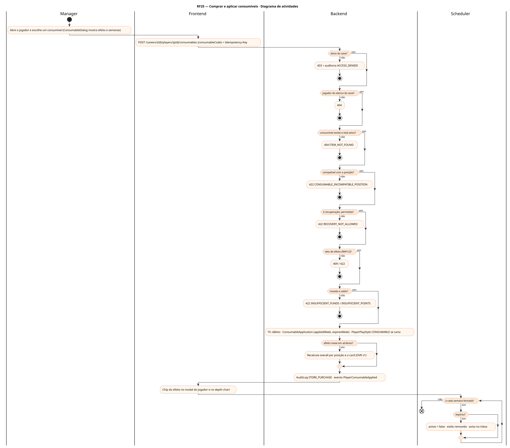
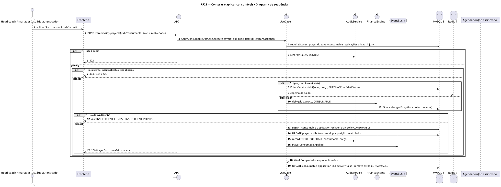
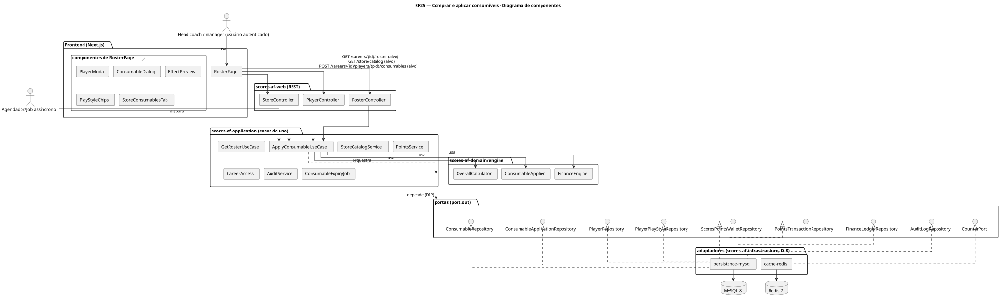
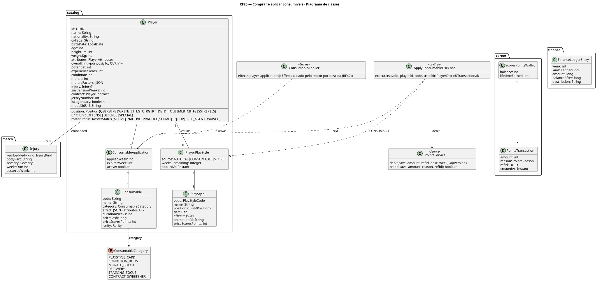
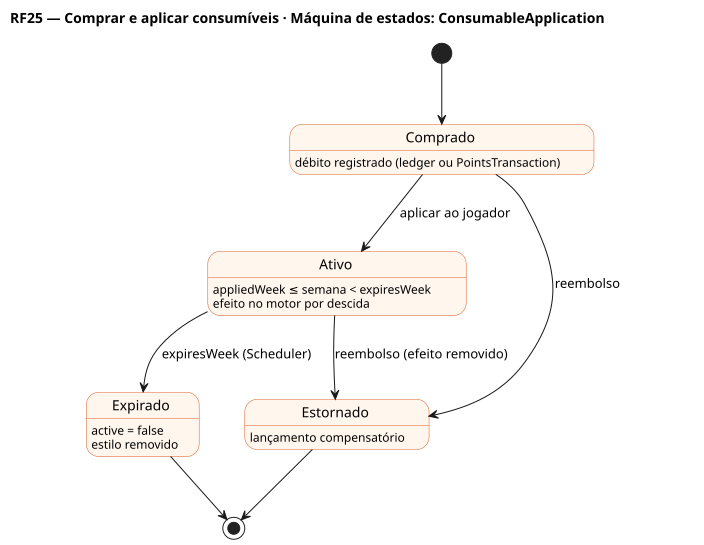

# RF25 — Comprar e aplicar consumíveis

## História de usuário

> HU-RF25 — DADO QUE estou na loja ou no elenco QUANDO escolho um consumível (carta de estilo, condição, moral, recuperação, foco de treino, adoçante de contrato) ENTÃO posso comprá-lo com S$ ou Scores Points e aplicá-lo a um jogador por N semanas, com efeitos nos atributos do futebol americano dentro das regras da RNF12

Sprint: 11 · Atores: Manager, Scheduler · Tela: Modal do jogador → Consumíveis (/c/{careerId}/roster) · Loja → aba Consumíveis (/c/{careerId}/store)

## Diagramas

### Atividades

Fonte: [`RF25-act.puml`](RF25-act.puml)

### Sequência

Fonte: [`RF25-seq.puml`](RF25-seq.puml)

### Componentes

Fonte: [`RF25-cmp.puml`](RF25-cmp.puml)

### Classes

Fonte: [`RF25-cls.puml`](RF25-cls.puml)

### Máquina de estados: ConsumableApplication

Fonte: [`RF25-stm.puml`](RF25-stm.puml)

## Endpoints

✅ = existe num controller do `scores-af-web` · ⛔ alvo = previsto no modelo, ainda sem controller (lista em `generator/endpoints_code.json`).

| Estado | Método | Rota | Caso de uso | Autorização | Descrição |
|---|---|---|---|---|---|
| ✅ | `GET` | `/api/v1/careers/{id}/roster` | `GetRosterUseCase` | JWT · dono do save | Elenco com consumíveis ativos por jogador (ConsumableApplication) e semanas restantes |
| ⛔ alvo | `GET` | `/api/v1/store/catalog` | `StoreCatalogService` | JWT | category=CONSUMABLE: efeito por atributo (ex.: +2 rota funda, +3 pass rush potência), posições compatíveis, duração em semanas, preço |
| ⛔ alvo | `POST` | `/api/v1/careers/{id}/players/{pid}/consumables` | `ApplyConsumableUseCase` | JWT · dono do save · Idempotency-Key | Debita S$ do caixa (não conta no teto) ou Scores Points da carteira do save, cria ConsumableApplication (appliedWeek, expiresWeek) e PlayerPlayStyle CONSUMABLE se carta de estilo |

## Pontos de decisão

| Gateway | Regra | Se falso |
|---|---|---|
| Dono do save? | save.userId == jwt.sub (CareerAccess.requireOwner) | 403 + AuditLog ACCESS_DENIED |
| Jogador do elenco do save? | player.club == save.club (ativo ou practice squad) | 404 NOT_FOUND |
| Consumível existe e está ativo? | Consumable.code no catálogo do mundo do save | 404 ITEM_NOT_FOUND |
| Compatível com a posição? | carta de estilo: player.position ∈ PlayStyle.positions (ex.: Deep Threat só WR/TE) · foco de treino: atributo relevante para a posição | 422 CONSUMABLE_INCOMPATIBLE_POSITION |
| Recuperação permitida? | RECOVERY reduz 1 semana de Injury.weeksOut · nunca tira do IR antes do mínimo · sem efeito em lesão encerrada | 422 RECOVERY_NOT_ALLOWED |
| Teto de efeito (RNF12)? | ≤ 1 ativo por categoria por jogador · ≤ 3 estilos ativos · teto de bônus por unidade (ataque, defesa, especiais) | 409 CONSUMABLE_ALREADY_ACTIVE / 422 PLAYSTYLE_LIMIT |
| Moeda e saldo? | priceCash: caixa do clube ≥ preço → FinanceLedgerEntry CONSUMABLE · priceScoresPoints: PointsService.debit na carteira do save (@Version) | 422 INSUFFICIENT_FUNDS / INSUFFICIENT_POINTS |
| Expirou? | WeekCompleted: expiresWeek < currentWeek → active = false e estilo CONSUMABLE removido | segue ativo |

---
Gerado por `../generator/generate.py` a partir de `../generator/model/*.py` e `../generator/common.py`; não edite os .puml à mão.
