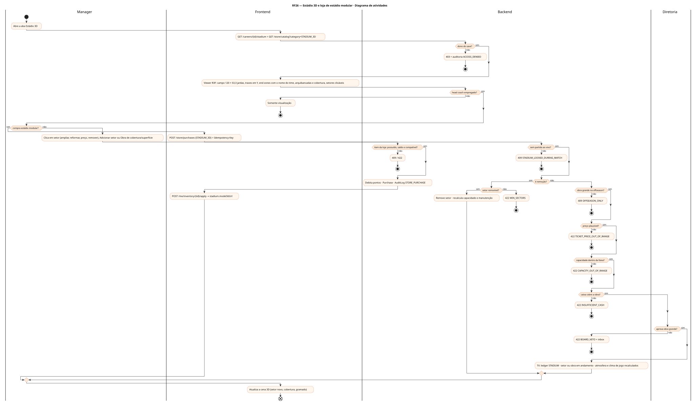
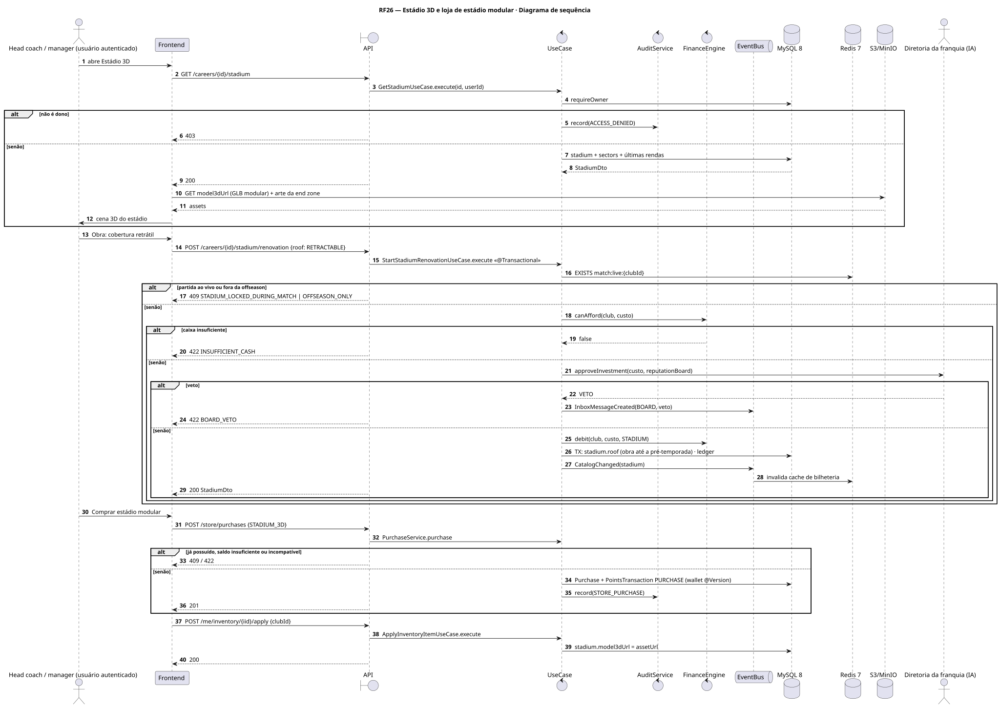
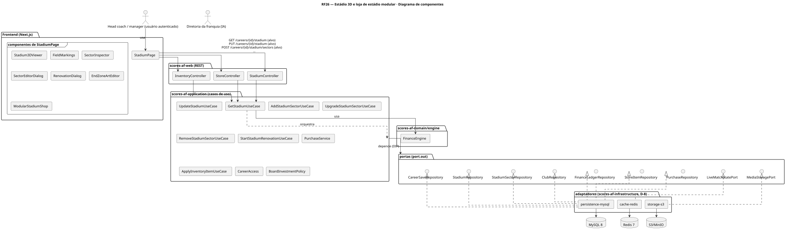
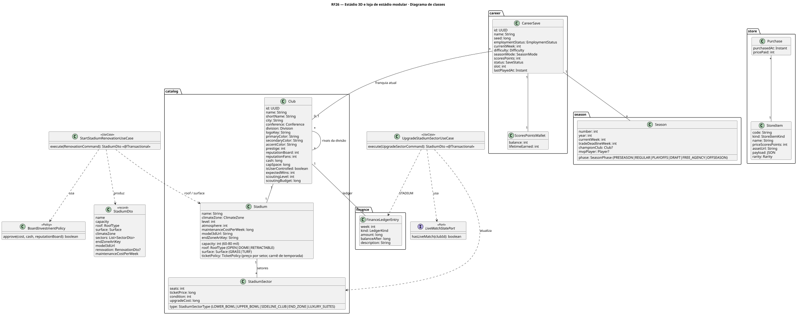
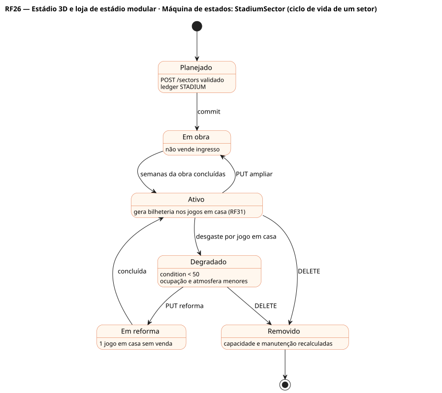
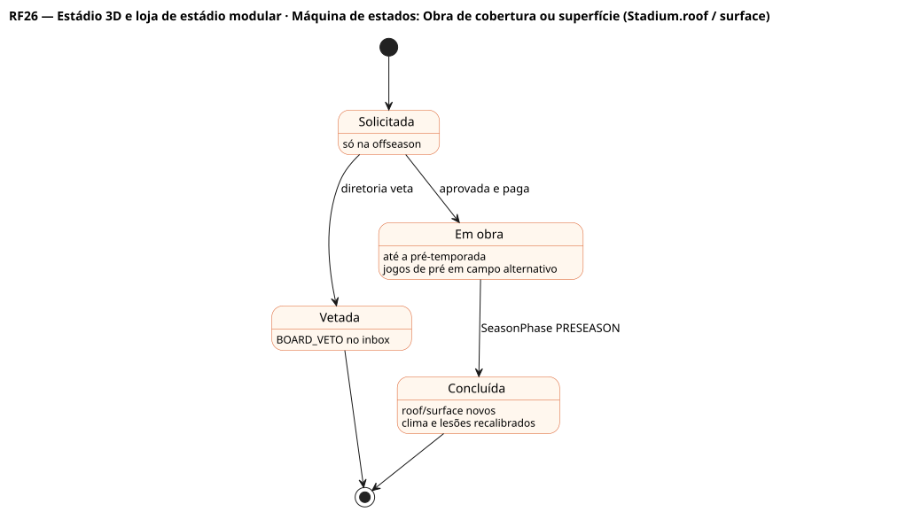

# RF26 — Estádio 3D e loja de estádio modular

## História de usuário

> HU-RF26 — DADO QUE estou vendo o estádio da franquia na aba 'estádio em 3D' QUANDO edito os dados do estádio POSSO ampliar ou remover setores, mudar preços, trocar a cobertura ou o gramado na offseason, editar a arte da end zone e comprar um estádio modular na loja com Scores Points

Sprint: 8 · Atores: Manager, Diretoria · Tela: Estádio 3D (/c/{careerId}/stadium)

## Diagramas

### Atividades

Fonte: [`RF26-act.puml`](RF26-act.puml)

### Sequência

Fonte: [`RF26-seq.puml`](RF26-seq.puml)

### Componentes

Fonte: [`RF26-cmp.puml`](RF26-cmp.puml)

### Classes

Fonte: [`RF26-cls.puml`](RF26-cls.puml)

### Máquina de estados: StadiumSector (ciclo de vida de um setor)

Fonte: [`RF26-stm.puml`](RF26-stm.puml)

### Máquina de estados: Obra de cobertura ou superfície (Stadium.roof / surface)

Fonte: [`RF26-stm-obra-de-cobertura-ou-superficie-stadium-.puml`](RF26-stm-obra-de-cobertura-ou-superficie-stadium-.puml)

## Endpoints

✅ = existe num controller do `scores-af-web` · ⛔ alvo = previsto no modelo, ainda sem controller (lista em `generator/endpoints_code.json`).

| Estado | Método | Rota | Caso de uso | Autorização | Descrição |
|---|---|---|---|---|---|
| ⛔ alvo | `GET` | `/api/v1/careers/{id}/stadium` | `GetStadiumUseCase` | JWT · dono do save | Capacidade (60–80 mil), cobertura (OPEN, DOME, RETRACTABLE), gramado ou sintético, zona climática, setores, arte da end zone, model3dUrl, manutenção por semana |
| ⛔ alvo | `PUT` | `/api/v1/careers/{id}/stadium` | `UpdateStadiumUseCase` | JWT · dono do save | Nome, arte da end zone e modelo 3D ativo |
| ⛔ alvo | `POST` | `/api/v1/careers/{id}/stadium/sectors` | `AddStadiumSectorUseCase` | JWT · dono do save | Compra um setor novo (S$) · obra concluída em N semanas |
| ⛔ alvo | `PUT` | `/api/v1/careers/{id}/stadium/sectors/{sid}` | `UpgradeStadiumSectorUseCase` | JWT · dono do save | Amplia assentos, reforma (condition) ou muda o preço do ingresso |
| ⛔ alvo | `DELETE` | `/api/v1/careers/{id}/stadium/sectors/{sid}` | `RemoveStadiumSectorUseCase` | JWT · dono do save | Remove setor (capacidade e manutenção caem) |
| ⛔ alvo | `POST` | `/api/v1/careers/{id}/stadium/renovation` | `StartStadiumRenovationUseCase` | JWT · dono do save | Obra grande: cobertura (OPEN → RETRACTABLE/DOME) ou superfície (GRASS ↔ TURF), só na offseason e com aprovação da diretoria |
| ⛔ alvo | `GET` | `/api/v1/store/catalog` | `StoreCatalogService` | JWT | category=STADIUM_3D: estádios modulares (Scores Points) |
| ⛔ alvo | `POST` | `/api/v1/store/purchases` | `PurchaseService` | JWT · Idempotency-Key | Compra o estádio modular (cosmético, RNF12) |
| ⛔ alvo | `POST` | `/api/v1/me/inventory/{iid}/apply` | `ApplyInventoryItemUseCase` | JWT · dono do save | Aplica o modelo 3D comprado ao estádio da franquia |

## Pontos de decisão

| Gateway | Regra | Se falso |
|---|---|---|
| Dono do save? | save.userId == jwt.sub (CareerAccess.requireOwner) | 403 + AuditLog ACCESS_DENIED |
| Head coach empregado? | save.employmentStatus == EMPLOYED | somente visualização 3D |
| Sem partida ao vivo? | nenhuma MatchSession LIVE ou BREAK da franquia | 409 STADIUM_LOCKED_DURING_MATCH |
| Obra grande na offseason? | cobertura, superfície ou +5 mil lugares só com season.phase ∈ {OFFSEASON, DRAFT, FREE_AGENCY} | 409 OFFSEASON_ONLY |
| Capacidade dentro da faixa? | 60 000 ≤ capacidade final ≤ 80 000 e ≤ capMax(stadium.level) | 422 CAPACITY_OUT_OF_RANGE |
| Caixa cobre a obra? | club.cash ≥ custo (S$ do caixa, fora do teto salarial) | 422 INSUFFICIENT_CASH · sugere empréstimo (RF14) |
| Diretoria aprova obra grande? | custo ≤ 25 % do caixa ou reputationBoard ≥ 60 | 422 BOARD_VETO com mensagem no inbox |
| Setor removível? | restam ≥ 2 setores, setor ≠ LOWER_BOWL e capacidade final ≥ 60 000 | 422 MIN_SECTORS |
| Preço plausível? | 0 < ticketPrice ≤ 5 × preço médio da liga | 422 TICKET_PRICE_OUT_OF_RANGE |
| Item da loja: possuído, saldo e compatível? | sem Purchase anterior · saldo ≥ preço · modelo compatível com roof (DOME exige cobertura) | 409 ITEM_ALREADY_OWNED / 422 INSUFFICIENT_POINTS / 422 STADIUM_MODEL_INCOMPATIBLE |

---
Gerado por `../generator/generate.py` a partir de `../generator/model/*.py` e `../generator/common.py`; não edite os .puml à mão.
