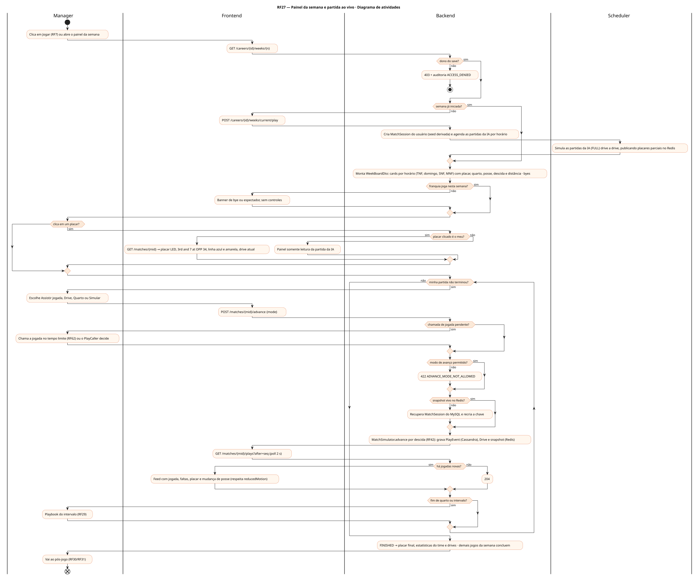
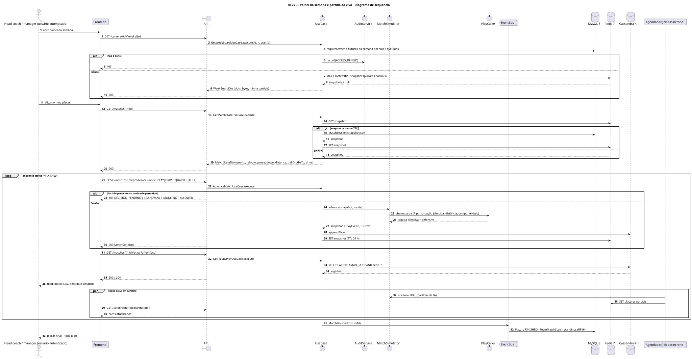
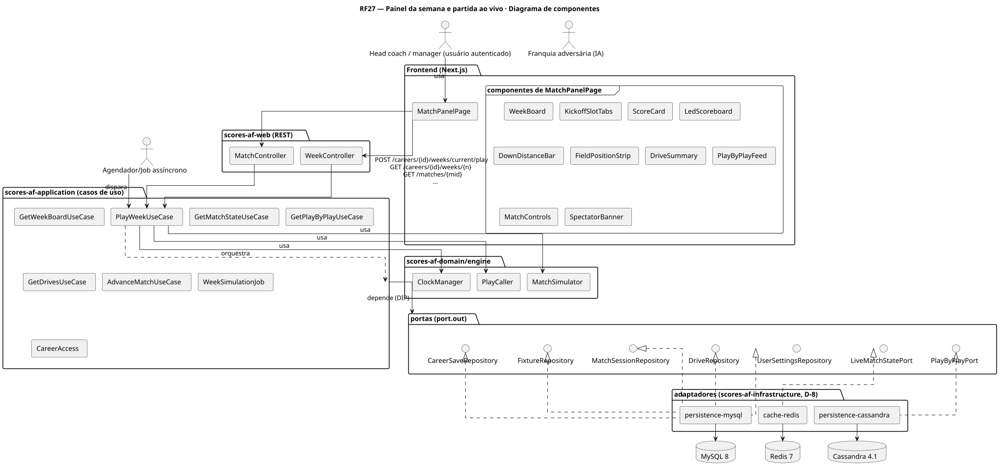
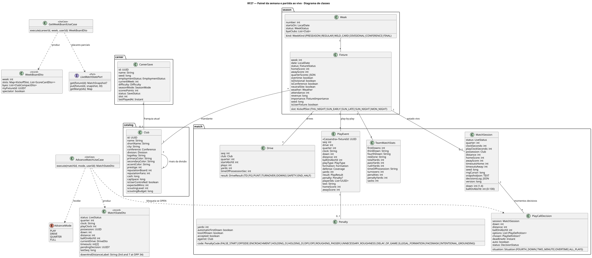
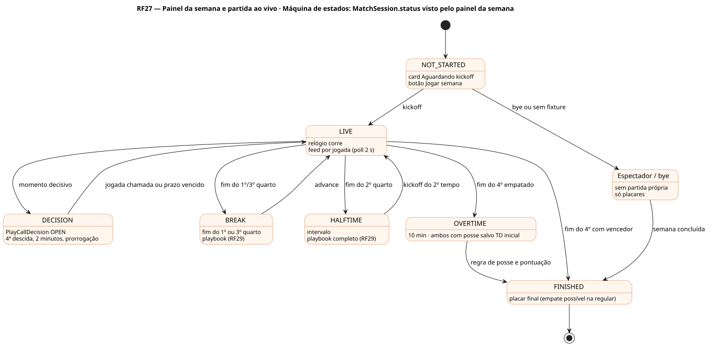

# RF27 — Painel da semana e partida ao vivo

## História de usuário

> HU-RF27 — DADO QUE estou jogando uma partida dentro do painel da semana QUANDO clico em qualquer placar ENTÃO o sistema mostra o painel da partida em andamento com play-by-play, quarto e relógio, descida e distância, linha da bola, drive atual e os placares dos outros jogos da semana

Sprint: 6 · Atores: Manager, Scheduler, ClubeIA · Tela: Painel da semana / partida ao vivo (/c/{careerId}/match)

## Diagramas

### Atividades

Fonte: [`RF27-act.puml`](RF27-act.puml)

### Sequência

Fonte: [`RF27-seq.puml`](RF27-seq.puml)

### Componentes

Fonte: [`RF27-cmp.puml`](RF27-cmp.puml)

### Classes

Fonte: [`RF27-cls.puml`](RF27-cls.puml)

### Máquina de estados: MatchSession.status visto pelo painel da semana

Fonte: [`RF27-stm.puml`](RF27-stm.puml)

## Endpoints

✅ = existe num controller do `scores-af-web` · ⛔ alvo = previsto no modelo, ainda sem controller (lista em `generator/endpoints_code.json`).

| Estado | Método | Rota | Caso de uso | Autorização | Descrição |
|---|---|---|---|---|---|
| ✅ | `POST` | `/api/v1/careers/{id}/weeks/current/play` | `PlayWeekUseCase` | JWT · dono do save | Inicia a semana: MatchSession do usuário e job das partidas da IA por horário (THU_NIGHT, SUN_EARLY, SUN_LATE, SUN_NIGHT, MON_NIGHT) |
| ✅ | `GET` | `/api/v1/careers/{id}/weeks/{n}` | `GetWeekBoardUseCase` | JWT · dono do save | Placares da semana por horário com quarto, relógio, posse, descida e distância · byes · minha partida em destaque |
| ✅ | `GET` | `/api/v1/matches/{mid}` | `GetMatchStateUseCase` | JWT · dono do save | Snapshot vivo: placar por quarto, relógio de jogo e de jogada, posse, descida, distância, ballOnAbsYd, drive atual, tempos técnicos, decisão pendente |
| ⛔ alvo | `GET` | `/api/v1/matches/{mid}/plays` | `GetPlayByPlayUseCase` | JWT · dono do save | Play-by-play incremental (?after=seq) do Cassandra |
| ⛔ alvo | `GET` | `/api/v1/matches/{mid}/drives` | `GetDrivesUseCase` | JWT · dono do save | Drives: jogadas, jardas, tempo de posse, resultado (TD, FG, PUNT, TURNOVER, DOWNS) |
| ✅ | `POST` | `/api/v1/matches/{mid}/advance` | `AdvanceMatchUseCase` | JWT · dono do save | Avança PLAY (assistir), DRIVE, QUARTER ou FULL (simular), no ritmo de simQuarterMinutes |

## Pontos de decisão

| Gateway | Regra | Se falso |
|---|---|---|
| Dono do save? | save.userId == jwt.sub (CareerAccess.requireOwner) | 403 + AuditLog ACCESS_DENIED |
| Semana já iniciada? | existe MatchSession da semana ou job WeekSimulation RUNNING/DONE | botão Jogar semana (POST /weeks/current/play) |
| Franquia joga nesta semana? | employmentStatus == EMPLOYED, save.club ∉ week.byeClubs e Fixture.isUserFixture | bye ou espectador (RF37): só placares, sem controles |
| Snapshot vivo no Redis? | GET match:{fid}:snapshot != null | fallback MySQL (MatchSession do último fim de drive) e recria a chave |
| Placar clicado é o meu? | fixture.isUserFixture | painel somente leitura da partida da IA (placar, drives, líderes) |
| Chamada de jogada pendente? | PlayCallDecision OPEN (4ª descida, 2 minutos finais, prorrogação · ou ALL_PLAYS) | avança · se pendente: 409 DECISION_PENDING até escolher ou o prazo vencer (escolha automática, RF62) |
| Modo de avanço permitido? | DRIVE, QUARTER e FULL só sem decisão pendente e fora de BREAK · PLAY sempre | 422 ADVANCE_MODE_NOT_ALLOWED |
| Há jogadas novas? | PlayEvent com seq > after | 204 · próximo poll em 2 s |
| Fim de quarto ou intervalo? | clockSeconds == 0 no 1º, 2º ou 3º quarto | segue LIVE · se sim: BREAK e playbook (RF29) |

---
Gerado por `../generator/generate.py` a partir de `../generator/model/*.py` e `../generator/common.py`; não edite os .puml à mão.
