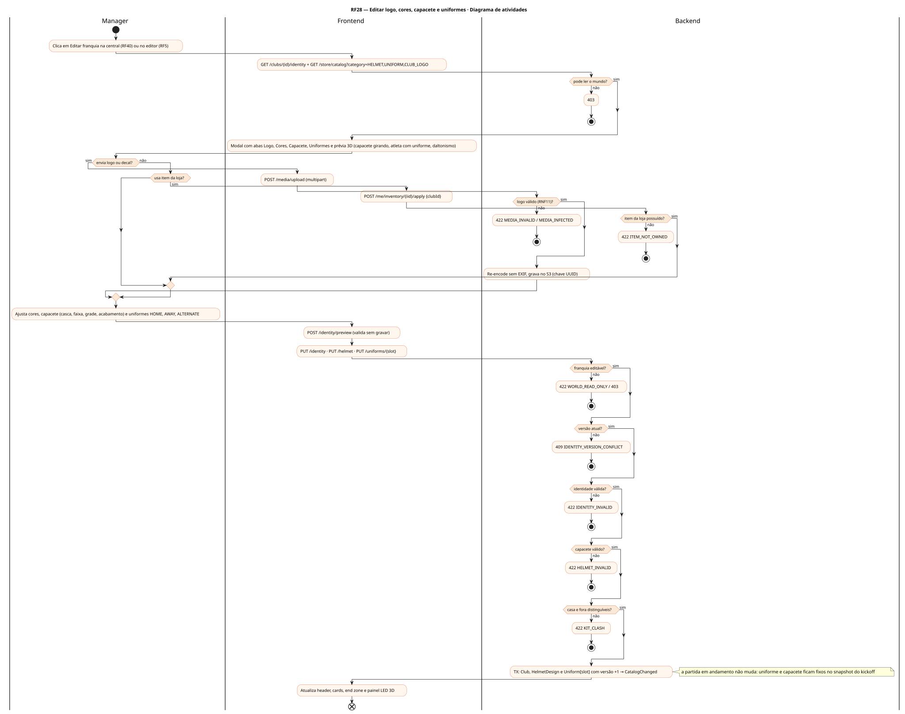
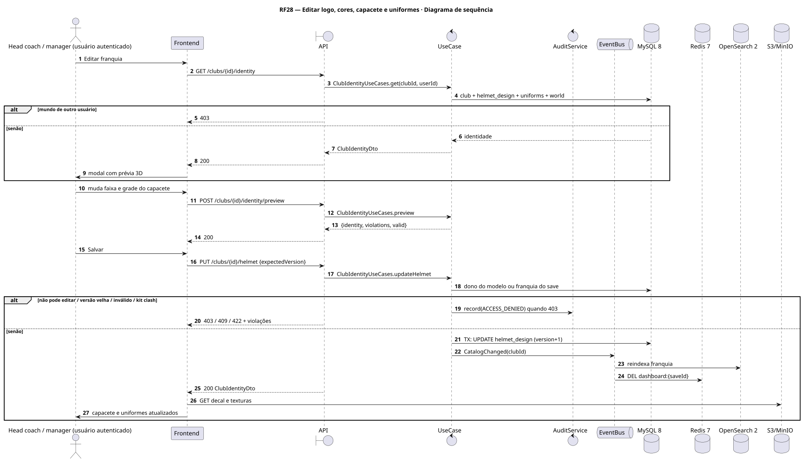
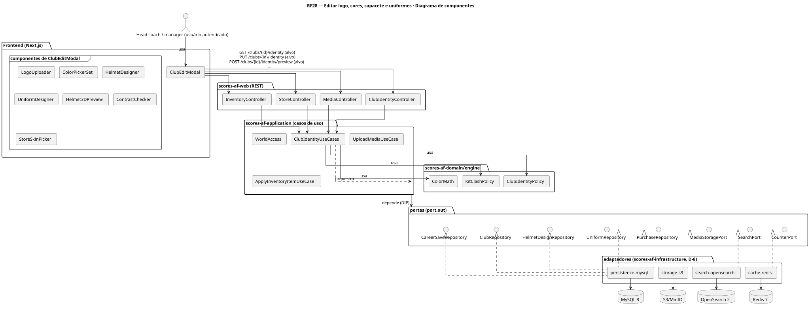
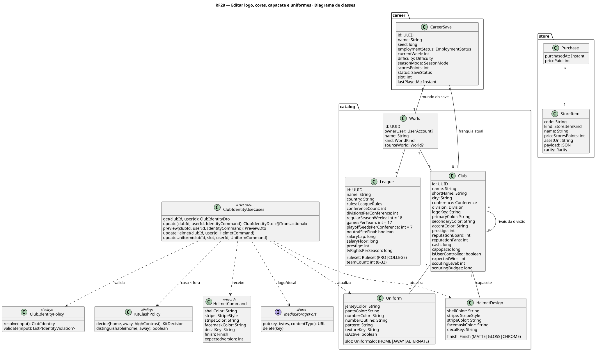
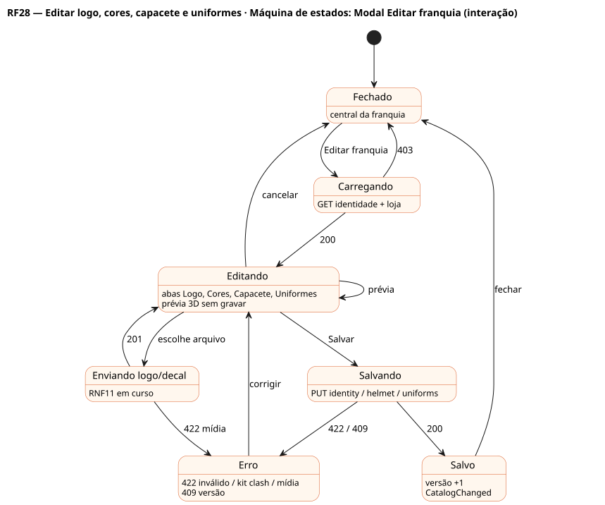

# RF28 — Editar logo, cores, capacete e uniformes

## História de usuário

> HU-RF28 — DADO QUE estou no painel da minha franquia QUANDO clico em 'Editar franquia' ENTÃO o sistema exibe um modal para editar logo, cores, capacete (cor, faixa, grade, logo lateral) e uniformes de casa, fora e alternativo

Sprint: 8 · Atores: Manager · Tela: Central da franquia → modal Editar franquia (/c/{careerId}?edit=club) · Editor de ligas e franquias

## Diagramas

### Atividades

Fonte: [`RF28-act.puml`](RF28-act.puml)

### Sequência

Fonte: [`RF28-seq.puml`](RF28-seq.puml)

### Componentes

Fonte: [`RF28-cmp.puml`](RF28-cmp.puml)

### Classes

Fonte: [`RF28-cls.puml`](RF28-cls.puml)

### Máquina de estados: Modal Editar franquia (interação)

Fonte: [`RF28-stm.puml`](RF28-stm.puml)

## Endpoints

✅ = existe num controller do `scores-af-web` · ⛔ alvo = previsto no modelo, ainda sem controller (lista em `generator/endpoints_code.json`).

| Estado | Método | Rota | Caso de uso | Autorização | Descrição |
|---|---|---|---|---|---|
| ⛔ alvo | `GET` | `/api/v1/clubs/{id}/identity` | `ClubIdentityUseCases.get` | JWT · leitura do mundo | Identidade resolvida: primária, secundária, destaque, contraste do número, capacete e uniformes HOME/AWAY/ALTERNATE com versões |
| ⛔ alvo | `PUT` | `/api/v1/clubs/{id}/identity` | `ClubIdentityUseCases.update` | JWT · dono do mundo modelo ou do save (só a franquia do save) | Cores e logo · 422 IDENTITY_INVALID com violações · 409 se expectedVersion divergir |
| ⛔ alvo | `POST` | `/api/v1/clubs/{id}/identity/preview` | `ClubIdentityUseCases.preview` | JWT · leitura do mundo | Valida e renderiza a proposta sem gravar |
| ⛔ alvo | `PUT` | `/api/v1/clubs/{id}/helmet` | `ClubIdentityUseCases.updateHelmet` | JWT · dono do mundo modelo ou do save | Cor da casca, faixa (estilo e cor), cor da grade, decal lateral, acabamento MATTE/GLOSS/CHROME |
| ⛔ alvo | `PUT` | `/api/v1/clubs/{id}/uniforms/{slot}` | `ClubIdentityUseCases.updateUniform` | JWT · dono do mundo modelo ou do save | Camisa, calça, número e contorno, padrão · versão sobe quando muda o visual |
| ⛔ alvo | `POST` | `/api/v1/media/upload` | `UploadMediaUseCase` | JWT | Upload do logo ou decal do capacete (RNF11) → mediaKey |
| ⛔ alvo | `GET` | `/api/v1/store/catalog` | `StoreCatalogService` | JWT | category=HELMET\|UNIFORM\|CLUB_LOGO (RF32) |
| ⛔ alvo | `POST` | `/api/v1/me/inventory/{iid}/apply` | `ApplyInventoryItemUseCase` | JWT · dono do save | Aplica capacete, uniforme ou logo comprado |

## Pontos de decisão

| Gateway | Regra | Se falso |
|---|---|---|
| Pode ler o mundo? | mundo padrão ou world.ownerUser == jwt.sub | 403 |
| Franquia editável? | mundo modelo do usuário ou, na carreira, club.id == save.club do próprio save | 422 WORLD_READ_ONLY / 403 + AuditLog ACCESS_DENIED |
| Versão atual? | expectedVersion igual à de club / helmet / uniform | 409 IDENTITY_VERSION_CONFLICT |
| Identidade válida? | #RRGGBB · número ≥ 4,5:1 sobre a camisa · contorno ≥ 3:1 · padrão no vocabulário único | 422 IDENTITY_INVALID + violações |
| Capacete válido? | StripeStyle no vocabulário · decal ≥ 3:1 sobre a casca · grade distinguível da casca | 422 HELMET_INVALID |
| Casa e fora distinguíveis? | KitClashPolicy: HOME × AWAY com ΔE ≥ 30 (AWAY claro por padrão) | 422 KIT_CLASH |
| Logo válido (RNF11)? | PNG/WebP/SVG saneado, ≤ 2 MB, magic bytes, antivírus, ≤ 1024 px | 422 MEDIA_INVALID / MEDIA_INFECTED |
| Item da loja possuído? | Purchase(user, item) existe | 422 ITEM_NOT_OWNED (ir à loja RF32) |

---
Gerado por `../generator/generate.py` a partir de `../generator/model/*.py` e `../generator/common.py`; não edite os .puml à mão.
