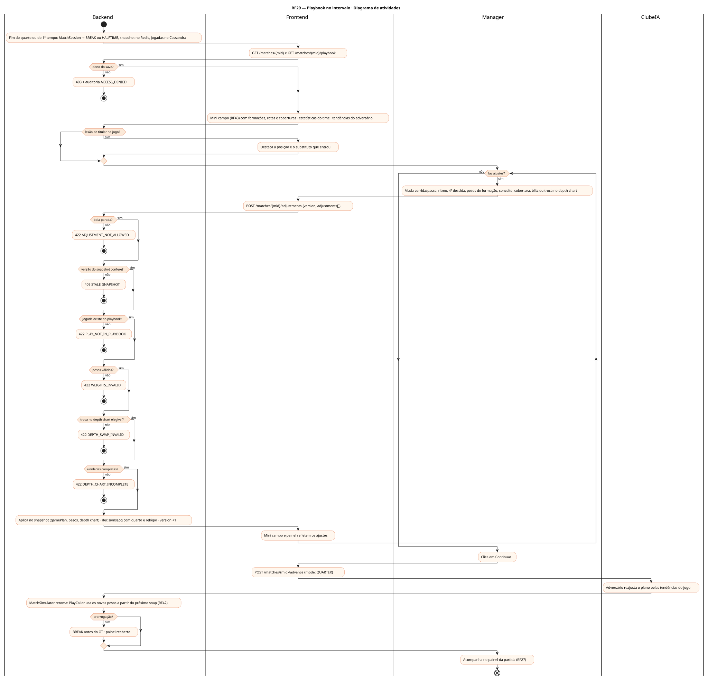
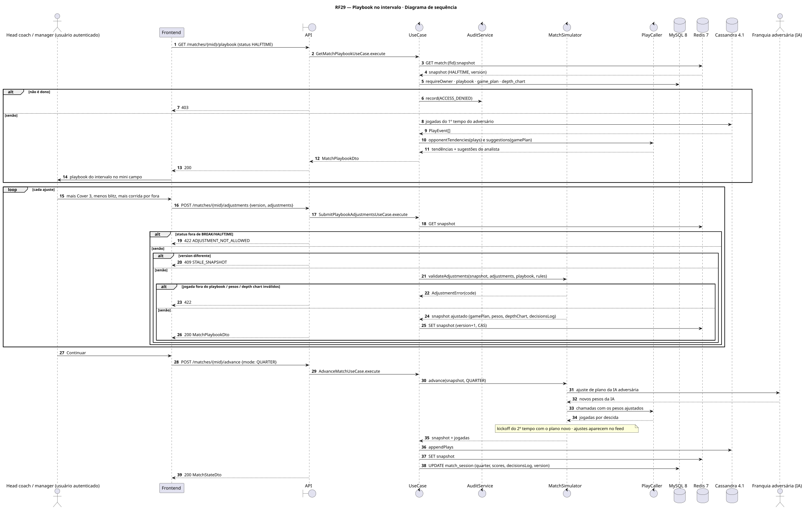
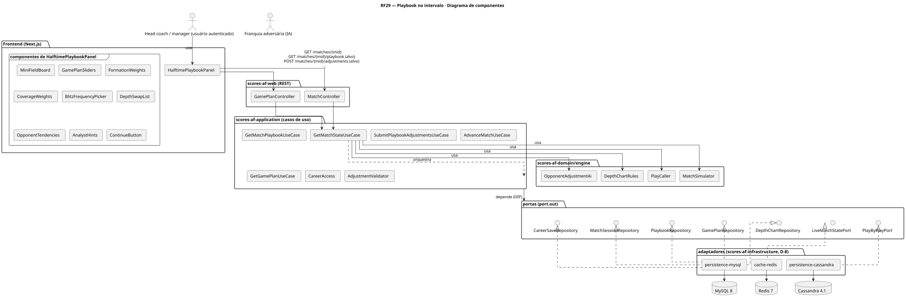
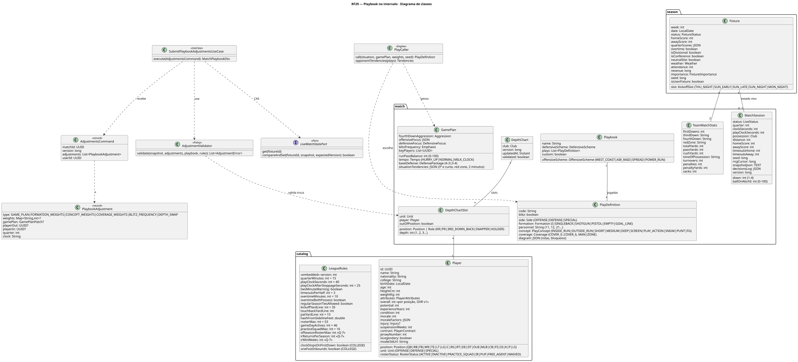
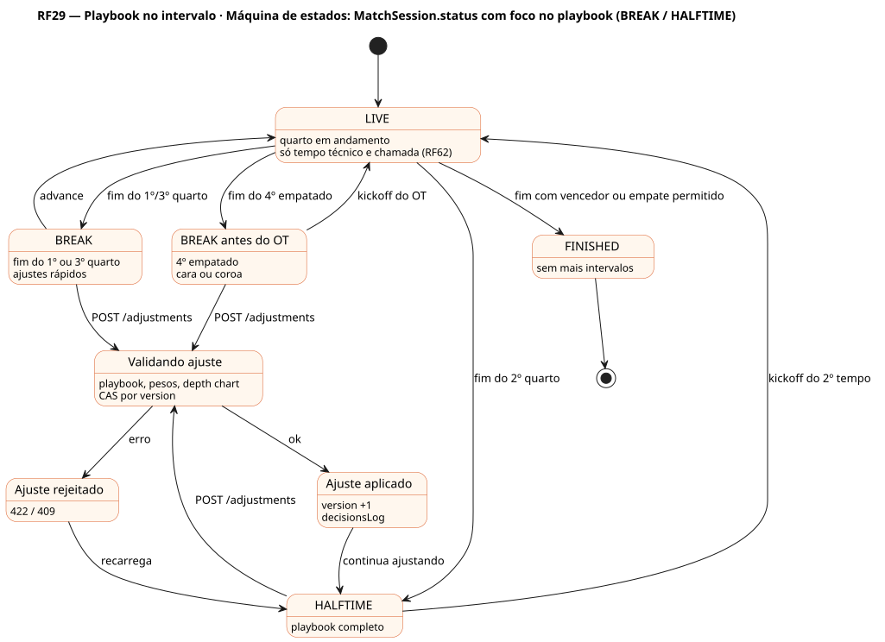

# RF29 — Playbook no intervalo

## História de usuário

> HU-RF29 — DADO QUE estou no painel do playbook durante o intervalo ou entre quartos QUANDO ajusto o plano de jogo, as formações, os conceitos, as coberturas, a frequência de blitz ou troco jogadores no depth chart ENTÃO a partir do próximo snap o motor usa os meus ajustes

Sprint: 6 · Atores: Manager, ClubeIA · Tela: Partida ao vivo → Playbook do intervalo (/c/{careerId}/match#playbook)

## Diagramas

### Atividades

Fonte: [`RF29-act.puml`](RF29-act.puml)

### Sequência

Fonte: [`RF29-seq.puml`](RF29-seq.puml)

### Componentes

Fonte: [`RF29-cmp.puml`](RF29-cmp.puml)

### Classes

Fonte: [`RF29-cls.puml`](RF29-cls.puml)

### Máquina de estados: MatchSession.status com foco no playbook (BREAK / HALFTIME)

Fonte: [`RF29-stm.puml`](RF29-stm.puml)

## Endpoints

✅ = existe num controller do `scores-af-web` · ⛔ alvo = previsto no modelo, ainda sem controller (lista em `generator/endpoints_code.json`).

| Estado | Método | Rota | Caso de uso | Autorização | Descrição |
|---|---|---|---|---|---|
| ⛔ alvo | `GET` | `/api/v1/matches/{mid}` | `GetMatchStateUseCase` | JWT · dono do save | Snapshot em BREAK ou HALFTIME: placar, tempos técnicos, estatísticas do time, fadiga, lesões e depth chart em uso |
| ⛔ alvo | `GET` | `/api/v1/matches/{mid}/playbook` | `GetMatchPlaybookUseCase` | JWT · dono do save | Plano de jogo vigente, pesos de formações e conceitos, coberturas e blitz, tendências do adversário no jogo (corrida/passe por descida, cobertura mais usada) e sugestões do analista |
| ⛔ alvo | `POST` | `/api/v1/matches/{mid}/adjustments` | `SubmitPlaybookAdjustmentsUseCase` | JWT · dono do save | Ajustes validados: GAME_PLAN (corrida/passe, ritmo, 4ª descida), FORMATION_WEIGHTS, CONCEPT_WEIGHTS, COVERAGE_WEIGHTS, BLITZ_FREQUENCY, DEPTH_SWAP |
| ⛔ alvo | `POST` | `/api/v1/matches/{mid}/advance` | `AdvanceMatchUseCase` | JWT · dono do save | mode=QUARTER: retoma com os ajustes no próximo snap ou kickoff |
| ⛔ alvo | `GET` | `/api/v1/careers/{id}/game-plan` | `GetGamePlanUseCase` | JWT · dono do save | Plano padrão da franquia (RF61) para restaurar |

## Pontos de decisão

| Gateway | Regra | Se falso |
|---|---|---|
| Dono do save? | save.userId == jwt.sub (CareerAccess.requireOwner) | 403 + AuditLog ACCESS_DENIED |
| Bola parada? | session.status ∈ {BREAK, HALFTIME} (fim do 1º e 3º quarto, intervalo, antes da prorrogação) | 422 ADJUSTMENT_NOT_ALLOWED |
| Versão do snapshot confere? | command.version == session.version | 409 STALE_SNAPSHOT (recarrega o painel) |
| Jogada existe no playbook? | formação e conceito pertencem ao Playbook da franquia (offensiveScheme e defensiveScheme) | 422 PLAY_NOT_IN_PLAYBOOK |
| Pesos válidos? | runPassBalance 0–100 · pesos de formação, conceito e cobertura ≥ 0 e somam 100 · blitz no vocabulário Emphasis | 422 WEIGHTS_INVALID |
| Troca no depth chart elegível? | jogador entre os 46 ativos do jogo, sem lesão OUT, posição compatível (ou aviso de fora de posição) | 422 DEPTH_SWAP_INVALID |
| Unidades completas? | 11 por unidade: QB e 5 OL no ataque base · K, holder e LS no FG/PAT · retornador no KR/PR | 422 DEPTH_CHART_INCOMPLETE |
| Lesão de titular no jogo? | titular saiu lesionado no quarto anterior | sem aviso · se sim: substituto do depth chart já entrou e o painel destaca a posição |
| Prorrogação? | fim do 4º empatado (e LeagueRules permite OT) | sem BREAK extra · se sim: BREAK antes do OT com cara ou coroa |

---
Gerado por `../generator/generate.py` a partir de `../generator/model/*.py` e `../generator/common.py`; não edite os .puml à mão.
