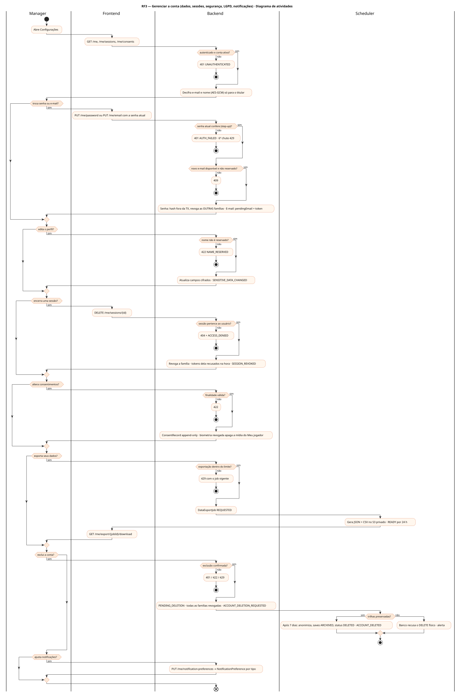
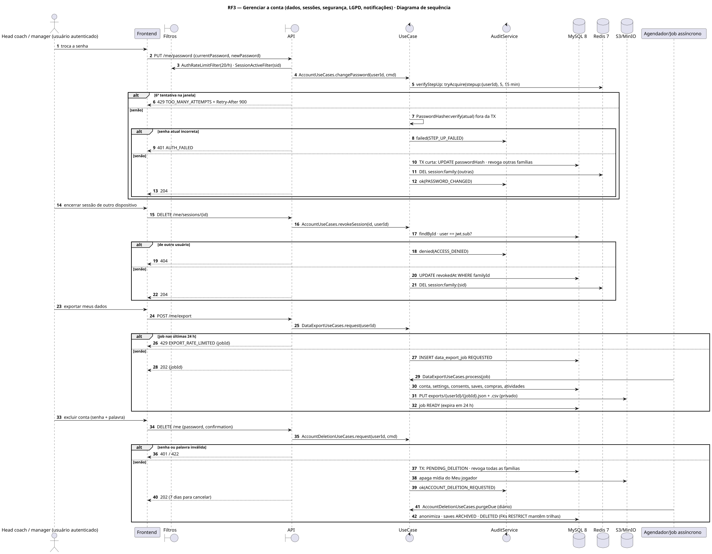
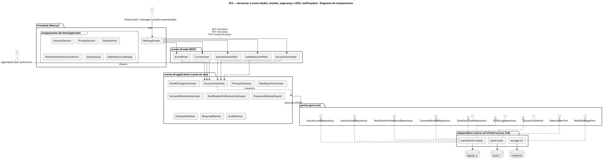
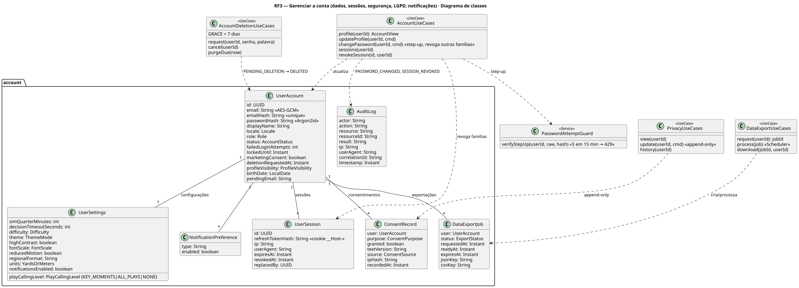
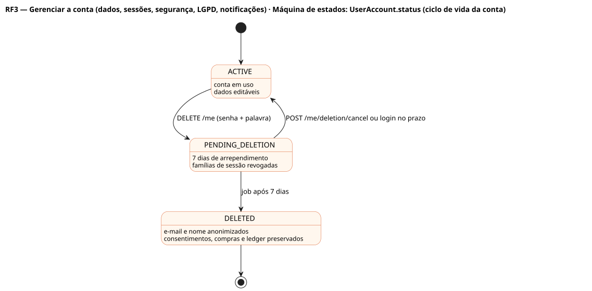
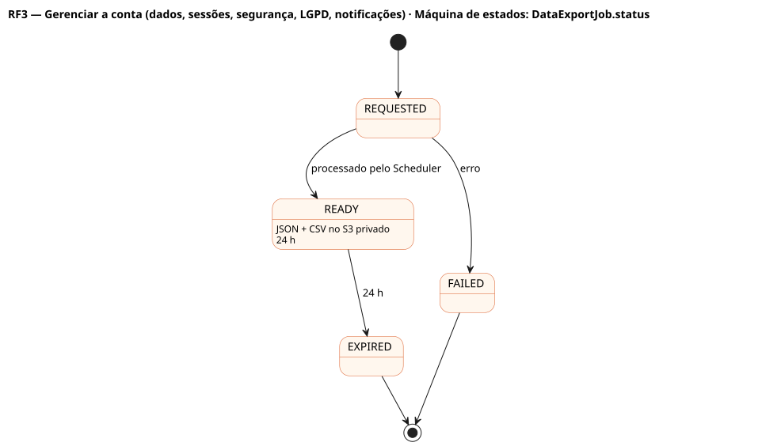

# RF3 — Gerenciar a conta (dados, sessões, segurança, LGPD, notificações)

## História de usuário

> HU-RF3 — COMO usuário autenticado POSSO gerenciar minha conta (dados pessoais, sessões, segurança, privacidade e notificações) PARA consultar, corrigir, controlar a visibilidade e exercer os direitos do titular sobre meus dados

Sprint: 3 · Atores: Manager, Scheduler · Tela: Configurações (/settings) — Conta, Privacidade, Seus dados, Notificações (RF10/RF46 detalham jogo, aparência e idioma)

## Diagramas

### Atividades

Fonte: [`RF3-act.puml`](RF3-act.puml)

### Sequência

Fonte: [`RF3-seq.puml`](RF3-seq.puml)

### Componentes

Fonte: [`RF3-cmp.puml`](RF3-cmp.puml)

### Classes

Fonte: [`RF3-cls.puml`](RF3-cls.puml)

### Máquina de estados: UserAccount.status (ciclo de vida da conta)

Fonte: [`RF3-stm.puml`](RF3-stm.puml)

### Máquina de estados: DataExportJob.status

Fonte: [`RF3-stm-dataexportjob-status.puml`](RF3-stm-dataexportjob-status.puml)

## Endpoints

✅ = existe num controller do `scores-af-web` · ⛔ alvo = previsto no modelo, ainda sem controller (lista em `generator/endpoints_code.json`).

| Estado | Método | Rota | Caso de uso | Autorização | Descrição |
|---|---|---|---|---|---|
| ✅ | `GET` | `/api/v1/me` | `AccountUseCases.profile` | JWT | Perfil (e-mail decifrado só para o titular), locale, status, visibilidade |
| ✅ | `PUT` | `/api/v1/me` | `AccountUseCases.updateProfile` | JWT | displayName, avatar, visibilidade, data de nascimento · SENSITIVE_DATA_CHANGED |
| ✅ | `PUT` | `/api/v1/me/email` | `EmailChangeUseCases.request` | JWT · senha atual (step-up) · 30 por IP/h | pendingEmail + token; conclui em POST /auth/email/verify |
| ✅ | `PUT` | `/api/v1/me/password` | `AccountUseCases.changePassword` | JWT · senha atual (step-up) · 20 por IP/h | Novo hash fora da transação; revoga as outras famílias de sessão |
| ✅ | `GET` | `/api/v1/me/sessions` | `AccountUseCases.sessions` | JWT | Famílias de sessão ativas (dispositivo, IP, última atividade, atual) |
| ✅ | `DELETE` | `/api/v1/me/sessions/{id}` | `AccountUseCases.revokeSession` | JWT | Revoga uma família do próprio usuário · SESSION_REVOKED |
| ✅ | `GET` | `/api/v1/me/consents` | `PrivacyUseCases.view` | JWT | Consentimento por finalidade (ANALYTICS, MARKETING_EMAIL, PUBLIC_RANKING, AI_ANALYST, BIOMETRIC_AVATAR) |
| ✅ | `PUT` | `/api/v1/me/consents` | `PrivacyUseCases.update` | JWT | Concede ou revoga (append-only); revogar biometria apaga a mídia do Meu jogador |
| ✅ | `POST` | `/api/v1/me/export` | `DataExportUseCases.request` | JWT | Portabilidade assíncrona: DataExportJob (JSON + CSV, 24 h) |
| ✅ | `GET` | `/api/v1/me/export/{jobId}/download` | `DataExportUseCases.download` | JWT · dono do job | Download do pacote · DATA_EXPORT_DOWNLOADED |
| ✅ | `DELETE` | `/api/v1/me` | `AccountDeletionUseCases.request` | JWT · senha + palavra (step-up) · 10 por IP/h | PENDING_DELETION, sessões encerradas, 7 dias de arrependimento |
| ✅ | `POST` | `/api/v1/me/deletion/cancel` | `AccountDeletionUseCases.cancel` | JWT | Cancela dentro do prazo |
| ⛔ alvo | `PUT` | `/api/v1/me/notification-preferences` | `NotificationPreferenceUseCases.update` | JWT | Liga/desliga por tipo (resultado da semana, lesão, proposta, prazo de trocas, draft) |

## Pontos de decisão

| Gateway | Regra | Se falso |
|---|---|---|
| Autenticado e conta ativa? | JWT RS256 válido · família de sessão sid ativa (SessionActiveFilter) · status != DELETED | 401 UNAUTHENTICATED {code, message, details, correlationId} |
| Senha atual confere (step-up)? | PasswordAttemptGuard.verifyStepUp: reserva atômica (5 em 15 min) antes do hash; verify fora da transação | 401 AUTH_FAILED · 6º chute: 429 TOO_MANY_ATTEMPTS + Retry-After 900 |
| Novo e-mail disponível e não reservado? | emailHash(novo) não existe em outra conta; domínio não reservado | 409 EMAIL_ALREADY_REGISTERED (genérico) |
| Nome não é reservado? | ReservedNames.isReserved == false | 422 NAME_RESERVED |
| Sessão pertence ao usuário? | session.user == jwt.sub | 404 NOT_FOUND (não revela) + ACCESS_DENIED |
| Finalidade válida? | ConsentPurpose conhecido; DATA_PROCESSING não é revogável (equivale a excluir a conta) | 422 INVALID_CONSENT_PURPOSE |
| Exportação dentro do limite? | nenhum DataExportJob REQUESTED/READY nas últimas 24 h | 429 EXPORT_RATE_LIMITED com o job vigente |
| Exclusão confirmada? | senha (step-up) + palavra EXCLUIR\|DELETE\|ELIMINAR | 422 DELETION_CONFIRMATION_MISMATCH |
| Trilhas preservadas? | FKs de consentimento, compras, carteira e ledger são RESTRICT: a exclusão anonimiza, nunca apaga a conta | DELETE físico recusado pelo banco |

---
Gerado por `../generator/generate.py` a partir de `../generator/model/*.py` e `../generator/common.py`; não edite os .puml à mão.
