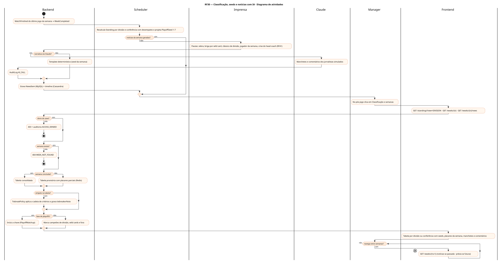
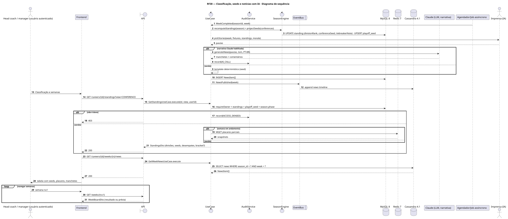
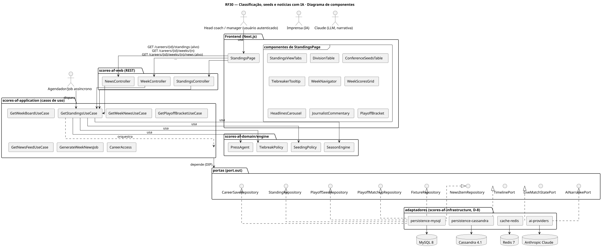
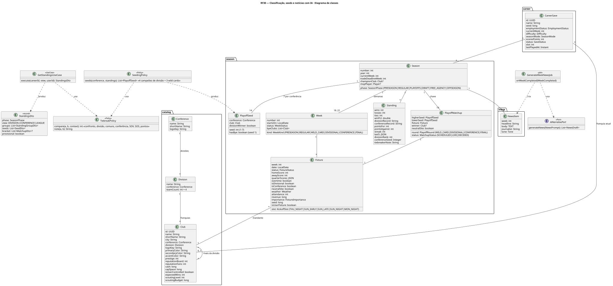
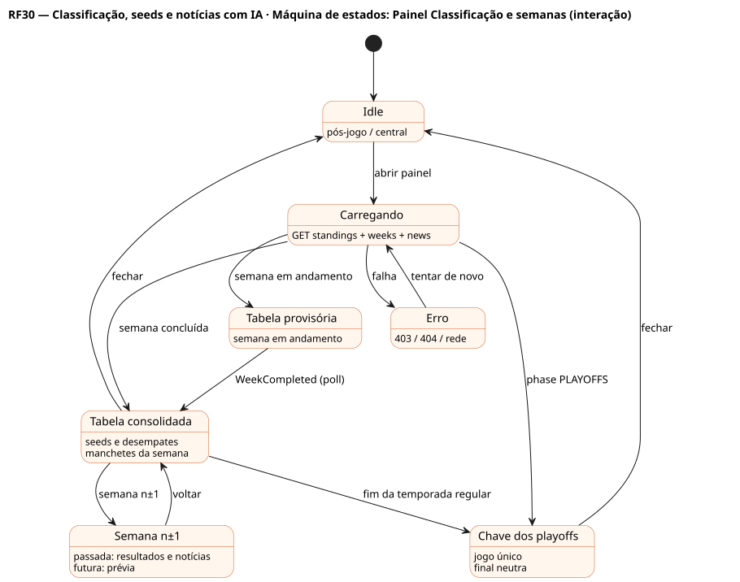

# RF30 — Classificação, seeds e notícias com IA

## História de usuário

> HU-RF30 — DADO QUE estou no painel da franquia QUANDO clico em 'classificação e semanas' ENTÃO o sistema exibe um painel dinâmico com IA: classificação por divisão e conferência, seeds dos playoffs, comentários de jornalistas simulados, manchetes, semanas passadas, atual e futuras

Sprint: 11 · Atores: Manager, Imprensa, Claude, Scheduler · Tela: Classificação e semanas (/c/{careerId}/standings) · Pós-jogo (/c/{careerId}/match/report)

## Diagramas

### Atividades

Fonte: [`RF30-act.puml`](RF30-act.puml)

### Sequência

Fonte: [`RF30-seq.puml`](RF30-seq.puml)

### Componentes

Fonte: [`RF30-cmp.puml`](RF30-cmp.puml)

### Classes

Fonte: [`RF30-cls.puml`](RF30-cls.puml)

### Máquina de estados: Painel Classificação e semanas (interação)

Fonte: [`RF30-stm.puml`](RF30-stm.puml)

## Endpoints

✅ = existe num controller do `scores-af-web` · ⛔ alvo = previsto no modelo, ainda sem controller (lista em `generator/endpoints_code.json`).

| Estado | Método | Rota | Caso de uso | Autorização | Descrição |
|---|---|---|---|---|---|
| ⛔ alvo | `GET` | `/api/v1/careers/{id}/standings` | `GetStandingsUseCase` | JWT · dono do save | view=DIVISION\|CONFERENCE\|LEAGUE: V-D-E, winPct, campanha na divisão e conferência, pontos pró e contra, sequência, seeds 1–7 projetados e nota de desempate |
| ✅ | `GET` | `/api/v1/careers/{id}/weeks/{n}` | `GetWeekBoardUseCase` | JWT · dono do save | Placares da semana n (passada, atual ou futura com prévia) |
| ⛔ alvo | `GET` | `/api/v1/careers/{id}/weeks/{n}/news` | `GetWeekNewsUseCase` | JWT · dono do save | Manchetes e comentários da semana (Cassandra) |
| ⛔ alvo | `GET` | `/api/v1/careers/{id}/playoffs` | `GetPlayoffBracketUseCase` | JWT · dono do save | Chave de 14 (7 por conferência, bye do seed 1), confrontos em jogo único, final em campo neutro |
| ⛔ alvo | `GET` | `/api/v1/careers/{id}/news` | `GetNewsFeedUseCase` | JWT · dono do save | Feed de notícias da temporada paginado |

## Pontos de decisão

| Gateway | Regra | Se falso |
|---|---|---|
| Dono do save? | save.userId == jwt.sub (CareerAccess.requireOwner) | 403 + AuditLog ACCESS_DENIED |
| Semana concluída? | todas as Fixtures da semana FINISHED, incluindo o jogo de segunda à noite | tabela provisória com placares parciais (badge Em andamento) |
| Seeds da conferência? | seeds 1–4: campeões de divisão por campanha · seeds 5–7: wild cards (melhores não campeões) · empate conta meia vitória no winPct | — |
| Empate na tabela? | mesmo winPct → confronto direto → campanha na divisão → jogos em comum → campanha na conferência → força das vitórias → força da tabela → saldo de pontos | ordem direta · tiebreakerNote explica o critério usado |
| Notícias da semana geradas? | existe NewsItem(season, week) na timeline | gera no WeekCompleted: template determinístico pela seed, Claude opcional |
| Narrativa via Claude? | scores.ai.narrative == claude e circuito fechado | template determinístico + AuditLog AI_CALL com falha |
| Fase de playoffs? | season.phase == PLAYOFFS | tabela com seeds projetados · se playoffs: chave + tabela final congelada |
| Semana existe? | 1 ≤ n ≤ regularSeasonWeeks + semanas de playoffs | 404 WEEK_NOT_FOUND |

---
Gerado por `../generator/generate.py` a partir de `../generator/model/*.py` e `../generator/common.py`; não edite os .puml à mão.
