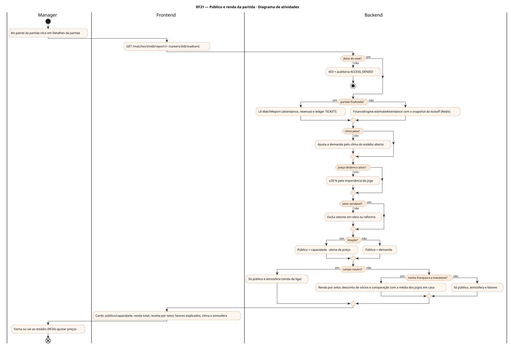
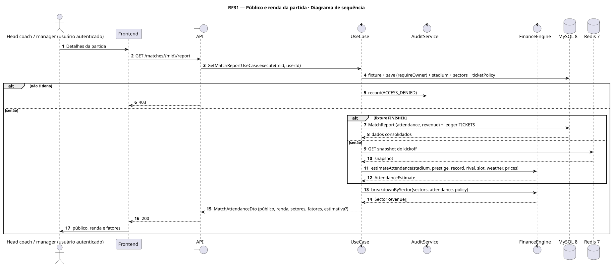
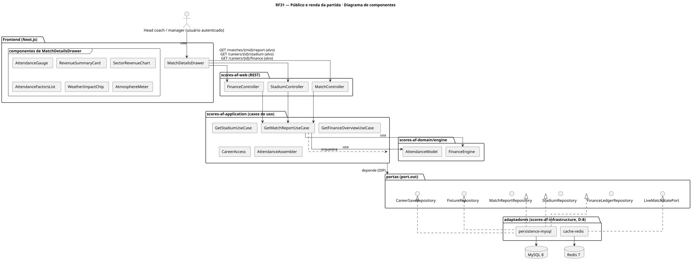
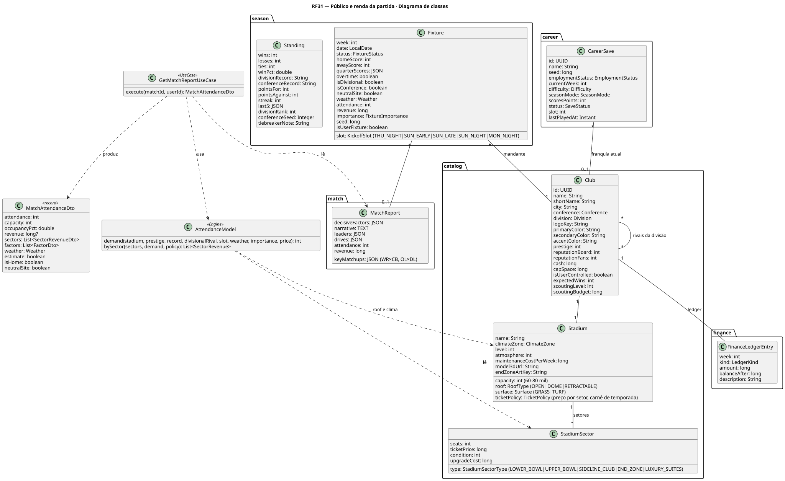
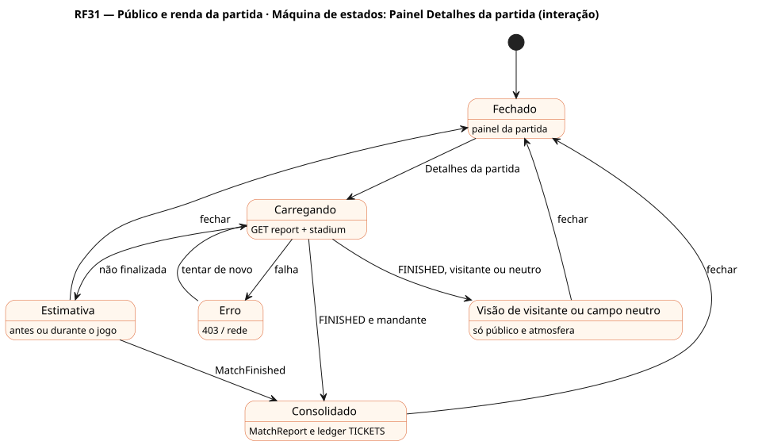

# RF31 — Público e renda da partida

## História de usuário

> HU-RF31 — DADO QUE estou no painel da partida QUANDO clico em detalhes da partida ENTÃO o sistema exibe o público no estádio e a renda por setor, com os fatores que explicam a lotação (campanha, rival de divisão, horário, clima, preço) nos 8 a 9 jogos em casa da temporada

Sprint: 11 · Atores: Manager · Tela: Partida ao vivo → Detalhes da partida (/c/{careerId}/match#details) · Pós-jogo

## Diagramas

### Atividades

Fonte: [`RF31-act.puml`](RF31-act.puml)

### Sequência

Fonte: [`RF31-seq.puml`](RF31-seq.puml)

### Componentes

Fonte: [`RF31-cmp.puml`](RF31-cmp.puml)

### Classes

Fonte: [`RF31-cls.puml`](RF31-cls.puml)

### Máquina de estados: Painel Detalhes da partida (interação)

Fonte: [`RF31-stm.puml`](RF31-stm.puml)

## Endpoints

✅ = existe num controller do `scores-af-web` · ⛔ alvo = previsto no modelo, ainda sem controller (lista em `generator/endpoints_code.json`).

| Estado | Método | Rota | Caso de uso | Autorização | Descrição |
|---|---|---|---|---|---|
| ⛔ alvo | `GET` | `/api/v1/matches/{mid}/report` | `GetMatchReportUseCase` | JWT · dono do save | attendance, revenue, ocupação e receita por setor, fatores (prestígio, campanha, rival de divisão, horário prime time, clima, importância, preço) |
| ⛔ alvo | `GET` | `/api/v1/careers/{id}/stadium` | `GetStadiumUseCase` | JWT · dono do save | Capacidade, cobertura, setores e preços usados no cálculo |
| ⛔ alvo | `GET` | `/api/v1/careers/{id}/finance` | `GetFinanceOverviewUseCase` | JWT · dono do save | Ledger TICKETS dos jogos em casa e média da temporada |

## Pontos de decisão

| Gateway | Regra | Se falso |
|---|---|---|
| Dono do save? | save.userId == jwt.sub (CareerAccess.requireOwner) | 403 + AuditLog ACCESS_DENIED |
| Partida finalizada? | fixture.status == FINISHED | estimativa do kickoff (badge Estimativa) |
| Campo neutro? | fixture.neutralSite (final) | segue · se neutro: renda da liga, sem mandante, só público |
| Minha franquia é a mandante? | fixture.home == save.club | só público e atmosfera (renda é do mandante) |
| Clima pesa? | stadium.roof == OPEN e Fixture.weather ∈ {frio intenso, chuva, neve} → demanda −5 a −15 % · DOME imune · RETRACTABLE fecha | sem ajuste de clima |
| Lotação? | demanda ≥ capacidade (demanda = f(prestígio, campanha, rival de divisão, slot, clima, importância, preço)) | público = demanda · se lotado: público = capacidade e alerta de preço abaixo do mercado |
| Preço dinâmico ativo? | ticketPolicy.dynamicPricing | preço fixo por setor · se ativo: ±20 % pela importância (DIVISIONAL, DECISIVE, PRIMETIME) |
| Setor vendável? | setor fora de obra ou reforma | setor excluído do público e da renda |

---
Gerado por `../generator/generate.py` a partir de `../generator/model/*.py` e `../generator/common.py`; não edite os .puml à mão.
