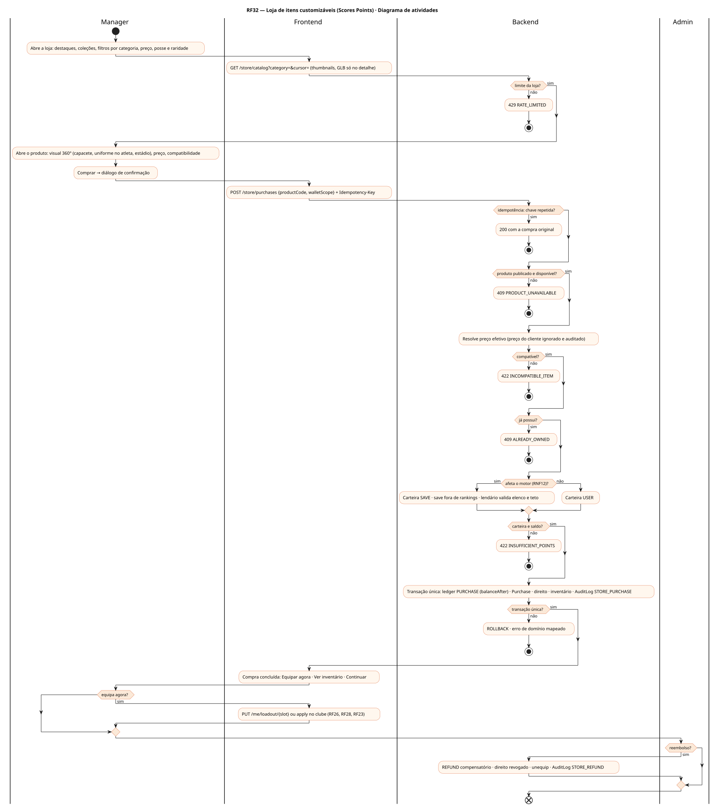
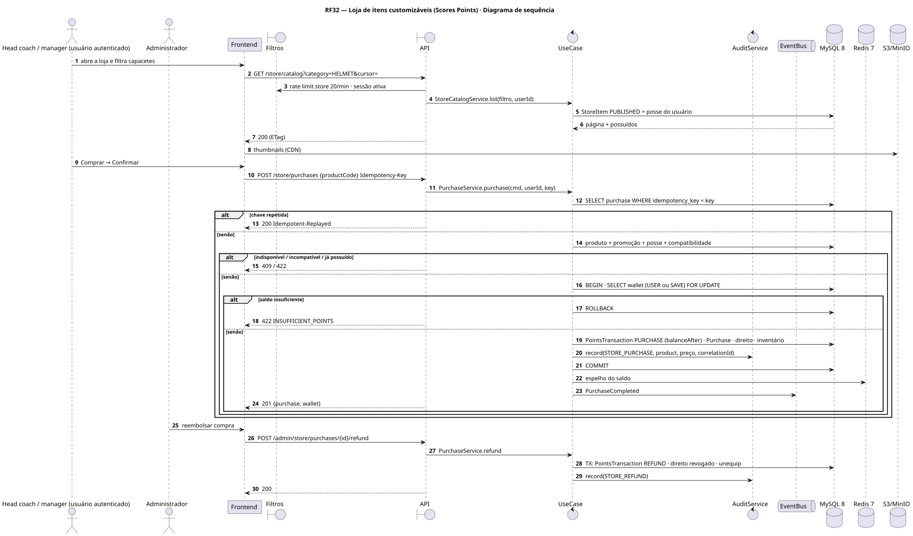
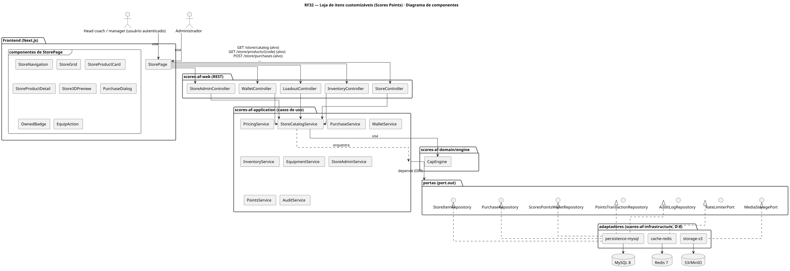
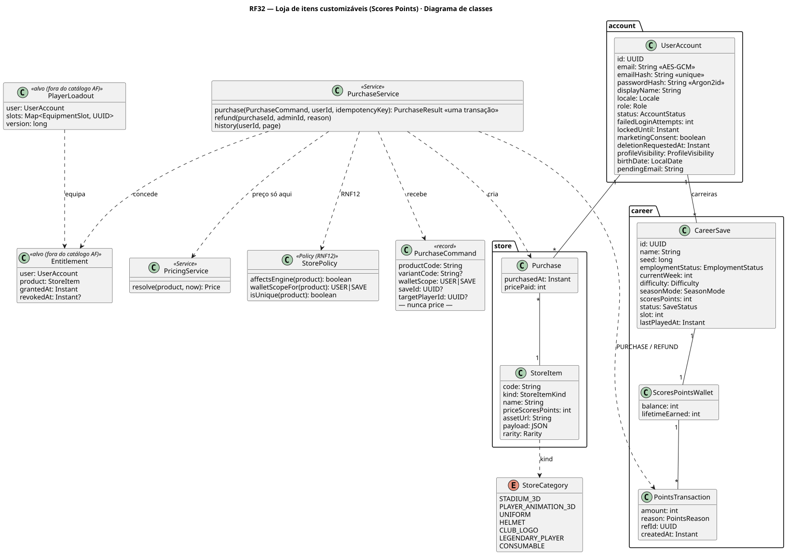
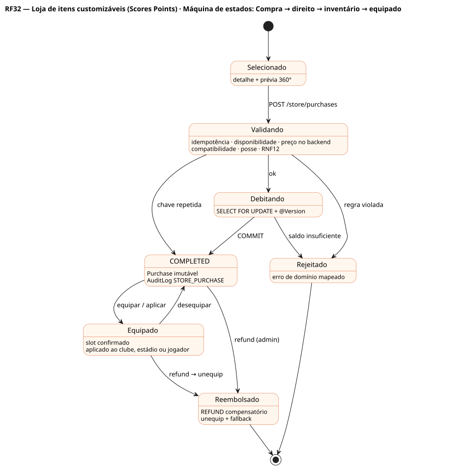
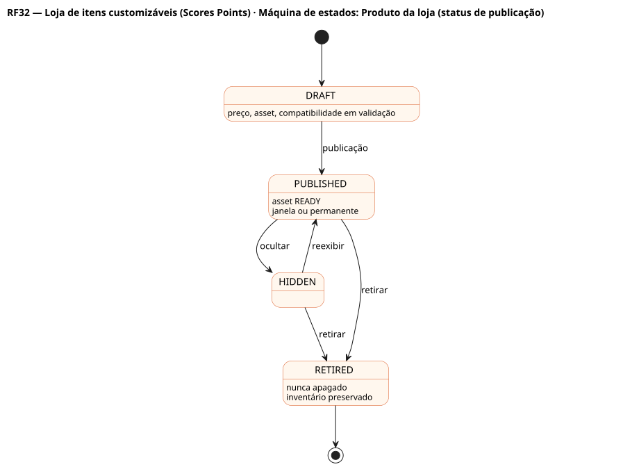

# RF32 — Loja de itens customizáveis (Scores Points)

## História de usuário

> HU-RF32 — DADO QUE estou na loja do jogo QUANDO filtro listas, opções e itens ENTÃO posso comprar com Scores Points itens customizáveis como estádio 3D, animações 3D de jogadores, uniformes, capacetes, logos de franquias e jogadores lendários

Sprint: 10 · Atores: Manager, Admin · Tela: Loja (/store · /c/{careerId}/store)

## Diagramas

### Atividades

Fonte: [`RF32-act.puml`](RF32-act.puml)

### Sequência

Fonte: [`RF32-seq.puml`](RF32-seq.puml)

### Componentes

Fonte: [`RF32-cmp.puml`](RF32-cmp.puml)

### Classes

Fonte: [`RF32-cls.puml`](RF32-cls.puml)

### Máquina de estados: Compra → direito → inventário → equipado

Fonte: [`RF32-stm.puml`](RF32-stm.puml)

### Máquina de estados: Produto da loja (status de publicação)

Fonte: [`RF32-stm-produto-da-loja-status-de-publicacao.puml`](RF32-stm-produto-da-loja-status-de-publicacao.puml)

## Endpoints

✅ = existe num controller do `scores-af-web` · ⛔ alvo = previsto no modelo, ainda sem controller (lista em `generator/endpoints_code.json`).

| Estado | Método | Rota | Caso de uso | Autorização | Descrição |
|---|---|---|---|---|---|
| ⛔ alvo | `GET` | `/api/v1/store/catalog` | `StoreCatalogService` | JWT · 20 por min | Catálogo paginado por cursor: categoria (STADIUM_3D, PLAYER_ANIMATION_3D, UNIFORM, HELMET, CLUB_LOGO, LEGENDARY_PLAYER, CONSUMABLE), coleção, busca, ordenação · ETag + marcação de posse |
| ⛔ alvo | `GET` | `/api/v1/store/products/{code}` | `StoreCatalogService` | JWT | Detalhe: preço base e efetivo com motivo, compatibilidade (posição para animações, cobertura para estádios), assets READY |
| ⛔ alvo | `POST` | `/api/v1/store/purchases` | `PurchaseService` | JWT · Idempotency-Key · 20 por min | Compra: preço só no backend · transação única (ledger + Purchase + direito + inventário + AuditLog STORE_PURCHASE) · mesma chave ⇒ mesma resposta |
| ⛔ alvo | `GET` | `/api/v1/me/purchases` | `PurchaseService` | JWT | Histórico: item, data, preço, status |
| ⛔ alvo | `GET` | `/api/v1/me/wallet` | `WalletService` | JWT | Carteira USER (cosméticos): saldo e lançamentos com balanceAfter |
| ⛔ alvo | `GET` | `/api/v1/me/inventory` | `InventoryService` | JWT | O que possuo, inclusive itens retirados da loja |
| ⛔ alvo | `PUT` | `/api/v1/me/loadout/{slot}` | `EquipmentService` | JWT | Equipar (confirmação se o slot está ocupado) |
| ⛔ alvo | `POST` | `/api/v1/admin/store/products` | `StoreAdminService` | JWT · ADMIN | Criar, publicar, ocultar, retirar, agendar produto · nunca edita ledger |

## Pontos de decisão

| Gateway | Regra | Se falso |
|---|---|---|
| Autenticado? | JWT válido + família de sessão ativa | 401 UNAUTHENTICATED |
| Limite da loja? | /api/v1/store/** ≤ 20 por minuto por IP | 429 RATE_LIMITED |
| Idempotência? | Idempotency-Key UNIQUE na compra · mesma chave e payload ⇒ 200 com a compra original · payload diferente ⇒ 422 IDEMPOTENCY_CONFLICT | sem chave: 400 IDEMPOTENCY_KEY_REQUIRED |
| Produto publicado e disponível? | status PUBLISHED, dentro da janela, asset READY | 409 PRODUCT_UNAVAILABLE |
| Preço confiável? | cliente envia só productCode · backend resolve preço base, promoção e preço efetivo · price no payload é ignorado e auditado | — |
| Compatível? | animação: posição do jogador alvo · estádio: cobertura · capacete/uniforme: franquia do save | 422 INCOMPATIBLE_ITEM |
| Já possui? | cosmético: direito único por usuário e produto | 409 ALREADY_OWNED |
| Afeta o motor (RNF12)? | LEGENDARY_PLAYER e CONSUMABLE são GAME_EFFECT: só carteira SAVE, save fora de rankings · lendário precisa de vaga no elenco (53) e espaço no teto | COSMETIC_ONLY: carteira USER, nunca altera atributos |
| Carteira e saldo? | SELECT FOR UPDATE + @Version · balance ≥ preço efetivo | 422 INSUFFICIENT_POINTS (saldo e preço) |
| Transação única? | ledger PURCHASE + Purchase + direito + inventário + AuditLog na mesma transação | ROLLBACK total |

---
Gerado por `../generator/generate.py` a partir de `../generator/model/*.py` e `../generator/common.py`; não edite os .puml à mão.
