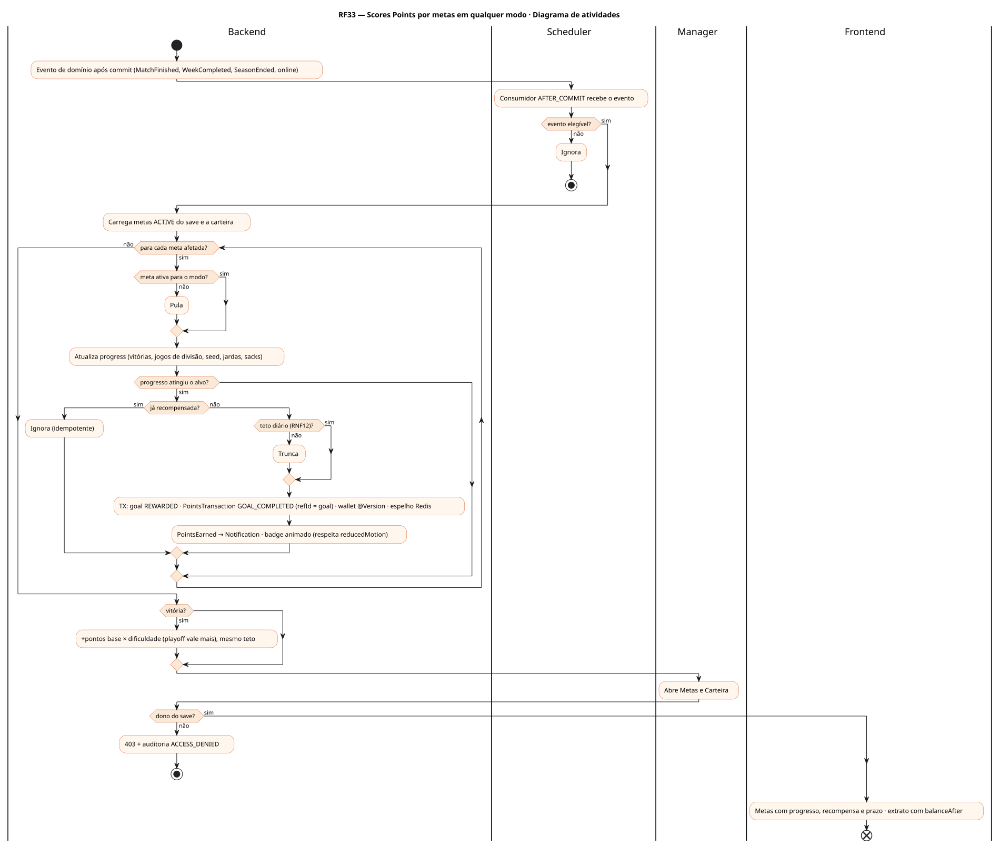
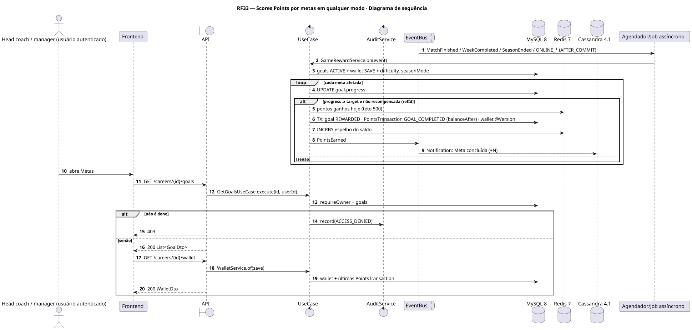
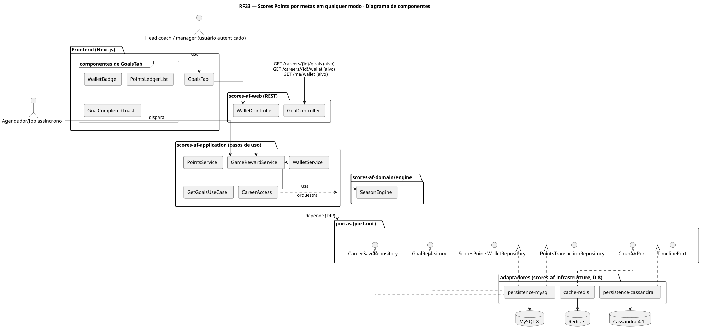
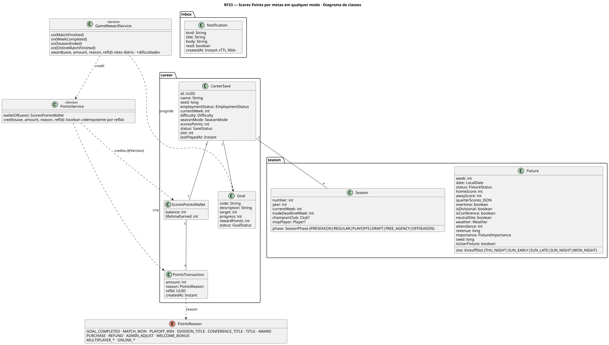
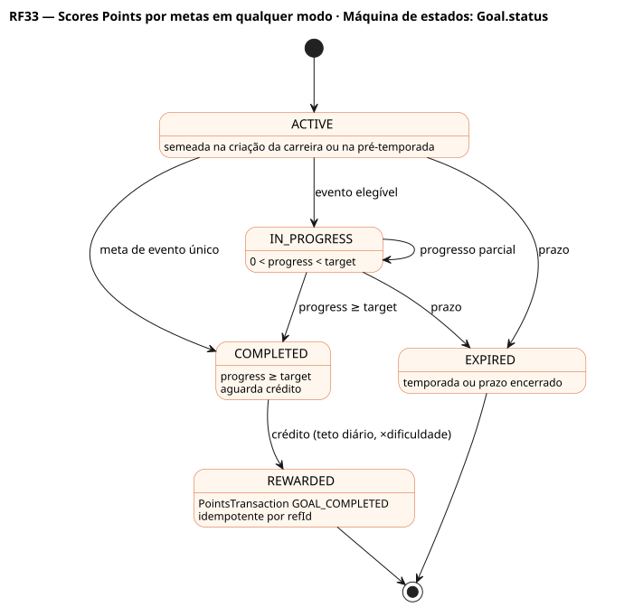

# RF33 — Scores Points por metas em qualquer modo

## História de usuário

> HU-RF33 — DADO QUE estou jogando qualquer modo do Scores ENTÃO ganho Scores Points ao concluir metas (vitórias, título de divisão, vaga e vitórias nos playoffs, título, marcas individuais, partidas online) PARA comprar itens customizáveis na loja

Sprint: 10 · Atores: Manager, Scheduler · Tela: Loja → aba Metas (/c/{careerId}/store/goals) · badge de pontos na central

## Diagramas

### Atividades

Fonte: [`RF33-act.puml`](RF33-act.puml)

### Sequência

Fonte: [`RF33-seq.puml`](RF33-seq.puml)

### Componentes

Fonte: [`RF33-cmp.puml`](RF33-cmp.puml)

### Classes

Fonte: [`RF33-cls.puml`](RF33-cls.puml)

### Máquina de estados: Goal.status

Fonte: [`RF33-stm.puml`](RF33-stm.puml)

## Endpoints

✅ = existe num controller do `scores-af-web` · ⛔ alvo = previsto no modelo, ainda sem controller (lista em `generator/endpoints_code.json`).

| Estado | Método | Rota | Caso de uso | Autorização | Descrição |
|---|---|---|---|---|---|
| ⛔ alvo | `GET` | `/api/v1/careers/{id}/goals` | `GetGoalsUseCase` | JWT · dono do save | Metas ativas e concluídas com progresso, recompensa e prazo (ex.: vencer 4 jogos de divisão, chegar aos playoffs, QB com 4 000 jardas) |
| ⛔ alvo | `GET` | `/api/v1/careers/{id}/wallet` | `WalletService` | JWT · dono do save | Carteira SAVE: saldo, lifetimeEarned e extrato com balanceAfter |
| ⛔ alvo | `GET` | `/api/v1/me/wallet` | `WalletService` | JWT | Carteira USER (cosméticos) |

## Pontos de decisão

| Gateway | Regra | Se falso |
|---|---|---|
| Dono do save? | save.userId == jwt.sub (CareerAccess.requireOwner) | 403 + AuditLog ACCESS_DENIED |
| Evento elegível? | MatchFinished (vitória), WeekCompleted, SeasonEnded (título de divisão, vaga, vitórias de playoff, título), marcas individuais na temporada, ONLINE_* e MULTIPLAYER_* | ignora o evento |
| Meta ativa para o modo? | goal ACTIVE e vale para o seasonMode do save | sem progresso |
| Progresso atingiu o alvo? | goal.progress ≥ goal.target | só atualiza progresso |
| Já recompensada? | existe PointsTransaction(reason, refId) · credit idempotente por refId | ignora (reprocessamento seguro) |
| Teto diário (RNF12)? | pontos ganhos hoje + recompensa ≤ 500 | trunca ao teto |
| Quem concede ≠ quem consome? | GameRewardService concede · PurchaseService consome · mesma tabela de lançamentos, classes separadas | — |

---
Gerado por `../generator/generate.py` a partir de `../generator/model/*.py` e `../generator/common.py`; não edite os .puml à mão.
