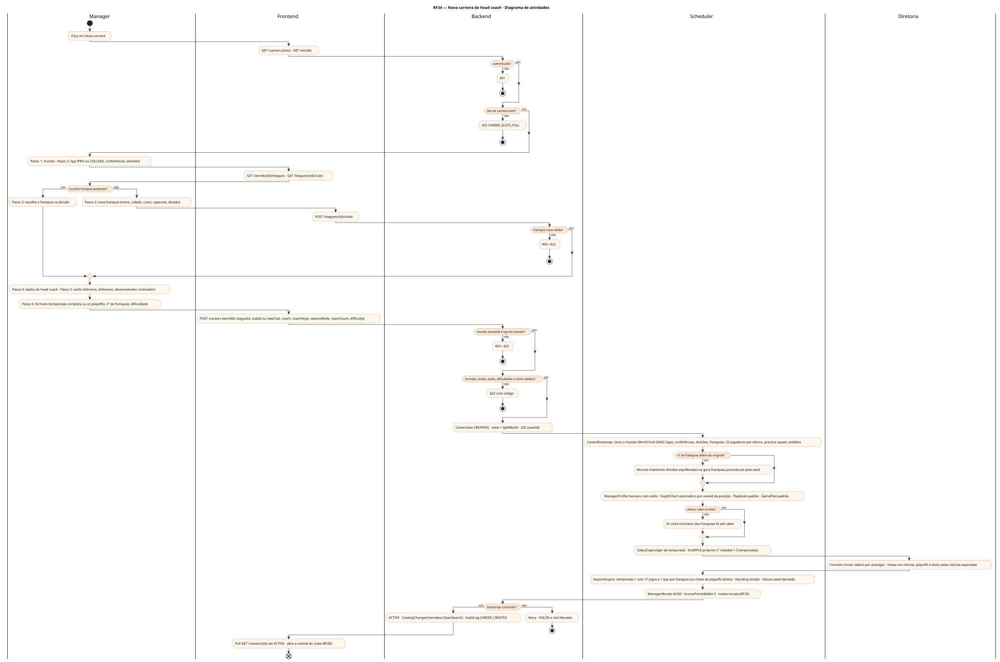
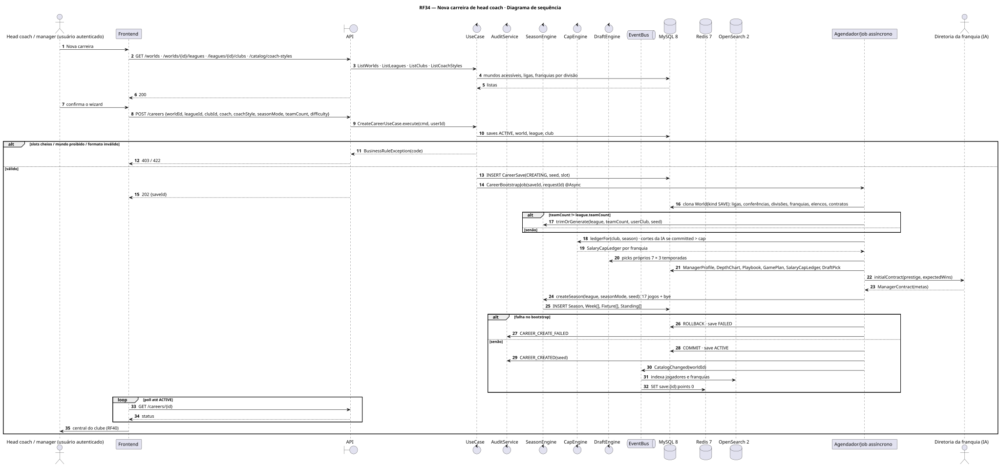
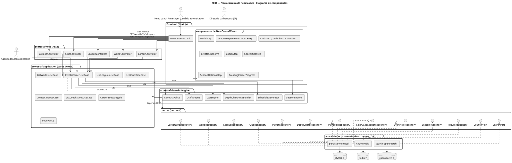
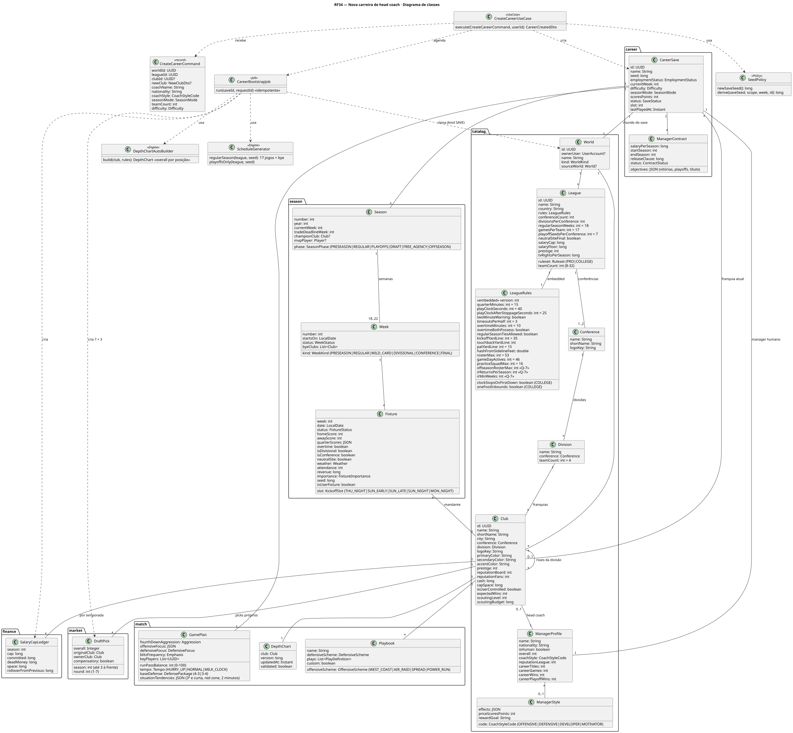
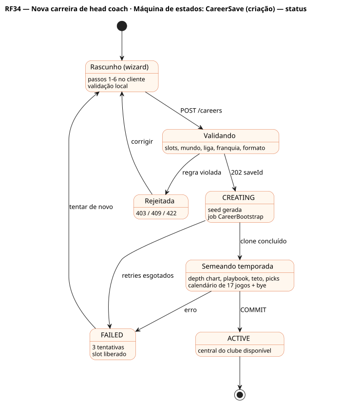

# RF34 — Nova carreira de head coach

## História de usuário

> HU-RF34 — DADO QUE estou criando uma nova carreira QUANDO escolho o mundo, a liga de futebol americano (regras PRO ou COLLEGE, conferências e divisões, 8–32 franquias), a franquia (ou crio uma), meus dados, o estilo de head coach, o formato da temporada e a dificuldade ENTÃO o sistema salva a carreira com calendário, depth chart, playbook, teto salarial e picks prontos

Sprint: 6 · Atores: Manager, Scheduler, Diretoria · Tela: Nova carreira — wizard em 6 passos (/careers/new)

## Diagramas

### Atividades

Fonte: [`RF34-act.puml`](RF34-act.puml)

### Sequência

Fonte: [`RF34-seq.puml`](RF34-seq.puml)

### Componentes

Fonte: [`RF34-cmp.puml`](RF34-cmp.puml)

### Classes

Fonte: [`RF34-cls.puml`](RF34-cls.puml)

### Máquina de estados: CareerSave (criação) — status

Fonte: [`RF34-stm.puml`](RF34-stm.puml)

## Endpoints

✅ = existe num controller do `scores-af-web` · ⛔ alvo = previsto no modelo, ainda sem controller (lista em `generator/endpoints_code.json`).

| Estado | Método | Rota | Caso de uso | Autorização | Descrição |
|---|---|---|---|---|---|
| ⛔ alvo | `GET` | `/api/v1/worlds` | `ListWorldsUseCase` | JWT | Mundo padrão (32 franquias fictícias) e mundos editados do usuário (RF5) |
| ⛔ alvo | `GET` | `/api/v1/worlds/{id}/leagues` | `ListLeaguesUseCase` | JWT | Ligas com ruleset PRO/COLLEGE, conferências, divisões, nº de franquias, teto e piso salarial |
| ⛔ alvo | `GET` | `/api/v1/leagues/{id}/clubs` | `ListClubsUseCase` | JWT | Franquias por conferência e divisão (prestígio, cap space, vitórias esperadas, overall por unidade) |
| ⛔ alvo | `POST` | `/api/v1/leagues/{id}/clubs` | `CreateClubUseCase` | JWT | Cria franquia (nome, cidade, cores, capacete, divisão) só em mundo editável |
| ⛔ alvo | `GET` | `/api/v1/catalog/coach-styles` | `ListCoachStylesUseCase` | JWT | Estilos de head coach: OFFENSIVE, DEFENSIVE, DEVELOPER, MOTIVATOR (RF15) |
| ⛔ alvo | `POST` | `/api/v1/careers` | `CreateCareerUseCase` | JWT | Cria CareerSave CREATING e agenda o bootstrap → 202 {saveId} |
| ⛔ alvo | `GET` | `/api/v1/careers/{id}` | `GetCareerUseCase` | JWT · dono do save | Status da criação (CREATING → ACTIVE | FAILED) para o poll do wizard |
| ⛔ alvo | `GET` | `/api/v1/careers` | `ListCareersUseCase` | JWT | Carreiras salvas e slots livres (RF11) |

## Pontos de decisão

| Gateway | Regra | Se falso |
|---|---|---|
| Autenticado? | JWT válido e conta ACTIVE | 401 |
| Slot de carreira livre? | saves ACTIVE do usuário < 5 | 422 CAREER_SLOTS_FULL (arquivar ou excluir em RF11) |
| Mundo acessível e liga do mundo? | world.ownerUser nulo (padrão) ou == jwt.sub · league.worldId == world.id | 403 WORLD_FORBIDDEN / 422 LEAGUE_NOT_IN_WORLD |
| Franquia existente ou nova válida? | clubId da liga ou newClub com nome único, sigla de 2–4 letras, cores com contraste, divisão com vaga · mundo editável | 422 CLUB_REQUIRED / 409 CLUB_NAME_TAKEN / 422 CLUB_INVALID |
| Formato da liga válido? | 8 ≤ teamCount ≤ 32 · teamCount = conferências × divisões × franquias por divisão (Q-3) · ruleset PRO ou COLLEGE (Q-1) | 422 LEAGUE_LAYOUT_INVALID |
| Franquia do usuário sobrevive ao recorte? | ao reduzir franquias, a do usuário e a divisão dela ficam · saem as de menor prestígio mantendo divisões equilibradas | — |
| Modo, estilo e dificuldade válidos? | seasonMode ∈ {FULL_SEASON, PLAYOFFS_ONLY} · coachStyle ∈ ManagerStyle · difficulty ∈ {EASY, NORMAL, HARD, LEGEND} | 422 com código do campo |
| Nome do head coach válido? | 2–40 caracteres, sem HTML, nacionalidade ISO | 422 MANAGER_NAME_INVALID |
| Elenco cabe no teto? | SalaryCapLedger.committed ≤ league.salaryCap para cada franquia depois do clone (cortes automáticos da IA nas franquias IA) | IA corta contratos até caber (nunca a franquia do usuário sem aviso) |
| Bootstrap concluído? | job CareerBootstrap DONE (idempotente por requestId) | save fica CREATING · retry · FAILED após 3 tentativas |

---
Gerado por `../generator/generate.py` a partir de `../generator/model/*.py` e `../generator/common.py`; não edite os .puml à mão.
