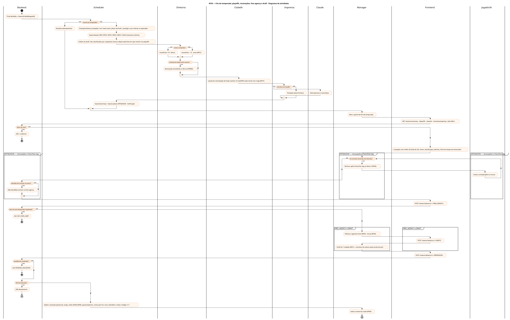
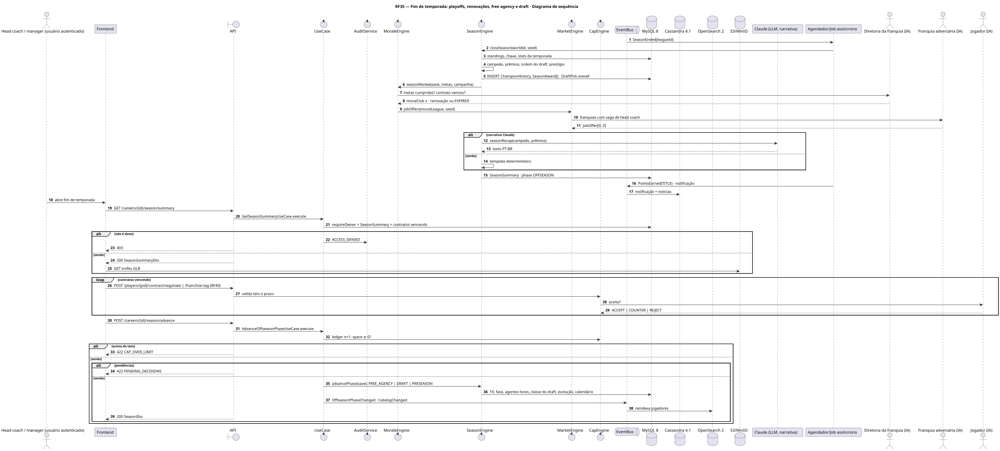
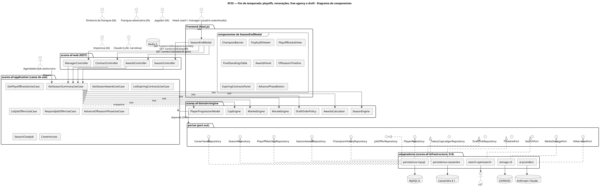
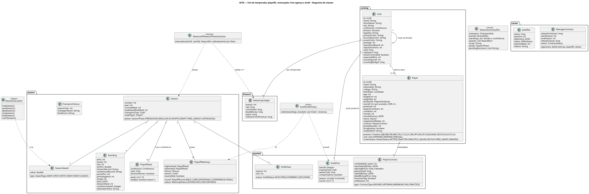
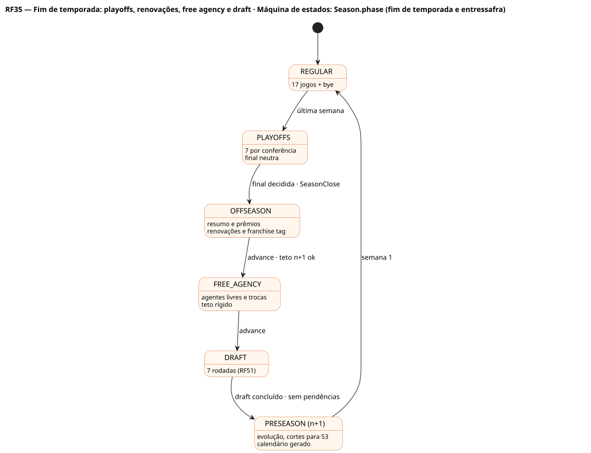

# RF35 — Fim de temporada: playoffs, renovações, free agency e draft

## História de usuário

> HU-RF35 — DADO QUE a final da liga foi decidida QUANDO o sistema fecha a temporada ENTÃO exibe o painel com o campeão e o troféu 3D, a chave dos playoffs, os prêmios (MVP, OPOY, DPOY, OROY, DROY, técnico do ano), os rankings e as pendências, e conduz a entressafra na ordem renovações e franchise tag → free agency → draft → nova temporada

Sprint: 6 · Atores: Manager, Scheduler, Diretoria, ClubeIA, JogadorIA, Imprensa, Claude · Tela: Fim de temporada (/c/{careerId}/season-end) · linha do tempo da entressafra

## Diagramas

### Atividades

Fonte: [`RF35-act.puml`](RF35-act.puml)

### Sequência

Fonte: [`RF35-seq.puml`](RF35-seq.puml)

### Componentes

Fonte: [`RF35-cmp.puml`](RF35-cmp.puml)

### Classes

Fonte: [`RF35-cls.puml`](RF35-cls.puml)

### Máquina de estados: Season.phase (fim de temporada e entressafra)

Fonte: [`RF35-stm.puml`](RF35-stm.puml)

## Endpoints

✅ = existe num controller do `scores-af-web` · ⛔ alvo = previsto no modelo, ainda sem controller (lista em `generator/endpoints_code.json`).

| Estado | Método | Rota | Caso de uso | Autorização | Descrição |
|---|---|---|---|---|---|
| ⛔ alvo | `GET` | `/api/v1/careers/{id}/season/summary` | `GetSeasonSummaryUseCase` | JWT · dono do save | Campeão (troféu 3D), classificação final por divisão e conferência, rankings, prêmios, narrativa, fase da entressafra e pendências |
| ⛔ alvo | `GET` | `/api/v1/careers/{id}/playoffs` | `GetPlayoffBracketUseCase` | JWT · dono do save | Chave final: 7 por conferência, folga do 1º, final neutra (RF66) |
| ⛔ alvo | `GET` | `/api/v1/careers/{id}/awards` | `GetSeasonAwardsUseCase` | JWT · dono do save | MVP, OPOY, DPOY, OROY, DROY, COACH |
| ⛔ alvo | `GET` | `/api/v1/careers/{id}/contracts/expiring` | `ListExpiringContractsUseCase` | JWT · dono do save | Contratos que vencem: renovar, aplicar franchise tag ou deixar ir (RF49) |
| ⛔ alvo | `GET` | `/api/v1/careers/{id}/job-offers` | `ListJobOffersUseCase` | JWT · dono do save | Propostas de head coach da janela pós-temporada (RF37) |
| ⛔ alvo | `POST` | `/api/v1/careers/{id}/job-offers/{jid}/respond` | `RespondJobOfferUseCase` | JWT · dono do save | Aceitar ou recusar proposta |
| ⛔ alvo | `POST` | `/api/v1/careers/{id}/season/advance` | `AdvanceOffseasonPhaseUseCase` | JWT · dono do save | Avança a fase: OFFSEASON → FREE_AGENCY → DRAFT → PRESEASON n+1 · idempotente por (seasonId, fase) |

## Pontos de decisão

| Gateway | Regra | Se falso |
|---|---|---|
| Dono do save? | save.userId == jwt.sub | 403 + AuditLog ACCESS_DENIED |
| Temporada encerrada? | PlayoffMatchup FINAL com winner (ou última semana em PLAYOFFS_ONLY) | 409 SEASON_NOT_FINISHED |
| Resumo já computado? | SeasonSummary(seasonId) materializado | job SeasonClose computa (idempotente por seasonId) |
| Prêmio com amostra mínima? | MVP/OPOY: ≥ 12 jogos · QB ≥ 224 passes ou não-QB por snaps · DPOY por sacks, INT, tackles e pressões ponderados · OROY/DROY só calouros | candidato excluído |
| Contrato do head coach venceu? | contract.endSeason == season.number | segue · se venceu: diretoria propõe renovação (moralClub ≥ 50) ou EXPIRED |
| Metas cumpridas? | vitórias ≥ meta · playoffs/título quando exigidos · caixa ≥ 0 | moralClub −15 · possível demissão (RF41) |
| Decisões de contrato no prazo? | OFFSEASON: cada contrato vencendo da franquia do usuário tem decisão (renovar, tag, deixar ir) até o fim da fase | não decididos viram agentes livres ao abrir FREE_AGENCY |
| Teto da nova temporada respeitado? | SalaryCapLedger(n+1).space ≥ 0 com rollover do espaço não usado | 422 CAP_OVER_LIMIT (cortar ou reestruturar antes de avançar, RF49) |
| Pendências resolvidas? | JobOffer PENDING respondidas ou expiradas · FreeAgentOffer do usuário concluídas ao fechar FREE_AGENCY · draft concluído (RF51) | 422 PENDING_DECISIONS (lista o que falta) |
| Narrativa via Claude? | scores.ai.narrative == claude e circuito fechado | template determinístico (AuditLog AI_CALL nos dois casos) |
| Fase já avançada? | season.phase já é a fase pedida (idempotência) | 200 sem reprocessar |

---
Gerado por `../generator/generate.py` a partir de `../generator/model/*.py` e `../generator/common.py`; não edite os .puml à mão.
