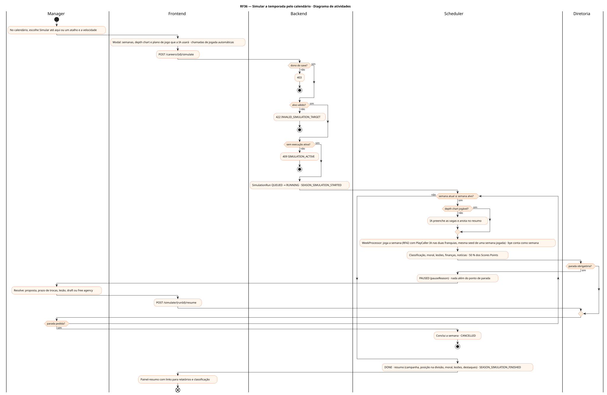
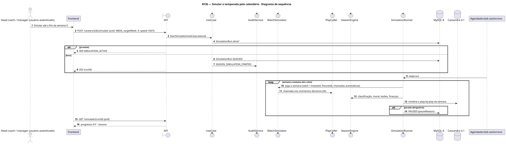
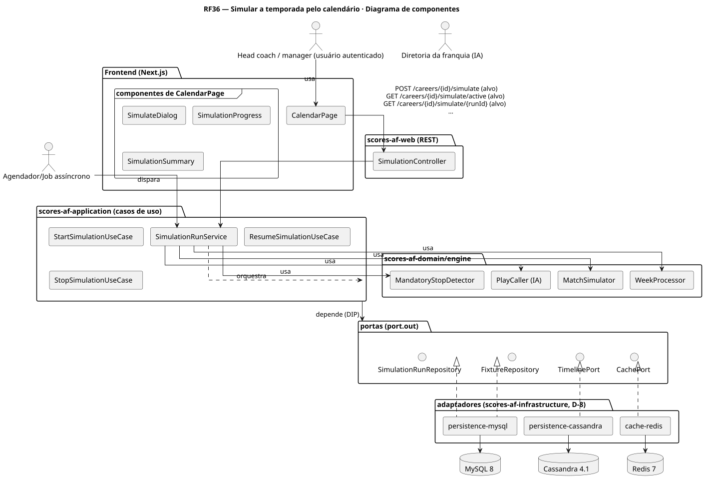
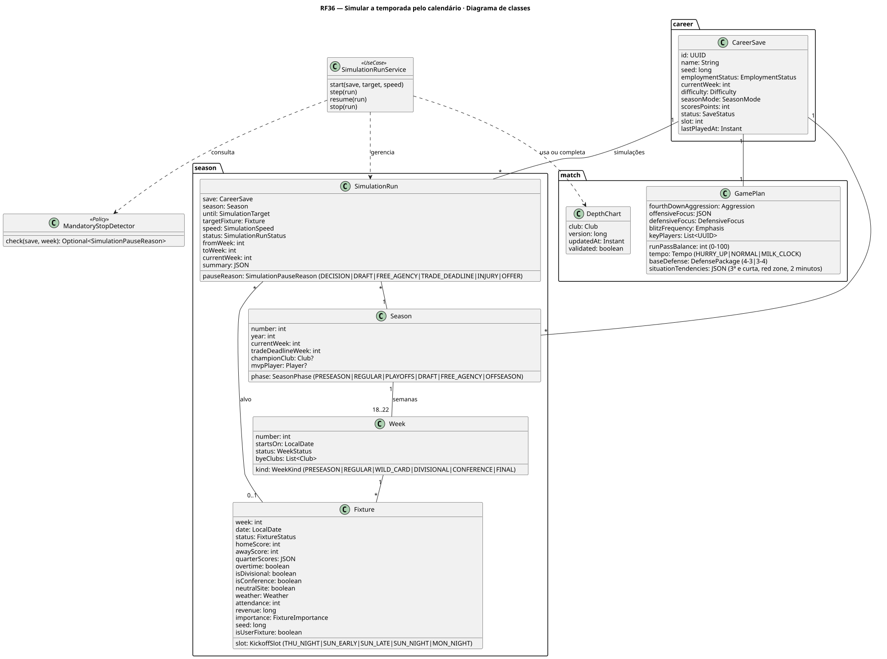
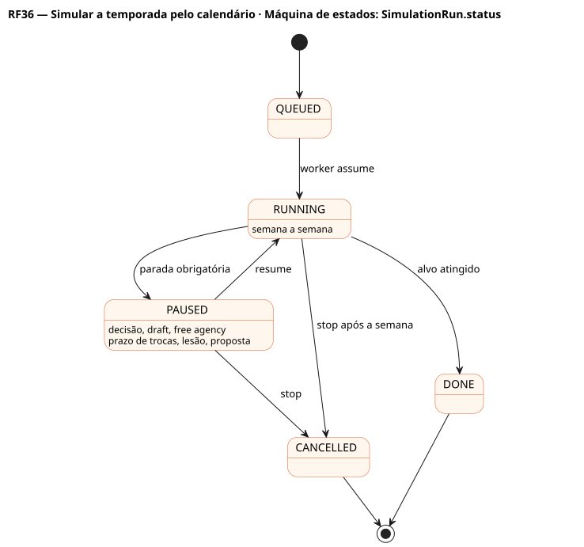

# RF36 — Simular a temporada pelo calendário

## História de usuário

> HU-RF36 — COMO head coach POSSO escolher no calendário uma partida ou um atalho (próximo jogo, fim da semana, fim da temporada regular, fim da temporada) e uma velocidade PARA simular semanas com a minha franquia chamada pela IA assistente, parando em decisões obrigatórias, no draft, na free agency e no prazo de trocas

Sprint: 11 · Atores: Manager, Scheduler, Diretoria · Tela: Calendário (/c/{careerId}/calendar): Simular até aqui · modal de confirmação · progresso · resumo

## Diagramas

### Atividades

Fonte: [`RF36-act.puml`](RF36-act.puml)

### Sequência

Fonte: [`RF36-seq.puml`](RF36-seq.puml)

### Componentes

Fonte: [`RF36-cmp.puml`](RF36-cmp.puml)

### Classes

Fonte: [`RF36-cls.puml`](RF36-cls.puml)

### Máquina de estados: SimulationRun.status

Fonte: [`RF36-stm.puml`](RF36-stm.puml)

## Endpoints

✅ = existe num controller do `scores-af-web` · ⛔ alvo = previsto no modelo, ainda sem controller (lista em `generator/endpoints_code.json`).

| Estado | Método | Rota | Caso de uso | Autorização | Descrição |
|---|---|---|---|---|---|
| ⛔ alvo | `POST` | `/api/v1/careers/{id}/simulate` | `StartSimulationUseCase` | JWT · dono do save | {until, targetFixtureId?, targetWeek?, speed} → 202 {runId} |
| ⛔ alvo | `GET` | `/api/v1/careers/{id}/simulate/active` | `GetActiveSimulationUseCase` | JWT · dono do save | Execução ativa (retomar após recarregar) |
| ⛔ alvo | `GET` | `/api/v1/careers/{id}/simulate/{runId}` | `GetSimulationUseCase` | JWT · dono do save | Progresso (semana X/Y), motivo da pausa e resumo |
| ⛔ alvo | `POST` | `/api/v1/careers/{id}/simulate/{runId}/stop` | `StopSimulationUseCase` | JWT · dono do save | Conclui a semana atual e encerra |
| ⛔ alvo | `POST` | `/api/v1/careers/{id}/simulate/{runId}/resume` | `ResumeSimulationUseCase` | JWT · dono do save | Retoma depois de resolver a parada |

## Pontos de decisão

| Gateway | Regra | Se falso |
|---|---|---|
| Dono do save? | save.userId == jwt.sub | 403 + AuditLog ACCESS_DENIED |
| Alvo válido? | until ∈ {NEXT_FIXTURE, WEEK_END, REGULAR_SEASON_END, SEASON_END, FIXTURE, WEEK} e alvo no futuro | 422 INVALID_SIMULATION_TARGET |
| Sem execução ativa? | uma SimulationRun QUEUED/RUNNING/PAUSED por carreira | 409 SIMULATION_ACTIVE |
| Depth chart jogável? | titulares em todas as posições das três unidades, sem IR nem OUT · senão a IA preenche e avisa | IA monta o depth chart da semana e registra no resumo |
| Parada obrigatória? | pauseReason ∈ {DECISION, DRAFT, FREE_AGENCY, TRADE_DEADLINE, INJURY (titular fora 3+ semanas), OFFER} | processa a próxima semana |
| Parada pedida? | stopRequested == true | segue até o alvo |
| Execução pausada? | resume só em PAUSED | 409 SIMULATION_NOT_PAUSED |

---
Gerado por `../generator/generate.py` a partir de `../generator/model/*.py` e `../generator/common.py`; não edite os .puml à mão.
