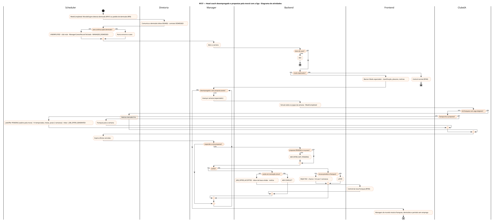
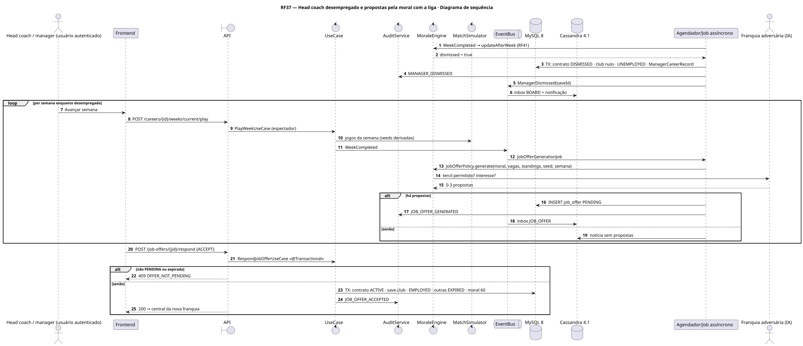
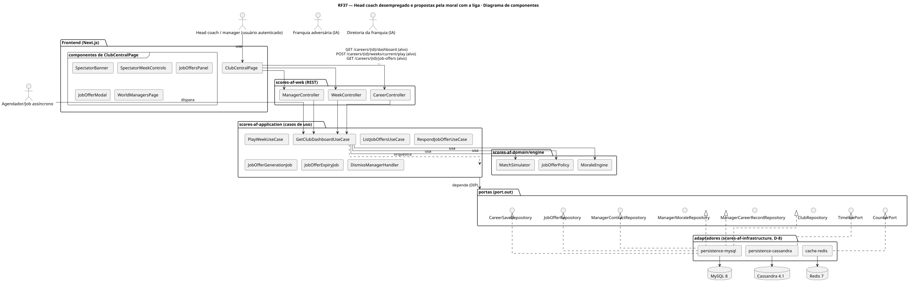
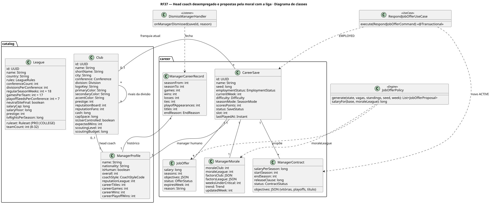
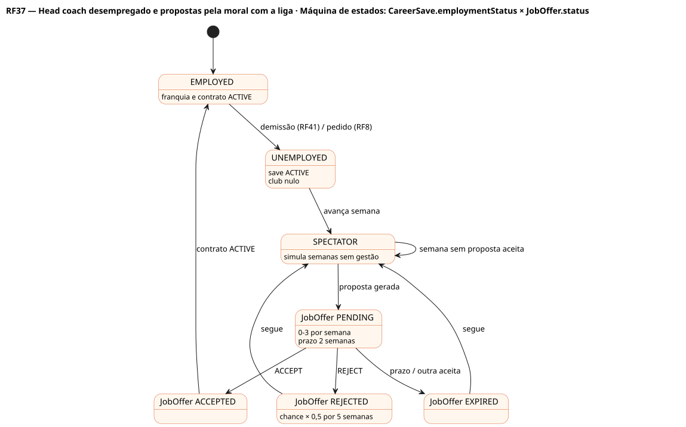

# RF37 — Head coach desempregado e propostas pela moral com a liga

## História de usuário

> HU-RF37 — DADO QUE perdi o emprego na franquia QUANDO uma semana termina ENTÃO o sistema mantém a carreira em modo espectador e mostra propostas de head coach limitadas pela moral com a liga (RF41), concentradas na janela pós-temporada, PARA aceitar ou recusar

Sprint: 7 · Atores: Manager, Scheduler, ClubeIA, Diretoria · Tela: Central do clube em modo espectador (/c/{careerId}) · Head coach → Propostas (/c/{careerId}/manager)

## Diagramas

### Atividades

Fonte: [`RF37-act.puml`](RF37-act.puml)

### Sequência

Fonte: [`RF37-seq.puml`](RF37-seq.puml)

### Componentes

Fonte: [`RF37-cmp.puml`](RF37-cmp.puml)

### Classes

Fonte: [`RF37-cls.puml`](RF37-cls.puml)

### Máquina de estados: CareerSave.employmentStatus × JobOffer.status

Fonte: [`RF37-stm.puml`](RF37-stm.puml)

## Endpoints

✅ = existe num controller do `scores-af-web` · ⛔ alvo = previsto no modelo, ainda sem controller (lista em `generator/endpoints_code.json`).

| Estado | Método | Rota | Caso de uso | Autorização | Descrição |
|---|---|---|---|---|---|
| ⛔ alvo | `GET` | `/api/v1/careers/{id}/dashboard` | `GetClubDashboardUseCase` | JWT · dono do save | Painel espectador: classificação, placares da semana, notícias, propostas · sem cards de gestão |
| ⛔ alvo | `POST` | `/api/v1/careers/{id}/weeks/current/play` | `PlayWeekUseCase` | JWT · dono do save | Espectador: simula a semana inteira e publica WeekCompleted |
| ⛔ alvo | `GET` | `/api/v1/careers/{id}/job-offers` | `ListJobOffersUseCase` | JWT · dono do save | Propostas PENDING: franquia, divisão, salário, temporadas, metas, prazo e motivo |
| ⛔ alvo | `POST` | `/api/v1/careers/{id}/job-offers/{jid}/respond` | `RespondJobOfferUseCase` | JWT · dono do save | ACCEPT em transação única · REJECT reduz a chance da franquia · LATER mantém |
| ⛔ alvo | `GET` | `/api/v1/careers/{id}/managers/world` | `ListWorldManagersUseCase` | JWT · dono do save | Histórico do head coach: franquias, demissões, períodos sem emprego (RF18) |

## Pontos de decisão

| Gateway | Regra | Se falso |
|---|---|---|
| Dono do save? | save.userId == jwt.sub | 403 + AuditLog ACCESS_DENIED |
| Save continua após demissão? | ManagerDismissed/Resigned: save ACTIVE, employmentStatus UNEMPLOYED, club nulo (nunca ARCHIVED) | nunca ocorre |
| Modo espectador? | employmentStatus ∈ {UNEMPLOYED, SPECTATOR} | central normal (RF40) |
| Há franquias com vaga elegíveis? | sem head coach forte e tercil de prestígio permitido pela moral com a liga (< 30 inferior · 30–69 inferior e médio · ≥ 70 qualquer) · janela pós-temporada dobra a chance | 0 propostas · notícia mercado frio |
| Franquia faz a proposta? | u(seed, semana) < 0,35 + 0,5·moralLiga/100 · máx. 3 · sem penalidade de recusa ativa | franquia pula a semana |
| Proposta PENDING e no prazo? | status PENDING e expiresWeek ≥ semana atual | 409 OFFER_NOT_PENDING |
| Aceite em transação única? | contrato ACTIVE, save.club, EMPLOYED, head coach IA dispensado, demais ofertas EXPIRED, moral clube 60, ManagerCareerRecord aberto · @Version | rollback · 409 CONFLICT |
| Recusa penaliza a franquia? | REJECT → chance × 0,5 por 5 semanas (Redis com TTL) | LATER: segue PENDING até o prazo |

---
Gerado por `../generator/generate.py` a partir de `../generator/model/*.py` e `../generator/common.py`; não edite os .puml à mão.
