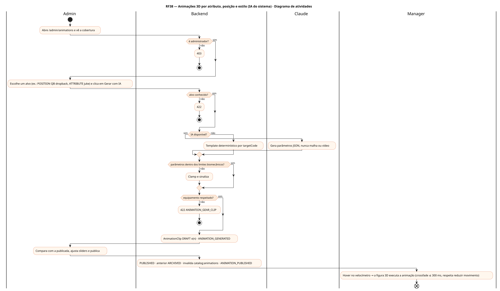
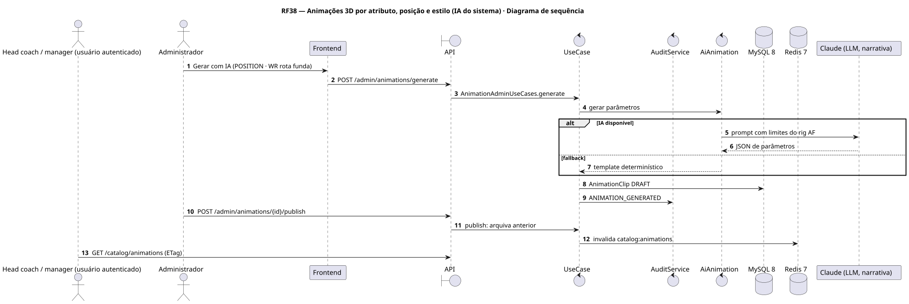
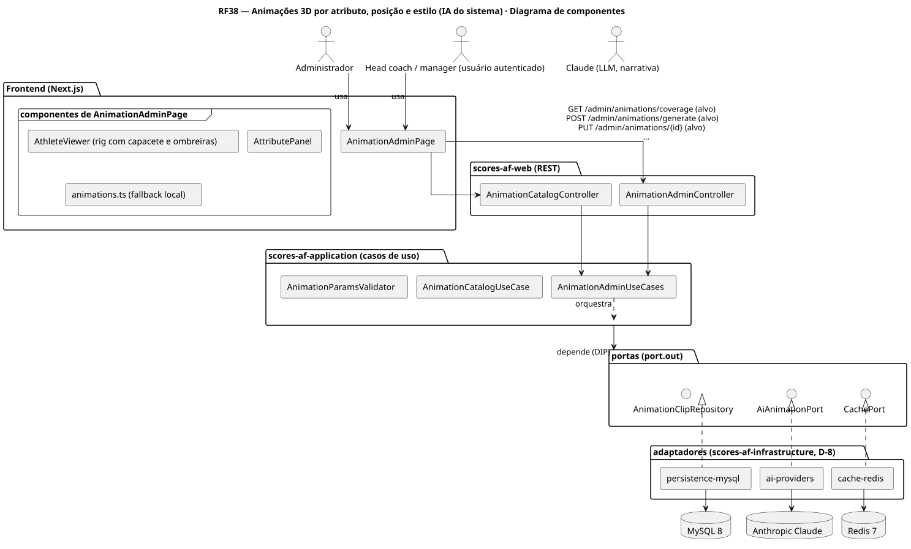
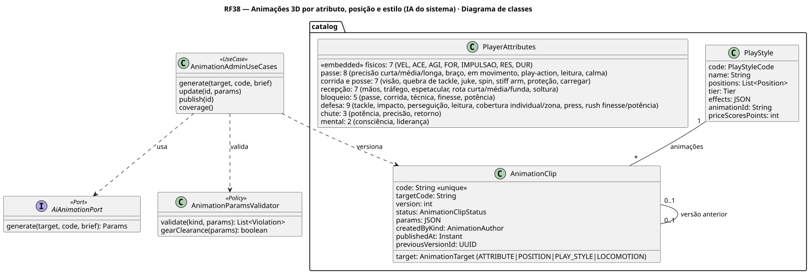
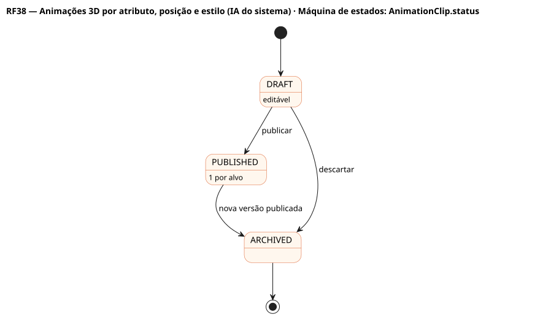

# RF38 — Animações 3D por atributo, posição e estilo (IA do sistema)

## História de usuário

> HU-RF38 — COMO administrador POSSO usar a IA do sistema para gerar, revisar e publicar animações 3D para cada subatributo, posição e estilo de jogo do futebol americano (drop do QB, rota, bloqueio, tackle, chute) PARA que o velocímetro, o chip ou a insígnia animem a figura 3D do atleta

Sprint: 11 · Atores: Admin, Manager, Claude · Tela: /admin/animations (cobertura, prévia publicada × rascunho, sliders, Gerar com IA) · modal do jogador (hover no velocímetro)

## Diagramas

### Atividades

Fonte: [`RF38-act.puml`](RF38-act.puml)

### Sequência

Fonte: [`RF38-seq.puml`](RF38-seq.puml)

### Componentes

Fonte: [`RF38-cmp.puml`](RF38-cmp.puml)

### Classes

Fonte: [`RF38-cls.puml`](RF38-cls.puml)

### Máquina de estados: AnimationClip.status

Fonte: [`RF38-stm.puml`](RF38-stm.puml)

## Endpoints

✅ = existe num controller do `scores-af-web` · ⛔ alvo = previsto no modelo, ainda sem controller (lista em `generator/endpoints_code.json`).

| Estado | Método | Rota | Caso de uso | Autorização | Descrição |
|---|---|---|---|---|---|
| ⛔ alvo | `GET` | `/api/v1/admin/animations/coverage` | `AnimationAdminUseCases.coverage` | JWT · ADMIN | Alvos sem animação publicada: ≈40 subatributos, 20 posições, estilos, locomoção (deve ser vazio) |
| ⛔ alvo | `POST` | `/api/v1/admin/animations/generate` | `AnimationAdminUseCases.generate` | JWT · ADMIN | Rascunho de parâmetros gerado pela IA e validado |
| ⛔ alvo | `PUT` | `/api/v1/admin/animations/{id}` | `AnimationAdminUseCases.update` | JWT · ADMIN | Ajusta parâmetros do rascunho |
| ⛔ alvo | `POST` | `/api/v1/admin/animations/{id}/publish` | `AnimationAdminUseCases.publish` | JWT · ADMIN | Publica e arquiva a anterior |
| ⛔ alvo | `GET` | `/api/v1/catalog/animations` | `AnimationCatalogUseCase` | JWT | Catálogo público (só PUBLISHED, ETag + cache) |

## Pontos de decisão

| Gateway | Regra | Se falso |
|---|---|---|
| É administrador? | role == ADMIN | 403 |
| Alvo conhecido? | target ∈ {ATTRIBUTE, POSITION, PLAY_STYLE, LOCOMOTION} e targetCode no catálogo (≈40 subatributos, 20 posições, estilos) | 422 ANIMATION_UNKNOWN_TARGET |
| Parâmetros dentro dos limites biomecânicos? | kind válido (stance, dropback, throw, catch, cut, block, tackle, kick, celebrate) · speed 0,3–2 · crouch 0–0,8 · stance 2 ou 3 pontos · throwArc 0–1 · cutAngle 0–90 · lean −0,5–0,5 · kickSwing 0–1 · accent #rrggbb | 422 ANIMATION_INVALID_PARAMS (ou clamp sinalizado) |
| Equipamento respeitado? | clipe não atravessa capacete e ombreiras (colisores do rig AF) | 422 ANIMATION_GEAR_CLIP |
| IA disponível? | circuit breaker fechado | TemplateAnimationAdapter determinístico |
| É rascunho? | edição só em DRAFT | 409 ANIMATION_NOT_DRAFT |

---
Gerado por `../generator/generate.py` a partir de `../generator/model/*.py` e `../generator/common.py`; não edite os .puml à mão.
