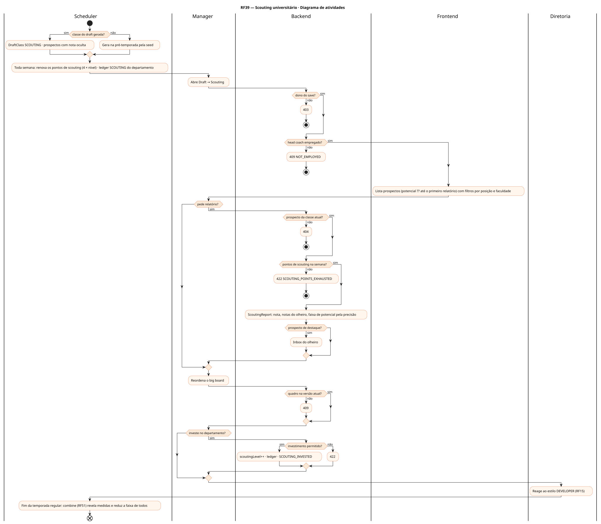
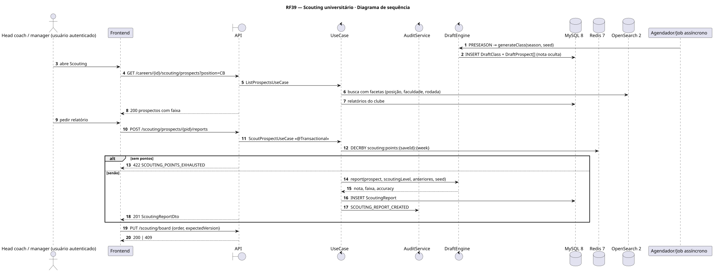
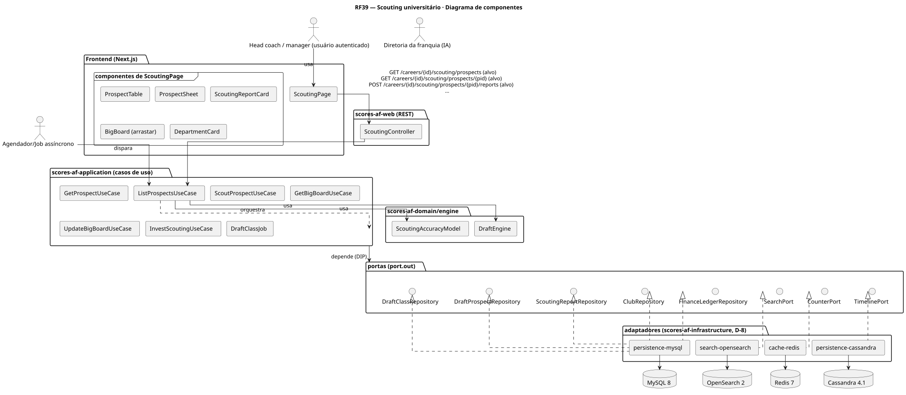
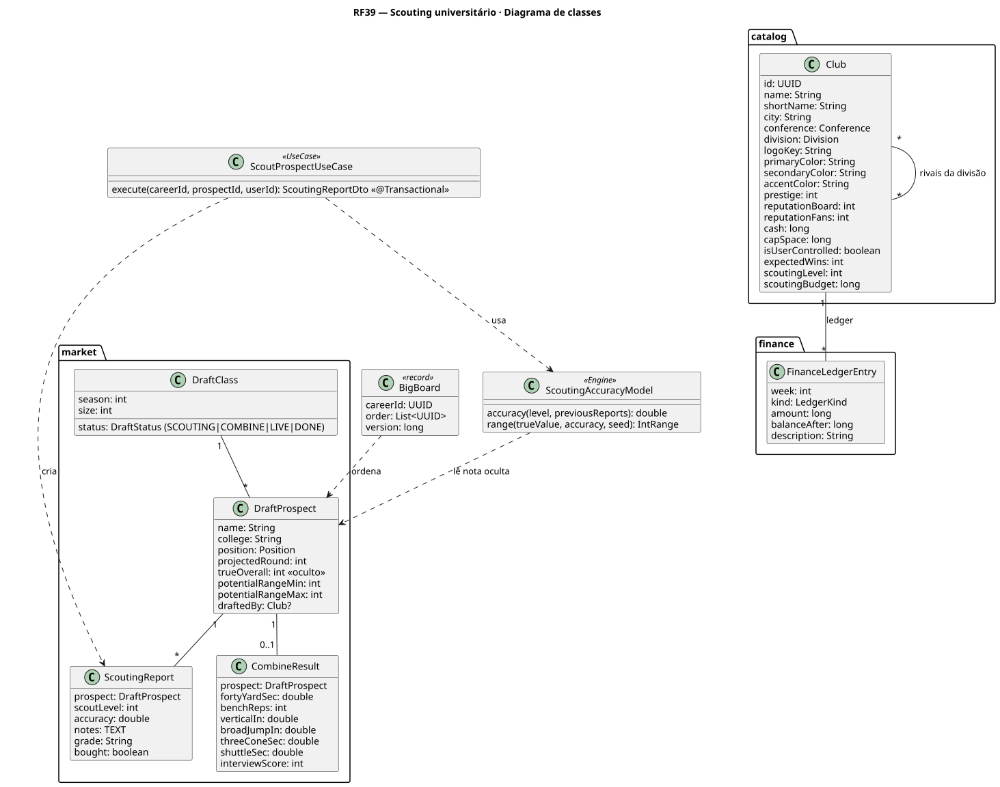
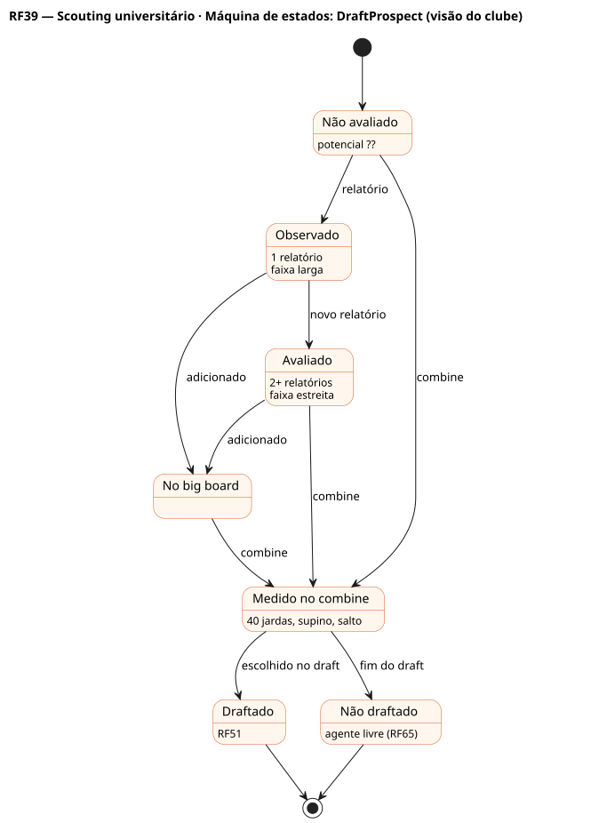

# RF39 — Scouting universitário

## História de usuário

> HU-RF39 — COMO head coach POSSO enviar olheiros para avaliar prospectos universitários ao longo da temporada, montar o meu quadro de prospectos (big board) e investir no departamento de scouting PARA chegar ao draft (RF51) sabendo o potencial real de quem vou escolher

Sprint: 11 · Atores: Manager, Scheduler, Diretoria · Tela: Draft → Scouting (/c/{careerId}/scouting): prospectos, relatórios, big board, departamento

## Diagramas

### Atividades

Fonte: [`RF39-act.puml`](RF39-act.puml)

### Sequência

Fonte: [`RF39-seq.puml`](RF39-seq.puml)

### Componentes

Fonte: [`RF39-cmp.puml`](RF39-cmp.puml)

### Classes

Fonte: [`RF39-cls.puml`](RF39-cls.puml)

### Máquina de estados: DraftProspect (visão do clube)

Fonte: [`RF39-stm.puml`](RF39-stm.puml)

## Endpoints

✅ = existe num controller do `scores-af-web` · ⛔ alvo = previsto no modelo, ainda sem controller (lista em `generator/endpoints_code.json`).

| Estado | Método | Rota | Caso de uso | Autorização | Descrição |
|---|---|---|---|---|---|
| ⛔ alvo | `GET` | `/api/v1/careers/{id}/scouting/prospects` | `ListProspectsUseCase` | JWT · dono do save | Classe do draft com filtros (posição, faculdade, rodada projetada) · potencial em faixa conforme os relatórios |
| ⛔ alvo | `GET` | `/api/v1/careers/{id}/scouting/prospects/{pid}` | `GetProspectUseCase` | JWT · dono do save | Ficha: relatórios, nota, faixa de potencial, combine (se já houve) |
| ⛔ alvo | `POST` | `/api/v1/careers/{id}/scouting/prospects/{pid}/reports` | `ScoutProspectUseCase` | JWT · dono do save | Gasta pontos de scouting da semana: novo relatório com precisão pelo nível do departamento |
| ⛔ alvo | `GET` | `/api/v1/careers/{id}/scouting/board` | `GetBigBoardUseCase` | JWT · dono do save | Quadro de prospectos ordenado pelo usuário |
| ⛔ alvo | `PUT` | `/api/v1/careers/{id}/scouting/board` | `UpdateBigBoardUseCase` | JWT · dono do save | Reordena o quadro (expectedVersion) |
| ⛔ alvo | `POST` | `/api/v1/careers/{id}/scouting/invest` | `InvestScoutingUseCase` | JWT · dono do save | Sobe Club.scoutingLevel (1–5): mais pontos por semana e mais precisão |

## Pontos de decisão

| Gateway | Regra | Se falso |
|---|---|---|
| Dono do save? | save.userId == jwt.sub | 403 + AuditLog ACCESS_DENIED |
| Head coach empregado? | save.employmentStatus == EMPLOYED | 409 NOT_EMPLOYED |
| Classe do draft gerada? | PRESEASON: DraftClass SCOUTING com 250–300 prospectos pela seed (SeedPolicy.derive(save.seed, 'draft', season)) · trueOverall e potencial ocultos | scouting indisponível até a pré-temporada |
| Prospecto da classe atual? | prospect.draftClass == classe da temporada e draftedBy nulo | 404 PROSPECT_NOT_FOUND |
| Pontos de scouting na semana? | pontos restantes ≥ custo (relatório 1 ponto, visita 3) · pontos por semana = 4 × scoutingLevel | 422 SCOUTING_POINTS_EXHAUSTED |
| Precisão do relatório? | accuracy = 0,5 + 0,08 × scoutingLevel + 0,05 × relatórios anteriores (máx. 0,95) · faixa de potencial encolhe com a precisão | — |
| Prospecto de destaque? | nota ≥ 1ª rodada e potencial alto → inbox do olheiro | sem aviso |
| Investimento permitido? | scoutingLevel < 5 · caixa ≥ custo · 1 investimento por temporada | 422 SCOUTING_MAX_LEVEL / INSUFFICIENT_CASH / INVEST_COOLDOWN |
| Quadro na versão atual? | expectedVersion == board.version | 409 BOARD_VERSION_CONFLICT |

---
Gerado por `../generator/generate.py` a partir de `../generator/model/*.py` e `../generator/common.py`; não edite os .puml à mão.
