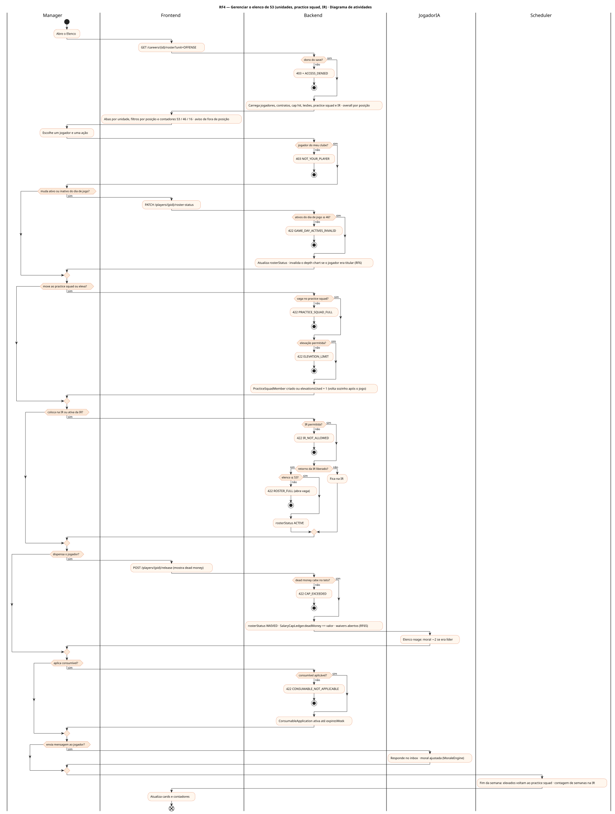
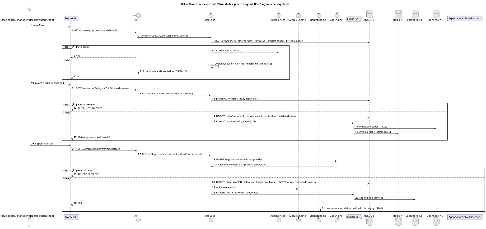
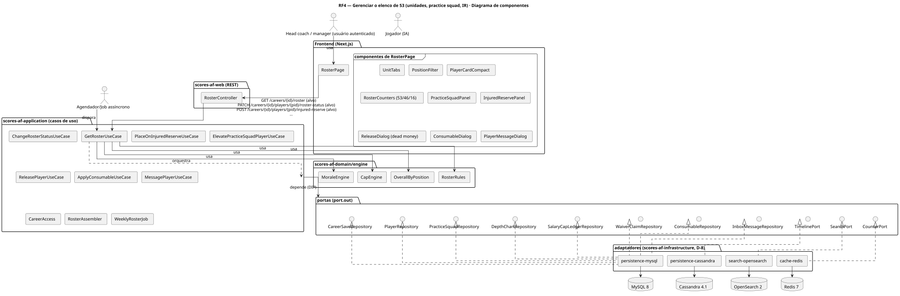
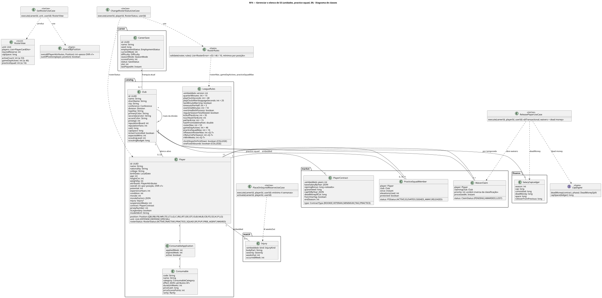
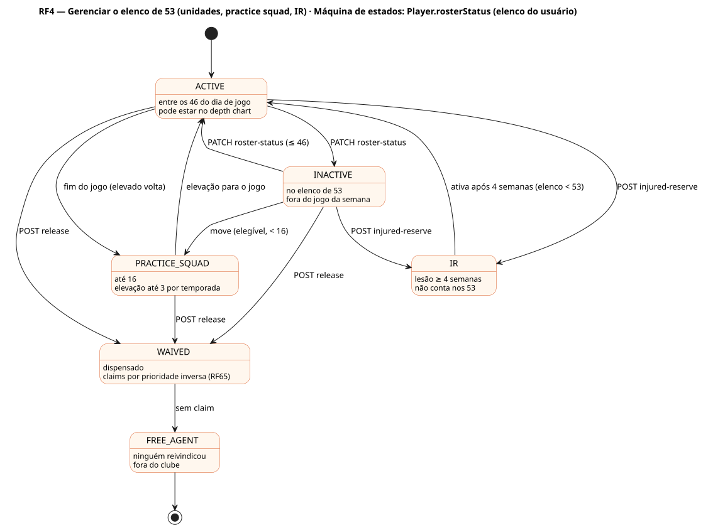

# RF4 — Gerenciar o elenco de 53 (unidades, practice squad, IR)

## História de usuário

> HU-RF4 — COMO head coach dentro de uma carreira POSSO gerenciar o elenco de 53 jogadores por unidade (ataque, defesa, times especiais), o practice squad e a lista de lesionados PARA ver overall por posição, condição, moral, lesão, contrato e definir quem fica ativo no dia de jogo

Sprint: 6 · Atores: Manager, JogadorIA, Scheduler · Tela: Elenco (/c/{careerId}/roster) — abas Ataque, Defesa, Especiais, Practice squad, IR

## Diagramas

### Atividades

Fonte: [`RF4-act.puml`](RF4-act.puml)

### Sequência

Fonte: [`RF4-seq.puml`](RF4-seq.puml)

### Componentes

Fonte: [`RF4-cmp.puml`](RF4-cmp.puml)

### Classes

Fonte: [`RF4-cls.puml`](RF4-cls.puml)

### Máquina de estados: Player.rosterStatus (elenco do usuário)

Fonte: [`RF4-stm.puml`](RF4-stm.puml)

## Endpoints

✅ = existe num controller do `scores-af-web` · ⛔ alvo = previsto no modelo, ainda sem controller (lista em `generator/endpoints_code.json`).

| Estado | Método | Rota | Caso de uso | Autorização | Descrição |
|---|---|---|---|---|---|
| ✅ | `GET` | `/api/v1/careers/{id}/roster` | `GetRosterUseCase` | JWT · dono do save | Cards compactos por unidade (unit=OFFENSE\|DEFENSE\|SPECIAL): posição, overall na posição, macros da família (D-6), condição, moral, lesão, rosterStatus, contrato e cap hit; contadores 53/46/16 |
| ✅ | `PATCH` | `/api/v1/careers/{id}/players/{pid}/roster-status` | `ChangeRosterStatusUseCase` | JWT · dono do save | ACTIVE ↔ INACTIVE do dia de jogo (46 ativos) ou move ao practice squad (dos 53, passa por waivers até a semana avançar: PRACTICE_SQUAD_WAIVERS, Q-23) |
| ⛔ alvo | `POST` | `/api/v1/careers/{id}/players/{pid}/injured-reserve` | `PlaceOnInjuredReserveUseCase` | JWT · dono do save | Coloca na IR (mínimo 4 semanas) e libera vaga no elenco de 53; retorno com POST …/activate |
| ⛔ alvo | `POST` | `/api/v1/careers/{id}/practice-squad/{pid}/elevate` | `ElevatePracticeSquadPlayerUseCase` | JWT · dono do save | Sobe um jogador do practice squad para o jogo da semana (até 3 elevações por temporada) |
| ✅ | `POST` | `/api/v1/careers/{id}/players/{pid}/release` | `ReleasePlayerUseCase` | JWT · dono do save | Dispensa: vai a waivers (RF65) e gera dead money no teto (RF49) |
| ⛔ alvo | `POST` | `/api/v1/careers/{id}/players/{pid}/consumables` | `ApplyConsumableUseCase` | JWT · dono do save | Aplica consumível com efeito em atributos do futebol americano (RF25) |
| ⛔ alvo | `POST` | `/api/v1/careers/{id}/players/{pid}/message` | `MessagePlayerUseCase` | JWT · dono do save | Mensagem ao jogador (elogio, cobrança, promessa de snaps) com efeito na moral |

## Pontos de decisão

| Gateway | Regra | Se falso |
|---|---|---|
| Dono do save? | save.userId == jwt.sub (CareerAccess.requireOwner) | 403 FORBIDDEN + AuditLog ACCESS_DENIED |
| Jogador do meu clube? | save.employmentStatus == EMPLOYED && player.clubId == save.clubId (inclui practice squad e IR) | 403 NOT_YOUR_PLAYER |
| Ativos do dia de jogo ≤ 46? | count(ACTIVE) ≤ rules.gameDayActives (46) e ≥ mínimo por posição (2 QB, 1 K, 1 P, 1 LS) | 422 GAME_DAY_ACTIVES_INVALID |
| Elenco ≤ 53? | count(ACTIVE + INACTIVE) ≤ rules.rosterMax (53) · IR e practice squad não contam | 422 ROSTER_FULL |
| Vaga no practice squad? | count(PRACTICE_SQUAD + PRACTICE_SQUAD_WAIVERS) < rules.practiceSquadMax (16) e jogador elegível (experienceYears ≤ 3 ou vaga de veterano, contando os em waivers) | 422 PRACTICE_SQUAD_FULL |
| Elevação permitida? | practiceSquadMember.elevationsUsed < 3 na temporada e ativos < 46 (elevado conta como ativo só no jogo) | 422 ELEVATION_LIMIT |
| IR permitida? | player.injury != null && injury.weeksOut ≥ 4 | 422 IR_NOT_ALLOWED |
| Retorno da IR liberado? | semanas na IR ≥ 4 e jogador recuperado (injury == null ou weeksOut == 0) e elenco < 53 | 422 IR_RETURN_NOT_ALLOWED |
| Dead money cabe no teto? | comprometido − cap hit + dead money da temporada ≤ teto, ou não aumenta (antes de 1º de junho: dead money inteiro; a partir dele: parcela do ano agora, resto na próxima, D-79/D-80) | 422 CAP_EXCEEDED (dispensa bloqueada; details: teto, comprometido, excedente) |
| Consumível aplicável? | item do usuário não aplicado, sem aplicação ativa da mesma categoria, efeito compatível com a posição | 422 CONSUMABLE_NOT_APPLICABLE |

---
Gerado por `../generator/generate.py` a partir de `../generator/model/*.py` e `../generator/common.py`; não edite os .puml à mão.
