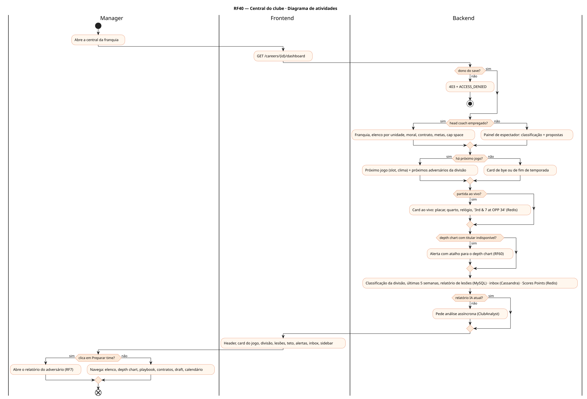
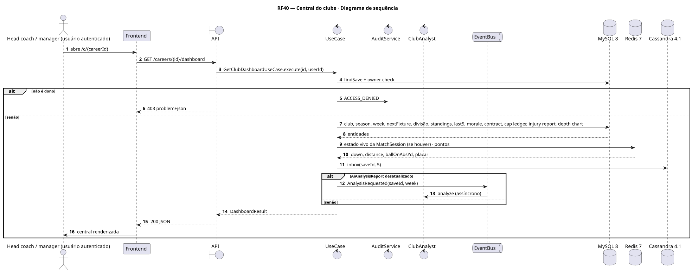
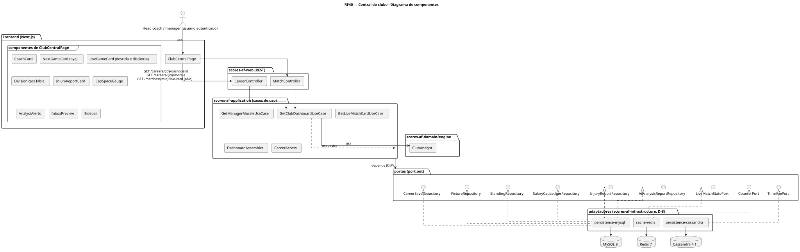
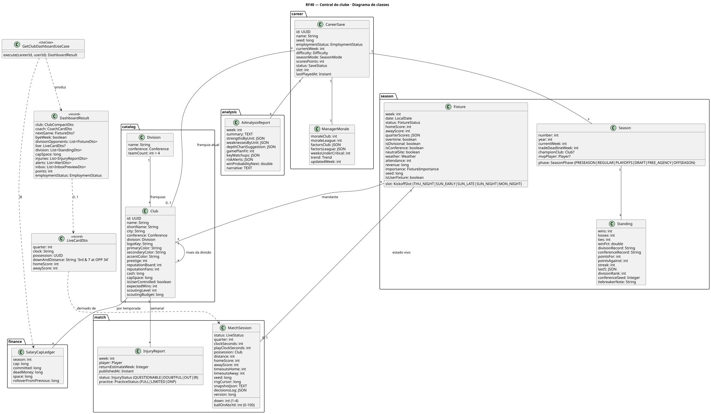
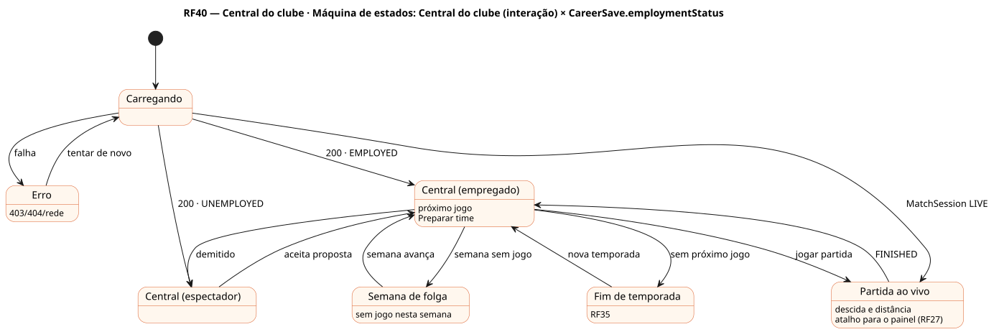

# RF40 — Central do clube

## História de usuário

> HU-RF40 — COMO head coach dentro de uma carreira POSSO ver e gerenciar a central da franquia (próximo jogo e adversários da divisão, partida ao vivo com descida e distância, classificação da divisão, teto salarial, relatório de lesões, alertas do depth chart, inbox) PARA preparar o time para a próxima semana

Sprint: 6 · Atores: Manager · Tela: Central do clube (/c/{careerId})

## Diagramas

### Atividades

Fonte: [`RF40-act.puml`](RF40-act.puml)

### Sequência

Fonte: [`RF40-seq.puml`](RF40-seq.puml)

### Componentes

Fonte: [`RF40-cmp.puml`](RF40-cmp.puml)

### Classes

Fonte: [`RF40-cls.puml`](RF40-cls.puml)

### Máquina de estados: Central do clube (interação) × CareerSave.employmentStatus

Fonte: [`RF40-stm.puml`](RF40-stm.puml)

## Endpoints

✅ = existe num controller do `scores-af-web` · ⛔ alvo = previsto no modelo, ainda sem controller (lista em `generator/endpoints_code.json`).

| Estado | Método | Rota | Caso de uso | Autorização | Descrição |
|---|---|---|---|---|---|
| ✅ | `GET` | `/api/v1/careers/{id}/dashboard` | `GetClubDashboardUseCase` | JWT · dono do save | Head coach, franquia, próximo jogo ou bye, próximos adversários da divisão, partida ao vivo, últimas semanas, divisão, cap space, lesões, alertas IA, inbox |
| ✅ | `GET` | `/api/v1/careers/{id}/morale` | `GetManagerMoraleUseCase` | JWT · dono do save | Moral com a franquia e com a liga + fatores (RF41) |
| ⛔ alvo | `GET` | `/api/v1/matches/{mid}/live-card` | `GetLiveMatchCardUseCase` | JWT · dono do save | Placar, quarto, relógio, posse e 'descida & distância at OPP yd' (Redis) |

## Pontos de decisão

| Gateway | Regra | Se falso |
|---|---|---|
| Dono do save? | save.userId == jwt.sub | 403 + AuditLog ACCESS_DENIED |
| Head coach empregado? | save.employmentStatus == EMPLOYED | painel em modo espectador (RF37) |
| Há próximo jogo? | Fixture SCHEDULED da franquia na temporada | semana de bye: card Semana de folga · fim da temporada: card Avançar (RF35) |
| Partida ao vivo? | MatchSession da franquia com status LIVE, BREAK ou AWAITING_PLAY_CALL | card do próximo jogo |
| Depth chart com titular indisponível? | slot depth 1 com InjuryReport OUT/IR ou suspenso | sem alerta |
| Relatório IA atual? | AiAnalysisReport.week == save.currentWeek | agenda recomputação do ClubAnalyst |

---
Gerado por `../generator/generate.py` a partir de `../generator/model/*.py` e `../generator/common.py`; não edite os .puml à mão.
