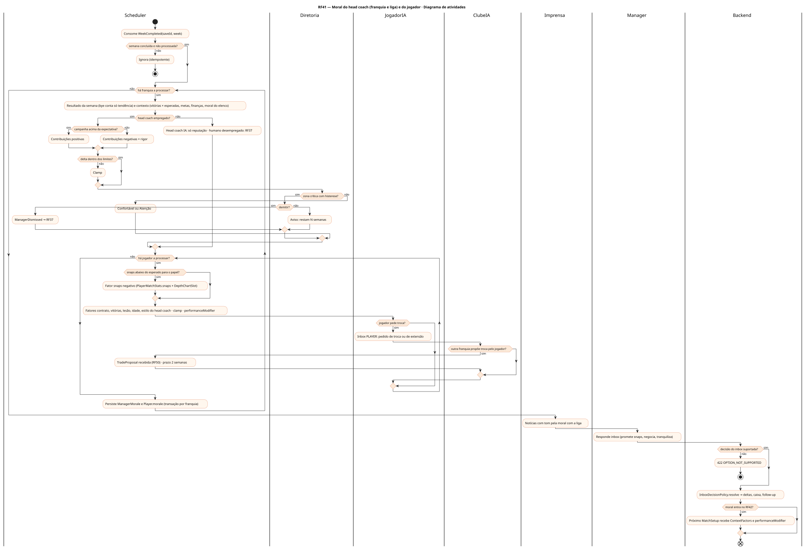
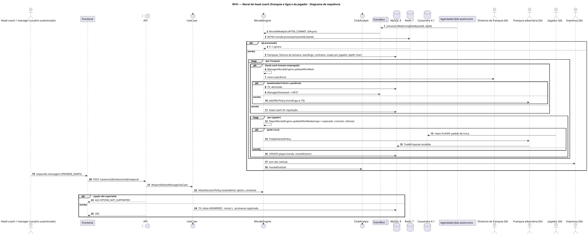
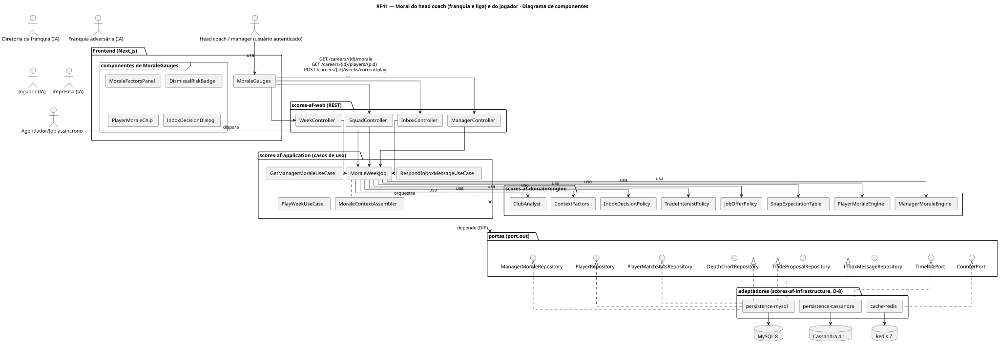
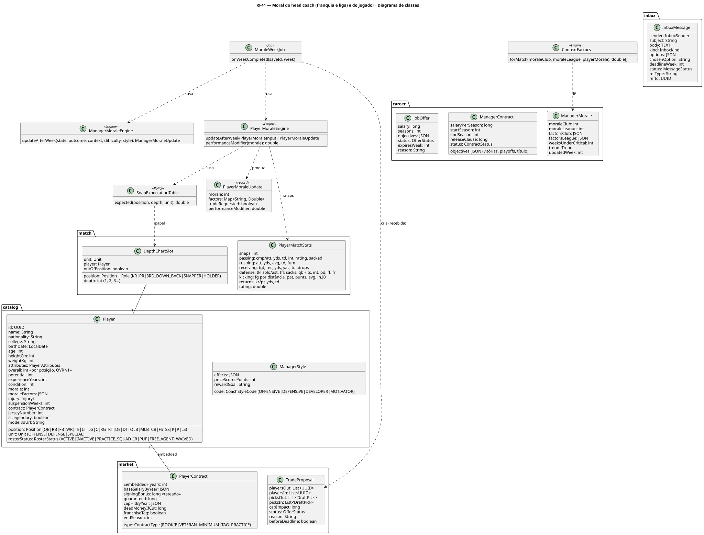
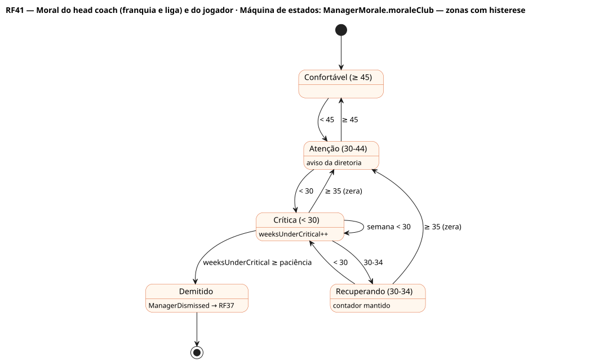
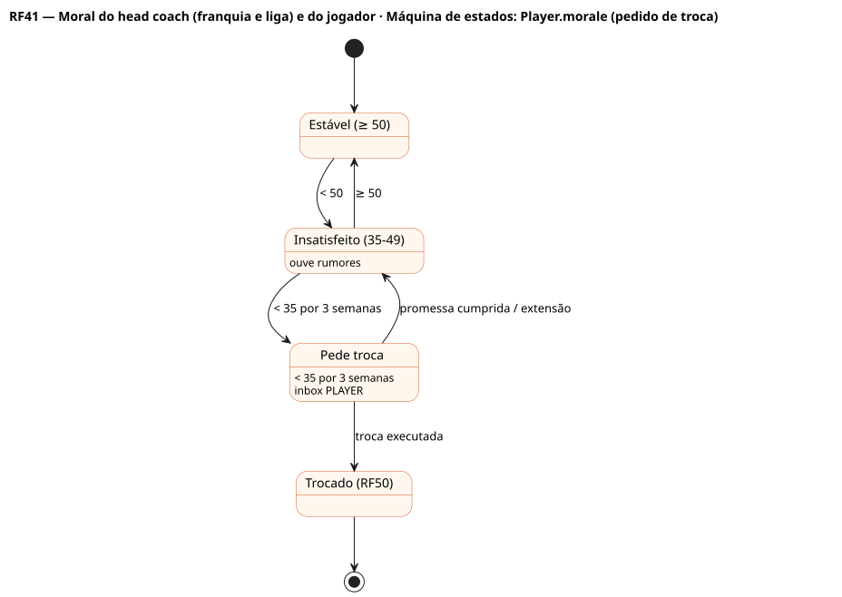

# RF41 — Moral do head coach (franquia e liga) e do jogador

## História de usuário

> HU-RF41 — COMO sistema backend POSSO calcular por semana a moral do head coach (com a franquia e com a liga) e de cada jogador (snaps jogados × esperados para o papel na posição, contrato, vitórias) PARA decidir demissões, propostas de outras franquias, pedidos de troca do jogador, respostas do inbox e o fator de moral na simulação (RF42)

Sprint: 6 · Atores: Scheduler, Manager, Diretoria, ClubeIA, JogadorIA, Imprensa · Tela: Transversal — medidores de moral na central, no head coach, no modal do jogador e no inbox

## Diagramas

### Atividades

Fonte: [`RF41-act.puml`](RF41-act.puml)

### Sequência

Fonte: [`RF41-seq.puml`](RF41-seq.puml)

### Componentes

Fonte: [`RF41-cmp.puml`](RF41-cmp.puml)

### Classes

Fonte: [`RF41-cls.puml`](RF41-cls.puml)

### Máquina de estados: ManagerMorale.moraleClub — zonas com histerese

Fonte: [`RF41-stm.puml`](RF41-stm.puml)

### Máquina de estados: Player.morale (pedido de troca)

Fonte: [`RF41-stm-player-morale-pedido-de-troca.puml`](RF41-stm-player-morale-pedido-de-troca.puml)

## Endpoints

✅ = existe num controller do `scores-af-web` · ⛔ alvo = previsto no modelo, ainda sem controller (lista em `generator/endpoints_code.json`).

| Estado | Método | Rota | Caso de uso | Autorização | Descrição |
|---|---|---|---|---|---|
| ⛔ alvo | `GET` | `/api/v1/careers/{id}/morale` | `GetManagerMoraleUseCase` | JWT · dono do save | moraleClub/moraleLeague, fatores, tendência, semanas em zona crítica, risco de demissão |
| ✅ | `GET` | `/api/v1/careers/{id}/players/{pid}` | `GetPlayerSheetUseCase` | JWT · dono do save | Moral do jogador, fatores (snaps, contrato, vitórias, papel), pedido de troca, modificador de desempenho |
| ✅ | `POST` | `/api/v1/careers/{id}/weeks/current/play` | `PlayWeekUseCase` | JWT · dono do save | Ao fechar a semana publica WeekCompleted → MoraleWeekJob |
| ⛔ alvo | `POST` | `/api/v1/careers/{id}/inbox/{mid}/respond` | `RespondInboxMessageUseCase` | JWT · dono do save | InboxDecisionPolicy → deltas de moral, caixa e follow-up (renovação, promessa de snaps, troca) |
| ⛔ alvo | `GET` | `/api/v1/careers/{id}/analysis` | `GetAnalysisReportUseCase` | JWT · dono do save | Previsão de zona e risco de demissão (ClubAnalyst) |

## Pontos de decisão

| Gateway | Regra | Se falso |
|---|---|---|
| Semana concluída e não processada? | WeekCompleted(saveId, week) AFTER_COMMIT · SETNX morale:processed:{saveId}:{week} | job ignora |
| Head coach empregado? | save.employmentStatus == EMPLOYED | só moraleLeague evolui · JobOfferPolicy (RF37) |
| Campanha acima da expectativa? | vitórias × vitórias esperadas pelo overall das unidades · margem do jogo × esperada (mando 2,5) · surpresa = tanh(...) | contribuição negativa × rigor da diretoria por dificuldade |
| Delta dentro dos limites? | EMA (memória 6 semanas, temporada curta) · deltaClub e deltaLeague em [−10, +6] | clamp e [0, 100] |
| Zona crítica com histerese? | moraleClub < 30 → weeksUnderCritical++ · ≥ 35 zera · 30–44 Atenção | Confortável (≥ 45) |
| Demitir? | weeksUnderCritical ≥ paciência (EASY 4 · NORMAL 3 · HARD 2 · LEGEND 2) · nunca durante a semana de jogo | aviso da diretoria |
| Snaps abaixo do esperado para o papel? | snaps% × esperado por posição e profundidade (QB titular 95 %, OL 95 %, DL em rodízio 60–70 %, RB 50–60 %, WR3 45 %, especialistas não contam) | fator neutro |
| Jogador pede troca? | moral < 35 por 3 semanas e (snaps abaixo do esperado ou contrato no último ano sem extensão) | jogador estável (moral < 50 só ouve rumores) |
| Outra franquia propõe troca pelo jogador? | TradeInterestPolicy: pedido de troca, contrato, overall, necessidade da posição · antes do prazo de trocas | sem proposta |
| Decisão do inbox suportada? | option ∈ opções do kind (ACCEPT, REJECT, NEGOTIATE, REASSURE, PROMISE_SNAPS, CONFRONT…) | 422 OPTION_NOT_SUPPORTED |
| Moral entra no RF42? | ContextFactors.forMatch(moralClub, moralLiga, moralJogador) → ±3 % nas chances por unidade · performanceModifier até ±5 % por jogador | neutro (moral 50) |

---
Gerado por `../generator/generate.py` a partir de `../generator/model/*.py` e `../generator/common.py`; não edite os .puml à mão.
