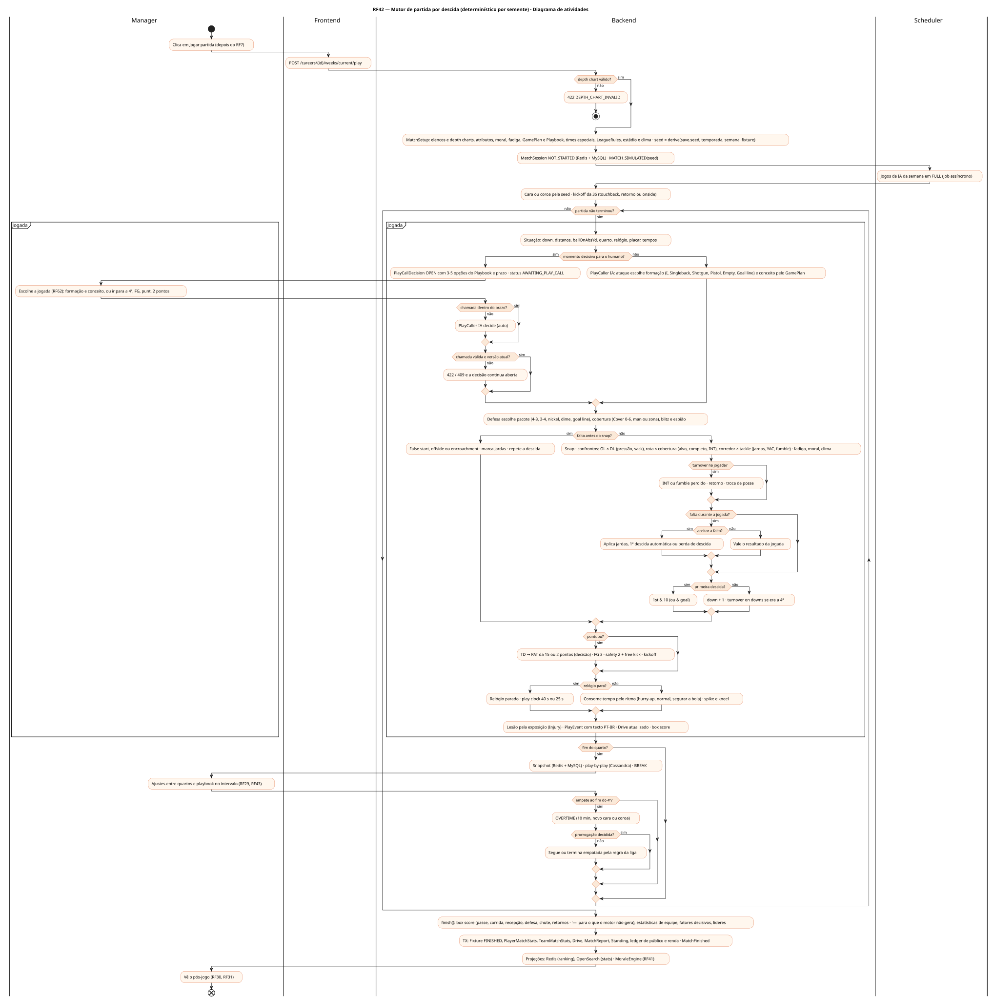
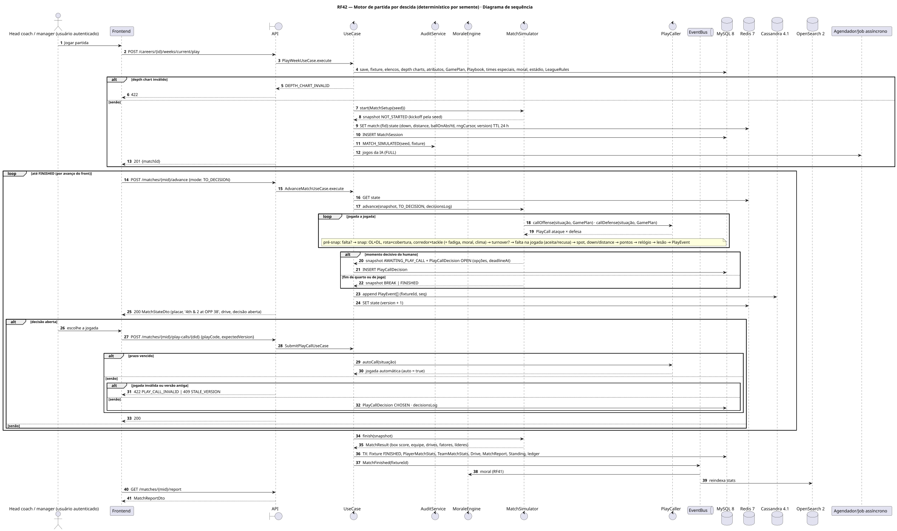
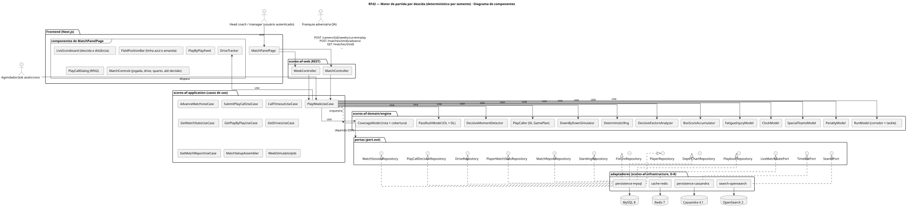
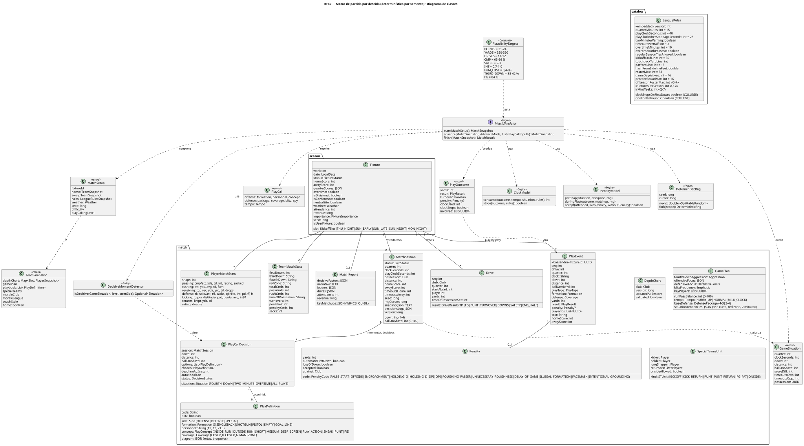
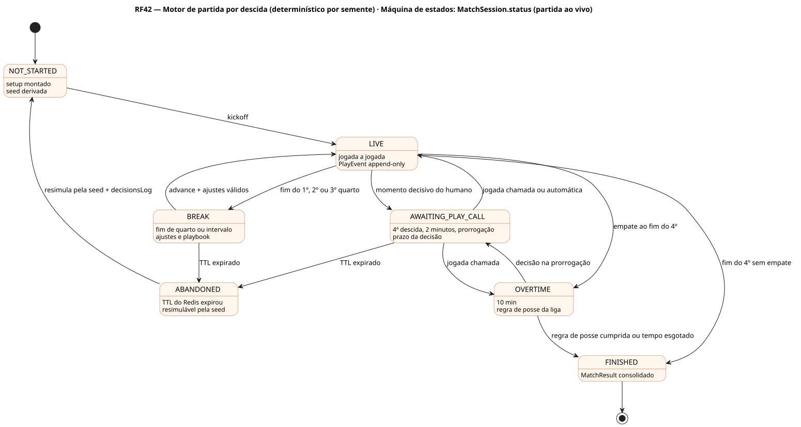
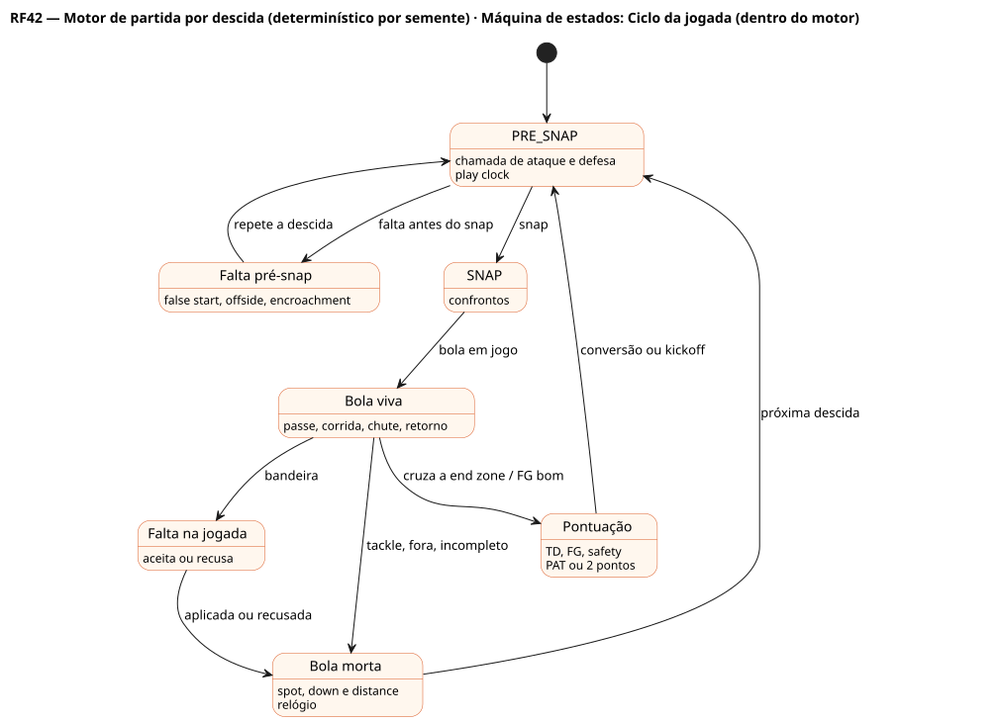
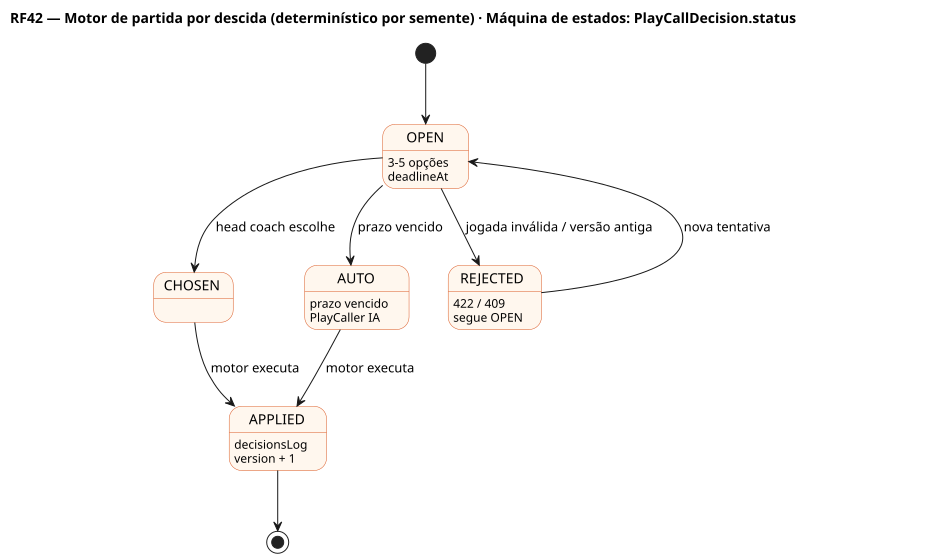
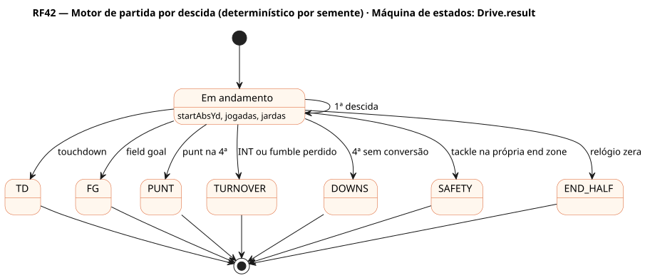

# RF42 — Motor de partida por descida (determinístico por semente)

## História de usuário

> HU-RF42 — COMO sistema backend POSSO simular a partida jogada a jogada, com a formação e o conceito do ataque contra o pacote e a cobertura da defesa, confrontos (bloqueio × pass rush, rota × cobertura, corredor × tackle), fadiga, moral, clima, relógio, faltas e times especiais, parando nos momentos decisivos para o head coach chamar a jogada, PARA gerar um resultado plausível e sempre o mesmo para a mesma semente e as mesmas decisões

Sprint: 5 · Atores: Manager, Scheduler, ClubeIA · Tela: Partida ao vivo (/c/{careerId}/match): placar, '3rd & 7 at OPP 34', drive atual, play-by-play, chamada de jogada (RF62)

## Diagramas

### Atividades

Fonte: [`RF42-act.puml`](RF42-act.puml)

### Sequência

Fonte: [`RF42-seq.puml`](RF42-seq.puml)

### Componentes

Fonte: [`RF42-cmp.puml`](RF42-cmp.puml)

### Classes

Fonte: [`RF42-cls.puml`](RF42-cls.puml)

### Máquina de estados: MatchSession.status (partida ao vivo)

Fonte: [`RF42-stm.puml`](RF42-stm.puml)

### Máquina de estados: Ciclo da jogada (dentro do motor)

Fonte: [`RF42-stm-ciclo-da-jogada-dentro-do-motor.puml`](RF42-stm-ciclo-da-jogada-dentro-do-motor.puml)

### Máquina de estados: PlayCallDecision.status

Fonte: [`RF42-stm-playcalldecision-status.puml`](RF42-stm-playcalldecision-status.puml)

### Máquina de estados: Drive.result

Fonte: [`RF42-stm-drive-result.puml`](RF42-stm-drive-result.puml)

## Endpoints

✅ = existe num controller do `scores-af-web` · ⛔ alvo = previsto no modelo, ainda sem controller (lista em `generator/endpoints_code.json`).

| Estado | Método | Rota | Caso de uso | Autorização | Descrição |
|---|---|---|---|---|---|
| ⛔ alvo | `POST` | `/api/v1/careers/{id}/weeks/current/play` | `PlayWeekUseCase` | JWT · dono do save | Inicia a semana: MatchSession do usuário (seed derivada) e jogos da IA em job |
| ⛔ alvo | `POST` | `/api/v1/matches/{mid}/advance` | `AdvanceMatchUseCase` | JWT · dono do save | Avança PLAY \| DRIVE \| QUARTER \| TO_DECISION \| FULL até o próximo momento decisivo ou intervalo |
| ⛔ alvo | `GET` | `/api/v1/matches/{mid}` | `GetMatchStateUseCase` | JWT · dono do save | Estado vivo: quarto, relógio, play clock, posse, down, distance, ballOnAbsYd, tempos, placar, decisão aberta, versão |
| ⛔ alvo | `POST` | `/api/v1/matches/{mid}/play-calls/{did}` | `SubmitPlayCallUseCase` | JWT · dono do save | Chamada de jogada no momento decisivo: PlayDefinition escolhida (ou ir para a 4ª, FG, punt, 2 pontos) · expectedVersion |
| ⛔ alvo | `POST` | `/api/v1/matches/{mid}/timeouts` | `CallTimeoutUseCase` | JWT · dono do save | Tempo técnico da franquia do usuário (máx. 3 por tempo) |
| ⛔ alvo | `GET` | `/api/v1/matches/{mid}/plays` | `GetPlayByPlayUseCase` | JWT · dono do save | Play-by-play paginado por seq (Cassandra) |
| ⛔ alvo | `GET` | `/api/v1/matches/{mid}/drives` | `GetDrivesUseCase` | JWT · dono do save | Drives: início, jogadas, jardas, tempo de posse, resultado |
| ⛔ alvo | `GET` | `/api/v1/matches/{mid}/report` | `GetMatchReportUseCase` | JWT · dono do save | Box score por jogador e equipe (§3.6), fatores decisivos, líderes, confrontos-chave, público e renda |

## Pontos de decisão

| Gateway | Regra | Se falso |
|---|---|---|
| Dono do save? | save.userId == jwt.sub | 403 + AuditLog ACCESS_DENIED |
| Depth chart válido? | 11 titulares no ataque e 11 na defesa para a formação base · K, P, LS, holder, KR e PR · nenhum IR, OUT ou suspenso · 46 ativos (LeagueRules.gameDayActives) | 422 DEPTH_CHART_INVALID (lista as vagas) |
| Momento decisivo para o humano? | playCallingLevel ALL_PLAYS, ou KEY_MOMENTS e (4ª descida, últimos 2 min de cada tempo, prorrogação, conversão após TD) com posse ou defesa da franquia do usuário | PlayCaller IA chama pelo GamePlan (tendências por situação) |
| Chamada dentro do prazo? | now ≤ decision.deadlineAt (UserSettings.decisionTimeoutSeconds) | decisão automática do PlayCaller IA (auto = true) |
| Chamada válida e versão atual? | PlayDefinition do Playbook da franquia, lado correto, opção permitida na situação (FG só ao alcance do K), expectedVersion == session.version | 422 PLAY_CALL_INVALID / 409 STALE_VERSION |
| Falta antes do snap? | u < P(false start \| ruído do estádio, disciplina) ou P(offside/encroachment \| pass rush, disciplina) | snap normal |
| Turnover na jogada? | sack-fumble, fumble do portador (proteção da bola × impacto) ou INT (precisão × cobertura × pressão) | segue com o resultado em jardas |
| Falta durante a jogada? | u < P(holding, DPI, OPI, roughing, facemask… \| confronto, disciplina) | resultado da jogada vale |
| Aceitar a falta? | a equipe ofendida aceita se o resultado com a penalidade for melhor (jardas, 1ª descida automática, perda de descida) · humano decide só se for momento decisivo | recusa: vale a jogada |
| Primeira descida? | jardas ganhas ≥ distance ou penalidade com 1ª descida automática | down + 1 · na 4ª sem conversão → posse troca (turnover on downs) |
| Pontuou? | TD (bola cruza a end zone) · FG convertido · safety | segue o drive |
| Relógio para? | incompleto, fora de campo, falta, pontuação, troca de posse, tempo técnico, aviso dos 2 minutos · COLLEGE: também na 1ª descida | relógio corre (play clock 40 s) |
| Fim do quarto? | clockSeconds == 0 com bola morta | próxima jogada |
| Empate ao fim do 4º? | homeScore == awayScore | FINISHED |
| Prorrogação decidida? | PRO: as duas posses salvo TD na primeira, depois quem pontuar · COLLEGE: posses alternadas da 25 · fim dos 10 min empatado só se regularSeasonTiesAllowed | segue a prorrogação |
| Determinístico? | mesma seed + mesmo decisionsLog ⇒ mesmos PlayEvent e mesmo placar (SplittableRandom com rngCursor no snapshot · teste com amostra dourada) | build falha (teste de determinismo) |
| Plausível? | em 1 000 jogos IA × IA: ≈21–24 pts, 320–360 jardas, 11–12 drives, 63–66 % passes completos, 2–3 sacks, 0,7–1,0 INT, 0,4–0,6 fumble perdido, 38–42 % na 3ª descida, ≈84 % FG por equipe e jogo | build falha (teste de plausibilidade) |

---
Gerado por `../generator/generate.py` a partir de `../generator/model/*.py` e `../generator/common.py`; não edite os .puml à mão.
