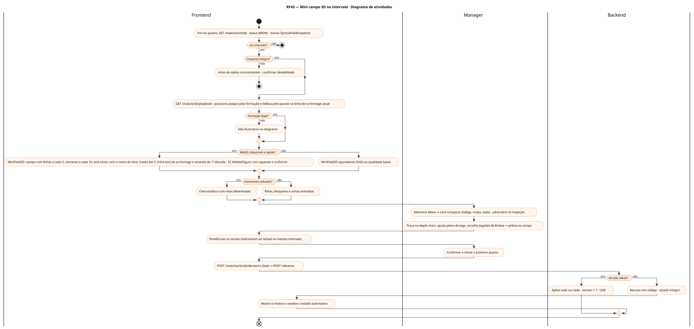
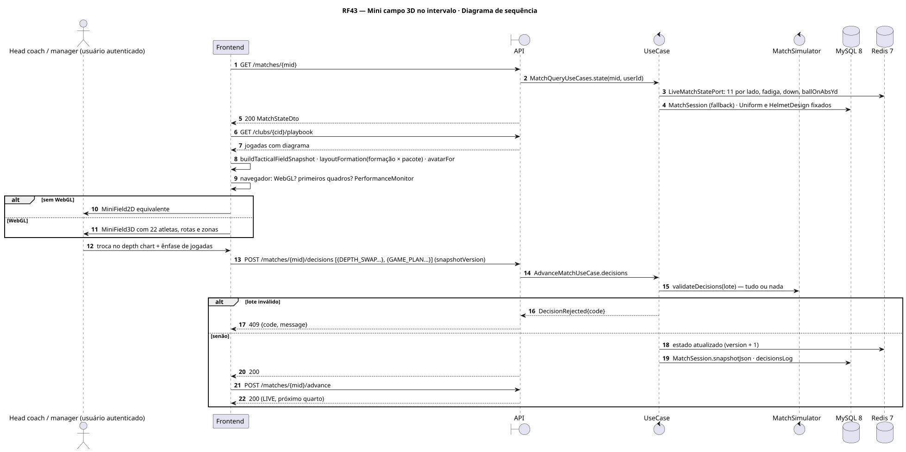
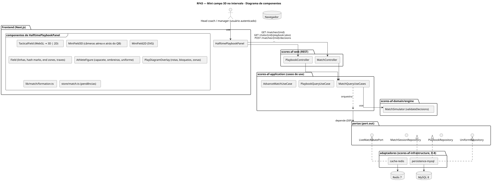
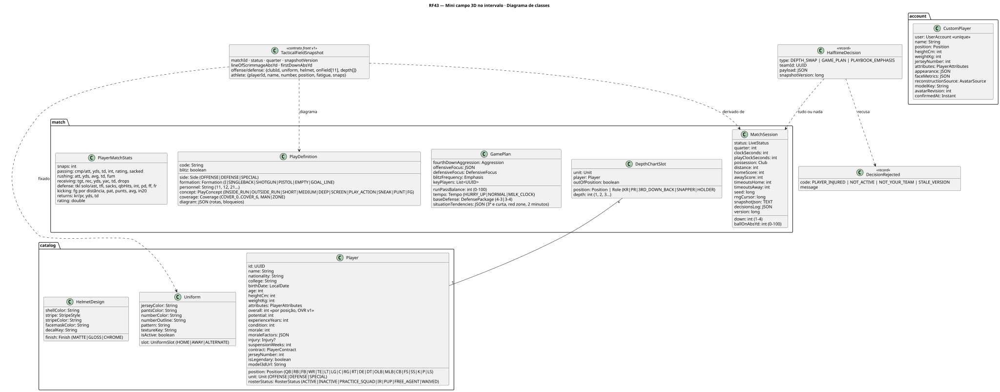
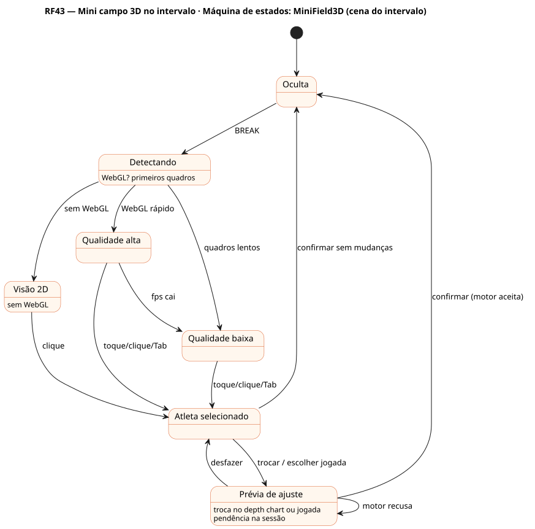
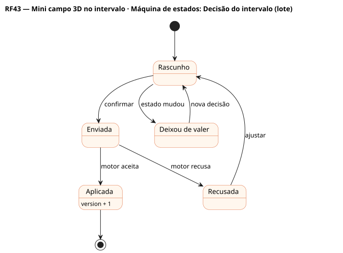

# RF43 — Mini campo 3D no intervalo

## História de usuário

> HU-RF43 — DADO QUE estou no intervalo ou entre quartos QUANDO o painel do playbook abre ENTÃO vejo um mini campo 3D com os 22 atletas alinhados na formação do ataque contra o pacote da defesa, com rotas, bloqueios e zonas de cobertura desenhadas, PARA ajustar o depth chart, o plano de jogo e as jogadas do próximo quarto

Sprint: 8 · Atores: Manager · Tela: Partida ao vivo → painel do intervalo (/c/{careerId}/match) — abas Depth chart · Plano de jogo · Playbook

## Diagramas

### Atividades

Fonte: [`RF43-act.puml`](RF43-act.puml)

### Sequência

Fonte: [`RF43-seq.puml`](RF43-seq.puml)

### Componentes

Fonte: [`RF43-cmp.puml`](RF43-cmp.puml)

### Classes

Fonte: [`RF43-cls.puml`](RF43-cls.puml)

### Máquina de estados: MiniField3D (cena do intervalo)

Fonte: [`RF43-stm.puml`](RF43-stm.puml)

### Máquina de estados: Decisão do intervalo (lote)

Fonte: [`RF43-stm-decisao-do-intervalo-lote.puml`](RF43-stm-decisao-do-intervalo-lote.puml)

## Endpoints

✅ = existe num controller do `scores-af-web` · ⛔ alvo = previsto no modelo, ainda sem controller (lista em `generator/endpoints_code.json`).

| Estado | Método | Rota | Caso de uso | Autorização | Descrição |
|---|---|---|---|---|---|
| ✅ | `GET` | `/api/v1/matches/{mid}` | `MatchQueryUseCases.state` | JWT · dono do save | Estado vivo + snapshot tático: 11 por lado, depth chart em campo, fadiga, lesões, uniformes e capacetes fixados, versão |
| ⛔ alvo | `GET` | `/api/v1/clubs/{cid}/playbook` | `PlaybookQueryUseCase` | JWT · dono do save | Jogadas com diagrama (formação, rotas, bloqueios, cobertura) para desenhar no mini campo |
| ✅ | `POST` | `/api/v1/matches/{mid}/decisions` | `AdvanceMatchUseCase.decisions` | JWT · dono do save | Lote do intervalo: DEPTH_SWAP, GAME_PLAN, PLAYBOOK_EMPHASIS · tudo ou nada · recusa com código |
| ✅ | `POST` | `/api/v1/matches/{mid}/advance` | `AdvanceMatchUseCase` | JWT · dono do save | Confirma e inicia o próximo quarto (snapshotVersion confere) |

## Pontos de decisão

| Gateway | Regra | Se falso |
|---|---|---|
| Dono do save? | save.userId == jwt.sub | 403 + AuditLog ACCESS_DENIED |
| Em intervalo? | MatchSession.status == BREAK (fim de quarto ou intervalo) | painel não abre · 409 DECISIONS_ONLY_AT_BREAK |
| Snapshot íntegro? | 22 atletas únicos = 11 por lado do depth chart em campo · nenhum reserva ou lesionado em campo · uniforme e capacete lidos do snapshot | aviso e confirmar desabilitado |
| Formação legal? | 7 na linha de scrimmage no ataque, elegíveis nas pontas, 11 por lado · rotas e zonas dentro do campo de 53,3 jardas | diagrama marcado como ilustrativo (não bloqueia) |
| WebGL disponível e rápido? | WebGL + primeiros quadros < 120 ms em média + PerformanceMonitor ≥ 24 fps | sem WebGL: visão 2D do campo (SVG) · lento: qualidade baixa |
| Movimento reduzido? | prefers-reduced-motion ou preferência | rotas animadas · modo Calmo anima só o selecionado |
| Decisão válida? | troca no depth chart com jogador ativo, não lesionado, posição compatível (fora de posição com aviso) · GamePlan nos limites · versão do snapshot | motor recusa com código · estado íntegro · decisão inválida removida e avisada |
| Identidade canônica? | avatarFor(playerId) + Uniform e HelmetDesign fixados no snapshot · número legível (contraste) | o mesmo atleta mudaria entre telas |
| Orçamento de desempenho? | campo 120 × 53,3 com linhas, hash marks, end zones e traves · 22 figuras com geometria compartilhada · arquibancada instanciada com LOD | qualidade baixa automática |

---
Gerado por `../generator/generate.py` a partir de `../generator/model/*.py` e `../generator/common.py`; não edite os .puml à mão.
