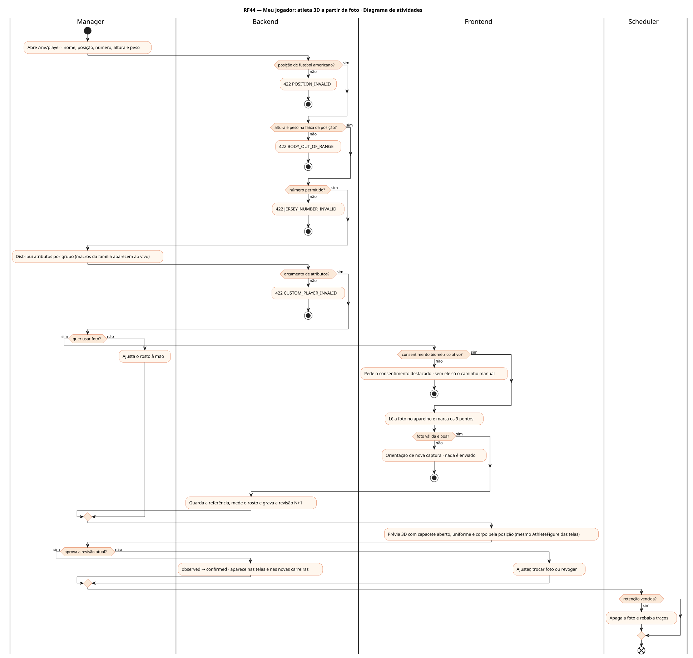
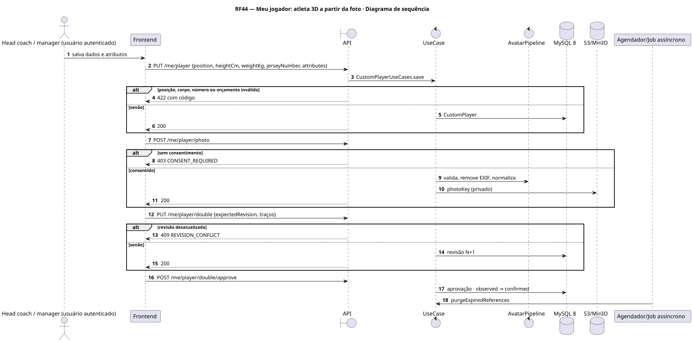
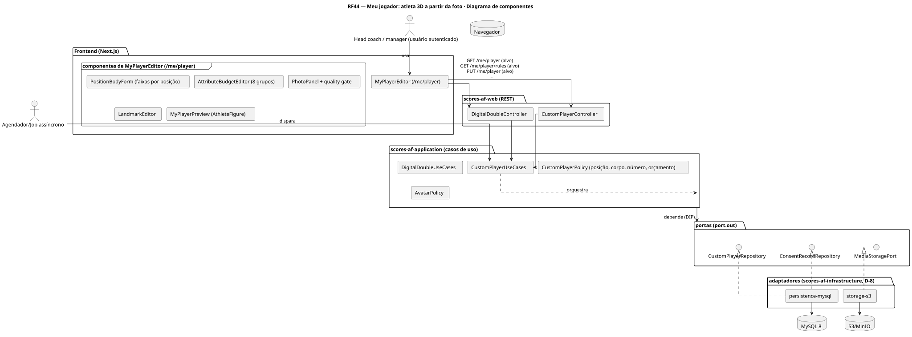
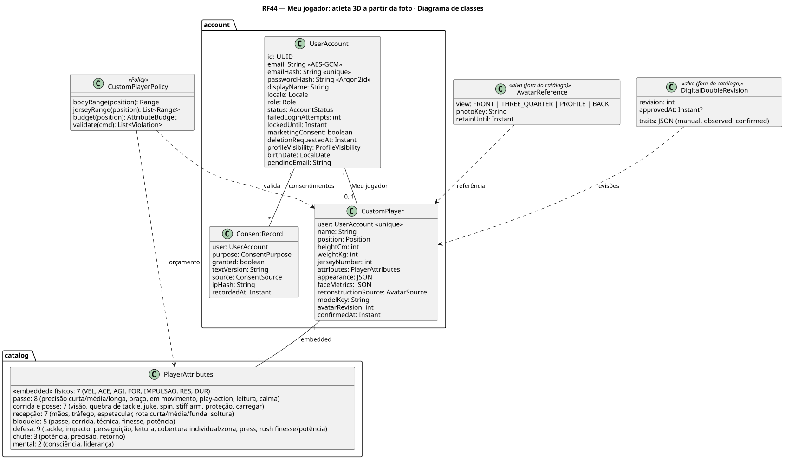
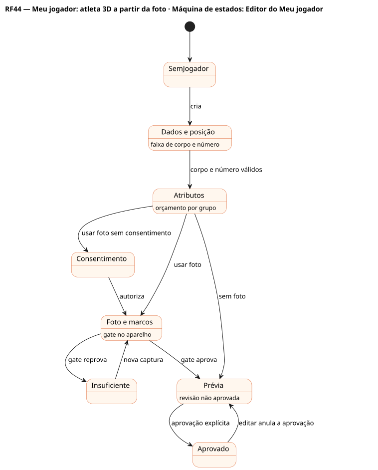

# RF44 — Meu jogador: atleta 3D a partir da foto

## História de usuário

> HU-RF44 — COMO usuário POSSO enviar minha foto e criar o 'Meu jogador' (posição de futebol americano, altura e peso na faixa da posição, número permitido, atributos por orçamento e rosto 3D) PARA incluí-lo em novas carreiras

Sprint: 9 · Atores: Manager, Scheduler · Tela: Editar meu jogador e visualizar 3D (/me/player)

## Diagramas

### Atividades

Fonte: [`RF44-act.puml`](RF44-act.puml)

### Sequência

Fonte: [`RF44-seq.puml`](RF44-seq.puml)

### Componentes

Fonte: [`RF44-cmp.puml`](RF44-cmp.puml)

### Classes

Fonte: [`RF44-cls.puml`](RF44-cls.puml)

### Máquina de estados: Editor do Meu jogador

Fonte: [`RF44-stm.puml`](RF44-stm.puml)

## Endpoints

✅ = existe num controller do `scores-af-web` · ⛔ alvo = previsto no modelo, ainda sem controller (lista em `generator/endpoints_code.json`).

| Estado | Método | Rota | Caso de uso | Autorização | Descrição |
|---|---|---|---|---|---|
| ⛔ alvo | `GET` | `/api/v1/me/player` | `CustomPlayerUseCases.get` | JWT | Meu jogador: dados, posição, atributos, estado do avatar |
| ⛔ alvo | `GET` | `/api/v1/me/player/rules` | `CustomPlayerUseCases.rules` | JWT | Faixas de altura/peso e números por posição, orçamento por grupo dos ≈40 subatributos, limites de upload |
| ⛔ alvo | `PUT` | `/api/v1/me/player` | `CustomPlayerUseCases.save` | JWT | Dados, posição e atributos (orçamento validado) |
| ⛔ alvo | `POST` | `/api/v1/me/player/photo` | `CustomPlayerUseCases.uploadPhoto` | JWT · consentimento BIOMETRIC_AVATAR | Foto JPEG/PNG ≤ 5 MB, EXIF removido |
| ⛔ alvo | `PUT` | `/api/v1/me/player/avatar` | `CustomPlayerUseCases.saveAvatar` | JWT · consentimento | Marcos faciais (do navegador) → parâmetros do rosto + quality gate |
| ⛔ alvo | `PUT` | `/api/v1/me/player/double` | `DigitalDoubleUseCases.revise` | JWT · expectedRevision | Revisão N+1 dos traços · anula a aprovação |
| ⛔ alvo | `POST` | `/api/v1/me/player/double/approve` | `DigitalDoubleUseCases.approve` | JWT | Aprovação humana da revisão atual |
| ⛔ alvo | `DELETE` | `/api/v1/me/player/avatar` | `CustomPlayerUseCases.redo` | JWT | Refazer: apaga foto, textura, modelo e marcos |

## Pontos de decisão

| Gateway | Regra | Se falso |
|---|---|---|
| Consentimento biométrico ativo? | ConsentRecord BIOMETRIC_AVATAR concedido no texto vigente (LGPD Art. 11) | 403 CONSENT_REQUIRED · só avatar manual |
| Posição de futebol americano? | position ∈ {QB, RB, FB, WR, TE, LT, LG, C, RG, RT, DE, DT, OLB, MLB, CB, FS, SS, K, P, LS} | 422 POSITION_INVALID |
| Altura e peso na faixa da posição? | faixa por posição (ex.: OL 188–203 cm e 135–165 kg · CB 175–190 cm e 80–95 kg · K/P livres dentro do geral) | 422 BODY_OUT_OF_RANGE (mostra a faixa) |
| Número permitido? | faixas por posição (OL 50–79, QB/K/P 1–19, WR 0–49 e 80–89…) | 422 JERSEY_NUMBER_INVALID |
| Orçamento de atributos? | ≈40 subatributos em 8 grupos · cada um 40–80 · soma pelo orçamento da posição (D-6) | 422 CUSTOM_PLAYER_INVALID |
| Foto válida e boa? | JPEG/PNG, ≤ 5 MB, ≥ 256 px · rosto frontal único, luz, nitidez, sem oclusão (gate no aparelho e no servidor) | 422 PHOTO_* / AVATAR_QUALITY_REJECTED com dicas |
| Revisão esperada é a atual? | expectedRevision = última revisão | 409 REVISION_CONFLICT |
| Aprovação da revisão atual? | approve(expectedRevision) = revisão atual | 409 STALE_APPROVAL |
| Retenção vencida? | captura + 180 dias ou aprovação + 30 dias | mantém |

---
Gerado por `../generator/generate.py` a partir de `../generator/model/*.py` e `../generator/common.py`; não edite os .puml à mão.
