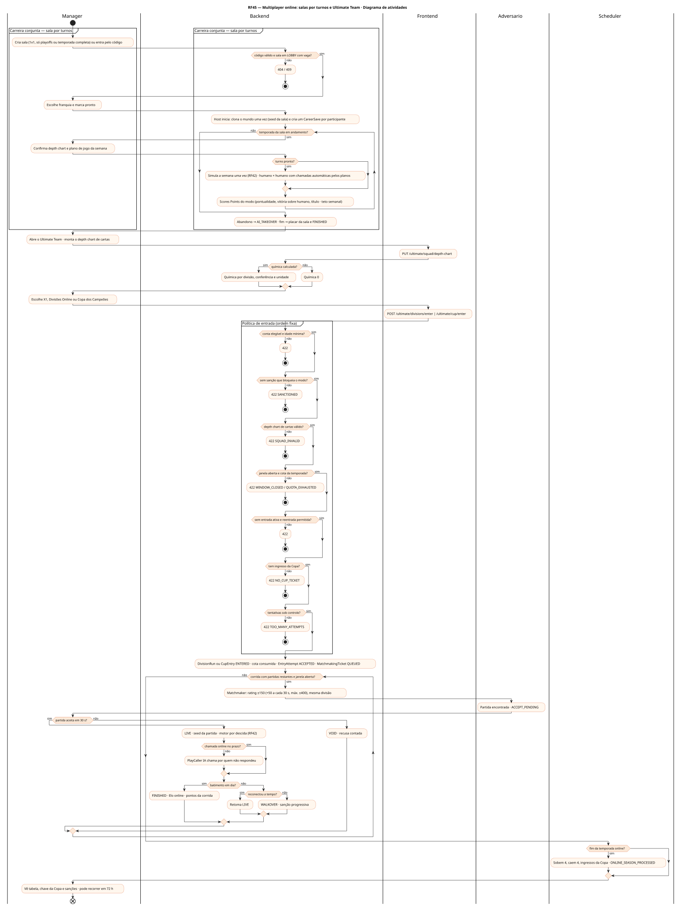
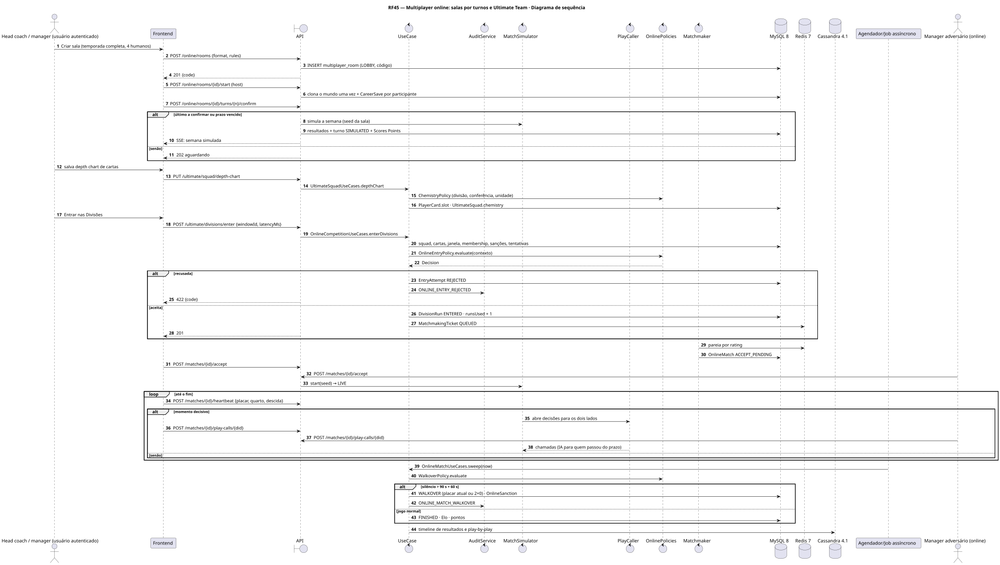
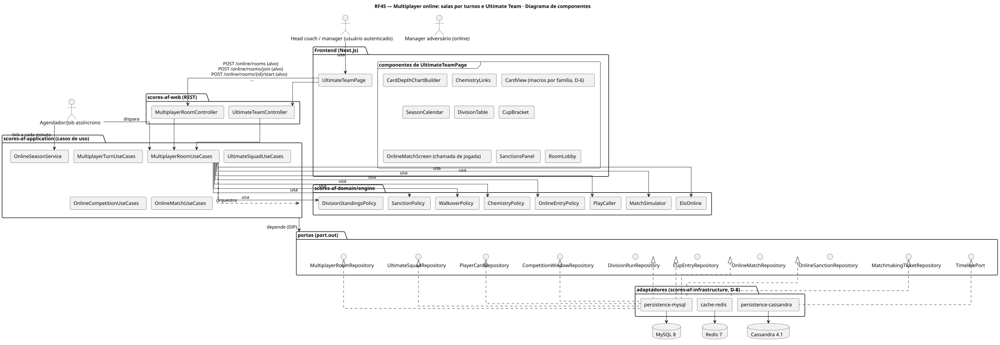
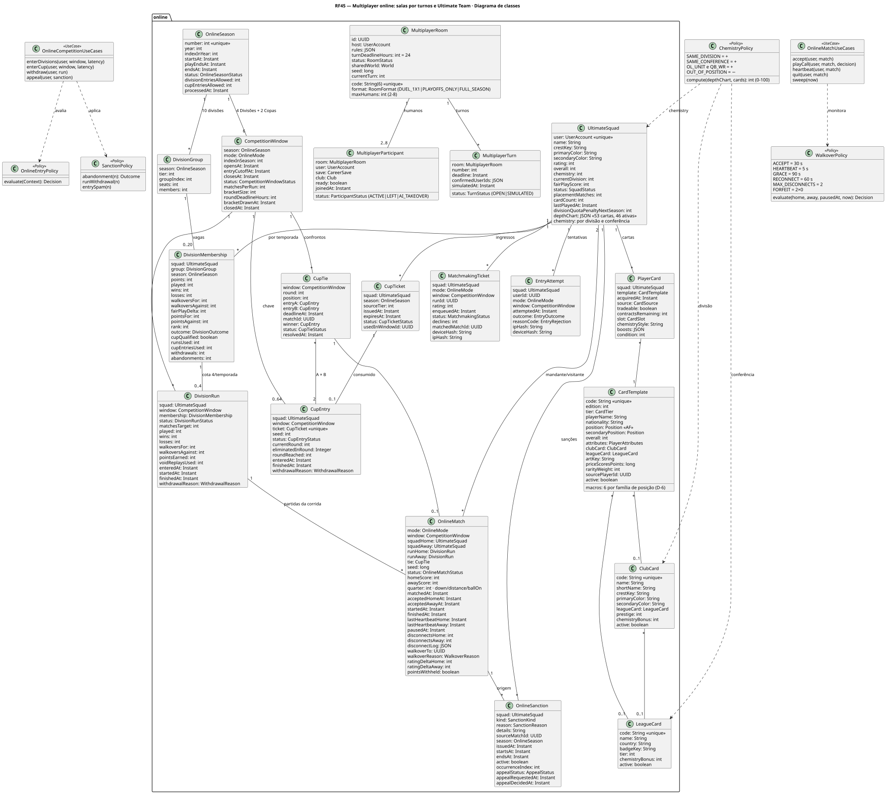
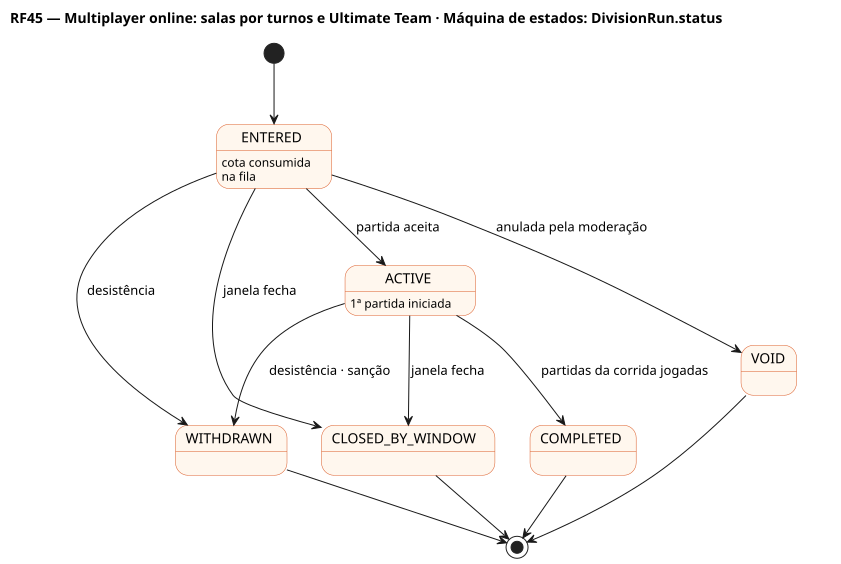
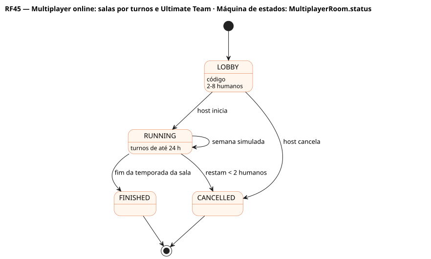
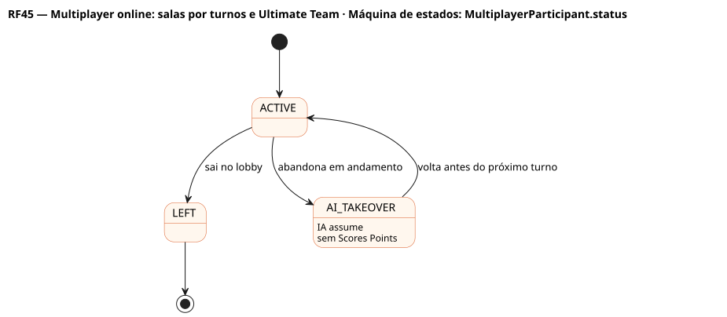
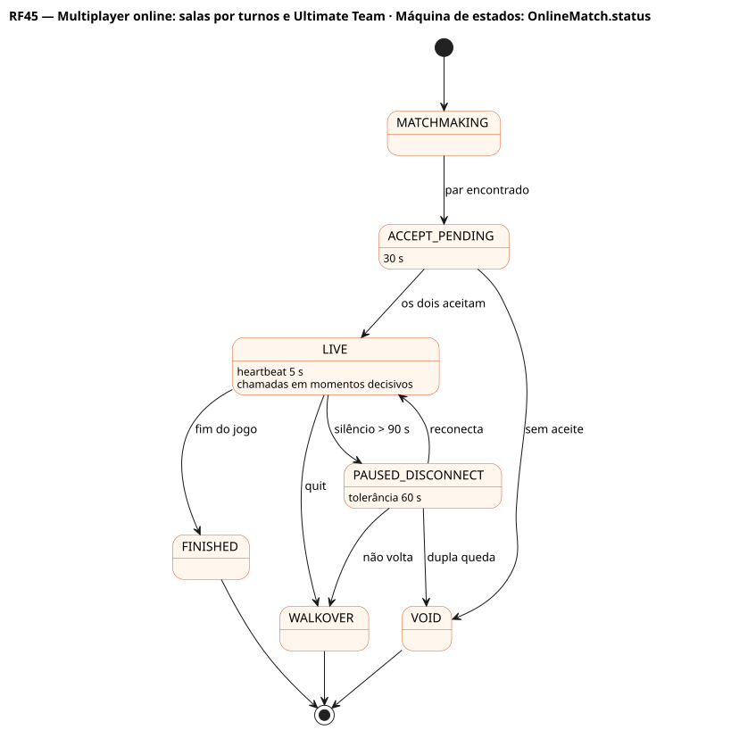
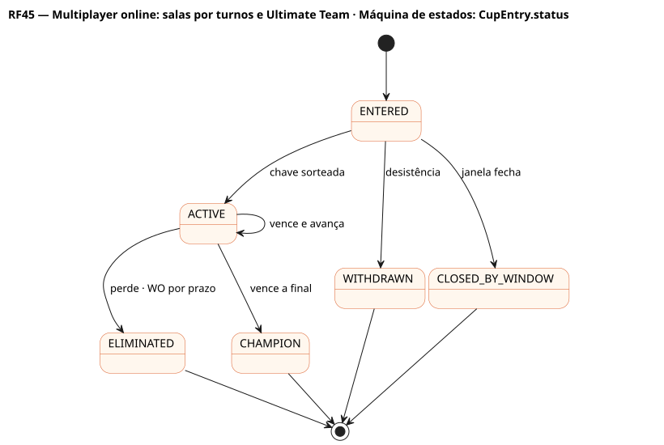
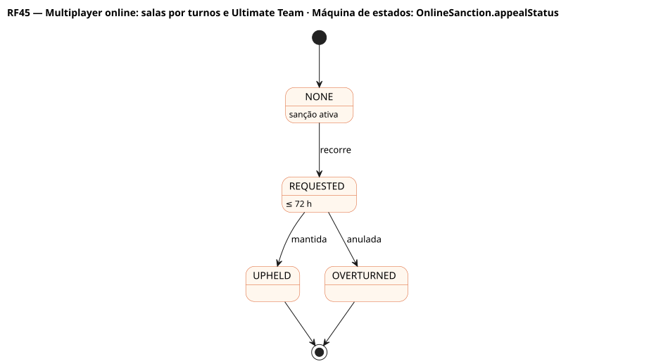

# RF45 — Multiplayer online: salas por turnos e Ultimate Team

## História de usuário

> HU-RF45 — COMO usuário online POSSO criar ou entrar em uma carreira conjunta (sala com código, 2–8 humanos, formatos 1x1, só playoffs ou temporada completa) com semanas sincronizadas por turnos, e montar um elenco de cartas no Ultimate Team com depth chart e química por divisão e conferência PARA jogar X1, Divisões Online e a Copa dos Campeões contra outros head coaches

Sprint: 10 · Atores: Manager, Adversario, Scheduler · Tela: Carreira conjunta (/online/rooms) · Ultimate Team (/ultimate): Meu clube · Cartas · Depth chart · Calendário · Divisões · Copa · Partida online · Sanções

## Diagramas

### Atividades

Fonte: [`RF45-act.puml`](RF45-act.puml)

### Sequência

Fonte: [`RF45-seq.puml`](RF45-seq.puml)

### Componentes

Fonte: [`RF45-cmp.puml`](RF45-cmp.puml)

### Classes

Fonte: [`RF45-cls.puml`](RF45-cls.puml)

### Máquina de estados: DivisionRun.status

Fonte: [`RF45-stm.puml`](RF45-stm.puml)

### Máquina de estados: MultiplayerRoom.status

Fonte: [`RF45-stm-multiplayerroom-status.puml`](RF45-stm-multiplayerroom-status.puml)

### Máquina de estados: MultiplayerParticipant.status

Fonte: [`RF45-stm-multiplayerparticipant-status.puml`](RF45-stm-multiplayerparticipant-status.puml)

### Máquina de estados: OnlineMatch.status

Fonte: [`RF45-stm-onlinematch-status.puml`](RF45-stm-onlinematch-status.puml)

### Máquina de estados: CupEntry.status

Fonte: [`RF45-stm-cupentry-status.puml`](RF45-stm-cupentry-status.puml)

### Máquina de estados: OnlineSanction.appealStatus

Fonte: [`RF45-stm-onlinesanction-appealstatus.puml`](RF45-stm-onlinesanction-appealstatus.puml)

## Endpoints

✅ = existe num controller do `scores-af-web` · ⛔ alvo = previsto no modelo, ainda sem controller (lista em `generator/endpoints_code.json`).

| Estado | Método | Rota | Caso de uso | Autorização | Descrição |
|---|---|---|---|---|---|
| ⛔ alvo | `POST` | `/api/v1/online/rooms` | `MultiplayerRoomUseCases.create` | JWT | Cria sala (formato, regras PRO/COLLEGE, 2–8 humanos, prazo 24 h) com código de 6 caracteres |
| ⛔ alvo | `POST` | `/api/v1/online/rooms/join` | `MultiplayerRoomUseCases.join` | JWT | Entra pelo código e escolhe franquia livre |
| ⛔ alvo | `POST` | `/api/v1/online/rooms/{id}/start` | `MultiplayerRoomUseCases.start` | JWT · host | Clona o mundo uma vez e cria um CareerSave por participante |
| ⛔ alvo | `POST` | `/api/v1/online/rooms/{id}/turns/{n}/confirm` | `MultiplayerTurnUseCases.confirm` | JWT · participante | Confirma depth chart e plano da semana · simula quando todos confirmam ou o prazo vence |
| ⛔ alvo | `GET` | `/api/v1/ultimate/squad` | `UltimateSquadUseCases.get` | JWT | Elenco online: rating, divisão, química, status |
| ⛔ alvo | `GET` | `/api/v1/ultimate/squad/cards` | `UltimateSquadUseCases.cards` | JWT | Cartas (template, nível Bronze…Elite, contratos, slot) |
| ⛔ alvo | `PUT` | `/api/v1/ultimate/squad/depth-chart` | `UltimateSquadUseCases.depthChart` | JWT | Depth chart de cartas: 53 no elenco, 46 ativas, titulares por posição e unidade · recalcula química |
| ⛔ alvo | `GET` | `/api/v1/ultimate/calendar` | `OnlineCompetitionUseCases.calendar` | JWT | Temporada online, janelas e cotas (4 Divisões / 2 Copa) |
| ⛔ alvo | `POST` | `/api/v1/ultimate/divisions/enter` | `OnlineCompetitionUseCases.enterDivisions` | JWT | Entrada numa corrida de Divisões (201 / 422 com motivo) |
| ⛔ alvo | `POST` | `/api/v1/ultimate/cup/enter` | `OnlineCompetitionUseCases.enterCup` | JWT | Entrada na Copa com ingresso das divisões 1–2 |
| ⛔ alvo | `POST` | `/api/v1/ultimate/matches/{id}/accept` | `OnlineMatchUseCases.accept` | JWT · participante | Aceite em ≤ 30 s |
| ⛔ alvo | `POST` | `/api/v1/ultimate/matches/{id}/play-calls/{did}` | `OnlineMatchUseCases.playCall` | JWT · participante | Chamada de jogada nos momentos decisivos (os dois head coaches, prazo curto) |
| ⛔ alvo | `POST` | `/api/v1/ultimate/matches/{id}/heartbeat` | `OnlineMatchUseCases.heartbeat` | JWT · participante | Batimento a cada 5 s (placar, quarto, descida) |
| ⛔ alvo | `POST` | `/api/v1/ultimate/matches/{id}/quit` | `OnlineMatchUseCases.quit` | JWT · participante | Abandono ⇒ WO ao adversário |
| ⛔ alvo | `POST` | `/api/v1/ultimate/sanctions/{id}/appeal` | `OnlineCompetitionUseCases.appeal` | JWT · dono | Recurso em até 72 h |

## Pontos de decisão

| Gateway | Regra | Se falso |
|---|---|---|
| Código válido e sala em LOBBY com vaga? | room.status LOBBY e humanos < maxHumans | 404 ROOM_NOT_FOUND / 409 ROOM_FULL |
| Turno pronto? | todos os participantes ACTIVE confirmaram ou o prazo de 24 h venceu | aguarda · no prazo, IA monta depth chart e plano de quem faltou |
| Conta elegível e idade mínima? | conta ACTIVE, e-mail verificado, idade ≥ 13 | 422 ACCOUNT_NOT_ELIGIBLE / UNDERAGE |
| Sem sanção que bloqueia o modo? | nenhuma OnlineSanction ativa para o modo | 422 SANCTIONED |
| Depth chart de cartas válido? | ≥ 46 cartas ativas · titulares QB, RB, WR×3, TE, OL×5 · DL×4, LB×3, CB×2, S×2 · K, P, LS · contratos > 0 | 422 SQUAD_INVALID (vagas listadas) |
| Química calculada? | ligações por divisão e conferência (ClubCard e LeagueCard) e por unidade (OL e QB-WR) · fora de posição reduz · 0–100 | química 0 (não bloqueia) |
| Janela aberta e cota da temporada? | CompetitionWindow OPEN antes do corte · Divisões runsUsed < 4 − penalidade · Copa cupEntriesUsed < 2 | 422 WINDOW_CLOSED / QUOTA_EXHAUSTED |
| Sem entrada ativa e reentrada permitida? | nenhuma DivisionRun/CupEntry ativa na janela · não saiu por desistência ou sanção | 422 ALREADY_ENTERED / REENTRY_BLOCKED |
| Tem ingresso da Copa? | Copa: CupTicket AVAILABLE | 422 NO_CUP_TICKET |
| Tentativas sob controle? | < 5 recusas em 10 min | 422 TOO_MANY_ATTEMPTS + cooldown 30 min |
| Partida aceita em 30 s? | os dois aceitam | VOID sem consumir tentativa |
| Chamada online no prazo? | cada head coach responde a sua decisão em ≤ 20 s | PlayCaller IA decide por ele (sem penalidade) |
| Batimento em dia? | heartbeat a cada 5 s · silêncio > 90 s ⇒ PAUSED_DISCONNECT | pausa e tolerância de 60 s |
| Reconectou a tempo? | volta em ≤ 60 s e no máximo 2 quedas | WO ao adversário (placar atual se ele vencia, senão 2×0) |
| Fim da temporada online? | dia 42 da temporada | segue |

---
Gerado por `../generator/generate.py` a partir de `../generator/model/*.py` e `../generator/common.py`; não edite os .puml à mão.
