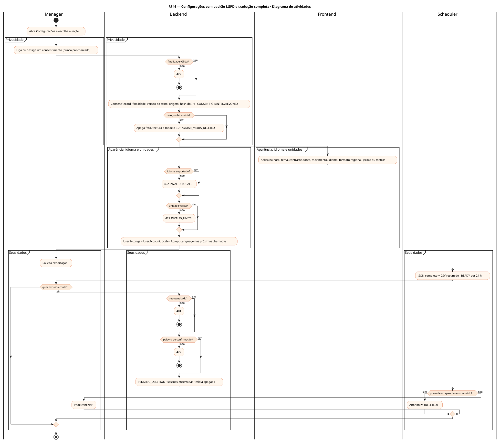
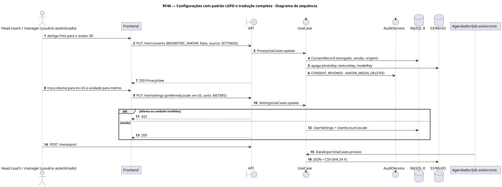
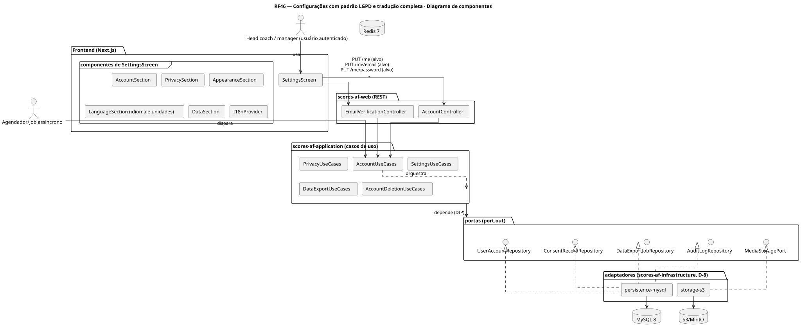
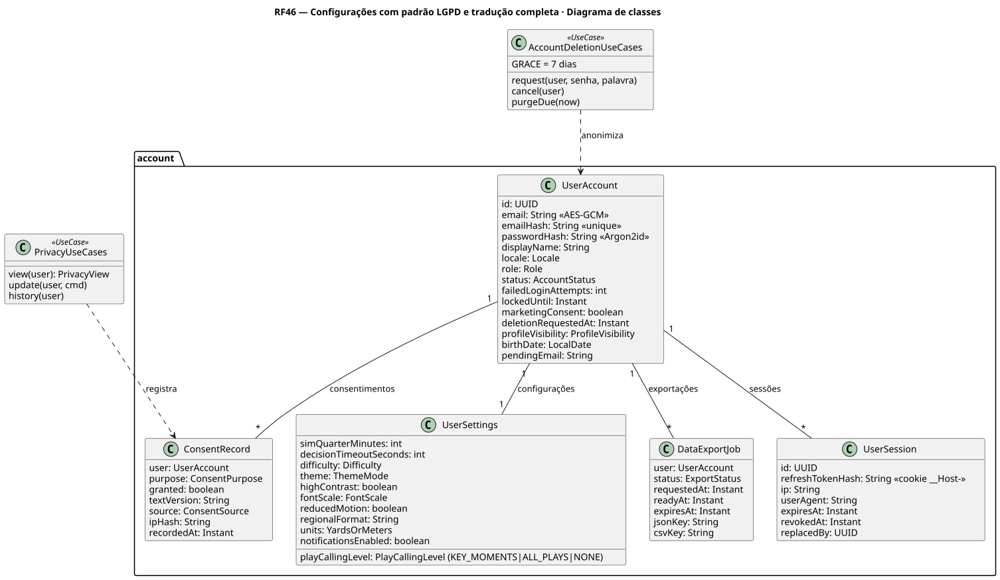
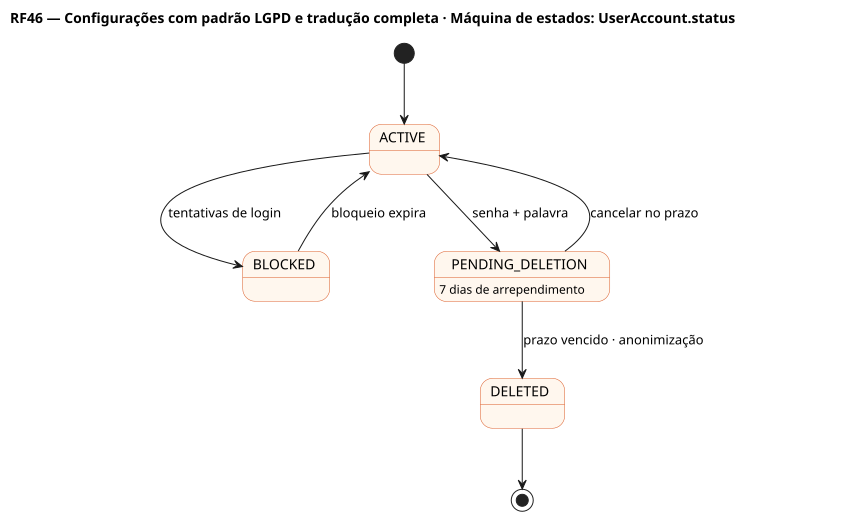
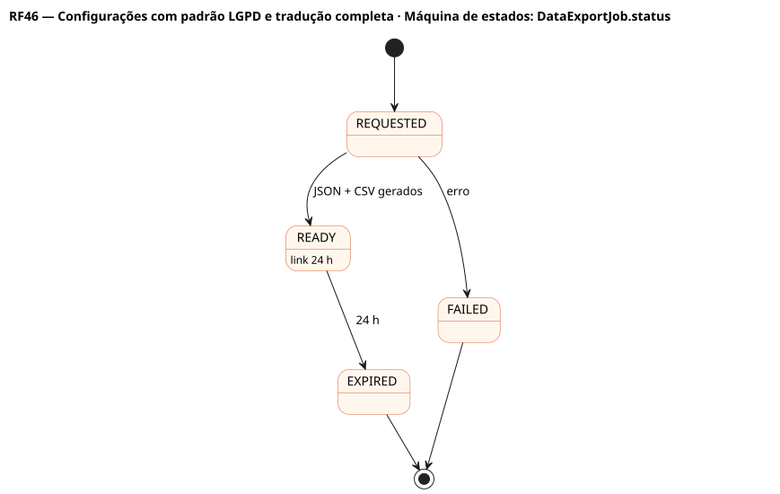
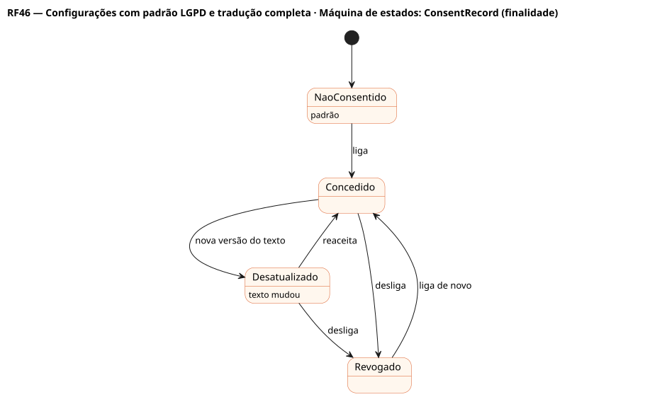

# RF46 — Configurações com padrão LGPD e tradução completa

## História de usuário

> HU-RF46 — COMO usuário autenticado POSSO acessar Conta, Privacidade, Aparência, Idioma e Seus dados, corrigir meus dados, controlar cada consentimento por finalidade, escolher tema, idioma e unidade (jardas ou metros) e exercer meus direitos de titular PARA usar o Scores no meu idioma, com privacidade por padrão

Sprint: 3 · Atores: Manager, Scheduler · Tela: Configurações (/settings?s=account|privacy|appearance|language|data)

## Diagramas

### Atividades

Fonte: [`RF46-act.puml`](RF46-act.puml)

### Sequência

Fonte: [`RF46-seq.puml`](RF46-seq.puml)

### Componentes

Fonte: [`RF46-cmp.puml`](RF46-cmp.puml)

### Classes

Fonte: [`RF46-cls.puml`](RF46-cls.puml)

### Máquina de estados: UserAccount.status

Fonte: [`RF46-stm.puml`](RF46-stm.puml)

### Máquina de estados: DataExportJob.status

Fonte: [`RF46-stm-dataexportjob-status.puml`](RF46-stm-dataexportjob-status.puml)

### Máquina de estados: ConsentRecord (finalidade)

Fonte: [`RF46-stm-consentrecord-finalidade.puml`](RF46-stm-consentrecord-finalidade.puml)

## Endpoints

✅ = existe num controller do `scores-af-web` · ⛔ alvo = previsto no modelo, ainda sem controller (lista em `generator/endpoints_code.json`).

| Estado | Método | Rota | Caso de uso | Autorização | Descrição |
|---|---|---|---|---|---|
| ⛔ alvo | `PUT` | `/api/v1/me` | `AccountUseCases.updateProfile` | JWT | Correção de dados (Art. 18, III) |
| ⛔ alvo | `PUT` | `/api/v1/me/email` | `EmailChangeUseCases.request` | JWT · reautenticação | Troca com verificação de posse |
| ⛔ alvo | `PUT` | `/api/v1/me/password` | `AccountUseCases.changePassword` | JWT · reautenticação | Encerra as outras sessões |
| ⛔ alvo | `GET` | `/api/v1/me/consents` | `PrivacyUseCases.view` | JWT | Consentimento por finalidade |
| ⛔ alvo | `PUT` | `/api/v1/me/consents` | `PrivacyUseCases.update` | JWT | Conceder ou revogar · biometria apaga mídia |
| ⛔ alvo | `GET` | `/api/v1/me/consents/history` | `PrivacyUseCases.history` | JWT | Histórico append-only (versão do texto, origem, hash do IP) |
| ⛔ alvo | `GET` | `/api/v1/me/settings` | `SettingsUseCases.get` | JWT | Preferências atuais |
| ⛔ alvo | `PUT` | `/api/v1/me/settings` | `SettingsUseCases.update` | JWT | Tema, contraste, fonte, movimento, idioma, formato regional, unidade (jardas ou metros) |
| ⛔ alvo | `POST` | `/api/v1/me/export` | `DataExportUseCases.request` | JWT | Exportação JSON + CSV (24 h) |
| ⛔ alvo | `GET` | `/api/v1/me/export/{jobId}/download` | `DataExportUseCases.download` | JWT · dono do job | Download (DATA_EXPORT_DOWNLOADED) |
| ⛔ alvo | `DELETE` | `/api/v1/me` | `AccountDeletionUseCases.request` | JWT · senha + palavra (step-up) | Exclusão com 7 dias de arrependimento |
| ⛔ alvo | `POST` | `/api/v1/me/deletion/cancel` | `AccountDeletionUseCases.cancel` | JWT | Cancela dentro do prazo |

## Pontos de decisão

| Gateway | Regra | Se falso |
|---|---|---|
| Reautenticado (step-up)? | reserva atômica (5 em 15 min) antes do hash · e-mail, senha e exclusão | 401 AUTH_FAILED · 6ª tentativa: 429 + Retry-After 900 |
| Idade mínima? | birthDate ≥ 13 anos (Art. 14) | 422 MIN_AGE |
| Finalidade válida? | ANALYTICS | MARKETING_EMAIL | PUBLIC_RANKING | AI_ANALYST | BIOMETRIC_AVATAR | 422 INVALID_CONSENT_PURPOSE |
| Revogou biometria? | BIOMETRIC_AVATAR: concedido → revogado | só registra |
| Idioma suportado? | pt-BR | en-US | es-ES · termos do esporte em inglês quando é o uso do Brasil (touchdown, snap, sack) (RNF13) | 422 INVALID_LOCALE |
| Unidade válida? | units ∈ {YARDS, METERS} · jardas é o padrão do esporte | 422 INVALID_UNITS |
| Palavra de confirmação? | EXCLUIR | DELETE | ELIMINAR | 422 DELETION_CONFIRMATION_MISMATCH |
| Prazo de arrependimento vencido? | 7 dias após o pedido | pode cancelar |

---
Gerado por `../generator/generate.py` a partir de `../generator/model/*.py` e `../generator/common.py`; não edite os .puml à mão.
