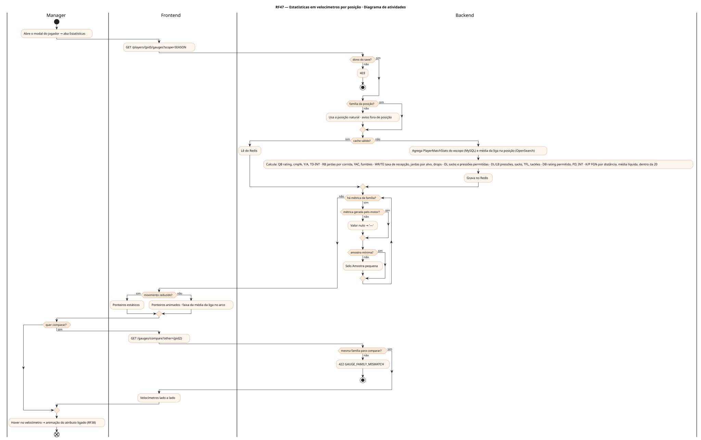
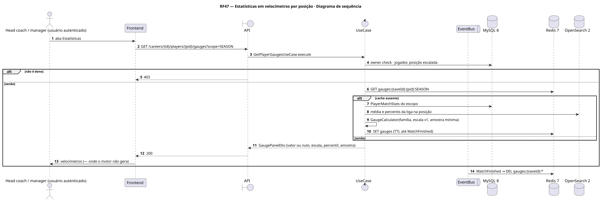
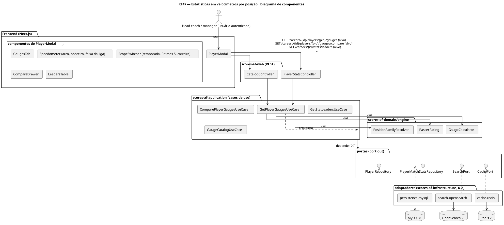
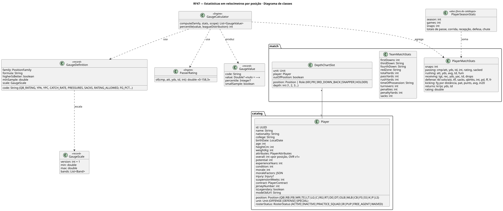
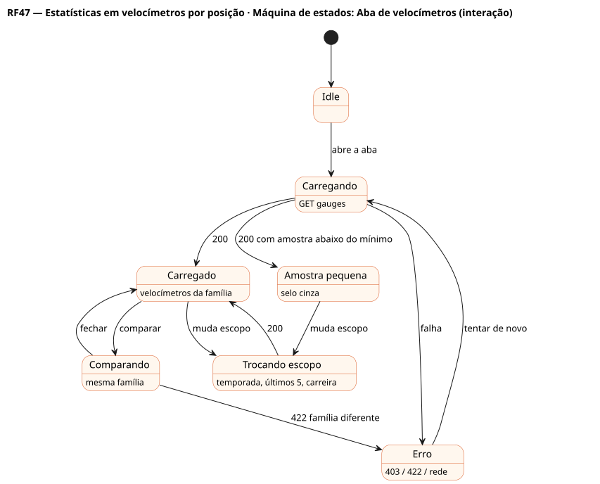

# RF47 — Estatísticas em velocímetros por posição

## História de usuário

> HU-RF47 — COMO head coach POSSO ver as estatísticas de cada jogador em velocímetros escolhidos pela posição (rating do QB, jardas por tentativa, jardas após a recepção, pressões, sacks, rating permitido na cobertura, FG por distância) na temporada, nos últimos 5 jogos ou na carreira, comparados à média da liga na posição, PARA avaliar o desempenho de um jeito rápido

Sprint: 9 · Atores: Manager · Tela: Modal do jogador → aba Estatísticas (velocímetros) · Comparar jogadores · Líderes por posição

## Diagramas

### Atividades

Fonte: [`RF47-act.puml`](RF47-act.puml)

### Sequência

Fonte: [`RF47-seq.puml`](RF47-seq.puml)

### Componentes

Fonte: [`RF47-cmp.puml`](RF47-cmp.puml)

### Classes

Fonte: [`RF47-cls.puml`](RF47-cls.puml)

### Máquina de estados: Aba de velocímetros (interação)

Fonte: [`RF47-stm.puml`](RF47-stm.puml)

## Endpoints

✅ = existe num controller do `scores-af-web` · ⛔ alvo = previsto no modelo, ainda sem controller (lista em `generator/endpoints_code.json`).

| Estado | Método | Rota | Caso de uso | Autorização | Descrição |
|---|---|---|---|---|---|
| ⛔ alvo | `GET` | `/api/v1/careers/{id}/players/{pid}/gauges` | `GetPlayerGaugesUseCase` | JWT · dono do save | ?scope=SEASON|LAST5|CAREER&position= · velocímetros da família da posição com valor, escala, percentil na posição e amostra |
| ⛔ alvo | `GET` | `/api/v1/careers/{id}/players/{pid}/gauges/compare` | `ComparePlayerGaugesUseCase` | JWT · dono do save | ?other={pid2} · mesmos velocímetros lado a lado (mesma família) |
| ⛔ alvo | `GET` | `/api/v1/careers/{id}/stats/leaders` | `GetStatLeadersUseCase` | JWT · dono do save | ?position=&metric= · líderes da liga (OpenSearch) |
| ⛔ alvo | `GET` | `/api/v1/catalog/gauges` | `GaugeCatalogUseCase` | JWT | Definições por família: métrica, fórmula, escala mín./máx., sentido (maior ou menor é melhor), amostra mínima, versão |

## Pontos de decisão

| Gateway | Regra | Se falso |
|---|---|---|
| Dono do save? | save.userId == jwt.sub | 403 + AuditLog ACCESS_DENIED |
| Família da posição? | QB · RB/FB · WR/TE · OL · DL · LB · DB · K/P pela posição escalada (DepthChartSlot) ou natural | usa a posição natural e avisa fora de posição |
| Métrica gerada pelo motor? | a métrica existe em PlayerMatchStats ou TeamMatchStats (ex.: pressões e snaps sim · rota corrida por jogada não) | velocímetro mostra '—', nunca zero (§3.6) |
| Amostra mínima? | QB ≥ 14 passes por jogo do escopo · RB ≥ 6,25 corridas · WR/TE ≥ 1,5 alvo · DL/LB/DB ≥ 20 snaps · K ≥ 1 tentativa | velocímetro cinza com selo Amostra pequena |
| Escala versionada? | GaugeScale v1 por métrica (ex.: rating do QB 0–158,3 · Y/A 0–12 · FG% 0–100) com vetor de ouro Java ↔ TS | build falha (teste de contrato) |
| Mesma família para comparar? | família(pid) == família(pid2) | 422 GAUGE_FAMILY_MISMATCH |
| Cache válido? | Redis gauges:{saveId}:{pid}:{scope} com versão da semana | recalcula e grava (invalidado por MatchFinished) |
| Movimento reduzido? | prefers-reduced-motion ou preferência | ponteiro animado (≤ 600 ms) |

---
Gerado por `../generator/generate.py` a partir de `../generator/model/*.py` e `../generator/common.py`; não edite os .puml à mão.
