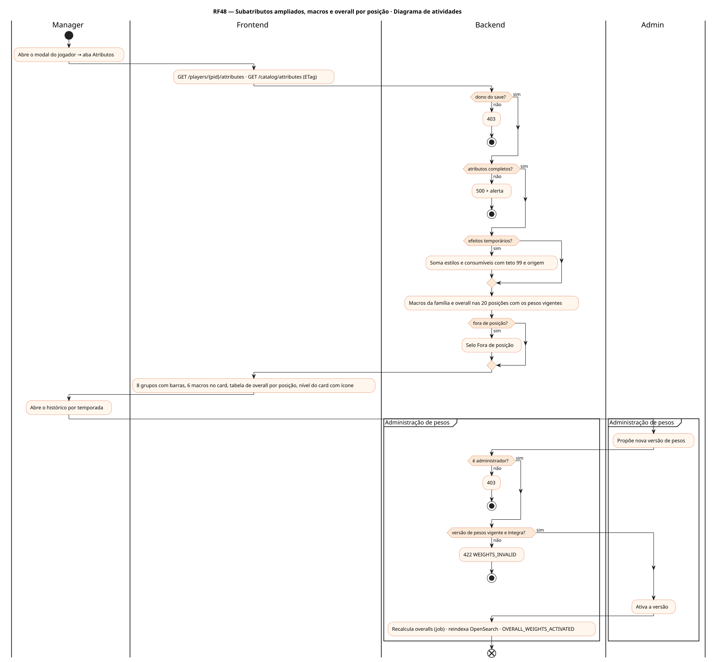
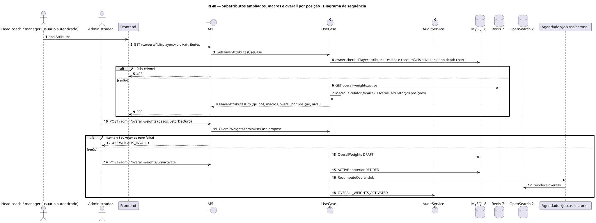
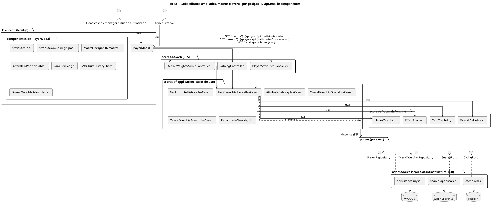
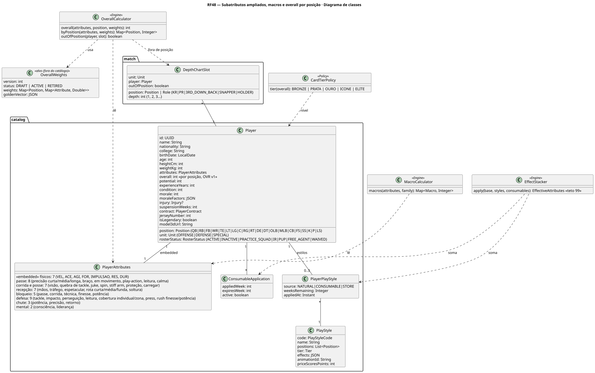
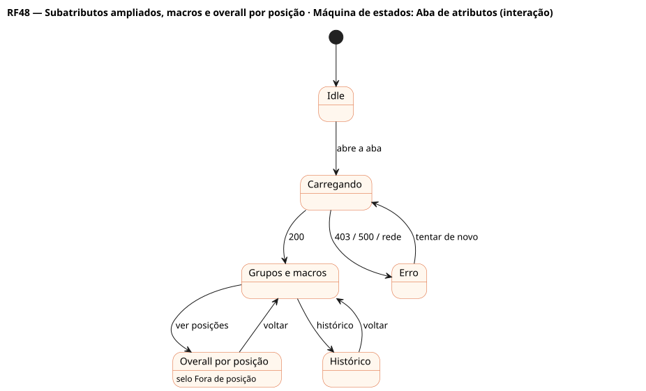
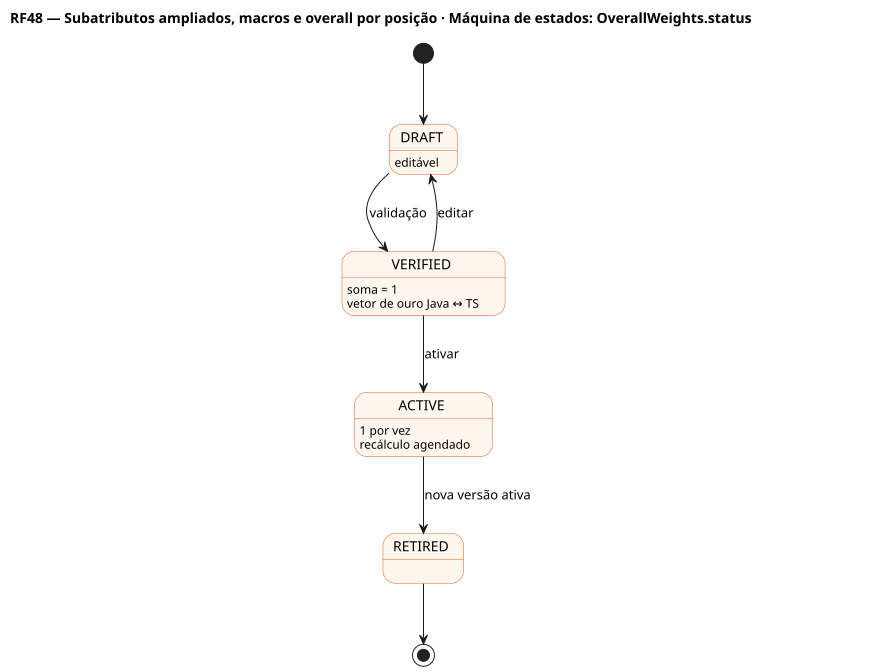

# RF48 — Subatributos ampliados, macros e overall por posição

## História de usuário

> HU-RF48 — COMO head coach POSSO ver os ≈40 subatributos do jogador em 8 grupos (físicos, passe, corrida e posse, recepção, bloqueio, defesa, chute, mental), as 6 macros da família da posição e o overall em cada posição com pesos oficiais versionados PARA saber onde ele rende mais e quando está fora de posição

Sprint: 9 · Atores: Manager, Admin · Tela: Modal do jogador → aba Atributos (grupos, macros, overall por posição) · /admin/overall-weights

## Diagramas

### Atividades

Fonte: [`RF48-act.puml`](RF48-act.puml)

### Sequência

Fonte: [`RF48-seq.puml`](RF48-seq.puml)

### Componentes

Fonte: [`RF48-cmp.puml`](RF48-cmp.puml)

### Classes

Fonte: [`RF48-cls.puml`](RF48-cls.puml)

### Máquina de estados: Aba de atributos (interação)

Fonte: [`RF48-stm.puml`](RF48-stm.puml)

### Máquina de estados: OverallWeights.status

Fonte: [`RF48-stm-overallweights-status.puml`](RF48-stm-overallweights-status.puml)

## Endpoints

✅ = existe num controller do `scores-af-web` · ⛔ alvo = previsto no modelo, ainda sem controller (lista em `generator/endpoints_code.json`).

| Estado | Método | Rota | Caso de uso | Autorização | Descrição |
|---|---|---|---|---|---|
| ⛔ alvo | `GET` | `/api/v1/careers/{id}/players/{pid}/attributes` | `GetPlayerAttributesUseCase` | JWT · dono do save | ≈40 subatributos, macros da família, overall por posição, nível do card, efeitos de estilos e consumíveis ativos |
| ⛔ alvo | `GET` | `/api/v1/careers/{id}/players/{pid}/attributes/history` | `GetAttributeHistoryUseCase` | JWT · dono do save | Evolução por temporada (progressão, idade, lesões) |
| ⛔ alvo | `GET` | `/api/v1/catalog/attributes` | `AttributeCatalogUseCase` | JWT | Definições, grupos, macros por família (D-6), textos i18n, ETag |
| ⛔ alvo | `GET` | `/api/v1/catalog/overall-weights` | `OverallWeightsQueryUseCase` | JWT | ?version= · pesos por posição (OVR v1 vigente) |
| ⛔ alvo | `POST` | `/api/v1/admin/overall-weights` | `OverallWeightsAdminUseCase.propose` | JWT · ADMIN | Nova versão de pesos (rascunho) com vetor de ouro |
| ⛔ alvo | `POST` | `/api/v1/admin/overall-weights/{v}/activate` | `OverallWeightsAdminUseCase.activate` | JWT · ADMIN | Ativa a versão e agenda o recálculo dos overalls |

## Pontos de decisão

| Gateway | Regra | Se falso |
|---|---|---|
| Dono do save? | save.userId == jwt.sub | 403 + AuditLog ACCESS_DENIED |
| Atributos completos? | todos os ≈40 subatributos em [1, 99] | erro de consistência · 500 com correlationId e alerta |
| Macros da família? | 6 macros por família (QB: PRE, BRA, LEI, MOB, CAL, LID · corredores e recebedores: VEL, AGI, MAO, ROT, QBT, FOR · OL: BLP, BLC, FOR, TEC, AGI, CON · defesa: TAC, IMP, COB, PRS, VEL, LEI · chutadores: POT, PRE, CON) | — |
| Fora de posição? | overall na posição escalada < overall na posição natural − 5 | sem aviso |
| Efeitos temporários? | estilos (PlayerPlayStyle) e consumíveis ativos somam ao valor base com teto 99 e mostram a origem | só valor base |
| Versão de pesos vigente e íntegra? | OverallWeights ACTIVE · soma dos pesos por posição = 1 · vetor de ouro Java ↔ TS passa | 422 WEIGHTS_INVALID (admin) / build falha |
| É administrador? | role == ADMIN | 403 |
| Nível do card? | Bronze ≤ 64 · Prata 65–74 · Ouro 75–84 · Ícone 85–89 · Elite ≥ 90 | — |

---
Gerado por `../generator/generate.py` a partir de `../generator/model/*.py` e `../generator/common.py`; não edite os .puml à mão.
