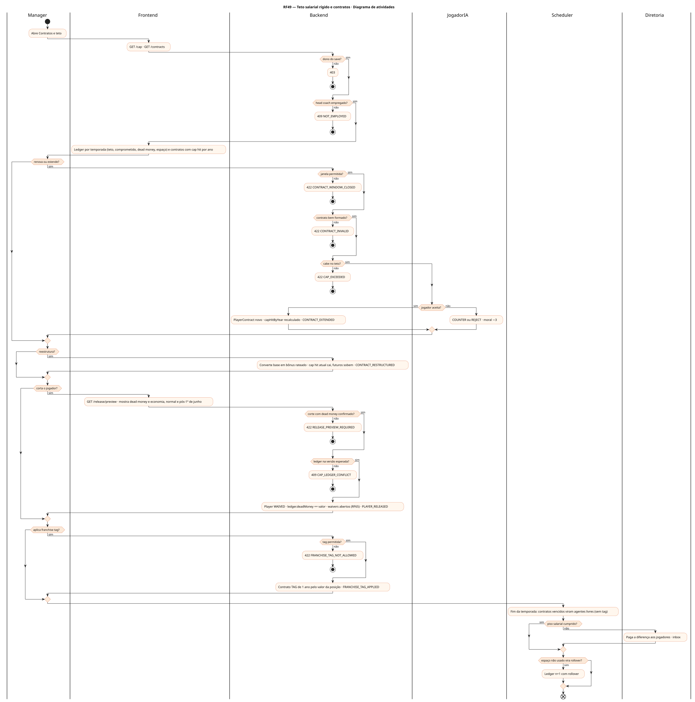
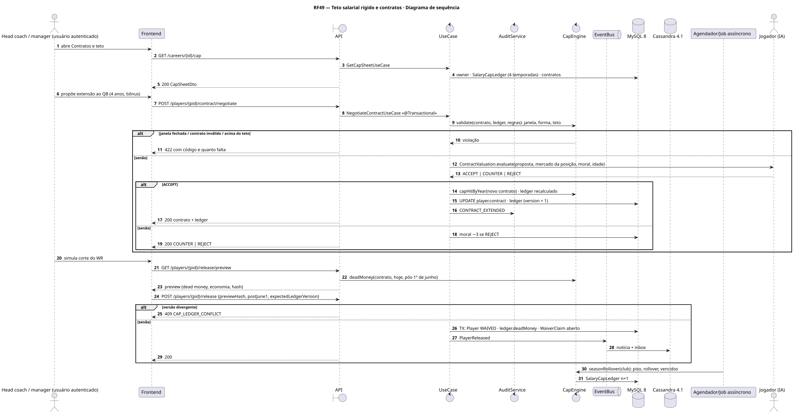
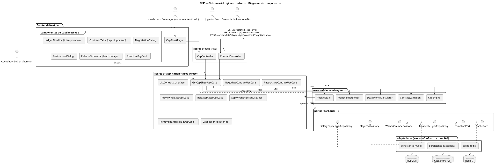
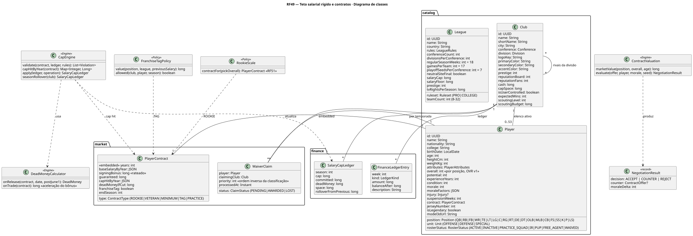
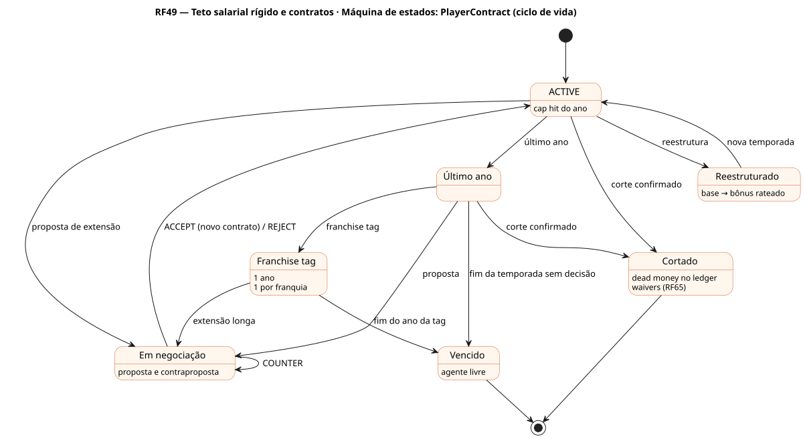
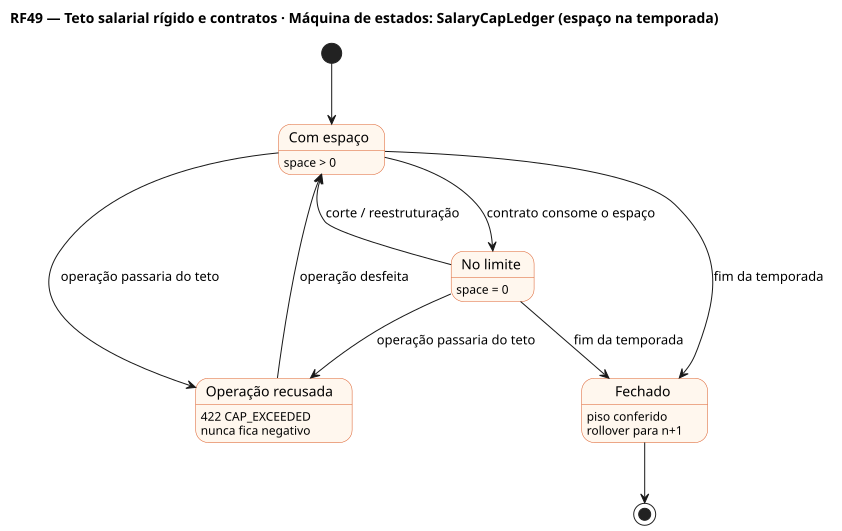

# RF49 — Teto salarial rígido e contratos

## História de usuário

> HU-RF49 — COMO head coach POSSO renovar, reestruturar, cortar e aplicar a franchise tag nos contratos do elenco, vendo o impacto no teto salarial rígido desta e das próximas temporadas (cap hit, bônus de assinatura rateado, garantias, dead money) PARA montar o elenco sem nunca passar do teto

Sprint: 7 · Atores: Manager, JogadorIA, Diretoria, Scheduler · Tela: Elenco → Contratos e teto (/c/{careerId}/cap): ledger por temporada, contratos, simulador de corte, negociação

## Diagramas

### Atividades

Fonte: [`RF49-act.puml`](RF49-act.puml)

### Sequência

Fonte: [`RF49-seq.puml`](RF49-seq.puml)

### Componentes

Fonte: [`RF49-cmp.puml`](RF49-cmp.puml)

### Classes

Fonte: [`RF49-cls.puml`](RF49-cls.puml)

### Máquina de estados: PlayerContract (ciclo de vida)

Fonte: [`RF49-stm.puml`](RF49-stm.puml)

### Máquina de estados: SalaryCapLedger (espaço na temporada)

Fonte: [`RF49-stm-salarycapledger-espaco-na-temporada.puml`](RF49-stm-salarycapledger-espaco-na-temporada.puml)

## Endpoints

✅ = existe num controller do `scores-af-web` · ⛔ alvo = previsto no modelo, ainda sem controller (lista em `generator/endpoints_code.json`).

| Estado | Método | Rota | Caso de uso | Autorização | Descrição |
|---|---|---|---|---|---|
| ⛔ alvo | `GET` | `/api/v1/careers/{id}/cap` | `GetCapSheetUseCase` | JWT · dono do save | SalaryCapLedger da temporada e das 3 seguintes: teto, comprometido, dead money, espaço, rollover |
| ⛔ alvo | `GET` | `/api/v1/careers/{id}/contracts` | `ListContractsUseCase` | JWT · dono do save | Contratos com cap hit por ano, bônus rateado, garantias e dead money se cortado |
| ⛔ alvo | `POST` | `/api/v1/careers/{id}/players/{pid}/contract/negotiate` | `NegotiateContractUseCase` | JWT · dono do save | Proposta de extensão (anos, salário por ano, bônus, garantias) → ACCEPT \| COUNTER \| REJECT |
| ⛔ alvo | `POST` | `/api/v1/careers/{id}/players/{pid}/contract/restructure` | `RestructureContractUseCase` | JWT · dono do save | Converte salário-base em bônus rateado: alivia o ano atual, pesa nos próximos |
| ⛔ alvo | `GET` | `/api/v1/careers/{id}/players/{pid}/release/preview` | `PreviewReleaseUseCase` | JWT · dono do save | Dead money e economia, normal e pós-1º de junho |
| ✅ | `POST` | `/api/v1/careers/{id}/players/{pid}/release` | `ReleasePlayerUseCase` | JWT · dono do save | Corta o jogador (waivers, RF65) e lança o dead money · expectedLedgerVersion |
| ⛔ alvo | `POST` | `/api/v1/careers/{id}/players/{pid}/franchise-tag` | `ApplyFranchiseTagUseCase` | JWT · dono do save | Tag de 1 ano: valor = máx(média dos 5 maiores salários da posição, 120 % do salário anterior) |
| ⛔ alvo | `DELETE` | `/api/v1/careers/{id}/players/{pid}/franchise-tag` | `RemoveFranchiseTagUseCase` | JWT · dono do save | Retira a tag antes de assinada (jogador vira agente livre) |

## Pontos de decisão

| Gateway | Regra | Se falso |
|---|---|---|
| Dono do save? | save.userId == jwt.sub | 403 + AuditLog ACCESS_DENIED |
| Head coach empregado? | save.employmentStatus == EMPLOYED | 409 NOT_EMPLOYED |
| Janela permitida? | extensão em qualquer fase fora de partida ao vivo · tag só em OFFSEASON até o prazo · reestruturação com ≥ 2 anos restantes · corte fora de partida ao vivo | 422 CONTRACT_WINDOW_CLOSED |
| Contrato bem formado? | 1–5 anos (calouro pela escala do pick) · bônus rateado em até 5 anos e ≤ anos do contrato · garantias ≤ total · salário ≥ mínimo da liga pela experiência | 422 CONTRACT_INVALID |
| Cabe no teto? | SalaryCapLedger.space após a operação ≥ 0 na temporada atual (teto rígido) · projeções futuras só avisam | 422 CAP_EXCEEDED (mostra quanto falta) |
| Jogador aceita? | ContractValuation: valor por ano e garantias × mercado da posição, idade, overall, moral, papel no depth chart, estilo do head coach · u(seed) decide perto do limite | COUNTER (nova proposta) ou REJECT · moral −3 |
| Tag permitida? | 1 tag por franquia por temporada · jogador com contrato vencendo · espaço para o valor da tag | 422 FRANCHISE_TAG_NOT_ALLOWED |
| Corte com dead money confirmado? | preview visto (hash do preview no comando) · dead money = bônus rateado restante + garantias não pagas · pós-1º de junho divide em 2 temporadas | 422 RELEASE_PREVIEW_REQUIRED |
| Ledger na versão esperada? | expectedLedgerVersion == ledger.version (lock otimista) | 409 CAP_LEDGER_CONFLICT |
| Piso salarial cumprido? | fim da temporada: gasto em dinheiro ≥ salaryFloor | diferença paga aos jogadores do elenco · inbox da diretoria |
| Espaço não usado vira rollover? | fim da temporada: space > 0 soma ao teto seguinte (rolloverFromPrevious) | — |

---
Gerado por `../generator/generate.py` a partir de `../generator/model/*.py` e `../generator/common.py`; não edite os .puml à mão.
