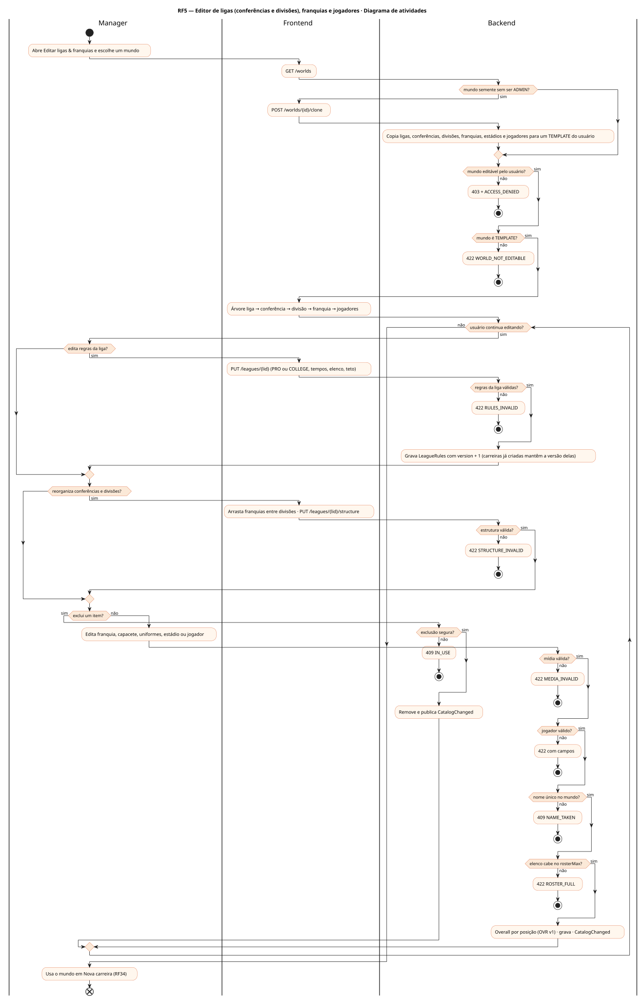
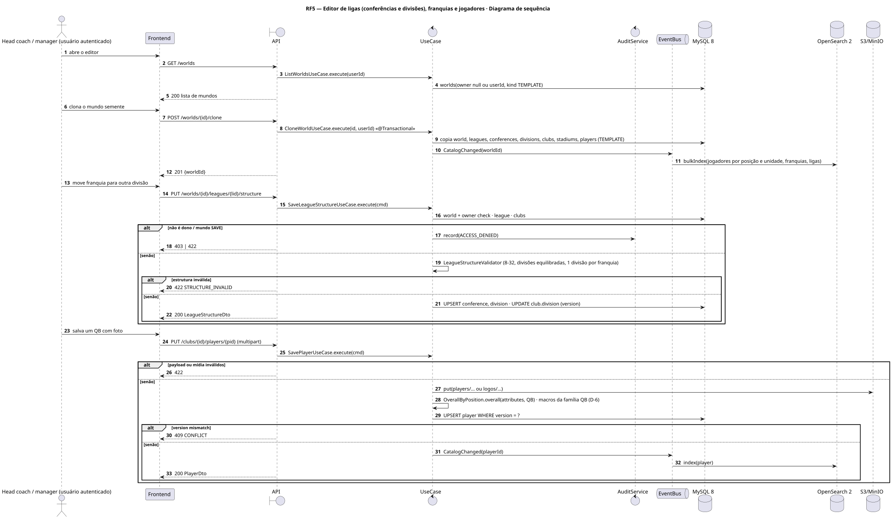
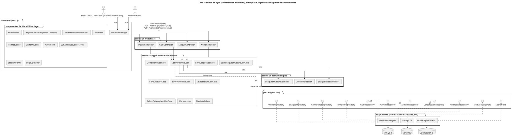
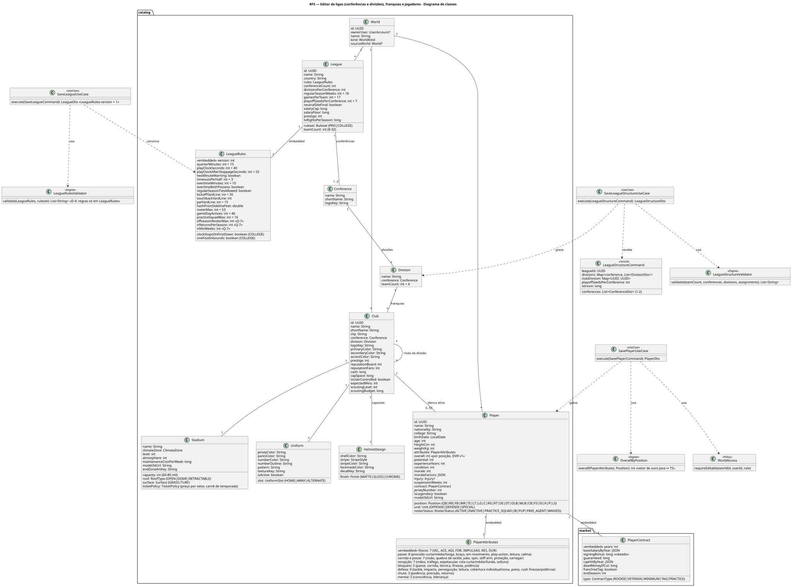
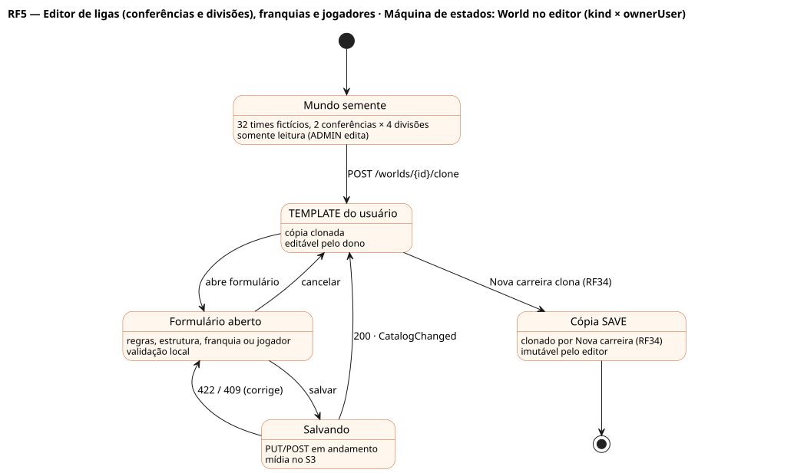

# RF5 — Editor de ligas (conferências e divisões), franquias e jogadores

## História de usuário

> HU-RF5 — COMO usuário autenticado POSSO acessar 'Editar ligas & franquias' no menu PARA editar ligas (regras, conferências, divisões, 8 a 32 times), franquias, estádios, uniformes e jogadores de futebol americano

Sprint: 4 · Atores: Manager, Admin · Tela: Editor de ligas & franquias (/editor)

## Diagramas

### Atividades

Fonte: [`RF5-act.puml`](RF5-act.puml)

### Sequência

Fonte: [`RF5-seq.puml`](RF5-seq.puml)

### Componentes

Fonte: [`RF5-cmp.puml`](RF5-cmp.puml)

### Classes

Fonte: [`RF5-cls.puml`](RF5-cls.puml)

### Máquina de estados: World no editor (kind × ownerUser)

Fonte: [`RF5-stm.puml`](RF5-stm.puml)

## Endpoints

✅ = existe num controller do `scores-af-web` · ⛔ alvo = previsto no modelo, ainda sem controller (lista em `generator/endpoints_code.json`).

| Estado | Método | Rota | Caso de uso | Autorização | Descrição |
|---|---|---|---|---|---|
| ⛔ alvo | `GET` | `/api/v1/worlds` | `ListWorldsUseCase` | JWT | Mundo semente fictício de 32 times + mundos TEMPLATE do usuário |
| ⛔ alvo | `POST` | `/api/v1/worlds/{id}/clone` | `CloneWorldUseCase` | JWT | Copia o mundo semente (ou outro TEMPLATE) para o usuário editar |
| ⛔ alvo | `POST` | `/api/v1/worlds/{id}/leagues` | `SaveLeagueUseCase` | JWT · dono do mundo | Cria liga com ruleset PRO\|COLLEGE, LeagueRules AF (quarto, relógio de jogada, prorrogação, kickoff, 53/46/16), teto e piso salarial |
| ⛔ alvo | `PUT` | `/api/v1/worlds/{id}/leagues/{lid}` | `SaveLeagueUseCase` | JWT · dono do mundo | Edita liga e regras (LeagueRules.version + 1) |
| ⛔ alvo | `PUT` | `/api/v1/worlds/{id}/leagues/{lid}/structure` | `SaveLeagueStructureUseCase` | JWT · dono do mundo | Conferências (1–2), divisões por conferência e franquia de cada divisão; vagas de playoff por conferência |
| ⛔ alvo | `DELETE` | `/api/v1/worlds/{id}/leagues/{lid}` | `DeleteCatalogItemUseCase` | JWT · dono do mundo | Exclui liga (sem franquias ou cascata confirmada) |
| ⛔ alvo | `POST` | `/api/v1/leagues/{id}/clubs` | `SaveClubUseCase` | JWT · dono do mundo | Cria franquia (nome, cidade, divisão, cores, capacete, logo, prestígio) |
| ⛔ alvo | `PUT` | `/api/v1/leagues/{id}/clubs/{cid}` | `SaveClubUseCase` | JWT · dono do mundo | Edita franquia, uniformes (HOME\|AWAY\|ALTERNATE) e capacete |
| ⛔ alvo | `POST` | `/api/v1/clubs/{id}/players` | `SavePlayerUseCase` | JWT · dono do mundo | Cria jogador: posição AF, unidade, ≈40 subatributos, altura/peso, college, contrato |
| ⛔ alvo | `PUT` | `/api/v1/clubs/{id}/players/{pid}` | `SavePlayerUseCase` | JWT · dono do mundo | Edita jogador · overall por posição recalculado (OVR v1) |
| ⛔ alvo | `DELETE` | `/api/v1/clubs/{id}/players/{pid}` | `DeleteCatalogItemUseCase` | JWT · dono do mundo | Exclui jogador |
| ⛔ alvo | `PUT` | `/api/v1/clubs/{id}/stadium` | `SaveStadiumUseCase` | JWT · dono do mundo | Estádio do catálogo: capacidade, cobertura, gramado, zona climática, arte da end zone |

## Pontos de decisão

| Gateway | Regra | Se falso |
|---|---|---|
| Mundo editável pelo usuário? | world.ownerUser == jwt.sub ou (world.ownerUser == null && role == ADMIN) | 403 + ACCESS_DENIED |
| Mundo semente sem ser ADMIN? | world.ownerUser == null && role != ADMIN | edita diretamente |
| Mundo é TEMPLATE? | world.kind == TEMPLATE (mundos SAVE são cópias congeladas) | 422 WORLD_NOT_EDITABLE |
| Regras da liga válidas? | ruleset PRO\|COLLEGE · quarterMinutes 5–15 · playClock 40/25 · overtimeMinutes 0–15 · kickoffYardLine 30–40 · rosterMax ≥ gameDayActives · practiceSquadMax 0–16 · salaryFloor ≤ salaryCap | 422 RULES_INVALID com campos |
| Estrutura válida? | teamCount 8–32 · conferências 1–2 · cada franquia em exatamente 1 divisão · divisões equilibradas (±1) · vagas de playoff ≤ franquias da conferência | 422 STRUCTURE_INVALID |
| Jogador válido? | posição no catálogo AF (QB…LS) · unidade coerente · subatributos 0–100 · altura e peso na faixa da posição | 422 VALIDATION_ERROR |
| Nome único no mundo? | liga ou franquia sem homônimo no mesmo mundo | 409 NAME_TAKEN |
| Elenco cabe no rosterMax? | players(club) < league.rules.rosterMax (53) ao criar jogador | 422 ROSTER_FULL |
| Mídia válida? | logo, decalque do capacete e textura do uniforme PNG\|SVG ≤ 1 MB, ≤ 1024 px, conteúdo verificado (RNF11) | 422 MEDIA_INVALID |
| Exclusão segura? | liga sem franquias / franquia sem jogadores (ou cascata confirmada) e nenhuma carreira usando o mundo | 409 IN_USE |

---
Gerado por `../generator/generate.py` a partir de `../generator/model/*.py` e `../generator/common.py`; não edite os .puml à mão.
