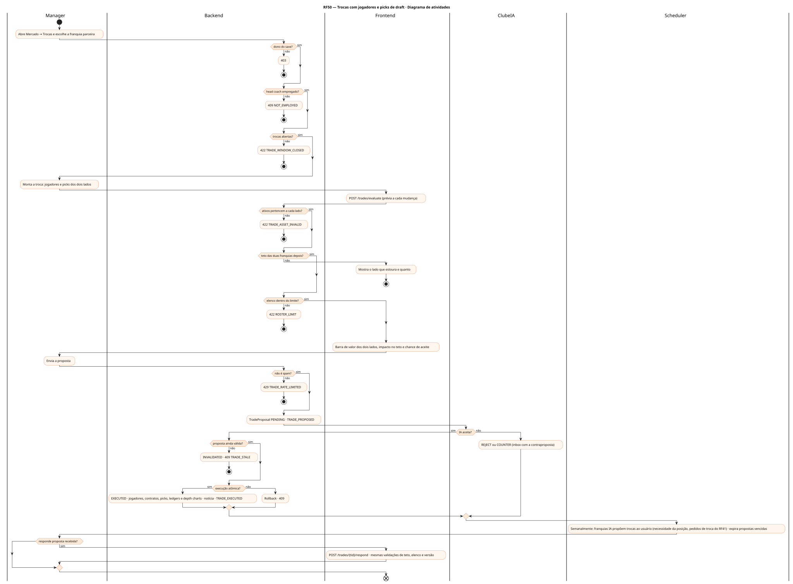
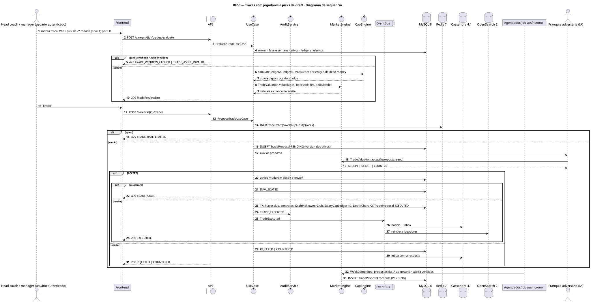
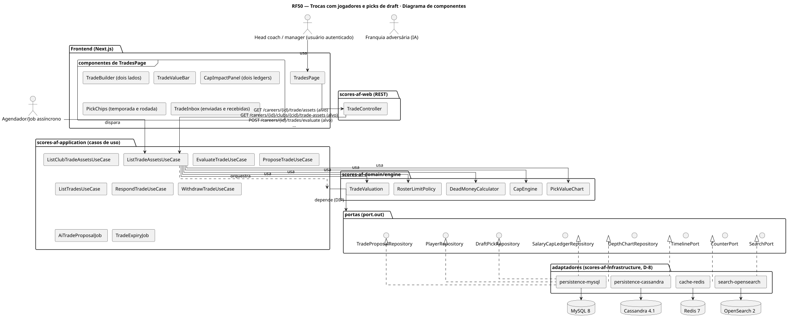
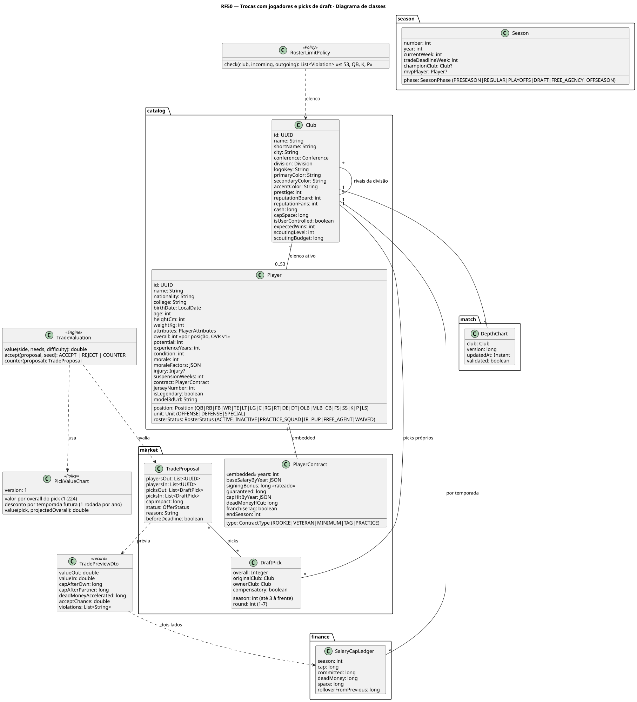
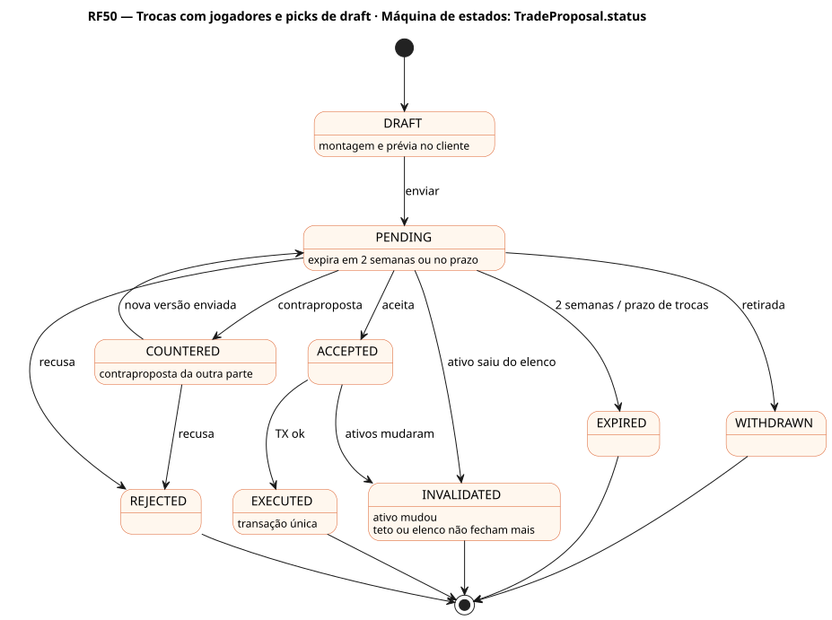
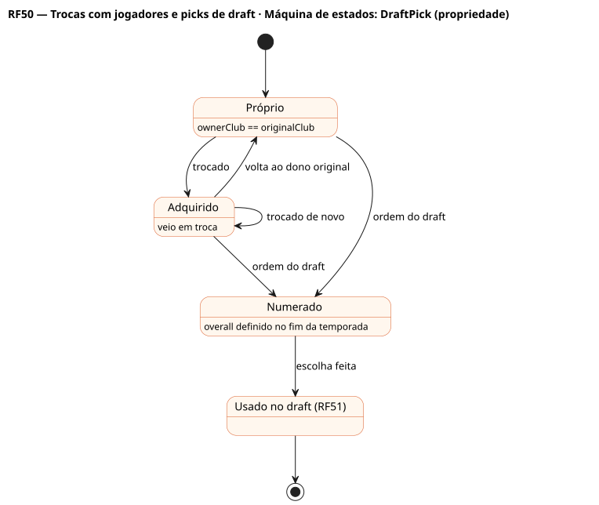

# RF50 — Trocas com jogadores e picks de draft

## História de usuário

> HU-RF50 — COMO head coach POSSO propor, receber e responder trocas com outras franquias envolvendo jogadores e picks de draft de até 3 temporadas à frente, vendo o valor da troca, o impacto no teto das duas franquias e a chance de aceite, PARA reforçar o elenco antes do prazo de trocas ou na entressafra

Sprint: 7 · Atores: Manager, ClubeIA, Scheduler · Tela: Mercado → Trocas (/c/{careerId}/trades): montar troca, propostas enviadas e recebidas, picks

## Diagramas

### Atividades

Fonte: [`RF50-act.puml`](RF50-act.puml)

### Sequência

Fonte: [`RF50-seq.puml`](RF50-seq.puml)

### Componentes

Fonte: [`RF50-cmp.puml`](RF50-cmp.puml)

### Classes

Fonte: [`RF50-cls.puml`](RF50-cls.puml)

### Máquina de estados: TradeProposal.status

Fonte: [`RF50-stm.puml`](RF50-stm.puml)

### Máquina de estados: DraftPick (propriedade)

Fonte: [`RF50-stm-draftpick-propriedade.puml`](RF50-stm-draftpick-propriedade.puml)

## Endpoints

✅ = existe num controller do `scores-af-web` · ⛔ alvo = previsto no modelo, ainda sem controller (lista em `generator/endpoints_code.json`).

| Estado | Método | Rota | Caso de uso | Autorização | Descrição |
|---|---|---|---|---|---|
| ⛔ alvo | `GET` | `/api/v1/careers/{id}/trade/assets` | `ListTradeAssetsUseCase` | JWT · dono do save | Meus jogadores (contrato, cap hit, dead money se trocado) e picks (temporada, rodada, overall se conhecido, dono original) |
| ⛔ alvo | `GET` | `/api/v1/careers/{id}/clubs/{cid}/trade-assets` | `ListClubTradeAssetsUseCase` | JWT · dono do save | Ativos da outra franquia e necessidades por posição |
| ⛔ alvo | `POST` | `/api/v1/careers/{id}/trades/evaluate` | `EvaluateTradeUseCase` | JWT · dono do save | Prévia: valor de cada lado (tabela de picks + valor do jogador), teto das duas franquias depois, elenco, chance de aceite |
| ⛔ alvo | `POST` | `/api/v1/careers/{id}/trades` | `ProposeTradeUseCase` | JWT · dono do save | Envia a proposta (expira em 2 semanas ou no prazo de trocas) |
| ⛔ alvo | `GET` | `/api/v1/careers/{id}/trades` | `ListTradesUseCase` | JWT · dono do save | Enviadas e recebidas com status |
| ⛔ alvo | `POST` | `/api/v1/careers/{id}/trades/{tid}/respond` | `RespondTradeUseCase` | JWT · dono do save | Recebida: ACCEPT \| REJECT \| COUNTER |
| ⛔ alvo | `POST` | `/api/v1/careers/{id}/trades/{tid}/withdraw` | `WithdrawTradeUseCase` | JWT · dono do save | Retira proposta enviada ainda pendente |

## Pontos de decisão

| Gateway | Regra | Se falso |
|---|---|---|
| Dono do save? | save.userId == jwt.sub | 403 + AuditLog ACCESS_DENIED |
| Head coach empregado? | save.employmentStatus == EMPLOYED | 409 NOT_EMPLOYED |
| Trocas abertas? | REGULAR até Season.tradeDeadlineWeek · OFFSEASON, FREE_AGENCY e DRAFT (picks da classe atual) liberados · PLAYOFFS e partida ao vivo bloqueados | 422 TRADE_WINDOW_CLOSED |
| Ativos pertencem a cada lado? | jogadores no elenco ativo (não IR com retorno marcado, não recém-contratados há < 1 semana) · picks com ownerClub == franquia, season ≤ atual + 3, não usados | 422 TRADE_ASSET_INVALID |
| Teto das duas franquias depois? | space ≥ 0 nos dois ledgers após a troca · quem envia acelera o bônus rateado restante do jogador como dead money | 422 TRADE_CAP_EXCEEDED (lado e valor) |
| Elenco dentro do limite? | ≤ 53 no elenco ativo após a troca (ou corte obrigatório em 24 h de jogo) · ≥ 1 QB e K e P | 422 ROSTER_LIMIT |
| IA aceita? | TradeValuation: valor recebido ≥ valor enviado × (1 + margem por dificuldade) · ajuste por necessidade da posição, idade, contrato e janela de título · u(seed) perto do limite | REJECT ou COUNTER com o ativo que falta |
| Não é spam? | mesma proposta (mesmos ativos) para a mesma franquia no máx. 1 vez por semana · ≤ 10 propostas abertas | 429 TRADE_RATE_LIMITED |
| Proposta ainda válida? | status PENDING, não expirada e ativos sem mudança desde o envio (version) | 409 TRADE_STALE · proposta INVALIDATED |
| Execução atômica? | uma transação: jogadores trocam de Club, contratos seguem, DraftPick.ownerClub muda, ledgers e depth charts atualizados, TradeProposal EXECUTED | rollback · 409 CONFLICT |

---
Gerado por `../generator/generate.py` a partir de `../generator/model/*.py` e `../generator/common.py`; não edite os .puml à mão.
