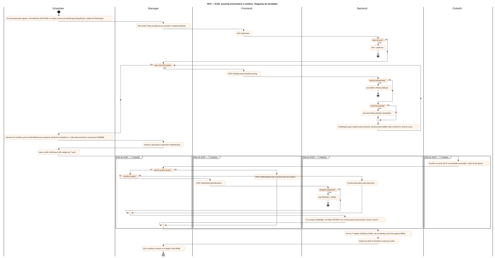
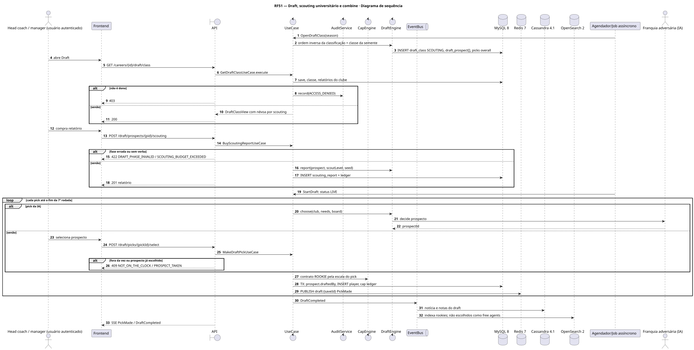
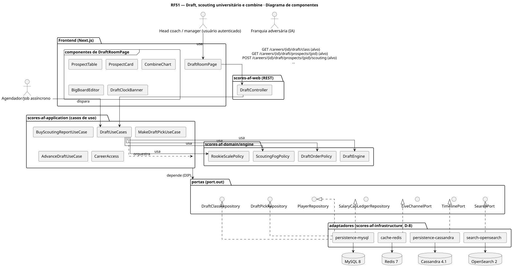
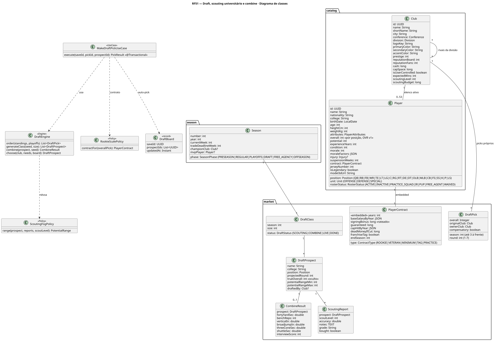
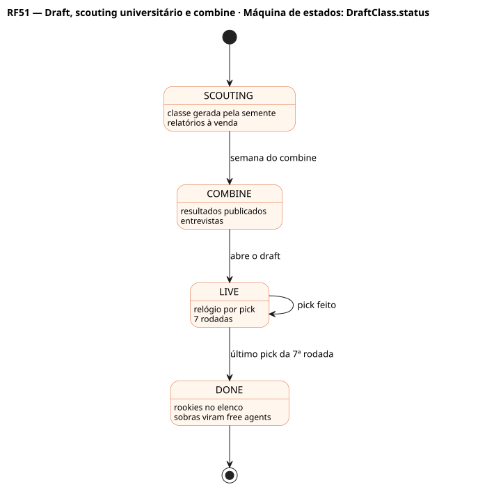
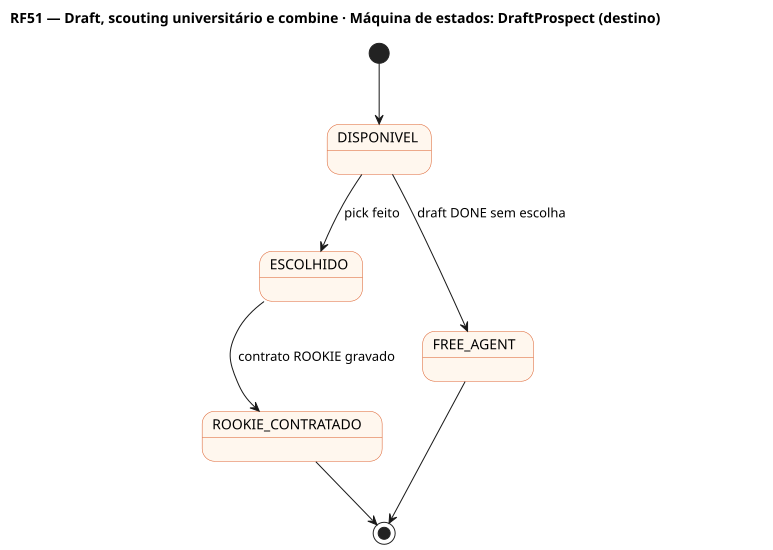

# RF51 — Draft, scouting universitário e combine

## História de usuário

> HU-RF51 — COMO head coach QUERO observar os prospectos universitários, ver o combine (40 jardas, supino, saltos, entrevistas), comprar relatórios de scouting e escolher na minha vez das 7 rodadas PARA renovar o elenco com contratos de rookie baratos

Sprint: 7 · Atores: Manager, ClubeIA, Scheduler · Tela: Draft (/c/{careerId}/draft): Prospectos · Combine · Big board · Sala do draft ao vivo

## Diagramas

### Atividades

Fonte: [`RF51-act.puml`](RF51-act.puml)

### Sequência

Fonte: [`RF51-seq.puml`](RF51-seq.puml)

### Componentes

Fonte: [`RF51-cmp.puml`](RF51-cmp.puml)

### Classes

Fonte: [`RF51-cls.puml`](RF51-cls.puml)

### Máquina de estados: DraftClass.status

Fonte: [`RF51-stm.puml`](RF51-stm.puml)

### Máquina de estados: DraftProspect (destino)

Fonte: [`RF51-stm-draftprospect-destino.puml`](RF51-stm-draftprospect-destino.puml)

## Endpoints

✅ = existe num controller do `scores-af-web` · ⛔ alvo = previsto no modelo, ainda sem controller (lista em `generator/endpoints_code.json`).

| Estado | Método | Rota | Caso de uso | Autorização | Descrição |
|---|---|---|---|---|---|
| ⛔ alvo | `GET` | `/api/v1/careers/{id}/draft/class` | `GetDraftClassUseCase` | JWT · dono do save | Classe do ano: status, prospectos com faixa de potencial (névoa conforme o scouting) |
| ⛔ alvo | `GET` | `/api/v1/careers/{id}/draft/prospects/{pid}` | `GetDraftProspectUseCase` | JWT · dono do save | Perfil, college, rodada projetada, combine e relatórios comprados |
| ⛔ alvo | `POST` | `/api/v1/careers/{id}/draft/prospects/{pid}/scouting` | `BuyScoutingReportUseCase` | JWT · dono do save | Compra relatório (custo por nível de scout); estreita a faixa de potencial |
| ⛔ alvo | `GET` | `/api/v1/careers/{id}/draft/combine` | `GetCombineResultsUseCase` | JWT · dono do save | Resultados do combine por posição (40 jardas, supino, vertical, distância, 3-cone, shuttle, entrevista) |
| ⛔ alvo | `PUT` | `/api/v1/careers/{id}/draft/board` | `SaveDraftBoardUseCase` | JWT · dono do save | Big board do usuário (ordem de preferência; usado na escolha automática) |
| ⛔ alvo | `POST` | `/api/v1/careers/{id}/draft/picks/{pickId}/select` | `MakeDraftPickUseCase` | JWT · dono do save | Escolhe o prospecto na vez; cria Player com contrato ROOKIE |
| ⛔ alvo | `POST` | `/api/v1/careers/{id}/draft/advance` | `AdvanceDraftUseCase` | JWT · dono do save | IA escolhe até o próximo pick do usuário (ou até o fim) |

## Pontos de decisão

| Gateway | Regra | Se falso |
|---|---|---|
| Dono do save? | save.userId == jwt.sub | 403 + AuditLog ACCESS_DENIED |
| Fase do draft permite? | scouting e compra em SCOUTING ou COMBINE · seleção só em LIVE | 422 DRAFT_PHASE_INVALID |
| Verba de scouting? | custo do relatório ≤ verba de scouting da temporada (club.scoutingLevel define a precisão) | 422 SCOUTING_BUDGET_EXCEEDED |
| Pick do usuário na vez? | pick.ownerClub == save.clubId e pick.overall == próximo pick do relógio | 409 NOT_ON_THE_CLOCK |
| Prospecto disponível? | prospect.draftedBy == null | 409 PROSPECT_TAKEN |
| Tempo da escolha esgotado? | relógio do pick vence (configurável) | segue aguardando |

---
Gerado por `../generator/generate.py` a partir de `../generator/model/*.py` e `../generator/common.py`; não edite os .puml à mão.
