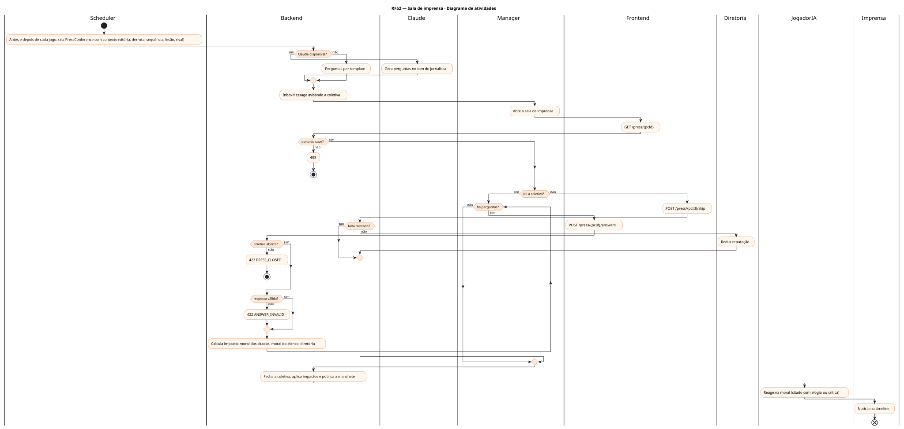
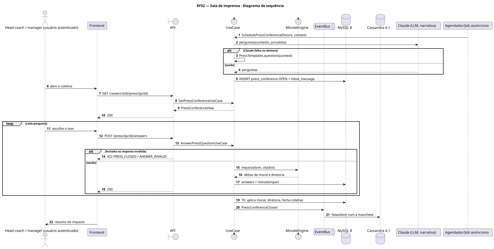
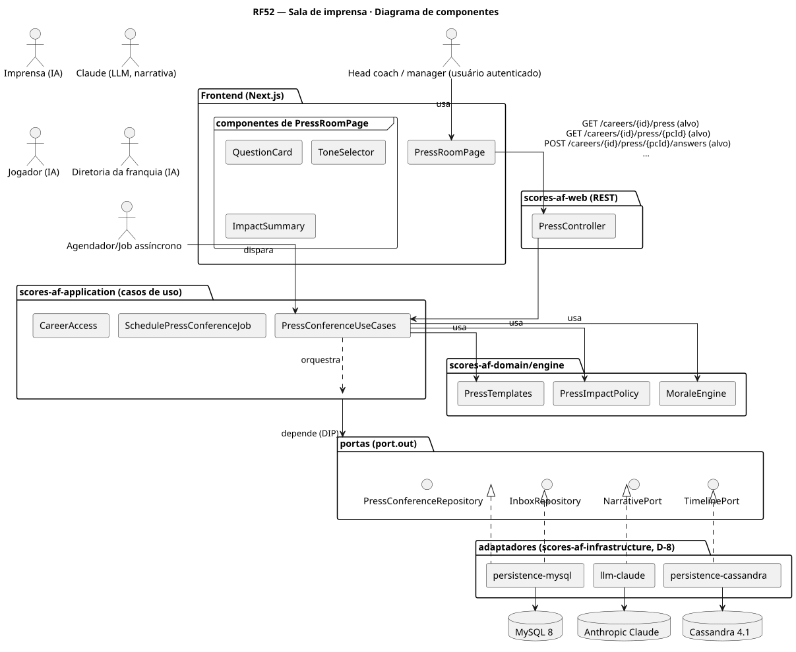
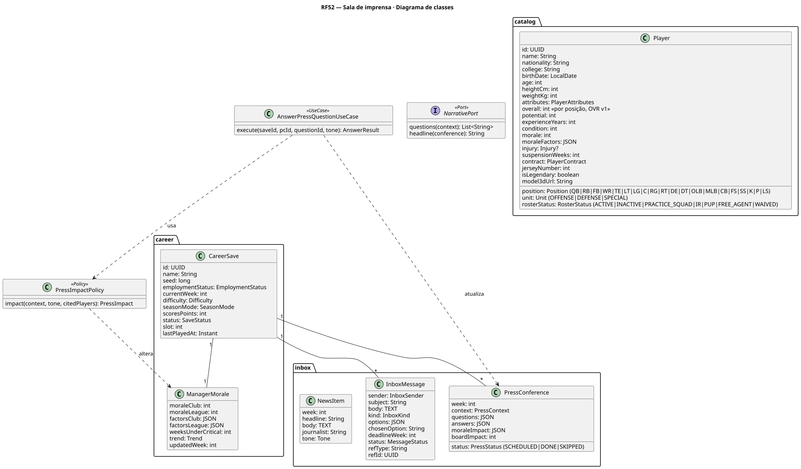
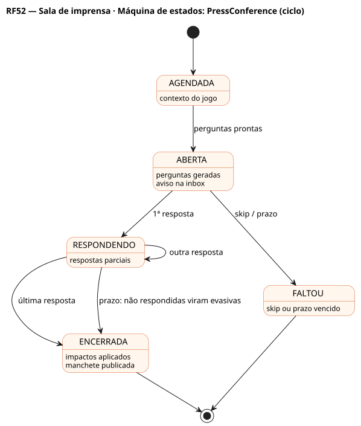

# RF52 — Sala de imprensa

## História de usuário

> HU-RF52 — COMO head coach QUERO responder às perguntas da imprensa antes e depois dos jogos PARA influenciar a moral do elenco, a diretoria e a opinião pública

Sprint: 11 · Atores: Manager, Imprensa, Claude, JogadorIA, Diretoria, Scheduler · Tela: Sala de imprensa (/c/{careerId}/press) · aviso na inbox (RF13)

## Diagramas

### Atividades

Fonte: [`RF52-act.puml`](RF52-act.puml)

### Sequência

Fonte: [`RF52-seq.puml`](RF52-seq.puml)

### Componentes

Fonte: [`RF52-cmp.puml`](RF52-cmp.puml)

### Classes

Fonte: [`RF52-cls.puml`](RF52-cls.puml)

### Máquina de estados: PressConference (ciclo)

Fonte: [`RF52-stm.puml`](RF52-stm.puml)

## Endpoints

✅ = existe num controller do `scores-af-web` · ⛔ alvo = previsto no modelo, ainda sem controller (lista em `generator/endpoints_code.json`).

| Estado | Método | Rota | Caso de uso | Autorização | Descrição |
|---|---|---|---|---|---|
| ⛔ alvo | `GET` | `/api/v1/careers/{id}/press` | `ListPressConferencesUseCase` | JWT · dono do save | Coletivas abertas e histórico com impacto |
| ⛔ alvo | `GET` | `/api/v1/careers/{id}/press/{pcId}` | `GetPressConferenceUseCase` | JWT · dono do save | Perguntas, opções de tom e prazo |
| ⛔ alvo | `POST` | `/api/v1/careers/{id}/press/{pcId}/answers` | `AnswerPressQuestionUseCase` | JWT · dono do save | Responde uma pergunta (tom: confiante, cauteloso, crítico, evasivo) |
| ⛔ alvo | `POST` | `/api/v1/careers/{id}/press/{pcId}/skip` | `SkipPressConferenceUseCase` | JWT · dono do save | Falta à coletiva (penalidade da diretoria se repetir) |

## Pontos de decisão

| Gateway | Regra | Se falso |
|---|---|---|
| Dono do save? | save.userId == jwt.sub | 403 + AuditLog ACCESS_DENIED |
| Coletiva aberta? | status OPEN e semana atual ≤ prazo (antes do kickoff ou até a semana seguinte) | 422 PRESS_CLOSED |
| Resposta válida? | pergunta pertence à coletiva, ainda sem resposta, tom entre as opções | 422 ANSWER_INVALID |
| Claude disponível? | chave configurada e resposta em ≤ 5 s | perguntas e manchete por template (fallback) |
| Falta tolerada? | ≤ 1 falta a cada 4 semanas | diretoria −reputação e notícia negativa |

---
Gerado por `../generator/generate.py` a partir de `../generator/model/*.py` e `../generator/common.py`; não edite os .puml à mão.
