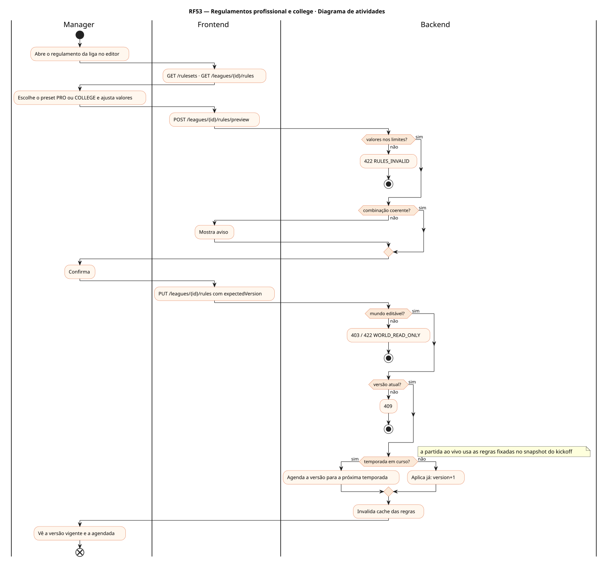
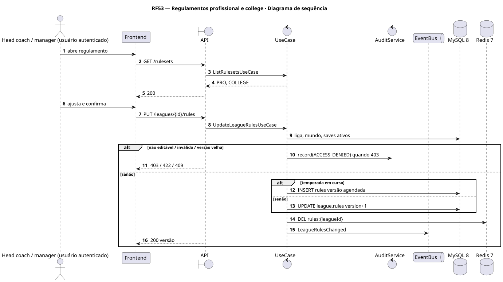
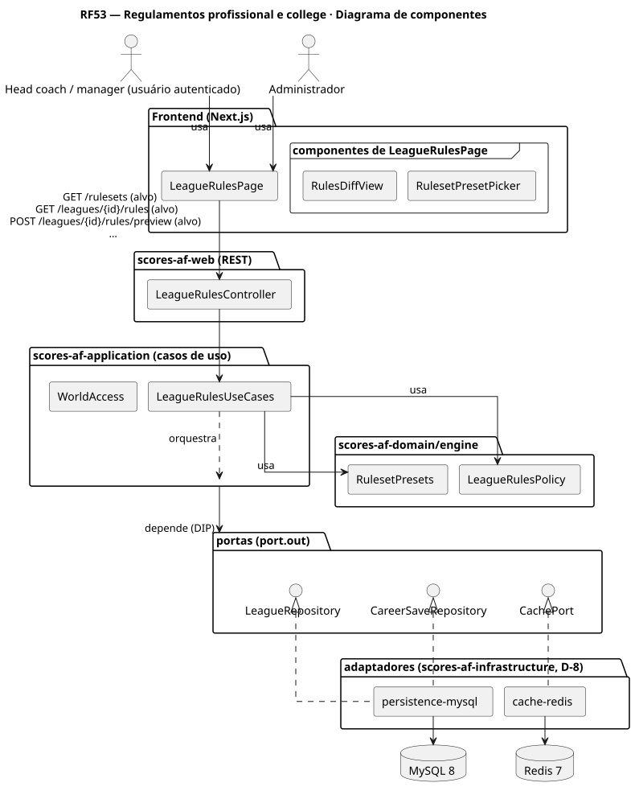
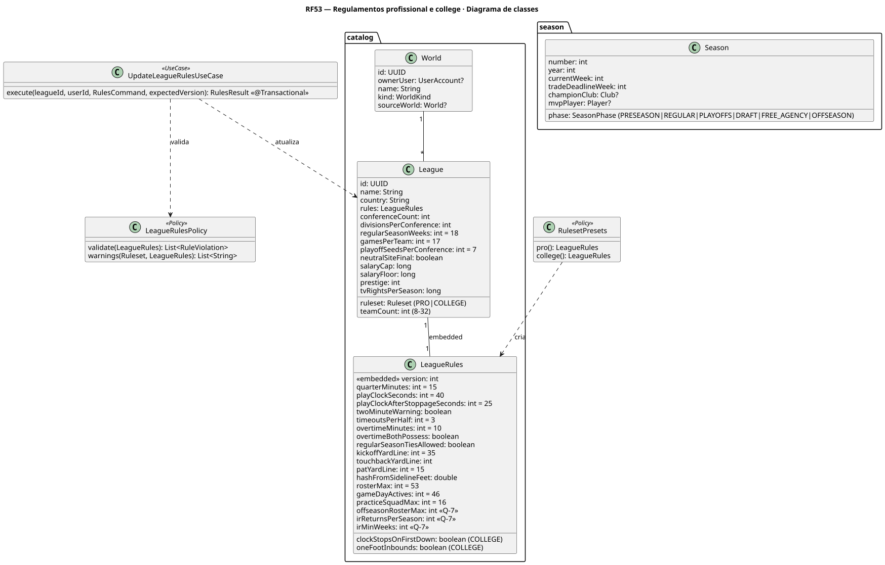
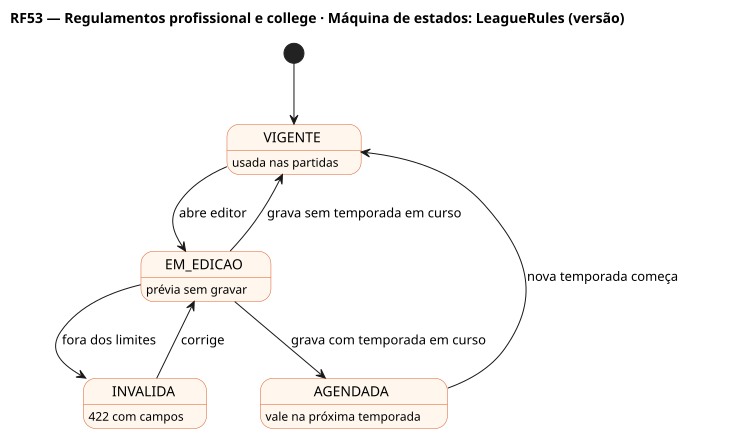

# RF53 — Regulamentos profissional e college

## História de usuário

> HU-RF53 — COMO dono de um mundo editado QUERO escolher o regulamento da liga (profissional ou college) e ajustar os valores de LeagueRules PARA jogar com as regras que prefiro, sem mudar o código (D-4, Q-1)

Sprint: 11 · Atores: Manager, Admin · Tela: Editor de ligas (RF5) → aba Regulamento (/worlds/{wid}/leagues/{lid}/rules)

## Diagramas

### Atividades

Fonte: [`RF53-act.puml`](RF53-act.puml)

### Sequência

Fonte: [`RF53-seq.puml`](RF53-seq.puml)

### Componentes

Fonte: [`RF53-cmp.puml`](RF53-cmp.puml)

### Classes

Fonte: [`RF53-cls.puml`](RF53-cls.puml)

### Máquina de estados: LeagueRules (versão)

Fonte: [`RF53-stm.puml`](RF53-stm.puml)

## Endpoints

✅ = existe num controller do `scores-af-web` · ⛔ alvo = previsto no modelo, ainda sem controller (lista em `generator/endpoints_code.json`).

| Estado | Método | Rota | Caso de uso | Autorização | Descrição |
|---|---|---|---|---|---|
| ⛔ alvo | `GET` | `/api/v1/rulesets` | `ListRulesetsUseCase` | público | Presets PRO e COLLEGE com os valores padrão |
| ⛔ alvo | `GET` | `/api/v1/leagues/{id}/rules` | `GetLeagueRulesUseCase` | JWT | Regras vigentes da liga (versão) |
| ⛔ alvo | `POST` | `/api/v1/leagues/{id}/rules/preview` | `PreviewLeagueRulesUseCase` | JWT | Valida e mostra diferenças e impacto sem gravar |
| ⛔ alvo | `PUT` | `/api/v1/leagues/{id}/rules` | `UpdateLeagueRulesUseCase` | JWT | Grava nova versão; vale na próxima temporada se houver save em curso |

## Pontos de decisão

| Gateway | Regra | Se falso |
|---|---|---|
| Mundo editável? | world.ownerUser == jwt.sub e world.kind != PADRAO (ADMIN edita o padrão) | 403 / 422 WORLD_READ_ONLY |
| Valores nos limites? | quarterMinutes 5–15, playClock 25–40, timeouts 1–3, overtime 0–15, rosterMax 45–53, gameDayActives ≤ rosterMax, practiceSquadMax 0–16 | 422 RULES_INVALID + campos |
| Combinação coerente? | COLLEGE liga clockStopsOnFirstDown e oneFootInbounds; PRO desliga (pode sobrescrever com aviso) | aviso na prévia |
| Temporada em curso? | algum save do mundo com Season.phase REGULAR ou PLAYOFFS | vale já |
| Versão atual? | expectedVersion == rules.version | 409 RULES_VERSION_CONFLICT |

---
Gerado por `../generator/generate.py` a partir de `../generator/model/*.py` e `../generator/common.py`; não edite os .puml à mão.
