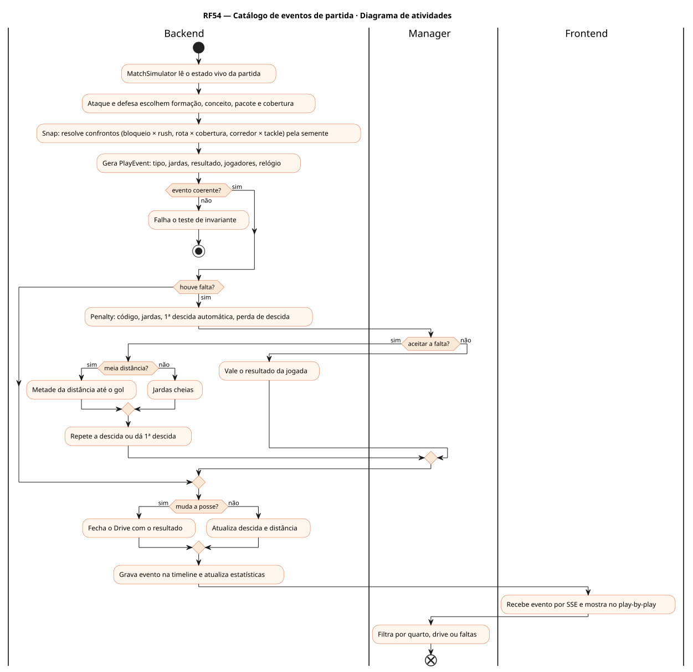
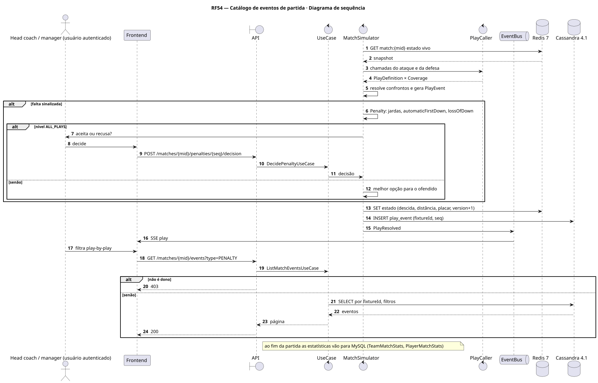
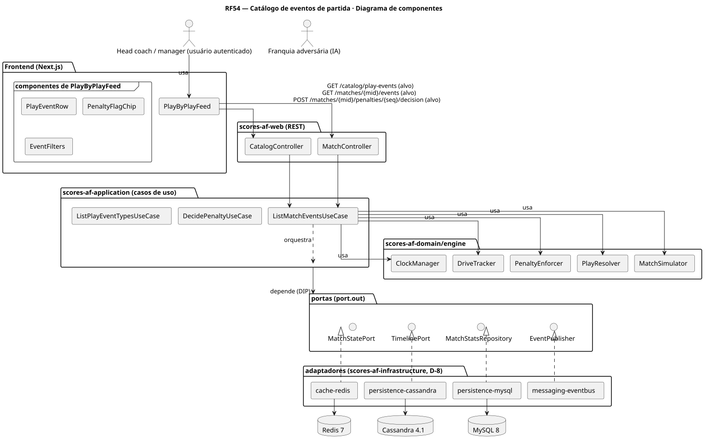
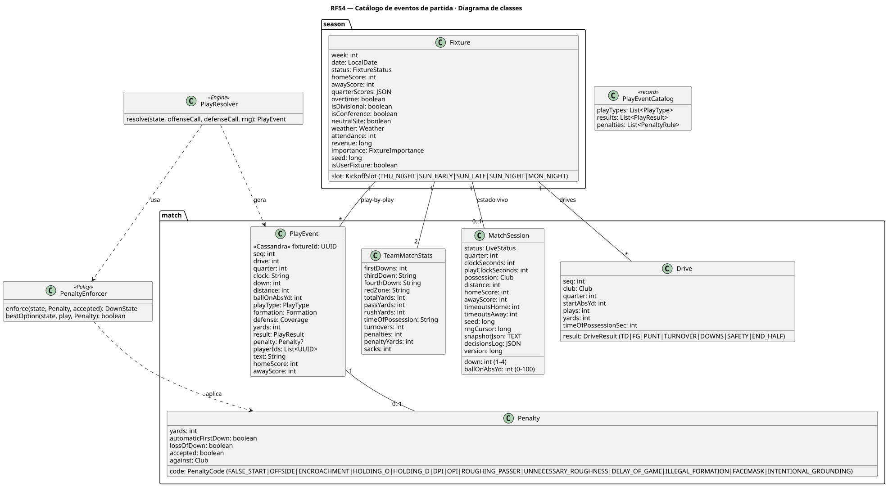
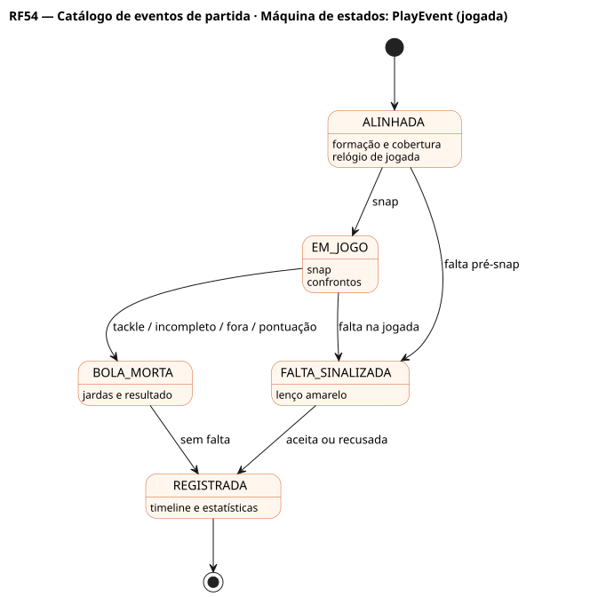

# RF54 — Catálogo de eventos de partida

## História de usuário

> HU-RF54 — COMO head coach QUERO que cada jogada gere um evento completo (tipo, formação, cobertura, jardas, resultado, falta) PARA acompanhar o play-by-play, as estatísticas e as faltas aceitas ou recusadas

Sprint: 5 · Atores: Manager, ClubeIA · Tela: Partida ao vivo (RF27) → play-by-play com filtros · catálogo de faltas

## Diagramas

### Atividades

Fonte: [`RF54-act.puml`](RF54-act.puml)

### Sequência

Fonte: [`RF54-seq.puml`](RF54-seq.puml)

### Componentes

Fonte: [`RF54-cmp.puml`](RF54-cmp.puml)

### Classes

Fonte: [`RF54-cls.puml`](RF54-cls.puml)

### Máquina de estados: PlayEvent (jogada)

Fonte: [`RF54-stm.puml`](RF54-stm.puml)

## Endpoints

✅ = existe num controller do `scores-af-web` · ⛔ alvo = previsto no modelo, ainda sem controller (lista em `generator/endpoints_code.json`).

| Estado | Método | Rota | Caso de uso | Autorização | Descrição |
|---|---|---|---|---|---|
| ⛔ alvo | `GET` | `/api/v1/catalog/play-events` | `ListPlayEventTypesUseCase` | público | Tipos de jogada, resultados e faltas (jardas, 1ª descida automática, perda de descida) |
| ✅ | `GET` | `/api/v1/matches/{mid}/events` | `ListMatchEventsUseCase` | JWT · dono do save | Play-by-play paginado (quarto, drive, tipo, só faltas, só pontuação) |
| ⛔ alvo | `POST` | `/api/v1/matches/{mid}/penalties/{seq}/decision` | `DecidePenaltyUseCase` | JWT · dono do save | Aceita ou recusa a falta quando o nível de chamada pede (RF62) |

## Pontos de decisão

| Gateway | Regra | Se falso |
|---|---|---|
| Dono do save? | fixture do save de jwt.sub | 403 |
| Evento coerente? | tipo no catálogo, ballOnAbsYd 0–100, descida 1–4, placar só sobe por pontuação válida | erro de motor (teste de invariante falha) |
| Houve falta? | sorteio pela semente × disciplina e pressão | segue sem falta |
| Aceitar a falta? | o time ofendido escolhe o melhor resultado (automático) ou o manager decide no nível ALL_PLAYS | resultado da jogada vale |
| Meia distância? | jardas da falta > metade da distância até o gol | jardas cheias |
| Muda a posse? | TD, FG, safety, turnover, 4ª descida falhada ou punt | nova descida ou 1ª descida |

---
Gerado por `../generator/generate.py` a partir de `../generator/model/*.py` e `../generator/common.py`; não edite os .puml à mão.
